# Administrator guide

*The plugin in wp-admin - settings, tools, access levels and the sync - plus everything mentors and students are told.*

This guide covers running the program: the plugin's own screens in wp-admin, what every setting does, who can read what, and what to check when something looks wrong.

It also contains the mentor and student guides in full. Administrators are the people other people ask. Unless you are on the program as a mentor or a student too, no Student Report Card or Mentor Report Card is your own: you open anyone's through the **Viewing as** switcher, as *Viewing a page as its owner* describes.

## Signing in

Nobody registers on this site, and there is no sign-up form: the program makes every account for
the person it belongs to. That means two things on your first visit:

1. Go to the site's login page and use **Lost your password?** with the email address on your
   account. A reset link arrives at that address.
2. Set a password, and you are in - unless your account also asks for a code, which the next
   part covers.

If the reset email never arrives, the address on your account is probably not the one you are
checking. The login page cannot change it - ask whoever runs the program.

### Signing in with a code

Besides your password, your account may ask for a code. Whether it does is the program's choice,
and it is made for every account of your kind at once. When it does, there is nothing to set up
first: from your next sign-in, the code arrives by email. When it does not, signing in works as
described above, and a card on your page invites you to turn the code on for yourself.

After you enter your username and password, a second screen asks for the code. Which kind depends
on how your account is set up.

**An emailed code.** The screen says a verification code has been sent to the email address on your
account. The email comes from this site and has *Login confirmation code* in its subject line. It
holds a code of eight digits. Type it into **Verification Code** and press **Verify**. A code works
once, and for fifteen minutes. **Resend Code** sends a new one and the new one replaces the old, so
use the newest email.

**An authenticator app.** If you have set one up, the screen asks for the code from your app
instead: **Authentication Code**. Open the app, find this site in it, and type the six digits it
shows. The digits change every 30 seconds, so type the ones on the screen at that moment.

A wrong code does not lock you out for good, but the site makes you wait a moment before the next
try, and the wait grows with every wrong code, up to fifteen minutes. Wait it out, then type the
code again, carefully.

### Setting up an authenticator app

An app on your phone is quicker than waiting for an email, and it keeps working when your inbox
does not. The card at the top of your page starts it. Its heading is **Add a second step to your
sign-in** when the code is yours to choose, and **Your account asks for a code when you sign in**
when the program asks for one; its button, **Turn on two-factor authentication** or **Set up an
authenticator app**, opens your profile screen at its **Two-Factor Options**. Ignoring the card
costs nothing: signing in keeps working the way it does now.

If you already use emailed codes and you open that screen more than about ten minutes after you
signed in, it first asks you to confirm with **Revalidate now**, which takes one more code. Then
follow the steps on the screen: install an authenticator app on your phone (any will do, such as
Google Authenticator or Microsoft Authenticator), scan the QR code the screen shows with it, and
type in the code your app then displays. Once the app is set up the card stops appearing.

Before you leave that screen, generate the **recovery codes** (the card calls them backup codes)
and keep them somewhere other than your phone. Each works once, and the screen shows them only
once. They are how you get back in if you lose the phone.

### If you cannot get your code

- **The email does not come.** Look in your spam folder, then press **Resend Code**. The email goes
  to the address on your account, so if you no longer read that mailbox, an emailed code cannot
  reach you.
- **Your phone or your app is gone.** Under **Having Problems?** on the same screen, the site
  lists any other way your account has, for example **Send a code to your email**, or **Use a
  recovery code** if you saved some. Type one of your saved recovery codes where the screen asks
  for it, and cross that code off, because it will not work twice.
- **You have neither.** Without the emailed code, the app or a recovery code, the site cannot tell
  that it is you, and it lets nobody past that screen. Tell whoever runs the program that you are
  locked out, and give them the username you sign in with. This guide cannot fix it for you.

### Once you are signed in

Your page is drawn for whoever is signed in, so the same address shows each person their own
page, and no change to a link shows anybody else's. The
program's Administrators are the one exception: to help, they can open anyone's page, through a
switcher only they are shown. A company's people share one Sponsor Dashboard, and an
institution's people share one Institution Dashboard: everyone attached to the company or the
institution sees the same page.

## The plugin in wp-admin

Everything the Administrator touches lives under one top-level menu, **WPCredits Program**. You
need the `wpcpm_manage_program` capability to see it, which the Administrator role is granted on
activation. Every screen under it is titled with its own name: **Overview**, a screen for each
audience, **Tools** and a screen for each tool, and **Settings**.

On the forms named here, a press locks the button at once and the button says what it is doing
until the next page opens, so a double press acts once: the decisions and the question on an opened
application, on the Sponsors and Institutions screens; on the Mentors screen, the decisions on an
application; on the Sponsors screen, **Run again** in the **Moving sponsors onto the site** box,
**Add the sponsor**, a sponsor's Edit form and its **Not a renewal**, a sponsor's **Attach
account**, **Remove** and posting switch, the offer and code forms, **Draft a report** and the forms
of a report's editor, and the agreement forms; on the Institutions screen, the signed agreement's
upload and withdrawal and the semester report buttons; **Save**, **Send me a test** and **Restore
the original** in
**WPCredits Program > Tools > Emails**; and the Track Builder's **Create the track** and
**Make the copy**. Every other form works as it always has, searching, filtering, a list's
**Apply** and **Screen Options** among them.

### The words the screens use

The screens, the settings and this guide call each thing by one name.

| Name | What it is | Where you meet it |
| --- | --- | --- |
| **WPCredits Program** | The plugin, as the menu names it. Each screen under the menu is titled with its own name alone: **Overview**, **Students**, **Tools**, **Settings** and so on. | The menu, and a screen's place in it, written with ">" between the steps, such as **WPCredits Program > Settings**. |
| **Audiences** | The people the program is for and the people who run it: **Students**, **Mentors**, **Institutions**, **Sponsors** and **Administrators**. Each audience has a user role and a screen under its name; the administrators hold WordPress's own Administrator role, which is granted the program's capabilities on activation. | The menu, each audience's own screen, and the Settings tabs. |
| **Tools** | The parts of the program that are run and configured on their own rather than belonging to one audience: **Header notices**, **Emails**, **Need help?**, the **Mentor Status Checker**, the **Student Duplicate Finder** and the **Track Builder**, each called by its name alone. | The **Tools** menu item and screen, and the Overview's **Tools** card, which lists each tool with its status. |
| **Landing page** | Where an account goes when it logs in: the **Mentor**, **Student**, **Institution** and **Sponsor landing page**, each with the page's address under its switch. | The Students and mentors, Institutions and Sponsors tabs of Settings. |
| **Remove** and **Leave** | The two answers of each rule for somebody who leaves the program, always in this order: remove the role or the access, or leave it in place. Nothing is ever deleted either way. | The Settings sections **When someone leaves**, **When an institution leaves the pipeline** and **When a sponsor is no longer Approved**. |

### Overview

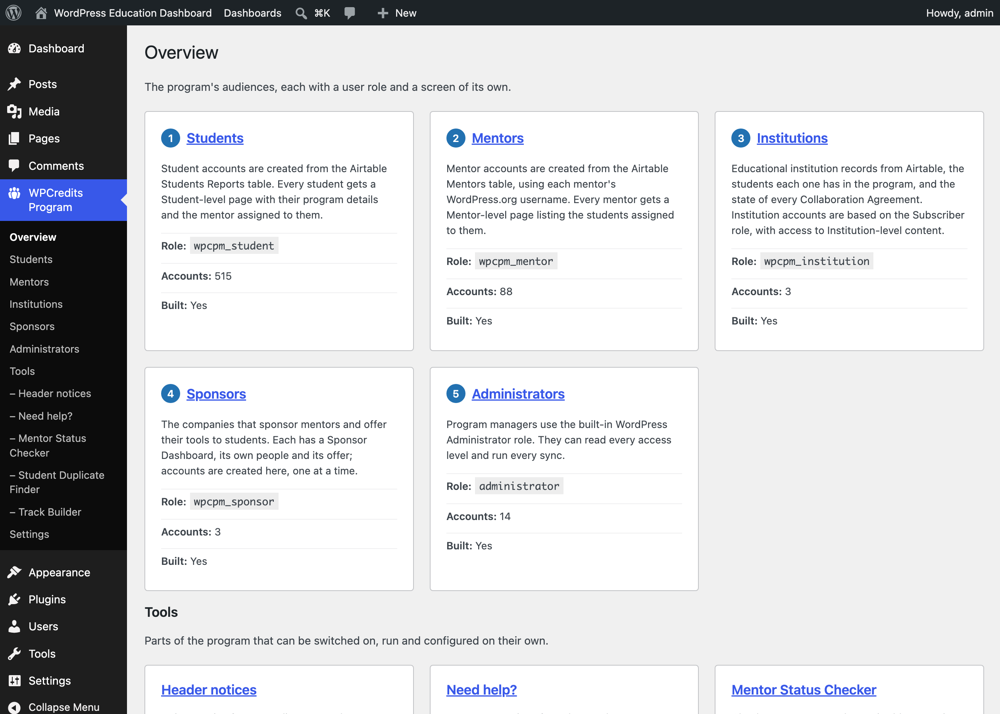

*The Overview screen: what waits for a decision, the syncs, the tools and the way to Settings.*

**WPCredits Program** opens on the Overview: four cards with what waits for a decision, when each
sync last ran and runs next, whether each tool can run, and the way to Settings. The Overview only
reads and links; it decides nothing.

If Airtable is not connected yet, this screen says so and links straight to the setting.

**Waiting for a decision** lists each queue with something in it, in the order of the Administrator
Dashboard's strip of counts, each as the strip reads its tile: the count first, set apart, then the
strip's name for the queue, such as "2 Collaboration Agreements to review, 1 overdue". The count is
the strip's own, so past 200 the sponsor posts and Sponsor Collaboration Agreements to review read
200+. Each is a link to where its queue is listed: the institution applications, agreements and
requests from institutions open the **Waiting for review** tab of the **Institutions** screen, the semester
reports to review and the semesters due for drafting its **Semester reports** tab, and the locked
accounts its **Accounts** tab; the mentor applications open the **Waiting for review** tab of the
**Mentors** screen; the sponsor applications, posts, events and agreements open the
**Waiting for review** tab of the **Sponsors** screen, each at the card that lists it, the sponsor
reports to finish its **Reports** tab, and the offers running low its **Offers and codes** tab; the
duplicated students open the **Student Duplicate Finder**; and the syncs that need a look open this
screen's own **Syncs** card. The dashboard's strip draws a tile only for a count above zero, and
this card likewise leaves out a queue with nothing in it; when nothing is waiting it says "Nothing
is waiting for an Administrator right now." At the foot of the card, **Decide on the Administrator Dashboard** opens that
page, where the decisions are made, except those on the mentor applications, which are made on the
Mentors screen; while the page is missing, the card says so in the button's place and asks you to
re-activate the plugin to recreate it.

**Syncs** has a row for each audience's sync, **Students**, **Mentors** and **Institutions**, each
name a link to the screen the sync is run from: the **Sync** tab of the Students and Mentors
screens and the **Sync and storage** tab of the Institutions screen. **Last run** gives the date and
time of the last run, in the site's own formats, or *Never*. **Next run** gives the date and time of
the next run; it says *Not scheduled* when none is, and *Running now* while a run is under way. The
audiences' rows show no errors: a sync's last error is on the Administrator Dashboard's **Syncs and
health** card. The fourth row, **Outcome figures** (1.122.24), is the weekly read of the three
figures the site counts for its homepage with the WordPress Credits impact dashboard's definitions,
every Monday at 07:00 UTC after the dashboard's build: its name opens the **Connection** tab of
Settings, **Last run** is when the stored figures were read, a line under it says why the last
attempt was held or failed, that it waits for the dashboard's build, that the site is not connected,
which figure the homepage leaves out for having fewer than 30 answers or outcomes, or that the
homepage shows none because the figures stored are more than 29 days old, and
`wp wpcredits outcome_figures` shows them, reads them again with `--refresh` and checks them with
`--refresh --dry-run`. The weekly read never stores the first figures: it holds them, and the line
says to compare the counts with the dashboard's with
`wp wpcredits outcome_figures --refresh --dry-run` and then store them with
`wp wpcredits outcome_figures --refresh`. On the Administrator Dashboard's **Syncs and health** card
the same line stands under the column headed **Last error**, and it is not always an error there:
*Waiting for the dashboard's Monday build.*, *Not connected.* and the note about fewer than 30
answers are notes, not errors.

**Tools** has a row for each tool, its name a link to the tool's screen, and under **Status** the
line the tool's card shows on the **Tools** screen; for a tool that cannot run, that line is the
warning that says why, in the tool's own words.

**Settings** says "Airtable is connected." or "Airtable is not connected yet." Its
**Open Settings** button opens the Settings screen.

### The audience screens

| Screen | What it does |
| --- | --- |
| **Students** | Two tabs: **Accounts**, the invitations and every Student account in one list, and **Sync**, the students sync and its last report. |
| **Mentors** | Four tabs: **Waiting for review**, the applications to mentor that came through the form on the site, read and decided here, with the applicants made mentors under **Activated**, the tab the screen opens on while any wait; **Accounts**, the invitations and every Mentor account in one list; **Engagement**, how each mentor uses the site; and **Sync**, the mentors sync, a warning while mentors made from applications wait for their Airtable row, and its last report. |
| **Institutions** | Six tabs: **Waiting for review**, the applications, signed agreements and requests from institutions waiting, read here and decided on the Administrator Dashboard; **Pipeline**, every institution record by stage and the consent report; **Accounts**, the invitations, every institution account in one list, the Confirmed institutions with no account yet, and each institution's members; **Semester reports**, every semester report and the semesters due for drafting; **Agreements**, the agreements to record as on file, the agreements in force with the form to revoke each, the ones Airtable disagrees with, and the plugin's copy of the Collaboration Agreement; and **Sync and storage**, the institutions sync, the reconciliation of Students with Students Reports, and the check of how the host serves the private files. |
| **Sponsors** | Eight tabs: **Waiting for review**, the sponsor applications, sponsor posts, sponsor offers and the changes to them, sponsor events while they are on, and signed agreements waiting, read here and decided on the Administrator Dashboard; **Sponsors**, the box that finishes the move of the sponsor records onto the site while it is incomplete, then every sponsor with its status, tier, product, program contact, accounts and logo, **Edit** and **Manage accounts** on each row, and the form that adds a sponsor; **Accounts**, the invitations, every sponsor account in one list, the Approved sponsors with no account yet, where their accounts are created, and each sponsor's accounts; **Offers and codes**, every offer with its codes and claims; **Interests**, what sponsors said they would like to support; **Reports**, each sponsor's report and the editor it is written in; **Agreements**, the standing state of every Approved sponsor's agreement; and **Handbook listing**, the sponsors' listing for the handbook, in the bar only while the sponsor tiers are announced. |
| **Administrators** | Two tabs, under the button to the Administrator Dashboard while that page exists: **Accounts**, every administrator account in one list, and **Capabilities**, the program capabilities granted to Administrator. |

Since 1.92.0 the Administrator Dashboard on the front end gathers the queues these screens hold, apart from the mentor applications, which it counts (since 1.122.31) and which are decided on the Mentors screen; the Administrators screen links to it.

Since 1.93.0 the Sponsors screen is no longer a placeholder: it holds every sponsor with its status, program contact and accounts, the **Create account** and **Attach account** controls, on its **Accounts** tab since 1.122.0, and the log of interests sponsors expressed on their Sponsor Dashboard. Since 1.111.0 the sponsors' records live on this site, added with **Add a sponsor** and changed with **Edit**, both now on the **Sponsors** tab. An approved application creates its sponsor's account; any other sponsor's account is created on the **Accounts** tab's **No account** view, and nowhere else.

Since 1.97.0 the Sponsors screen also holds the queue of companies that applied through the form on the site, and its menu entry carries a bubble counting the applications, the signed agreements and the sponsor posts waiting for an Administrator, and since 1.123.0, while **Sponsor tiers** is on, the events waiting too, and since 1.123.18 the sponsor offers and the changes to them waiting for review. Since 1.122.0 that queue is read on the screen's **Waiting for review** tab and decided on the Administrator Dashboard, as the institution queue is.

Since 1.118.0 the Students screen is two tabs, and a press on either tab comes back to it. **Accounts**, the tab **WPCredits Program > Students** opens on, holds the **Invitations** card and the **Student accounts** list. **Sync** holds the last sync's error when it ended in one, the **Airtable sync** card with **Sync students now**, or the run's progress and **Cancel sync** while one is going, and the **Last sync report**.

The **Student accounts** list works like WordPress's own **Users** screen: every Student account, a page at a time, so each one can be reached however many the site has. **Search students** finds an account by name, username, email address or institution. The **All**, **Invited** and **Never invited** views split the list by whether an account has been sent an invitation, each with its count. The list opens sorted by name, A to Z, so a first press on the **Student** heading turns it Z to A; a press on **Username** or **Institution** sorts the list by it, A to Z, and pressing a heading again reverses the order. **Screen Options** sets how many rows a page holds, 20 by default, and which columns are shown; the **Student** column cannot be hidden, because each row's actions sit under it. The institution picker above the table, each institution with its number of accounts, narrows the list to one institution, and the **Invitations** card follows it, so its button invites only the students at that institution who have never been invited, and comes back to that institution's list. A student who also mentors and whose invitation was held when an application made them a mentor is left out of the button, and the card says how many it left out: only that student's own row sends it (see *Becoming a mentor*). The picker, a search by institution and the **Institution** sort work on the whole list, never only on the page in view.

Under each name are **Edit**, which opens the account in wp-admin, **View page**, which opens that student's Student Report Card, and **Send invite** or **Resend invite**, which emails that one student at once. To invite several, tick them, choose **Send invite** or **Resend invite** under **Bulk actions** and press **Apply**. On WordPress 6.7 or later, on this list and on every other accounts list, the action chosen under **Bulk actions** runs only when **Apply** is pressed: a search sent with rows ticked and an action chosen comes back to the list with nothing done to them, and Enter pressed in the menu does not apply it. Below 6.7, WordPress's own behavior stands. **Send invite** queues a first invitation for each ticked account that has never had one, as the card's button does, and the card shows the progress. **Resend invite** queues a fresh invitation for each ticked account invited before, which goes out with the next batch: the card's progress bar and its stop button follow a run of first invitations, and a re-invitation starts no run, so on its own it shows on neither. A row's invitation and the bulk actions both come back to the list as it was: the same view, search, institution, sort and page. However it is asked for, nobody is sent a second invitation within fifteen minutes of the last one: **Resend invite** on ticked accounts leaves out anybody invited in the last fifteen minutes, and its notice says how many it left out. **Send invite** and **Resend invite** on ticked accounts both leave out an account whose invitation was held when an application made it a mentor, and the notice says how many they left out: only that account's own row sends it, once an Administrator has confirmed the account is the person's.

In 1.119.0 the Mentors screen became two tabs in the same way, and a press on either tab comes back to it. **Accounts**, the tab **WPCredits Program > Mentors** opens on while no application to mentor waits (see *Applications to mentor*), holds the **Invitations** card and the **Mentor accounts** list. **Sync** holds, since 1.122.33, a warning while mentors made from applications have no Airtable row yet, with the way to where each is written, the last sync's error when it ended in one, the warning while institution and team names have not been read yet, the **Airtable sync** card with **Sync mentors now**, or the run's progress and **Cancel sync** while one is going, and the **Last sync report**.

Since 1.122.26 the Mentors screen has a third tab between them, **Engagement**. It opens with the figures the Administrator Dashboard's **Mentor engagement** card shows, then lists every mentor: **Status**, whether Airtable holds them as Active (and **Administrator** for an Administrator who also mentors), their **Students** now and before, their **Last visit** (the latest day they opened a page of the site while signed in, which the site notes once a day) and **Last sign-in**, their **Schedule** (weekly hours and a meeting link, or what is missing), the **Notes** they wrote, their one-to-one **Calls** held and to come with how many held calls have a note, and their **Group sessions** held and to come. The 7 days and the 30 days count whichever is later, a mentor's last sign-in or last visit, so a mentor on a remembered session is not shown as absent; a mentor for whom the site holds neither is counted as never signed in. Sort by **Mentor**, **Students**, **Last visit**, **Last sign-in**, **Notes** or **Calls**; the list opens with the most students first. **Search mentors** finds a mentor by name, username or email address. **Screen Options** sets how many rows a page holds, 20 by default, and which columns are shown; the **Mentor** column cannot be hidden. The views, each with its count, find who to follow up with: **All**, **Active**, **With students now**, **Never signed in**, **Not seen in 30 days**, **No program action** (no note, no saved schedule, no group session created and no call they canceled, including those who never signed in, so it can list more mentors than the card's count of those who signed in without one), **Students, no weekly hours** and **Administrators**. Every view but **All** and **Administrators** lists active mentors only, those Airtable holds as Active, and so do the figures above, except the call and group session figures, which count every call and group session on the site; an Administrator who also mentors is counted apart, and **Administrators** lists the active ones. **All** lists every mentor, active or not. The tab reads only. Sign-ins from before the release were read once from what the site already held and are approximate, and visits start with the release, so a date can read **Not recorded yet**; the note under the list gives the date of the reading. The site records the last sign-in and last visit of every account, not only mentors', and uninstalling the plugin removes them. `wp wpcredits mentor_engagement --summary` prints the same figures on the command line, and without `--summary` it prints one row per mentor, as a table, JSON or CSV; it writes nothing.

The **Mentor accounts** list works as the **Student accounts** list does: every Mentor account, a page at a time. **Search mentors** finds an account by name, username or email address. The **All**, **Invited** and **Never invited** views split the list by whether an account has been sent an invitation, each with its count. **No students**, the fourth view, with its count too, lists the mentors whose **Students** column shows 0: no current student, whether every student they had has finished or they never had one. The search, the sorts and the pages work in it as in the other views, and when every mentor has a current student it says so. The list opens sorted by name, A to Z, so a first press on the **Mentor** heading turns it Z to A, and **Username** sorts it by username, A to Z. **Students** sorts it by how many current students a mentor has, the fewest first, and **Status** puts **Active** before **Not in Airtable**; pressing a heading again reverses the order. Every sort works on the whole list, never only on the page in view. **Screen Options** sets how many rows a page holds, 20 by default, and which columns are shown; the **Mentor** column cannot be hidden, because each row's actions sit under it. The list has no institution picker, so the **Invitations** card counts, and its button invites, every mentor who has never been invited, except one whose invitation was held when an application made them a mentor: the card says how many it left out, and only that mentor's own row sends it (see *Becoming a mentor*).

Under each name are **Edit**, which opens the account in wp-admin, **View page**, which opens that mentor's Mentor Report Card, and **Send invite** or **Resend invite**, which emails that one mentor at once. To invite several, tick them, choose **Send invite** or **Resend invite** under **Bulk actions** and press **Apply**; both work as they do on the Students screen, through the same queue. A row's invitation and the bulk actions both come back to the list as it was: the same view, search, sort and page. Here too nobody is sent a second invitation within fifteen minutes of the last one, and **Resend invite** on ticked accounts says how many it left out; both bulk actions leave out a mentor whose invitation was held, and say how many.

Since 1.119.0 the Administrators screen is two tabs too, **Accounts** and **Capabilities**, under the **Open the Administrator Dashboard** button, which stays above them whichever tab is shown. The button is there while that page exists; while it is missing, the **Administrator accounts** list says so. **Accounts**, the tab **WPCredits Program > Administrators** opens on, holds the **Administrator accounts** list: every account with WordPress's Administrator role, a page at a time. **Search administrators** finds an account by name, username or email address. The list opens sorted by name, A to Z, so a first press on the **Name** heading turns it Z to A; a press on **Username** sorts it by username, A to Z, and pressing a heading again reverses the order. **Screen Options** sets how many rows a page holds, 20 by default, and which columns are shown; the **Name** column cannot be hidden, because each row's **Edit**, which opens the account in wp-admin, sits under it. **Can manage program** says whether each account holds the program's capability.

The list has one view, **All**, and no checkboxes, bulk actions or invitations: Administrators use WordPress's own Administrator role, the plugin never invites them, and their accounts are added and managed on the **Users** screen. **Capabilities** lists the program capabilities the Administrator role is granted on activation, as the screen did before.

### Applications to mentor

Since 1.122.31 a person can apply to mentor on this site, at /become-a-mentor/, and an Administrator
decides on each application on the **Waiting for review** tab of the **Mentors** screen. The form is
off until **Take mentor applications through the form on this site** is switched on, under
**Mentor applications** on the Students and mentors tab of Settings. While it is off, the page shows
one sentence saying applications are closed (since 1.123.26); while the syncs have read no countries
or no contribution teams yet, the public see nothing. Either way an Administrator who opens it is
told why in a sentence of its own.
The page is not gated: the people it is for have no account. The form writes nothing to Airtable.
Since 1.122.33 a selected applicant who completes the mentors' course becomes a mentor on this site
once **Make mentors from applications** is switched on, under **Mentor applications** on the
Students and mentors tab of Settings, as *Becoming a mentor*, further down, describes. It is off
until the launch, and while it is off an application stops at the mentors' course, as it did before
1.122.33, and nothing is written to Airtable.

The page the plugin makes starts with the Airtable form's introduction, two paragraphs above the
form, and they are the page's to edit. So is the sentence an applicant reads once the form is sent:
**Thank-you sentence**, in the **Thank you** panel of the **Mentor Application Form** block (or
`thanks="..."` on the `[wpcpm_mentor_application]` shortcode), and while it is empty the plugin's
own sentence is shown. A page already at /become-a-mentor/ when the plugin first looks is used as
it is, so the form shows on it only once the block is added.

The form asks the eleven questions the Airtable form asks, in its order: the applicant's full name;
their email; their WordPress.org profile (the username, an @username or the address of their
profile on wordpress.org, kept as the username, and anything else refused with a sentence asking for
one of those); their country (one field: type a few letters and pick one); whether they are a
teacher at an institution taking part in the program; the languages they can mentor in; the
contribution areas they have expertise in, which may be left empty; the hours a week they can give,
from 1 to 40, kept to one decimal place; the compliance declaration, the GPL and trademark statement
with its two links, which must be ticked; anything else they would like us to know; and the
confirmation that they have read the WordPress.org privacy policy, which the line under the box
links. An answer to **Anything else you'd like us to know?** holding what WordPress's
cleaning would remove, a tag or a percent code, is refused: the form says so in a sentence that
tells the applicant how to keep every word, and hands the typing back in its box. The countries are
the ones the institution form offers and the contribution areas the teams a student picks from, both
read by the syncs; the languages are a fixed list in the plugin, since the site holds none. It is
guarded as the sponsor form is: a hidden field, a signed token, five submissions an hour per address
and forty a day for the whole site before the rest are held, consent as a precondition with what was
agreed to recorded, the comment disallowed list and the links counted, and a ceiling on
acknowledgements. An application giving the address or the WordPress.org username of another
application in the queue or waiting for the course, or of a mentor the site knows, is held with a
mark and never merged. The thank-you page shows the application's reference (MAPP-2026-0007), and
every application but one filed as spam is acknowledged by email with a link that confirms the
address, unless the day's ceiling on acknowledgements has been reached or the email could not be
handed to the mail queue; the addresses under **Who is mailed**, or every Administrator, are told of
each one the checks did not hold, with the applicant's name and profile and the way to the tab.

**WPCredits Program > Mentors** opens on **Waiting for review** while any application waits there,
and on **Accounts** while none does; the tab is first in the bar either way. It lists the
applications oldest first, fifty at a time, in six views, each with its count: **Waiting**, every
application not decided yet; **Asked for more information** and **Second opinion**, those two kinds
among them; **Selected (course pending)**, the applicants sent to the mentors' course;
**Activated**, the applicants made mentors, which orders its list differently (see *Becoming a
mentor*); and **Lapsed**. Under the list, in every view, **Recently decided** lists the fifty
applications most recently declined or filed as spam, newest first, until they are deleted. Each
application shows the name and reference, how long it has waited (for a selected one, the day it was
selected and the day it lapses; for an activated one, the day it was made a mentor; for a decided
one, the day it was declined or filed as spam), its marks (**held**, **possible duplicate**,
**already a mentor**, **address not confirmed** and **acknowledgement not sent**), every answer, its
history (each decision with its day, who took it and their note) and the decisions its state allows.
The Administrator Dashboard's strip counts the applications waiting, and its tile opens this tab.

A selected application also shows what the Mentor Status Checker last found on the applicant's
WordPress.org profile: *Not checked yet*, or the day of the last check and whether the course shows,
does not show yet, or the profile could not be read, and why. While **Make mentors from
applications** is off it says the applicant waits; and when the account for an applicant whose
course showed could not be made, it says on which day and why, and the application stays selected.

The decisions, each with a box for a note where it takes one; a note stays on this site and is
never sent:

- **Select** sends the selection email, with the link set under **Mentors' course invitation link**,
  and moves the application to **Selected (course pending)**. It is refused while that setting is
  empty, and it is offered on a lapsed application too, for an applicant who comes back, and on a
  declined one, for an applicant who appeals: an appeal is either a new application, if you ask
  them to apply again, or a note and Select on the same row.
- **Ask for more information** sends the request for more information; the application stays in the
  queue, under **Asked for more information**, with the day it was asked.
- **Second opinion** marks the application for a colleague and sends nothing. Its note, which says
  what to look at, is needed.
- **Decline** sends the decline email and moves the application to **Recently decided**.
- **Mark as spam** moves the application to **Recently decided** and sends nothing.
- **Put back in the queue**, on an application filed as spam, returns it to **Waiting**, with a line
  in its history. One that was never acknowledged, and so carries the mark **acknowledgement not
  sent**, is sent the acknowledgement then, once, with the link that confirms the address; one
  acknowledged when it came, marked as spam by mistake, is sent nothing.
- **Send the acknowledgement**, on an application still in the queue that carries the mark
  **acknowledgement not sent**, sends it now, once, with the link that confirms the address, and
  leaves the application where it is. It is for an application past the day's ceiling on
  acknowledgements, or whose hand-off to the mail queue was refused; one filed as spam is sent it by
  Put back in the queue. An application acknowledged already, or holding no address, is sent
  nothing, and two presses at one moment send it once.
- **The course is completed**, on a selected application, and offered only while **Make mentors
  from applications** is on: for an applicant an Administrator knows has completed the mentors'
  course, whatever the profile shows. Its note, how you know, is optional and never sent. It makes
  the applicant a mentor at once, by the Administrator who pressed it, as *Becoming a mentor*
  describes.
- **Withdraw**, on a selected application alone, moves it to **Lapsed** now and sends nothing. Its
  note, what the applicant wrote, is needed, and the public figures count it as lapsed. An
  application that another request is making a mentor at that moment is left as it is, and the
  press says so.
- **Write the Airtable row again**, on an activated application whose Mentors row Airtable refused
  or never finished, writes it as the activation did; it takes no note, and a second press makes no
  second row (see *Becoming a mentor*).

Select, Ask for more information and Decline wait until the applicant has confirmed the address with
the link in the acknowledgement: until then each is refused and says so. An application whose
address is never confirmed is closed with Mark as spam, and a spam application counts for nothing in
the public figures, so that applicant is not counted as having applied. An application marked
**acknowledgement not sent**, one the form's checks filed as spam, one past the day's ceiling on
acknowledgements, or one whose acknowledgement could not be handed to the mail queue when it was
submitted, was never sent the link, so its address cannot be confirmed and the three decisions that
email the applicant stay refused until it is: Put back in the queue sends it to an application filed
as spam, and Send the acknowledgement to one still in the queue, past the ceiling or after a refused
hand-off, and the mark goes either way. Select, Decline, Mark as spam, Withdraw, The course is
completed and Send the acknowledgement ask before they act. The five emails are the **Mentor
applications** area of **Tools > Emails**, where their words can be edited.

A selected application whose course has not shown after the days under **Selected applications
lapse after (days)**, 90 by default, moves to **Lapsed** by itself, with a line in its history, in
the daily run that also keeps the days under **Applications** on the Advanced tab: spam is
deleted after 30 days, and declined, lapsed and held applications after a year, by default. A
selected application that is being made a mentor at that moment is left to that and does not lapse.
The figures for the Credits Monthly Report and the WPCredits Tracker are public at
`/wp-json/wpcpm/v1/mentor-applications`: for each month since the first application, how many
applications were received, selected, activated (made a mentor), declined and lapsed, and how many
applications are open and how many selected today, with nothing about any person. An application
filed as spam is not counted as received. Each application
counts once per figure in a month: one selected twice in a month counts once there, a withdrawal and
a lapse in one month are one lapse, and one selected again in a later month, after a lapse or an
appeal, counts in both months, so the months are not to be added up as if each application counted
once. An applicant filed as already a mentor is not counted as made a mentor, and what happens to
the Airtable row counts for nothing.

#### Becoming a mentor

With **Make mentors from applications** on, a selected applicant becomes a mentor in one of two
ways: the Mentor Status Checker finds the mentors' course on their WordPress.org profile when it
promotes (the daily check does so when **Let the daily check also promote mentors** is ticked in the
tool's settings, and **Run check and promote** and `wp wpcredits check_mentors --promote` always
do), or an Administrator presses **The course is completed** on their application, which asks first.
It is one step either way, and the mentors sync makes a mentor the same way. It runs in this order,
so that a mentor is never kept waiting on Airtable:

1. **The account.** The applicant's account is the one that has their email address, else the one
   named after their WordPress.org username, else the one that holds their profile; where the
   Mentors row that holds their address is already linked to an account, that account is theirs.
   With none, an account is made, named after the username, with the Mentor role. An account that
   exists is linked and given the Mentor role besides its own: no role is taken away, and an
   Administrator's roles are never touched. A former mentor is a mentor again on their own account.
   If the account cannot be made, the application stays selected, with the reason on it.
2. **The application** moves to **Activated**, with a line in its history, and the Mentor Status
   Checker's Slack message names the new mentor.
3. **The invitation.** One invitation, which carries the welcome, is queued whatever **Invitation
   emails** says, and goes out with the queue, a few at a time. None goes to an Administrator's
   account, which signs in already, and none goes yet in two cases where the site cannot be sure
   whose address it would reach: when the account was found by the WordPress.org username alone,
   which may be somebody else's, and when the Mentors row that holds the applicant's address belongs
   to one account while another account also answered for the applicant. The mentor is made all the
   same. The notice after the press, the application's history and its row under Activated say the
   invitation is held and why, and once an Administrator has confirmed which account is the
   person's, **Send invite** or **Resend invite** on its row in the Mentors screen's **Accounts**
   tab sends it. Until then the **Invitations** card's button, **Send invite** and **Resend invite**
   on ticked accounts and the email queue pass the account over, and the card and the notice after a
   press say how many they left out.
4. **The Airtable row**, last. An account that holds its own Mentors row already, a former
   mentor's, has that row's Status set back to Active, the status the mentors sync reads, and no
   search is made; only if Airtable says that row is gone is the table searched, as for anyone
   else. Otherwise the Mentors table is searched for the applicant's address first. A row that
   holds it, whatever its Status, is set back to Active and linked to the account; only its Status
   changes. With none, one new row is written, with the applicant's name, WordPress.org profile,
   email and Status and their answers whose columns the table has, each shaped as its column takes
   it. A country, language or contribution area the base does not hold is left out by name, the
   application says so, and the rest of the row is written. Writing needs the token's
   `data.records:write` scope, and reading each column's type its `schema.bases:read` scope; where
   the token lacks the second, the row holds the name, profile, email and Status alone. Nothing else
   in Airtable is ever changed and nothing is deleted; after this the row is Airtable's, and the
   site never updates it again.

An applicant who is a mentor already, an account with the Mentor role, or an Administrator's, that
is active and linked to its Mentors row, is filed under **Activated** as already a mentor, with a
note in the history: nothing is sent, nothing is written to Airtable, and the public figures do not
count them as made a mentor. An Administrator who applied keeps their roles and is sent no
invitation. Two presses, or a press and the daily check, on one application at the same moment do
the step once: the second is told it is in hand. While **Make mentors from applications** is off
nothing is made, and an applicant whose course shows waits under Selected (course pending).

**Activated** lists the mentors made from applications. The applications still waiting for their
Airtable row come first, oldest first; the others follow, the newest mentor first. Fifty are drawn,
and a line says how many there are when there are more. Each row shows the account, linked to its
profile screen, and the invitation's fate and the Airtable row's. The invitation line counts from
the moment the applicant was made a mentor, never from an older invitation to the same address: it
says the invitation waits in the email queue; or was sent on a day; or was handed over on a day and
the mail log does not say whether it went; or that the site's mail host refused it, so that nothing
was sent and the link in any earlier invitation no longer works, with where Send invite or Resend
invite is; or that none has gone since, because it was held for a person to confirm the account or
was passed over, with where Send invite or Resend invite is. For an Administrator's account it says
none is sent, for an account that is gone that none can reach it, and for an applicant filed as
already a mentor it says nothing. The Airtable line says whether the row was written, set back to
Active or linked, and what was left out of it.

If Airtable refuses the row (a token without write access, a column that refuses a value, a table
that cannot be read, the network, or no Airtable connection at all), the mentor is made and invited
all the same. The application says Airtable's words, and **Write the Airtable row again** waits on
it under Activated. It searches the table by the address before it writes anything, so a row that a
request which died had made is found and never made twice. Meanwhile the mentors sync does not
unmake the mentor. If it links the account to an Active row itself, that ends the wait, and the
application then reads as linked by the mentors sync or by hand, with nothing more to write. An
account that is gone has nothing to write for, and the application says so. The Mentors screen's
**Sync** tab says how many mentors are waiting for their row.

#### Switching it on

**Make mentors from applications** ships off, and a person switches it on at the launch, in this
order:

1. Before the release that carries it is deployed, the mentor coordinator edits **Invitation:
   mentor** in **Tools > Emails**. Until the deploy the live editor shows the earlier text, with no
   welcome, so they add the welcome after the invitation's own lines, copied from the release's
   shipped text of that email, which shows it with one bracketed line where the private links go.
   They type the courses' invitation links and the mentor resource folder's link in where that line
   stands, and save. A saved edit is sent in place of the shipped text, welcome or none, so they
   check that the edit in place is the one they just saved, not an older one. **Contact address in
   emails** is set as well, since the welcome asks mentors to reply and a reply reaches that
   address. From the deploy on, every invitation the mentor's template sends carries the welcome: an
   activation's, one sent from the Mentors screen, and one the mentors sync queues while
   **Invitation emails** is on.
2. The person running the launch reads the Airtable base's automations, which the site cannot see,
   so that none fires on the check row of the next step.
3. They run `wp wpcredits mentor_airtable_row --check --email=<the test mailbox's address>`, by
   hand, once. It writes one synthetic row to the Mentors table, with that address and a Status that
   neither the mentors sync nor the Mentor Status Checker reads, reads it back, deletes it, and says
   which columns the base kept and which names it would leave out. It may be run against the live
   base because it only ever deletes the row it just wrote. It changes nothing on the site, and it
   ends in an error while a row may be left behind, which then has to be deleted in Airtable by
   hand, and while a column did not take what the site sends. A create that failed on its way to
   Airtable is said to have failed, never to have been refused, since it may still have reached the
   base. `wp wpcredits mentor_airtable_row <reference>` prints the row an application would write,
   with why the base's columns could not be read when they could not, and writes nothing; it prints
   the applicant's answers, so use it on a test application.
4. They switch **Make mentors from applications** on, and switch off the Airtable automation that
   emails the welcome, so that a new mentor is not welcomed twice.

### Institutions

The Institutions screen is six tabs, and a press on any of them comes back to it, with what came of it said above the tabs. **Waiting for review**, the tab **WPCredits Program > Institutions** opens on, holds the queue; the others are **Pipeline**, **Accounts**, **Semester reports**, **Agreements** and **Sync and storage**. While Airtable is not connected, every tab says so above the tabs, with the way to the setting. The menu entry carries a bubble counting the applications, the signed agreements and the requests from institutions waiting.

**Waiting for review** lists the applications from institutions, the signed agreements and the requests from institutions in one list, oldest first, each with how long it has waited and the country's person of contact, for information. An application or a signed agreement is marked *overdue* once it has waited longer than the days set under **Agreement review** on the Institutions tab of Settings, and a request from an institution once it has waited longer than fourteen days; an application the anti-spam checks held is marked *held*, and one that names the same institution or the same address as another in the queue *possible duplicate*. The queue is read here and decided on the Administrator Dashboard: every row ends with **Open on the Administrator Dashboard**, the way to the card there that decides it. An application's row also has **Open this application**, a mentor request's says who the mentor is wanted for and who asked, a school's request to correct its details is labeled **Details to correct** and says what it asks and who raised it, any other request's says what it asks, the student it is about and who raised it, and a signed agreement's row is the review block the dashboard draws, its checklist, what the scan noticed and the download link, with **Open on the Administrator Dashboard** where the dashboard's block has **Accept it** and **Return it with this note**. While the Administrator Dashboard's page is missing, the list says so once above the rows, and no row links there.

**Open this application** shows one application in the list's place, with **Back to the queue**: what the anti-spam checks noticed, whether the applicant has confirmed the address, every answer with the consent (the sentence the applicant agreed to, when, and the policy's address: the WordPress.org privacy policy since 1.123.24, this site's own page, with the date it last changed, for an application filed before), each under the Airtable column it is written to, and what Airtable already holds under the same name or address. Since 1.123.29 the answers include the five the form keeps on this site and never sends to Airtable, in the order the form asks them: the contact's role, the languages the students study in, who will sign the agreement, their title and the institution's page about WordPress Credits. They have no column under them, and an application filed before they were asked shows them unanswered. The Administrator Dashboard's **Read the application** shows the same answers. Under **Where it is decided**, an open application that the Administrator Dashboard's **Institution applications** card lists says it is decided there, with the way there. That card lists the fifty oldest open applications, so one past them is decided here, with the same four decisions, **Approve**, **Send this question**, **Reject** and **Reject as spam**, and each press comes back to the queue. Since 1.123.26 an open application whose address is not confirmed also has **Send the confirmation link again**, before the four, wherever they are drawn: **Approve** is refused until the applicant follows the link in the acknowledgement, and this sends the acknowledgement again, with the same link the first one carried, so that one keeps working too. It counts against the day's limit on acknowledgements as the form's own send does; past the limit nothing is sent and the notice says so. The application stays where it is, its history records the send, and the notice says "The confirmation link was sent again." **Put back in the queue** on an application the form's checks filed as spam, or one that came past the day's limit, sends it the acknowledgement as well, once; one acknowledged before is sent nothing. An application whose approval stopped halfway, after the Airtable record was created and maybe the account, is finished by pressing **Approve** again: since 1.123.26 it is marked *approval stopped partway* here and on its row in the list, with "Press Approve again to finish. Reject, Reject as spam and Put back in the queue are refused until it is.", and on the dashboard's card with the same sentences in a note, and **Reject**, **Reject as spam** and **Put back in the queue** refuse it, so no decline goes to an institution whose record already stands. The acknowledgement itself says the link is needed: "Please follow this link: we cannot take your application further until you do." The record-keeping on a closed application stays here: one rejected or marked as spam has **Put back in the queue** and **Delete for good**, since the dashboard folds in only the oldest fifty of those, and an approved one has **Delete for good**, since the dashboard never lists it. **Delete for good** keeps only the application's reference and the date.

**Pipeline** lists every institution record by stage, as the last institutions sync read it, and says when that was. Each row gives the institution's name, which opens its Institution Dashboard as an Administrator sees it, its country and city, whether Airtable holds a contact address for it, never the address itself, whether it carries the consent tick, when the record was created and the state of its agreement. Since 1.123.29 the counts leave out the records at SPAM, Not Moving Forward and Revisit Later, and those with no stage: the number beside the card's heading, each stage's own count, **Confirmed with no agreement recorded**, **Institutions with no live member**, the countries line and **Consent** count only the rest. A stage is read without the spaces around it, so "SPAM " is SPAM, and a stage the plugin does not know is counted. Those four stages are still listed, under the line "Not counted above" after the others, each folded with its count; open one to see its records. **Confirmed with no agreement recorded** narrows the list to those institutions, and **Show every stage** brings the rest back. Above the stages, **Institutions with no live member** counts the institutions nobody can act for on this site, with the way to give one an account on the **Accounts** tab, and a line lists the countries named by institutions that have no Administrator contact in the Countries table. Under them, **Find an institution** finds any record, whatever its stage, by typing part of its name; each entry reads its name, its city and its stage, and **Open its page** opens that institution's Institution Dashboard. While the Institution Dashboard's page is missing, the names are not links and the field is not shown. Under the list, **Consent** counts the records collected before the form asked for consent, and the ones created without the tick since, which is how a record entered by hand in Airtable looks.

**Accounts** holds the **Invitations** card, whose button invites every institution account never invited, except one that also mentors and whose invitation was held when an application made it a mentor (the card says how many it left out, and only that account's own row sends it), and the **Institution accounts** list, under a warning naming any institution account locked out of roster changes for the rest of the day, a lock that lifts by itself the next day. The list works as the **Student accounts** list does: every institution account, a page at a time, with no email address printed, though the search finds one. **Search institutions** finds an account by name, username, email address or the name of the institution it acts for. The **All**, **Invited** and **Never invited** views split the list by whether an account has been sent an invitation, each with its count. The list opens sorted by name, A to Z, so a first press on the **Name** heading turns it Z to A; **Username** and **Institution** sort it A to Z, **Member since** by the day the membership began, the earliest first, and **Status** puts **Active** before **Membership ended**, either followed by *locked today* for an account locked for the day; pressing a heading again reverses the order. Every sort works on the whole list, never only on the page in view. **Screen Options** sets how many rows a page holds, 20 by default, and which columns are shown; the **Name** column cannot be hidden, because each row's actions sit under it.

Under each name are **Edit**, which opens the account in wp-admin, **View page**, which opens the Institution Dashboard as the institution the account acts for, while that page exists, **Send invite** or **Resend invite**, which emails that one account at once, and **Manage members**. To invite several, tick them, choose **Send invite** or **Resend invite** under **Bulk actions** and press **Apply**; both work as they do on the Students screen, through the same queue, and come back to the list as it was. Here too nobody is sent a second invitation within fifteen minutes of the last one, and **Resend invite** on ticked accounts says how many it left out.

**No account**, the fourth view, lists institutions rather than accounts: the Confirmed institutions that have no account yet, the ones ready for one first, then by name. Each is shown by its name over its Airtable record ID, with whether Airtable holds a contact address for it under **Contact**, and under **Account** either **Ready** or why it cannot be given one yet, in the words the institutions sync uses. **Search institutions** finds an institution here by its name, and **Institution** sorts the view by it. To create the missing accounts, tick the ready institutions, choose **Create account** under **Bulk actions** and press **Apply**, or press **Create account** under one institution's name. **View page**, under every institution's name here as under an account's, opens the Institution Dashboard as that institution, while that page exists. Each account is made from the Contact Email Airtable holds, with an invitation queued for it: a password-set link to that address, which cannot be recalled once sent, as the view says above the list. One press creates at most 25 accounts, and the rest stay listed. While any institution on the view has no agreement recorded, the view names it above the list, with the way to the **Agreements** tab, and no account is created in bulk until it is recorded. Under the list, the view says whether the institutions sync creates these accounts too, which the **Create accounts automatically** setting decides, and when the institution records it lists were last read.

**Manage members** is under every row of the **No account** view, and under an account's row after its invitation; for an account whose membership ended, it opens the institution the account left, where the account is listed with its **Re-add**. It shows that institution's members in the list's place, under the institution's name and **Back to the accounts**, which returns to the list as it stood when **Manage members** was opened until **Remove**, **Re-add** or **Add account** is pressed on the view, after which it opens the **Accounts** tab's first page; uploading or withdrawing a signed agreement there keeps the list as it stood. The view shows each member with **Remove**, which ends their access and keeps their account; the contact Airtable names, when no member holds that address; each former member with **Re-add**; and **Add an account**, a name and an email address. **Add account** creates a new account with a random password and queues its invitation. An address that already has an account is adopted only when that account was a member of this institution before or belongs to a mentor; any other is refused as a conflict, naming the account's username, since an account made by hand is somebody's to explain. An adopted or re-added account that was invited before is not sent another invitation, and the notice says so.

Under the members, a signed agreement that reached the program by email is uploaded on the institution's behalf, and lands in the review queue as the institution's own upload does. Invitations the institution's members have sent their colleagues and that are still pending are not on this view: they are on the Institution Dashboard, where they can be resent or canceled. Since 1.123.26 **Remove** cancels the invitations the removed member sent that are still pending, and removing the last member cancels every invitation the institution has waiting, as the sync does when it ends a membership. An invitation whose sender is no longer a member of the institution, or no longer an Administrator, cannot be accepted: its link answers with the same sentence as an expired or canceled one. Unlike the list, the view prints the members' email addresses, because accounts are added and removed by address. For a record the pipeline index does not hold, it says "No institution record has that ID." and points to the institutions sync on the **Sync and storage** tab.

**Semester reports** lists every report the site holds, the drafts first, then the sixty most recently edited approved ones: each with its institution, a link that opens the report on the Institution Dashboard as that institution, its semester, whether it is a draft or approved, when it was drafted and whether by the site or an Administrator, when it was last edited, and **Ask the students**, which writes to the semester's students who wrote feedback and have not said whether it may be used. The number beside the card's heading is the drafts waiting for review, the number the Administrator Dashboard's strip gives as *Semester reports to review* and its *Semester reports* card lists under *To review*; the dashboard card's own number adds the semesters due for drafting. Under the list, **Due for drafting** lists the semesters the nightly job would draft, each with **Draft now**; **Draft any semester** drafts one the job has not reached, its **Institution** found by typing part of the name; and **Report log** lists the last twenty things that happened to a report.

**Agreements** holds four cards. **Agreements on file** lists every Confirmed institution with no agreement recorded, each name opening that institution's Institution Dashboard at its **Collaboration Agreement** panel, where **Record an agreement the program already holds** records its one agreement with the Drive link to the signed copy: the institution gets its recorded agreement, its line in the audit log and its Airtable cells, and its account can then be created. Under the list the card says "Record each one from its own page, with the signed copy the program holds." Until 1.123.26 a button under the list recorded every one of them as signed in one press, with one link; it was retired, because an institution confirmed since the site began taking applications has not signed by being Confirmed. **Agreements in force** lists every institution whose agreement stands, by name, whatever its stage: each name opens that institution's Institution Dashboard, and the line beside it says whether the agreement was accepted on the site or recorded on file, and on what day. Under each line, **Revoke this agreement** opens a form with a required note of 20 to 2,000 characters, **Why it is revoked, in your own words**, under which the form says that every member of the institution receives the note by email. The button asks before it acts: it names the institution and says that its members keep their accounts but reach only the agreement panel, that pending invitations are canceled and that every member receives your note. Airtable's Agreement Status is set to Revoked first, and when that fails nothing else changes; the institution's stage is not touched, so if the partnership has ended, change the stage in Airtable yourself. A note that is refused, because it is too short or too long, because WordPress would remove part of it, because Airtable could not be updated or because another write to the institution's agreement holds the lock, comes back to its box as you typed it with its form open, under a sentence above the tabs that says why nothing was revoked. A second press of the same form, from another tab, is refused: the agreement is no longer in force, so nothing is written and nobody is emailed again. A revoked agreement is put back in force with **Reinstate** on the Administrator Dashboard. The note is also kept with the revocation in the institution's audit log. **Agreement discrepancies** lists the institutions whose agreement the site and Airtable's Agreement Status disagree about, each locked until the two agree. **Agreement template** shows the plugin's copy of the Collaboration Agreement, its version, when it was copied from the Doc and its checksum, and which institutions signed which version.

**Sync and storage** holds the last sync's error when it ended in one, the **Airtable sync** card with **Sync institutions now**, or the run's progress and **Cancel sync** while one is going, then **Reconciliation**, the rows where the Students table and Students Reports disagree, as the last students sync found them, with the Students rows that name no institution and a **Link** for each where linking is safe, its institution found by typing part of the name among every record but the SPAM ones, and **Storage**, which says how the signed agreements are kept and whether the host refuses a stranger's request for them, with **Run probe** to ask the host again.

### Sponsors

The Sponsors screen is eight tabs, and a press on any of them comes back to it, with what came of it said above the tabs. **Waiting for review**, the tab **WPCredits Program > Sponsors** opens on, holds the queue; the others are **Sponsors**, **Accounts**, **Offers and codes**, **Interests**, **Reports**, **Agreements** and **Handbook listing**, which is in the bar only while the sponsor tiers are announced, with **Sponsor tiers** on in Settings. The sponsors' records live on this site: they are listed, added and edited on the **Sponsors** tab, an approved application creates its sponsor's account and any other sponsor's account is created on the **Accounts** tab's **No account** view, and no tab waits for a connection to another service. The menu entry carries a bubble counting the sponsor applications, the signed agreements, the sponsor posts and the sponsor offers waiting and, while **Sponsor tiers** is on, the events waiting.

**Waiting for review** holds a card for each kind of item waiting, in the order the Administrator Dashboard draws them, each listing what waits oldest first: **Sponsor applications**, **Sponsor posts to review**, **Sponsor offers to review**, **Events**, only while **Sponsor tiers** is on in Settings, and **Signed agreements**. The queue is read here and decided on the Administrator Dashboard, and every item links to its own place there. **Sponsor applications** lists the companies that applied through the form on the site, each with how long it has waited, its website and contact, and its state. An application the anti-spam checks held is marked *held*, one that names the same company or the same address as another in the queue *possible duplicate*, one from a company the site already holds under the same name or website *already on the site*, one whose contact address already belongs to an account on this site *already an account*, and one whose approval stopped halfway *approval half done*. Each row has **Open this application** and **Open on the Administrator Dashboard**, the way to its own item on that page's **Sponsor applications** card, and under the list the same link opens that card. Under it, **Recently decided** lists the fifty most recently decided applications, marked as spam, rejected or approved, newest decision first, each with **Open this application**, where one is put back in the queue or deleted for good, and no link to the Administrator Dashboard, which lists open applications only.

**Sponsor posts to review** lists the posts sponsors wrote and submitted for review, each with its sponsor, who wrote it, when it was submitted and **Preview**, the way to read it first. **Sponsor offers to review** lists the offers sponsors sent for review and the changes they made to what students see of live ones, the codes they added to an approved offer among them, each saying whether it is a new offer or changes, whose offer it is, who sent it and how long ago. **Events** lists the co-hosted events sponsors planned that wait for the program's approval, each with its sponsor, who planned it, how long ago and when it takes place, on your own clock. **Signed agreements** lists each document a company uploaded as the review block a reviewer reads: who uploaded it, when and how large it is, what to read it for, what the scan noticed in the file and **Download the signed agreement**. Every post, offer, event and document ends with **Open on the Administrator Dashboard**, the way to its own item there, where a post is published or returned, an offer or a change approved or returned, an event approved or returned, and a document accepted with **Accept it** or returned with **Return it with this note**. **Accept it** asks before it acts: it names the company, says that the agreement is recorded as accepted with the day's date and how many people at the company are emailed, and that it can be taken out of force on this screen's **Agreements** tab. **Sponsor applications**, **Sponsor posts to review**, **Sponsor offers to review** and **Signed agreements** each list no more than the fifty oldest, the ones the dashboard's card lists, and while more are waiting, a line above the list says how many of them it shows and that the next take their place as these are decided on the Administrator Dashboard; on **Sponsor applications** it adds that the list stops there so that a burst of applications cannot make the screen too slow to open. **Events** lists every event that waits, as the Administrator Dashboard's card does. The posts, the offers, the events and the agreements are counted up to 200, and past that their count reads 200+. While the Administrator Dashboard's page is missing, the tab says so once above the cards, and nothing on it links there.

**Open this application** shows one application in the cards' place, with its state, when it arrived and **Back to the queue**: what the anti-spam checks made of it, every answer with the consent (read as on the Institutions screen), the logo files, and what the site already holds under the same name or website. Under **Where it is decided**, an open application that the Administrator Dashboard's **Sponsor applications** card lists says it is decided there, with **Open on the Administrator Dashboard**, the way to its own item on that card. That card lists the fifty oldest open applications, so an open application past them keeps its decisions here, every decision its state allows, **Approve**, **Send this question**, **Reject** and **Reject as spam**, and **Put back in the queue** for one held or waiting on the applicant, and each press comes back to the queue. The record-keeping on a decided application stays here, since the dashboard lists open applications only: one rejected or marked as spam has **Put back in the queue** and **Delete for good**, and an approved one has **Delete for good**. **Delete for good** keeps only the application's reference and the date, and takes the logo files with it unless the application was approved, when they are the sponsor's logo. An application in a state no decision writes is told only that applications are decided on the Administrator Dashboard, with the way to that card, and while that page is missing, the opened application says so in the link's place.

**Sponsors** holds, while the move of the sponsor records onto the site is incomplete, the **Moving sponsors onto the site** box: how far the move got, the sponsors whose old Administrator matched no Administrator on this site, each to be given one on its Edit form, the sponsors still waiting for the first offer in draft that keeps the move open, and **Run again**. The move runs by itself, trying again at most once a minute, and the box goes once every sponsor has moved. Then the **Sponsors** card lists every sponsor on the site in a table, with its status, its tier, its product, its program contact, how many accounts act for it and whether its logo is on the site, and **Edit** and **Manage accounts** in each row's last cell. A sponsor's name opens the Sponsor Dashboard as that sponsor, while that page exists, and **Manage accounts** opens its accounts on the **Accounts** tab. **Edit** opens the sponsor's form in the card's place, a view of this tab, under **Back to the sponsors**: what an Administrator owns of the record, with **Save** and **Cancel**, then the sponsor's key and listing handle, which nobody edits. Right after Status, on the Edit form and the Add form alike, the box *Test sponsor: not listed publicly* makes the sponsor a test sponsor, left out of the Partners page, the logo strip, the handbook listing and the public feed, with its offers, posts and events shown to no student or mentor, while its own accounts see their Sponsor Dashboard as usual; the table marks its row "(test sponsor, not listed publicly)", and *Test sponsors (1.123.18)*, in the part of this guide on sponsors further on, says how to test with one. An address that names no sponsor draws the card under a notice that says so. Under the table, **Add a sponsor** is the form for a company that never applied on the site; nothing else happens when one is added, and the press opens the new sponsor's Edit form. Once its status is Approved, its account is made with **Create account** on the **Accounts** tab's **No account** view.

**Accounts** holds the **Invitations** card, whose button invites every sponsor account never invited, except one that also mentors and whose invitation was held when an application made it a mentor (the card says how many it left out, and only that account's own row sends it), and the **Sponsor accounts** list, under a warning naming any sponsor account locked out of changes for the rest of the day, a lock that lifts by itself the next day. The card and the list's **Send invite** and **Resend invite** are new for sponsor accounts in 1.122.0: before, a sponsor account was sent only the invitation queued when it was created or attached. The list works as the **Student accounts** list does: every sponsor account, a page at a time, with no email address printed, though the search finds one. **Search sponsor accounts** finds an account by name, username, email address or the name of the sponsor it acts for. The **All**, **Invited** and **Never invited** views split the list by whether an account has been sent an invitation, each with its count. **Sponsor** names the sponsor each account acts for, with the sponsor's status after it in parentheses when it is not Approved, since such a sponsor keeps its accounts until they are removed. The list opens sorted by name, A to Z, so a first press on the **Name** heading turns it Z to A; **Username** and **Sponsor** sort it A to Z, **Member since** by the day the membership began, the earliest first, and **Status** puts **Active** before **Membership ended**, either followed by *locked today* for an account locked for the day; pressing a heading again reverses the order. Every sort works on the whole list, never only on the page in view. **Screen Options** sets how many rows a page holds, 20 by default, and which columns are shown; the **Name** column cannot be hidden, because each row's actions sit under it.

Under each name are **Edit**, which opens the account in wp-admin, **View page**, which opens the Sponsor Dashboard as the sponsor the account acts for, while its membership lasts and that page exists, **Send invite** or **Resend invite**, which emails that one account at once, and **Manage accounts**, for an account whose **Sponsor** names one. To invite several, tick them, choose **Send invite** or **Resend invite** under **Bulk actions** and press **Apply**; both work as they do on the Students screen, through the same queue, and come back to the list as it was. Here too nobody is sent a second invitation within fifteen minutes of the last one, and **Resend invite** on ticked accounts says how many it left out.

**No account**, the fourth view, lists sponsors rather than accounts: every Approved sponsor that no account acts for yet, the ones ready for one first, then by name. Each is shown by its name over its key, the one the site holds it by, with its contact address under **Contact**, masked, or *no email* when it has none, and under **Account** whether it is **Ready**, ready with "the account that already uses this address will be attached", or why it cannot be given one yet: the sponsor's record holds no contact address, which is added on its Edit form, or the address belongs to an administrator, who already reaches every sponsor. **Search sponsor accounts** finds a sponsor here by its name, and **Sponsor** sorts the view by it. To create the missing accounts, tick the ready sponsors, choose **Create account** under **Bulk actions** and press **Apply**, or press **Create account** under one sponsor's name; a sponsor that is not ready has no box to tick. Each account is made from the sponsor's contact address, or the account that already uses that address is attached, and an invitation is queued for it unless it was invited before, as the view says above the list while a sponsor on it is ready: "Creating an account emails a password-set link to the sponsor's contact address. An invitation cannot be recalled once sent." The sponsor's first offer is created in draft, and the sponsor's log has a line for it. One press creates at most 10 accounts, and the rest stay listed: when more were ticked, the notice says "One press creates at most 10; tick the rest and press again." It names any sponsor it could not give an account, with why. A ticked sponsor that has had its account since the page was drawn is left alone, and when that leaves no ticked sponsor to give one, the notice says "There was nothing to create."; **Create account** pressed under such a sponsor's name says "That sponsor already has an account." Under the list, the view says "An approved application creates its sponsor's account. For any other Approved sponsor, this view is the way one is made." Under each sponsor's name are also **View page**, which opens the Sponsor Dashboard as that sponsor, while that page exists, and **Manage accounts**.

**Manage accounts** is under every row of the **No account** view, under an account's row when its **Sponsor** names a sponsor, and in the last cell of each row of the **Sponsors** tab's table; an Administrator reaches the same view from the Sponsor Dashboard's **People** card. It shows that sponsor's accounts in the list's place, a view of this tab, under the sponsor's name and **Back to the accounts**, which returns to the list as it stood when **Manage accounts** was opened until something is pressed on the view, after which it opens the **Accounts** tab's first page, as it does for a view opened from the **Sponsors** tab or the **People** card. Every press on the view comes back to it. Each account is listed by name and email address with **Remove**, which ends its membership and its right to write posts, and keeps the account. For an Approved sponsor, **Attach account** attaches the existing account that uses the address typed, and queues an invitation for it unless it was invited before; an address no account uses is refused, since a sponsor's first account is made with **Create account** on the **No account** view. Any account can be attached but an administrator's, a student's, an institution representative's or one that acts for another sponsor; a mentor's can. Every account attached to a sponsor has equal power on the Sponsor Dashboard. Under it, the posting switch says whether the sponsor's accounts can write posts in wp-admin, for an Administrator to publish, and **Turn posting off** or **Turn posting on** switches it; posting is switched here and nowhere else. A sponsor that is not Approved keeps its accounts, listed with **Remove**, and the view says no account can be attached to it and its posting cannot be switched. Unlike the list, the view prints the accounts' email addresses, because accounts are attached and removed by address. For an address that names no sponsor, it says "That link names no sponsor on this site." and that a sponsor is added on the **Sponsors** tab, with the way there.

**Offers and codes** lists every sponsor offer, the oldest hundred at most, with its sponsor, its kind, codes or one shared for everyone, its state, how many codes are available, claimed and void, the count it warns at and its last day, and, for support, who claimed from it: each person's name and address, the date and the code's last four characters, with **Void**, which lets the person claim again and keeps the code void for the count. A sponsor's primary offer is marked *(primary)*, and sponsors see counts only. Above the table, a sponsor that has an account and no offer has a button that creates its first offer, in draft, for the sponsor to complete and send for review from the Sponsor Dashboard.

**Interests** lists what sponsors said they would like to support from the Sponsor Dashboard, the last fifty, newest first, each with when it was sent, the sponsor, who sent it and what it said; each was mailed when it was sent, to the sponsor's assigned Administrator, or, for a sponsor with none, to the addresses in the **Interest mail** setting or to every Administrator.

**Reports** holds the **Reports** card: each sponsor's report, drafted, edited and marked final in an editor that opens in the card's place, a view of this tab, with the way back to the tab.

**Agreements** shows the standing state of every Approved sponsor's agreement, which is optional: a company's Sponsor Dashboard, offers and codes work without one. Each sponsor's block says what this site holds and offers the one thing that can be done next. An agreement accepted or recorded as on file has **Take it out of force**, with a note that is emailed to everybody at the company exactly as it is written. An agreement out of force is reinstated on the Administrator Dashboard, under **Out of force** in its **Sponsor Collaboration Agreements** card, as the block says, with the way to its own item there, or, while that page is missing, the sentence that says so in the link's place; that page lists the fifty oldest agreements out of force, so one past them has **Reinstate** here, under a sentence that says why. **Reinstate** asks before it acts, here and on the Administrator Dashboard alike: "Put this agreement back in force? Everybody at the company is emailed." Any other sponsor has **Record it as on file**, for a signed copy that predates this site: the link to it in the program's Drive folder, and the day it was signed if the copy says so. A document a company uploaded is not here: it waits on the **Waiting for review** tab, which this tab links.

**Handbook listing**, the last tab, holds the sponsors' listing for the handbook while the sponsor tiers are announced.

### Tools

The **Tools** submenu lists the parts of the program that are run and configured on their own
rather than belonging to one audience - currently **Header notices**, **Emails**, **Need help?**, the
**Mentor Status Checker**, the **Student Duplicate Finder** and the **Track Builder**. Each has its own screen
behind an *Open tool* button. Four of them, the **Mentor Status Checker**, the
**Student Duplicate Finder**, **Need help?** and **Emails**, keep their settings in a **Settings**
section on that screen, rather than on the Settings screen.

## Settings

**WPCredits Program > Settings**. Seven tabs along the top of the screen, in WordPress's own tab bar:
**Connection**, **Students and mentors**, **Institutions**, **Sponsors**, **Security**, **Mail** and
**Advanced**, and the screen opens on Connection. Each tab but Mail is a form of its own with its own
**Save settings** button: saving one tab leaves every other tab exactly as it was, and the notice
after a save names the tab it saved ("Sponsors settings saved."). A page left open from before an
update can post a form that names no tab; it saves nothing, and the notice asks you to reload the
page and save again.

Each section of a tab opens with one sentence and a link to its part of this guide, on a site that
publishes the guide at /program-manager-guide/. Each setting has one sentence of help under it, and
the rest of what there is to know in a **Details** fold under that, closed until you open it.

A setting that holds something Airtable or the site can list is chosen rather than typed: the base,
the tables and their name columns, the statuses and the stages, and the Administrators who are
told about agreements, reports and sponsors' mail. When a list cannot be read, the setting is typed
as it always was, and a sentence under it says why. A value saved that its list does not hold is
still offered, after the list and marked *(current)*, so a Save never drops it.

Four tools keep settings of their own, the **Mentor Status Checker**, the **Student Duplicate Finder**,
**Need help?** and **Emails**, and each keeps them on its own screen, in a **Settings** section with a
Save of its own, rather than on this one: at the top of the screen, or for Emails at the top of its
**Signature and footer** tab. The Connection tab's first line names the four, each a link to its
Settings section, and the next part of this guide, on the tools, says what each of those settings
does.

### The Connection tab

Its first line names the four tools that keep their settings on their own screens. Then two
sections, **Airtable** and **Tables**, the tab's **Save settings**, and under it a button of its own,
**Read the lists from Airtable again**.

#### Airtable

| Setting | What it is for |
| --- | --- |
| **Personal Access Token** | Stored in the database and never sent back to the browser: the field shows it masked. Leave it blank to keep the current token. |
| **Schema token** | Optional, and used by the Track Builder alone, to create a track's columns when it is published. Its fold says the rest: it needs the `schema.bases:write` scope and must belong to somebody with the base creator role on the base; left blank it keeps the current one, and typing remove takes it away. Without it, publishing lists the columns for somebody to create by hand. |
| **Token scopes** | The scopes the token needs, listed in the row's fold with what each is for: `data.records:read`, required, for reading mentors, students and tutors; `data.records:write`, required by the Mentor Status Checker, for changing a mentor's status when you promote them (without it the tool can still run in report-only mode, but promoting fails), and for the Mentors row that making a mentor from an application writes, a new row or the Status of the row that already holds the person (without it that mentor is made and invited all the same, and Airtable's refusal waits on the application), and for the check row that `wp wpcredits mentor_airtable_row --check` writes and deletes at the launch; `schema.bases:read`, optional, for listing the bases, tables, columns, statuses and stages the Settings tabs and the Mentor Status Checker's screen offer, and reading each column's description from Airtable (without it each of those settings is typed, and the built-in descriptions are shown instead), and for letting that Mentors row carry the applicant's answers (without it the row holds the name, profile, email and Status alone, and the site never updates it later). Set them on the token itself at airtable.com/create/tokens, with access to the WPCredits base; they cannot be checked from here without writing to the base, so the list is the reference. |
| **Base ID** | The Airtable base holding the program, chosen from the bases the token can open, each with its ID beside its name. Listing the bases needs the token's `schema.bases:read` scope; when the list cannot be read, the ID is typed, and a sentence under the field says why. |

#### Tables

Each table of the base the plugin reads or writes, chosen from the base's tables with its ID beside
its name, and each name column from its own table's columns. When a list cannot be read, the table's
ID or the column's name is typed, and a sentence under the field says why: no Personal Access Token
or no Base ID is set, Airtable refused the token, the token lacks the `schema.bases:read` scope or
access to the base, the base has no such table or column, or the read failed.

Four of these had no control before 1.117.0 and could only be changed in code: the **Tutors**,
**Feedback** and **Countries** tables, and the **Countries** name column.

The bases, statuses and stages are read from Airtable once a day, the tables and columns every
fifteen minutes, and all of them again after a Save of the Connection tab. A read that failed is not
asked again for five minutes, so an Airtable that does not answer holds up one draw of a tab, not
every one, and the fields stay typed meanwhile. **Read the lists from Airtable again**, under the
tab's Save button, reads them at once: for a status or a stage somebody has just added in Airtable,
which cannot be chosen until the lists are read again, or once Airtable answers again.

When its table is chosen from the list, which saves the table's ID, each of the **Institutions** and
**Countries** name columns can also be set to **None (the built-in column)**, which leaves the
setting blank: each is then read from the column the plugin names by default, **Name** for both, and
the Institutions table's by the mentors sync from the table's primary column, which it finds by the
table's ID. A table saved by its name, as one typed before 1.117.0 could be, keeps its name
column typed: the mentors sync would ask for that column itself, and a blank one names no column.

| Setting | What it is for |
| --- | --- |
| **Mentors table** | Where mentor records live. |
| **Students Reports table** | Holds the internship dates, links and contribution team the mentor page shows. |
| **Students table** | Read only for the Tutor column, which does not exist on Students Reports. |
| **Institutions table** and **Institutions name column** | Airtable sends linked-record fields as record IDs rather than names, so the table is read to turn those IDs into names. The name column is used only when the token lacks the `schema.bases:read` scope; with that scope the primary column is detected automatically. |
| **Contribution areas table** and **Contribution areas name column** | Read the same way, for the contribution team a record links to. |
| **Tutors table** | Read when an institution enrolls students, for that institution's own tutors and no other school's. |
| **Feedback table** | Where the students' survey answers are written: one row per student, with a column per question. |
| **Countries table** and **Countries name column** | Read for the name of each institution's country and the Administrator who looks after it; the name column holds each country's name. |

### The Students and mentors tab

Five sections: **Who is on the program**, **When someone leaves**, **Accounts**, **Landing
pages** and **Mentor applications**. The status lists are shared: a current student is anyone a mentor is currently mentoring.

#### Who is on the program

- **Currently mentoring** - a checkbox list of statuses: the Students Reports table's Status options
  under **From Airtable**, and the status of every track the site runs under **From the Track
  Builder**, each once. Students holding any of the ticked statuses appear under "Currently
  mentoring" on their mentor's page. The list keeps the status of every track the site runs: its box
  is ticked and switched off, with a note naming the track, and a save that would take one out all
  the same saves everything else, leaves Currently mentoring as it was, and a notice names the track.
  Take the track off the live site in the Track Builder first, then remove its status. A Settings page
  left open while a track was published keeps the new status when it is saved, and the Track
  Builder's list flags a live track whose status is missing from Currently mentoring. Left untouched,
  the list saves as it is stored; changed on a page left open, it brings back a status somebody
  removed in the meantime, so reload the page first. When Airtable's statuses cannot be read, the
  list is a box to type in, one status per line, and a sentence under it says why.
- **Past students** - statuses that mean mentoring has finished, from the same two lists. Those
  students appear in a separate, collapsed section on their mentor's page. Its fold: with none
  ticked, only current students are shown, and a status in both lists counts as current. No track
  runs on a past status, so the list never takes the status of a track the site runs: its box is
  switched off, under one note for the group, "A live track's status cannot be a past status.", and a
  save that would add one all the same saves everything else, leaves Past students as it was, and a
  notice names the track. Take the track off the live site in the Track Builder first, then add its
  status. A status the list already holds is never switched off there, so it can always be taken out.
  The program's four original tracks always run, so their statuses are never past statuses.
- **Mentor status to sync** - chosen from the Mentors table's Status options, *Active* by default;
  only mentors holding this status get an account.

Neither Currently mentoring nor Mentor status to sync can be left blank: each is what a sync filters
the base by, so a blank one goes back to its default and a notice says so.

#### When someone leaves

What the sync does with the account of a mentor or a student who is no longer on the program. The
answer that removes comes first, and it is the default for both.

- **When a mentor is no longer active** - **Remove the Mentor role and clear their student list**,
  or **Leave the role in place**. The account itself is never deleted either way.
- **When a student leaves the program** - **Remove the Student role, so they lose access to
  Student-level content**, or **Leave the role in place**. The account itself is never deleted
  either way, and their program details are kept.

#### Accounts

- **Invitation emails** - **Email each new mentor and student a password-reset link as their
  account is created**. Off by default, and worth leaving off unless you mean to email everybody: a
  first sync creates around ninety accounts at once. Its fold: invitations are queued and sent a few
  at a time rather than all inside the sync, so a mail limit cannot swallow half of them unnoticed,
  and you can also invite people one at a time from the Mentors and Students screens, or tick
  several in the Students or Mentors screen's list and invite them together. A mentor made from an
  application is sent theirs whatever this says, since it carries the welcome, except an
  Administrator, and a mentor whose account is not yet confirmed as the person's (see *Applications
  to mentor*).
- **Automatic sync** - **Read Airtable on a schedule**, on by default: the students, mentors and
  institutions syncs every three hours, the mentors run half an hour after the students run. Its
  fold: the student rows carry what people are shown on their cards, and the students run is the
  expensive one, reading a WordPress.org profile per mentor, cached for twelve hours; the mentors run
  reads three Airtable tables and no WordPress.org profile. A run already in progress is left to
  finish rather than restarted. The students and mentors runs can also be run by hand from the
  Students and Mentors screens.

#### Landing pages

Where mentors and students go when they log in. Each switch has the page's address under it, or,
when the page is missing, a sentence saying that re-activating the plugin recreates it.

- **Mentor landing page** - **Use the Mentor Report Card page as the mentor dashboard**, on by
  default: mentors go to their Mentor Report Card when they log in and in place of the wp-admin
  Dashboard, and get a "Mentor Report Card" link in the toolbar. Its fold: they keep their own
  profile screen, a mentor who followed a link somewhere specific still lands there, and
  administrators are unaffected.
- **Student landing page** - **Use the Student Report Card page as the student dashboard**, on by
  default: the same arrangement for students, with a "Student Report Card" link in the toolbar and
  the same exceptions: a requested destination wins, their own profile screen stays reachable, and
  anyone who can write posts is left alone.

#### Mentor applications

The form people apply to mentor through, at /become-a-mentor/, since 1.122.31.

- **Applications from mentors** - **Take mentor applications through the form on this site**. Off
  by default, since it is a public page anybody can post to; its address is under the switch. Every
  application is stored for an Administrator to decide on the Mentors screen's **Waiting for
  review** tab, and the form writes nothing to Airtable; while this is off, the page shows one
  sentence saying applications are closed, and an Administrator who opens it a second saying why
  (until 1.123.26 the public were shown nothing here, and on the institution and sponsor forms
  too, whatever their rows said). As with the other two
  forms, its consent box links to the WordPress.org privacy policy, not to this site's own privacy
  page (since 1.123.24), and the row's fold says so.
- **Make mentors from applications** (since 1.122.33) - **Make a mentor of each selected applicant
  whose course shows, or for whom The course is completed is pressed**. Off until the launch, since
  on means accounts made, invitations sent and rows written in the shared Airtable base, which
  somebody decides on the day rather than an update deciding it. Its fold: while it is off, an
  applicant whose course shows waits under Selected (course pending). What it does, and what the
  launch asks of a person beforehand, is under *Applications to mentor* in the part on the plugin
  in wp-admin.
- **Who is mailed** - the addresses told of each new mentor application, chosen as the
  Institutions tab's reviewers are; with none here, every Administrator is written to. The email
  names the applicant and their WordPress.org profile and links the Waiting for review tab; it
  carries none of their other answers. Point it at your own address before you try the form, or
  every Administrator hears of the test.
- **Mentors' course invitation link** - the link the selection email gives a selected applicant to
  join the mentors' course. Its fold: Select is refused while it is empty, since the selection
  email would have no link to give, and only an https link is kept.
- **Selected applications lapse after (days)** - from 14 to 365, 90 by default: a selected
  applicant whose course has not shown after this many days is moved to **Lapsed** with a dated
  note, and Select is offered on the row again.

### The Institutions tab

Five sections, headed on the screen **Applications and enrollment**, **Landing page**, **When an
institution leaves the pipeline**, **Collaboration Agreements** and **Semester reports**.

#### Institution applications and enrollment

- **Applications from institutions** - **Take applications through the form on this site**. Off by
  default, since the form is a public page anybody can post to; its address is under the switch.
  Since 1.123.27 the form is at /institution-application/, titled "Bring WordPress Credits to your
  institution", and /apply/, its address before, takes a visitor there.
  Every submission is stored for an Administrator to read on the Institutions screen's Waiting for
  review tab and to decide on the Administrator Dashboard, and nothing is created until somebody
  approves it; while this is off, the page shows one sentence saying applications are closed. Since
  1.123.24 the form's consent box links to the WordPress.org privacy policy, not to the page chosen
  under Settings > Privacy, so the form no longer waits on this site having a privacy page, and the
  row's fold says which policy it links. Since 1.123.29 the form also asks the contact's role at the
  institution and, from the mentor form's list, the languages the students study in, both required,
  and under **The agreement**, who will sign it for the institution, their title and the
  institution's page about WordPress Credits, none of them required, though a title is asked for
  when somebody is named to sign and a name when a title is given. These five answers are kept on
  this site and never sent to Airtable. On approval they are copied to a record of the institution
  on this site, kept under its Airtable record ID, so they are still there once the application
  has been deleted. When the approval joins a record the program already had, they fill only what
  that record does not hold yet, and a second press of **Approve** changes nothing. If the site
  cannot keep them, the approval stops before the application is called approved, the Airtable
  record and the account already made stay, and pressing **Approve** again finishes it. An
  institution approved before 1.123.29 has no such record.
- **Enrollment lists from institutions** - **Let an institution send a list of students to
  enroll**. Adds an "Enroll students" section to the Institution Dashboard, where a school chooses
  the program and the term and then adds one student or sends a CSV. Off by default. Beside the file
  box, a link **Download a sample list** sends a file, `students-sample.csv`, with the four headers
  the import reads (`name`, `email`, `field_of_study`, `tutor`) and one example student, so a school
  that has never seen the format is shown one. The site makes the file when the link is followed, to
  an account that may enroll students, and holds no copy of it. Its fold: the
  list is read and checked against the program records, and the school sees what was understood
  before anything is created; while this is off, the section does not appear at all. Each
  institution is held to five checks an hour and 600 students a day, and the files are read and
  never stored.
- **Create accounts automatically** - **Let the sync create the first account for a Confirmed
  institution**, from the Contact Email Airtable holds, and only for a Confirmed institution whose
  agreement is recorded and that has never had a member. Off by default. Its fold: an address that
  already belongs to an account is left alone, and on the Institutions screen's Accounts tab, under
  No account, the institution is listed with the reason, never the address or the account; with
  this off, accounts are created only when somebody presses Create account there.

#### Institution landing page

- **Institution landing page** - **Use the Institution Dashboard page as the institution
  dashboard**, on by default: institution accounts go to their Institution Dashboard when they log in
  and in place of the wp-admin Dashboard, and get an "Institution Dashboard" link in the toolbar, with
  the same exceptions as for mentors and students. The page's address is under the switch.

#### When an institution leaves the pipeline

- **Its people** - **Remove its people, so they lose access to its students**, the default, or
  **Leave their access in place**. The accounts themselves are never deleted either way, and the
  agreement and the roster are kept. Its fold: an institution leaves the pipeline when Airtable moves
  it out of the stages the program treats as active, which the Advanced tab lists under **Pipeline
  stages**.

#### Collaboration Agreements

- **Agreement review** - how many days, from 1 to 60 and 3 by default, a signed agreement or an
  institution's application may wait before the queue marks it overdue, and an agreement before
  the nightly reminder names it.
- **Who is emailed about institutions** (called **Who reviews agreements** until 1.123.26, the
  same setting) - who gets every email about institutions an Administrator is sent: a new
  application from an institution, a signed agreement uploaded for review, the nightly reminder of
  agreements waiting past the review days, the notice that the agreement template cannot be used,
  an institution's last member leaving, and the three emails about a school's details: a school
  saving a correction of its contact or agreement details (what changed, from what to what), a school
  asking to correct its name, website, city, country or contact's email (what it asks for, with a link
  to the request on the Administrator Dashboard), and a school withdrawing that request. A box for
  each Administrator, under **Administrators**, and an **Other addresses** line for anybody else,
  separated by commas. With nobody named, every Administrator account gets them, and a notice under
  the field says so: "Nobody is named, so every Administrator account gets these emails." That
  means every account with the WordPress Administrator role, technical ones too, so name somebody.
  Where no Administrator account with an email address can be listed, the addresses are typed,
  separated by commas.
- **The agreement wording** - the Google Doc the plugin's copy of the Collaboration Agreement was
  taken from, linked from the Agreement template card on the Institutions screen's Agreements tab;
  Google addresses only. Its fold: it is kept on this site rather than in the code, because the
  document is editable by anyone holding its link and the plugin's source is public.

#### Semester report drafting

- **Drafting** - **Draft each institution's semester report when the semester ends**, on by
  default: a daily job drafts a report for every finished semester and tells the Administrators.
  Off, drafts are written only when an Administrator presses Draft now.
- **Drafting grace** - how many days after a semester ends, from 7 to 365 and 45 by default, the job
  waits for students still in progress before drafting anyway. The draft says how many were still
  in progress.
- **Who reviews reports** - who is told when the job drafts a report, chosen as the agreements'
  reviewers are. With none, every Administrator is written to.

### The Sponsors tab

Six sections, headed on the screen **Applications**, **Landing page**, **When a sponsor is no longer
Approved**, **Interest mail**, **Offers** and **Tiers**.

#### Sponsor applications

- **Applications from sponsors** - **Take sponsor applications through the form on this site**, at
  /sponsor-application/. Off by default, since it is a public page anybody can post to; its address
  is under the switch. Every submission is stored for an Administrator to read on the Sponsors
  screen's Waiting for review tab and to decide on the Administrator Dashboard, and nothing becomes
  a sponsor until somebody approves it; while this is off, the page shows one sentence saying
  applications are closed. As with institutions, its consent box links to the WordPress.org privacy
  policy, and the row's fold says so.

#### Sponsor landing page

- **Sponsor landing page** - **Send sponsor accounts to the Sponsor Dashboard when they log in**,
  instead of the wp-admin Dashboard, on by default. Accounts that can also edit content or manage
  the program are left where WordPress sends them. The page's address is under the switch.

#### When a sponsor is no longer Approved

- **Its accounts** - **Remove its accounts from the sponsor, so they lose access to its Sponsor
  Dashboard**, or **Leave their access in place**, the default. Nothing is ever deleted, and Paused
  and Not Moving Forward sponsors keep their accounts by default, because a pause is often short.
  Its fold: the status is the record, and the first answer has a status change on the Sponsors
  screen remove the accounts of a sponsor that is no longer Approved.

#### Interest mail

- **Who is mailed** - the addresses mailed in place of a sponsor's Administrator when it has
  none, chosen as the Institutions tab's reviewers are; with none here, every Administrator is
  written to. Every mail meant for a sponsor's Administrator goes to its assigned Administrator:
  its interests, a mentor it would like to sponsor, its signed agreement, a problem reported with one
  of its codes, a warning that its codes are running low, the mail thirty days before its term ends
  and the mails about the events it plans, changes or cancels. A sponsor with none is mailed here,
  and every new sponsor application comes here too, since a new application has no Administrator yet.

#### Offers

- **Largest logo** - the largest logo file, in KB, from 100 to 8192 and 1024 by default, for the
  logos sponsors upload and the ones sent with an application. PNG, JPEG and WebP only; never SVG.
- **Tools from our sponsors** - two boxes: **Show the section on the Student Report Card**, on by
  default, and **Show the section on the Mentor Report Card**, off by default. The section lists the
  live offers, each with its claim button. Its fold: a student always sees offers open to students,
  a mentor sees the offers whose sponsor opened them to mentors, and the Administrator Dashboard
  shows every live offer whatever these say.
- **Low-stock warning** - when a pool of one-time codes falls below this many codes, from 1 to 1000
  and 10 by default, the sponsor and its Administrator are mailed, once per crossing. Its fold:
  this is the default for new offers, and each offer can set its own.

#### Sponsor tiers

- **Sponsor tiers** - **Launch the sponsor tiers**, the launch switch for the tiers, off by default:
  ticking it is the launch. Turning it on publishes the Partners page; turning it off returns the
  page to draft. Its fold lists everything else it turns on. While it is off, the switch gates the
  Partners page and the Sponsors block (the full list and the strip on the landing page alike), the
  badge a sponsor puts on its own site, the Handbook listing tab on the Sponsors screen, the
  application form's *Which level are you considering?* question, the partnership tiles a track's
  students see on their Student Report Card and the offers its partners keep for them, the At a
  glance tiles for the tier, the next event and the reports, the *Sponsorship*, *Badge*, *Reports*
  and *Events* cards, the badge in the Sponsor Dashboard's header, the reports a sponsor's members
  open on the *Reports* card and the event planner on the *Events* card, the Administrator
  Dashboard's *Events* card and its tile, which the Overview lists too, the *Events* card on the
  Sponsors screen's Waiting for review tab and the events in its menu bubble, and the *Events from
  our sponsors* lists, the reminders the day before each approved event, the description for the
  partner page, the caps a tier puts on posts, and the dormant state; the daily run puts nothing to
  dormant and wakes nothing. A signed-in Administrator sees the Partners page and the Sponsors block
  while the switch is off, under a note that visitors do not see them yet; the badge and the
  application's tier question stay refused to everyone, Administrators included, and the Handbook
  listing tab stays out of the Sponsors screen's tab bar, its address opening the first tab, until
  the switch is on. Administrators can set tiers, terms and funded lines on the Sponsors screen
  whether it is on or off, the Sponsors screen and the Administrator Dashboard show them either way,
  and the mail that warns of a term's end thirty days ahead goes out either way. Switched off again
  after being on, it leaves whatever is dormant where it is until it is back on, and the sponsor
  reads only that the program is holding it back.
- **Tier grace date** - 31 December 2026 by default. On or before this day nothing a sponsor's tier
  does not cover goes dormant, even with the switch on. Its fold: from the day after, the daily run
  applies the tiers as set. Until the day has passed, the Sponsors screen says what the run would put
  to dormant on the day after it. A value that is not a real date leaves the stored day in place.

### The Security tab

Two sections, **Two-factor authentication** and **Claude access (MCP)**.

#### Two-factor authentication

- **Roles that must use it** - a box for each role: **Administrators**, then Student, Mentor,
  Institution and Sponsor. An account in a ticked role is asked for a code as well as its password
  from its next sign-in, with nothing to set up first: the code is emailed. Administrators and
  institutions by default. Its fold: each person can set up an authenticator app on their own
  profile screen, which is quicker and does not depend on their email, and unticking everything asks
  nobody. Students are left off by default: a student account holds that student's own work, there
  are hundreds of them, and there is nobody to unlock the ones who change phone. They can still turn
  it on for themselves. Without the Two Factor plugin active nobody is asked, and the row says so
  above its boxes.
- **Where it stands** - while the Two Factor plugin is active, for each ticked role, how many
  accounts are covered and how many use an authenticator app, counted when the tab is opened. An
  account that is covered but has no app is using emailed codes.

#### Claude access (MCP)

Lets the Administrators ticked here ask Claude questions that the site answers from its own
records, read-only, through the MCP Adapter plugin. The section is saved with the tab's one
**Save settings**, along with the roles above it.

- **Turn it on** - **Let Claude read the program's figures**. Off by default. Under the box, one
  sentence says whether the MCP Adapter plugin is active: when it is not, nothing can connect
  whatever the box says; when it is active but older than 0.7.1, the version Claude access was
  written against, the sentence names the adapter's version and says Claude access needs 0.7.1 or
  later, so nothing can connect; when it is active at 0.7.1 or later, the sentence names the
  adapter's version and the address Claude connects at, the site's /wp-json/mcp/wpcredits. Every
  field of the section is written on every Save, so change this switch one way at a time: a tab
  opened before a change made from the command line, and saved afterward, writes the old value back.
- **Who may connect** - a box for each account that holds the program's management capability,
  named "display name (login)", or by the login alone when the account has no display name or its
  display name is its login, ticked for the accounts that may connect. Nobody by default. An
  account that is no longer drawn, because it was deleted or is no longer an Administrator, is
  taken off the list at the next Save; unticking every box empties the list. Under the boxes: each
  person creates their own application password on their profile, with a name that begins with
  Claude, for example "Claude - laptop". Its fold: a password with any other name does not open this
  address, and a password named this way opens nothing else.
- **What the address checks** - every request to the address is checked before anything answers, in
  this order, and the first thing that fails is the answer. No account: refused with 401, and nothing
  is logged, so a stranger cannot fill the log. The switch off: the address answers 404 and the check
  asks again all the same. A sign-in that is not an application password named Claude, such as a
  browser session or a password with any other name: refused with 403. An account that does not hold
  the program's management capability, or is not ticked under **Who may connect**: refused with 403.
  Each refusal of a signed-in account is a row in the log, one for each request however many times
  WordPress asks about it, and 60 an hour at most for each account; a question refused for being
  over the hour's or the day's limit counts in the same 60. The other half is the fence: a password named Claude opens this address and nothing else. Used on any
  other REST route or on the batch route it is refused with 403, and anywhere else a sign-in with it
  fails: on XML-RPC, and on any request a plugin opens to application passwords, such as the
  VideoPress requests Jetpack opens in wp-admin. That holds whether the switch is on or off, and on
  a REST route the refusal shows in the log as "Refused: another address". A password counts as named Claude when its name begins with Claude, in
  any case and with spaces before it: "Claude - laptop" does and "Claudette" does not.
  Before deactivating this plugin or installing a version below 1.123.30, revoke every application password whose name begins with Claude, or check that there is none: without the plugin, such a password opens every address its account can use.
- **Limits** - two numbers, each counted per person across every answer: **Answers an hour, per
  person**, 120 by default and from 1 to 1,000, and **Answers a day, per person**, 600 by default
  and from 1 to 10,000. A number outside its range is saved as the nearest end of it.
- **Keep the log for** - a number of days, 90 by default and from 7 to 365, outside which it is
  saved as the nearest end. Every answer and every refusal of a signed-in account is logged and kept
  for this many days.
- **Latest calls** - under the rows, a heading and a table of the newest 100 calls in the log, which
  the tab only reads and the Save does not touch. A row has **When** (in the site's date and time
  formats), **Who** (the account's display name, or "A removed account" when it has been deleted),
  **Password** (the name of the application password the call was signed with, never the password),
  **Asked**, **Outcome**, **Rows** (how many of the program's records the answer named) and **Time
  taken** in milliseconds. **Asked** is the question's name, for example "Program counts"; "Refused
  at the door" for a call that was turned away before any question was named, such as a browser
  session or a password not named Claude; and "Refused: another address" for a Claude password used
  anywhere but the MCP address. **Outcome** is answered, failed, or refused with its ground, for
  example "refused: hour_limit". Nothing asked yet shows "Nothing has been asked yet." instead of the
  table. A failed answer, and a server the MCP Adapter could not create, also leave one line in PHP's
  error log, at most one an hour of each, and nothing else: for an answer, the question's name and the
  exception's class, `not_an_answer` or `invalid_output`; for the server, the error's code or the
  exception's class. The table scrolls inside its own box, which a keyboard reaches. Under it: "See more with
  wp wpcredits mcp_log." That command lists up to 1,000 calls, newest first, as a table, JSON or CSV
  (`--limit` from 1 to 1,000, 100 by default; `--format`), with the columns when, account (the login),
  password, ability, outcome, reason, rows and ms; JSON and CSV also give input (what was asked, as
  JSON) and records (the IDs of the records that went out) after reason. A daily job deletes the
  calls older than **Keep the log for**, in batches of 500, the oldest first, up to 10,000 rows a run and the rest the next
  day, never fewer than 7 days whatever the setting holds, and no other row of the audit trail; it
  runs whether the switch is on or off.
- **What Claude can ask** - four questions, answered from the records the site already keeps and
  never from Airtable or WordPress.org, each saying when its sources were last read (for What waits
  for an Administrator, when each sync last ran; for Mentor engagement, the moment it counts as of),
  and none naming a person. **Program counts** gives the figures the Administrator Dashboard counts for the
  current semester: students per track, mentors, institutions per stage, sponsors per tier, mentor
  applications and the outcome figures. **What waits for an Administrator** lists the tiles of the
  dashboard's attention strip, with how many wait and where to open each, and when each sync last
  ran and runs next and whether the Syncs and health card counts it among those that need a look.
  **Mentor engagement** says how many active mentors signed in, were seen, acted
  or stayed idle, as the Engagement tab counts them, as of a day. **One institution** is found by
  its record ID or by part of its name, five at most at a time, and gives its pipeline stage, country
  and city, its Collaboration Agreement's status and dates, how many accounts act for it and its
  students per group, for one semester or for all, and when the institutions and, separately, the
  roster behind the students were last read. An institution's contact, the person who
  accepted its agreement and its members are never named, and every name and label in an answer is
  cut to one line of at most 120 characters.

### The Mail tab

Two sections, headed on the screen **Invitations** and **Recent mail**. No settings and no Save:
each points to the **Emails** tool, where the emails are edited and their record is kept.

#### Invitations waiting to be sent

How many invitations are still waiting to be sent, when any are; they go out a few at a time in the
background. What each invitation says, and a test of it sent to your own address, are in
**WPCredits Program > Tools > Emails**, on its **Templates** tab, which **Open the email templates**
opens. Until 1.122.19 this section had a button for each of the four invitations that emailed you a
sample; **Send me a test** on each template's editor does that now, with the invitation as it is
saved.

#### Recent mail

This section points to **WPCredits Program > Tools > Emails**, which keeps every email the site
sends for 30 days, with **Open the email log**. When an email failed in the last 30 days, the
section says how many and links to them.

### The Advanced tab

Eleven settings that change rarely, and whose defaults suit almost every site, in four sections,
headed on the screen **Pipeline stages**, **Applications**, **Agreements** and **Invitations**. Until
1.117.0 they could only be changed in code. Each number field refuses what the save would not keep,
so the limits given below are the field's own.

#### Pipeline stages

- **Institution starting stage** - the Current Stage an institution is created at in Airtable when
  its application is approved, *First Contact Made* by default, chosen from the Institutions table's
  Current Stage options. It cannot be left blank: a blank one goes back to its default, and a notice
  says so.
- **Institution pipeline stages** - a checkbox list of the same options, eight of them ticked by
  default, from *First Contact Made* to *Student*. An institution at any of the ticked stages is in
  the pipeline, and one whose stage leaves the list is treated as having left it, which the
  Institutions tab's leaving rule decides the rest of. It cannot be left empty, since an empty list
  would count every institution as having left: an empty one goes back to its default, and a notice
  says so. When the stages cannot be read, both are typed, the pipeline stages one per line, and a
  sentence under each says why.

#### Keeping applications

How long a decided application is kept, institution, sponsor and mentor applications alike, and the
one proxy the three application forms believe.

- **Spam kept for (days)** - from 1 to 365, 30 by default: an application marked as spam is deleted
  this many days after it was marked.
- **Rejected kept for (days)** - from 30 to 3650, a year by default: a rejected or declined
  application, or a mentor application that lapsed, is deleted this many days after the decision,
  and one the checks held, which has no decision, this many days after the last thing that happened
  to it. Either way the wait is long enough to recognize the same applicant applying again.
- **Approved kept for (days)** - from 0 to 3650, 0 by default, which keeps approved applications,
  and the mentor applications of those who became mentors, forever: they are the record of who was
  let in. An application made a mentor whose Airtable row is still to be written is kept whatever
  this says, since Write the Airtable row again needs its answers.
- **Trusted proxy** - the one IP address, not a range, of the proxy whose forwarded header the
  application forms believe for a sender's address, which their limits count by. Its fold: leave it
  empty unless the site sits behind a proxy, since anybody can send that header; anything but one
  address, a range included, is saved as empty.

The daily run that keeps these days for the mentor applications also lapses a selected application
whose course has not shown after the days set under **Mentor applications** on the Students and
mentors tab, and what every deleted mentor application counted for the public feed of application
figures is kept, so the feed's months do not change as rows go.

#### Agreement files

- **Largest upload (MB)** - from 1 to 50, 10 by default: the largest signed agreement an institution
  or a sponsor can upload.
- **Uploads per day** - from 1 to 50, 5 by default: how many files one institution or one sponsor
  can upload in a day.
- **Generations per day** - from 1 to 100, 10 by default: how many times one institution can
  generate its agreement from the template in a day.
- **Discarded files kept for (days)** - from 7 to 365, 30 by default: a withdrawn or returned file is
  deleted this many days after it was set aside. An accepted agreement never is.

#### Lapsed invitations

- **Settled invitations kept for (days)** - from 7 to 365, 30 by default: how long an invitation to
  join an institution's account stays listed once it was accepted, canceled or ran out, so an
  Administrator can still see who was invited and never came.

## Tools you run on their own

Three of the tools keep settings of their own: the **Mentor Status Checker**, the
**Student Duplicate Finder** and **Need help?**. Each shows them in a **Settings** section at the top
of its screen, a form with its own **Save settings** that saves that tool's settings and nothing
else, and the notice after a save, on the same screen, names the tool. The Settings screen's
Connection tab names the three, each a link to its section. On the **Tools** screen, a
tool that cannot run says why on its card, in its own words: the Airtable connection for the Mentor
Status Checker and the Student Duplicate Finder, and for Need help? its switch or its provider.

### Header notices

**WPCredits Program > Tools > Header notices.** One notice per audience - Students, Mentors,
Institutions, Sponsors, Administrators - each in its own editor on one screen, with a single Save
button underneath.

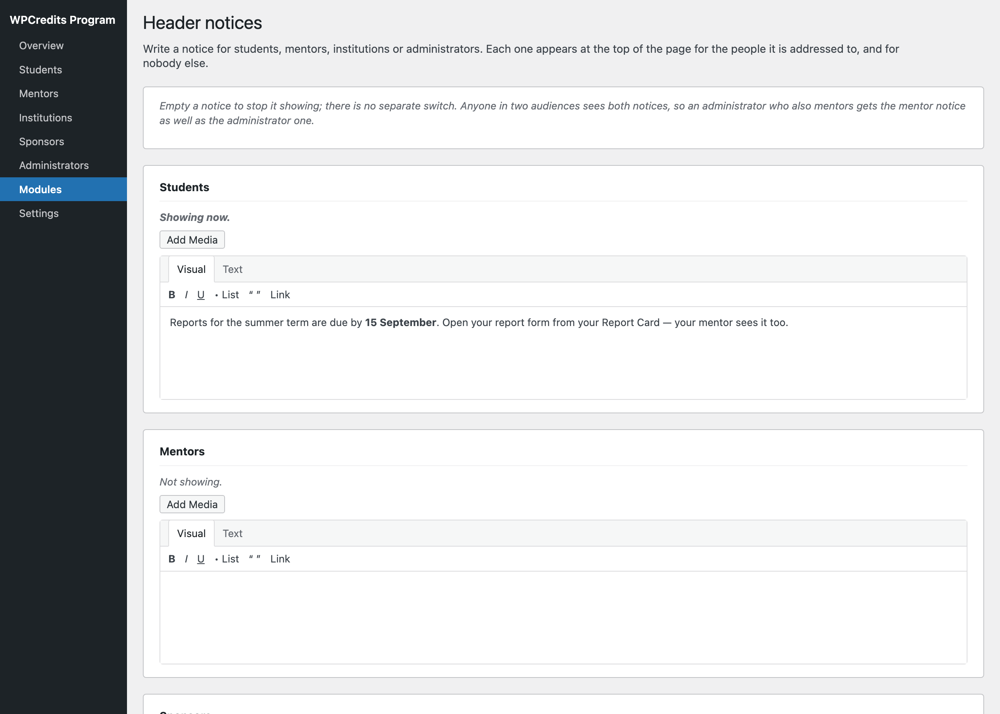

*One editor per audience. An empty notice is not shown; there is no separate switch.*

- **An empty notice is off.** There is no separate switch, because a switch is one more thing to leave
  in the wrong position.
- **Anyone in two audiences sees both notices.** An administrator who also mentors gets the mentor
  notice and the administrator one, mentor first. Audience membership uses the same tests the
  dashboards do, so an administrator matched to an Airtable mentor record counts as a mentor even
  though the sync never gives them the role.
- A notice appears at the top of the content, which in this program's theme is the top of the
  dashboard card - not above the site header.
- Links and simple emphasis survive; scripts and other markup are stripped **on save**, so nothing
  dangerous is stored rather than merely hidden at render time.

### Emails

**WPCredits Program > Tools > Emails.** The plugin's emails you can edit, by area. One you have not
edited is sent as the plugin ships it. Every email the plugin sends ends with the signature and
footer. The tool also keeps a record of every email the site sends, for 30 days. Three tabs,
**Templates**, **Signature and footer** and **Log**; the tool's own address opens Templates.

#### Templates

The plugin's emails, grouped by area, each area in a table of its own. There are six:

- **Invitations**: the student's, the mentor's, which since 1.122.33 carries the welcome a new mentor
  is sent, and the sponsor's invitation, and the institution's two, one for an institution whose
  Collaboration Agreement is not on file yet and one for an institution whose agreement is on file.
- **Mentor calls**: what the mentor and the students are told about one-to-one calls, group sessions
  and series of sessions: a booking, a join, a series joined, a session moved, a place left or
  released, a call or a session canceled, and the reminder a day before. Where the mentor and the
  student are told different words, each has an email of its own, named for whom it goes to; a
  group session's cancellation and its reminder say the same words to the mentor and to every
  student on it, so each is one email. A mentor who has not set a meeting link yet is told so where
  the others are told where to meet, so the mentor's three confirmations, of a call, of a join and of
  a series, each have a second email for that case.
- **Institutions**: what an institution and the Administrators are told from its application to
  its last member: the acknowledgement of an application, the notice of it to the Administrators, an
  Administrator's question and the rejection; a member's invitation to a colleague; the institution's
  Collaboration Agreement received, uploaded, accepted, put back in force, returned with a note and
  revoked, the daily list of agreements waiting too long, and the notice that the agreement's
  template could not be used; the notice that an institution has no members left; and what happens
  to an institution's details: a correction saved at once, a request to correct a checked detail
  (its name, website, city, country or contact's email), the request's approval, its decline with
  the Administrator's note, and its withdrawal. An email that says other words in one case than in
  another is two: the acknowledgement for a country with a call to book and for one without, the
  upload with the courtesy scan's notes and without, the revocation with a country contact named and
  without one, and the invitation with its inviter named and with nobody to name as its sender, the
  inviter's account gone or holding no name.
- **Semester reports**: the notice to the Administrators that the daily job drafted a report, the
  approval to the institution's accounts, and the question to the students whether the report may
  mention them.
- **Sponsors**: the acknowledgement of a sponsor application (and its twin for an application whose
  logo files were not kept), the notice of it to the Administrators, an Administrator's question and
  the rejection; the sponsor's Collaboration Agreement received, accepted, returned with a note, out
  of force and back in force; what a sponsor says on the Sponsor Dashboard it would like to support,
  and its request to sponsor a mentor; the warning that an offer's codes are running low and a
  claimant's report of a code that did not work; a sponsor's post sent back to its author; and the
  mail to a sponsor's Administrator thirty days before its term ends, and its twin for a term the
  daily run finds already over.
- **Sponsor events**: what the people on a sponsor's event, or on one of the program's own, the
  sponsor's accounts and its Administrator are told: a join and a leave, with the calendar file that
  adds the event or takes it off; a change or a cancel, to the people on it; the reminder the day
  before, to the people on it and to the sponsor's accounts that are not; an Administrator's
  approval, return and cancel with a note, to the sponsor's accounts; a change or a cancel of an
  approved event made on the Sponsor Dashboard, to the sponsor's accounts; and what a sponsor plans,
  changes or cancels there, to its Administrator. An event of the program's own says "Hosted by the
  WordPress Credits Program" where a sponsor's names its sponsor, so it has emails of its own, and
  so has what an Administrator did on a sponsor's behalf through the Sponsor Dashboard's switcher.
- **Mentor applications** (since 1.122.31): what a person who applied to mentor through the form on
  the site is told, the acknowledgement with the link that confirms the address, the selection with
  the mentors' course invitation link, the request for more information and the decline, and the
  notice of a new application to the Administrators. The four to the applicant ship with the words
  the program's Airtable automations sent, and carry the program's contact address as their
  Reply-To when **Contact address in emails** is set, so an answer reaches the program.

Where an email is two, as the mentor's confirmations with and without a meeting link and the others
above are, each of the two is edited on its own: an edit of one leaves the other as shipped. So an
Administrator's edit of "Invitation to join an institution" does not carry over to "Invitation to
join an institution, with no sender named": that invitation is sent as shipped until it is edited
too.

Each row names the email, who receives it and what sends it, its state, and who edited it last and
when. The states:

- **Shipped text**: the email is sent as the plugin ships it, which is word for word what it said
  before it could be edited: before 1.122.19 for the Invitations, before 1.122.21 for the Mentor
  calls and the Semester reports, and before 1.122.22 for the Institutions and the Sponsors, but
  for what 1.122.23 changed on purpose: the warning that an offer's codes are running low says
  "1 code left" for one, writes a count past a thousand and the mark beside it alike, and leaves
  out its Offers card line while the Sponsor Dashboard's page is not published; an institution's
  Collaboration Agreement sent back or revoked by an Administrator whose account holds no name, or
  only spaces, says "by an Administrator", and a sponsor's sent back by one says
  "An Administrator"; the invitation with nobody to name as its sender is an email of its own; an
  invitation to an institution says that a reply reaches the person who sent it only while it
  carries their address to reply to; the two emails about what a sponsor would like to support
  name the site; the notice of an upload the courtesy scan noticed something in says what in
  words; and every email prints a name as it was typed, its subject included, as below.
- **Edited**: it is sent as an Administrator wrote it, to everybody, in that wording.
- **Edited, and the shipped text has changed since**: an update changed the shipped text after the
  edit was saved. The edit is still the one sent, and its editor opens the new shipped text under
  the buttons, to compare. Saving your edit again clears this state.
- **Edit set aside**: the edit uses a placeholder the email no longer has, lacks one it now needs, or
  has one in its subject that goes in the body, so the shipped text is sent until the edit is saved
  again; the state says which placeholder.

**Edit** opens the email's editor: a **Subject** and a **Body**, the email's placeholders, each with
what it means and an example, and a **Preview** of the email filled with the examples and ending
with the signature and footer. A placeholder, such as `{set_password_link}`, is a word in braces that
is replaced by its value as the email is sent, as a person reads it: a name or a title WordPress
stores with an "&" or a "<" written as an entity, an account's name or an application's among them,
arrives as it was typed, in the body and in the subject. The subject of every email in this list is
plain text since 1.122.23, as an edited one's has been since 1.122.22, so a "<" or an "&" in it is a
character, never an entity, and nothing in it that looks like a tag is taken out; a line break in it
is one space.
A sentence whose placeholders are all empty is left out, and so is a line left with nothing on it,
together with the line ending in a colon directly
above it when that line holds no placeholder: an invitation with no dashboard page published leaves
out the line that would name it, as it always did. A sentence ends at a full stop followed by a
space; a question or exclamation mark does not end one. So in "Thanks! Write to {program_contact}."
with no contact address set, the whole of it goes, "Thanks!" with it, and in "e.g. " the full stop
ends a sentence.

An email about a call shows every time on its recipient's own clock: `{when}` is the call's start
and end as the recipient reads them, and `{time_zone}` names that clock, so a mentor in Tokyo and a
student in Warsaw each read the call at their own hour. A date in an Institutions or a Sponsors
email, such as `{accepted_on}`, is the site's, as it always was. A count arrives in words, such as
`{session_count}`, "3 sessions", or `{review_window}`, "3 working days", so a template needs no rule
for one and several. So does the number of codes left in the warning that an offer's codes are
running low, `{codes_left}`, "3 codes", since 1.122.23, where it arrived as a number: an edit of that
email saved before, which says "{codes_left} codes left", reads "3 codes codes left" until it is
edited again. Past a thousand, the count and the mark it warns below, `{low_mark}`, are written
alike, "4,999 codes" and "5,000". What the courtesy scan noticed, `{scan_flags}`, is in words since
1.122.23, each with the PDF's own name for it in brackets, such as "an action that runs when the
file is opened (/OpenAction)", in an edit saved before as well; the Institutions screen, the
Sponsors screen and the Administrator Dashboard name what the scan noticed in the same words. Both
invitations to an institution, the one with its sender named and the one with nobody to name, gain
the optional `{replies_reach}` in 1.122.23, so an edit saved before, which lacks it, is still sent
as edited. An invitation to an institution, with its sender named or not, says that a reply reaches
the person who sent it, `{replies_reach}`, only while it carries their address to reply to; empty,
its sentence is left out. The two emails about what a sponsor would like to support gain an
optional `{site_name}`, which names the site in their subject, so an edit saved before, which lacks
it, is still sent as edited. An edit of an email whose shipped body ends with a line break, as a
Semester reports email's does, ends with one too, after its signature and footer.

- **Save** stores the subject and the body, and is refused in the cases below.
- **Send me a test**, beside **Save**, sends the email as it is saved, filled with the example values
  and with "[Test]" before its subject, to your own address and to nobody else. The Log marks it
  **Test**. Save what you typed first: pressed with typing not saved yet, it sends nothing, and the
  editor comes back with your typing and says so. A test carries the subject and the body alone: the
  calendar file a Mentor calls email carries, and the reply address that several emails go out with
  (a Mentor calls email, an Administrator's question to an applicant, an agreement sent back with a
  note, a sponsor's agreement taken out of force, a colleague's invitation, a code that did not
  work), are added when it is really sent, so a test of one arrives without them.
- **Restore the original** is there once the email is edited. It asks first, then drops the edit,
  and the shipped text is sent from then on.

**Save** is refused, nothing is stored, and the editor comes back with what you typed, when:

- a box is empty;
- a required placeholder is missing. Every invitation needs `{set_password_link}`, the link that
  sets the password, and so does every other link that carries a secret: an institution
  application's confirmation link, `{verify_link}`, and a colleague's invitation to an institution,
  `{accept_link}`. Every email about a call needs `{when}`, its time (a series, `{session_dates}`),
  and a semester report `{semester}`. What an Administrator or a sponsor wrote, where it is the
  email's point, is needed too: a question to an applicant, `{question}`; a note on a returned or
  revoked agreement or a returned post, `{note}`; and what a sponsor said, `{interest}`. A returned
  post needs its title and its author's name, `{post_title}` and `{author_name}`, either of which
  can be empty. And an email sent only with a value its other words lack needs it: the mentor's
  confirmation sent with a meeting link, `{meeting_place}`; the acknowledgement with a call to book,
  `{booking_link}`; the upload with the scan's notes, `{scan_flags}`; the revocation with a country
  contact, `{country_contact}`;
- a link or a typed text that goes in the body is in the subject: a link that carries a secret, a
  mentor's meeting link, `{meeting_place}`, which can carry the meeting's passcode, a code's last
  characters, `{code_ending}`, what a person typed, such as `{topic}`, `{question}` or `{note}`, or
  an applicant's own answers (an address, a website, a contact, a city). A subject is not a link
  anybody can follow, and the Log keeps it;
- a placeholder is not one of the email's (a misspelled one is named as one the email does not
  have; a misspelled required one is reported as missing instead);
- WordPress would remove part of the text; or
- the subject is longer than 200 characters or the body longer than 10,000.

A save of the shipped text as it stands stores nothing, so the email stays shipped text. A subject
made of placeholders alone, such as `{mentor_name}`, is saved; if they all come out empty, the
email goes out with its shipped subject rather than with none, since an email with no subject is
not sent.

#### Signature and footer

The one block every email the plugin sends ends with, after a blank line and a line holding `-- `.
It is not added to the emails WordPress and the Two Factor plugin send themselves. Its placeholders
are `{site_name}`; `{site_link}`, the site's public address, its home page, the same for everyone
(since 1.122.37), which is left out of an email that names the home page already; `{dashboard_link}`,
the recipient's dashboard, which is empty for somebody with no account, such as an applicant, and
for an email that names the dashboard already, as every invitation does, so its line is left out
and no email names the address twice; and `{program_contact}`, the address in **Contact address in
emails**, which is empty until it is set, so its sentence is left out. A line left with nothing is
left out whole, so no email has an empty line in its footer. It ships as four lines (the site's
address since 1.123.24):

- `WordPress Credits, WordPress Education`
- `{site_link}`
- `{dashboard_link}`
- `This email comes from the WordPress Credits program. Questions? Write to {program_contact}.`

`{dashboard_link}` is each person's own page: a student's Student Report Card, a mentor's Mentor
Report Card, an institution member's Institution Dashboard, a sponsor member's Sponsor Dashboard and
an Administrator's Administrator Dashboard. A page that is not published gives no link. The tab's
preview and **Send me a test** show the footer as an Administrator gets it, since the test goes to
you, so both show the Administrator Dashboard; a note under the preview, and the test itself, list
what everybody else gets. The site's address, on the line above, is the same in every email, and
everybody can open it, an applicant with no account among them. A site whose front page is one of
the dashboards prints that address once, on the site's line.

The tab edits it with the editor every template has, without a subject, with **Save**, **Send me a
test** (a short email that ends with the block) and **Restore the original**. An empty block is not
saved, since every email ends with it.

#### Settings

At the top of the Signature and footer tab, the tool's one setting, **Contact address in emails**:
a mailbox the Administrators read, which the footer names for questions. Left empty, the footer
leaves that sentence out. An address that is not one is not saved, and the tab says so.

#### Log

A record of every email the site sends, kept for 30 days: the plugin's own, WordPress's (a password
reset, for example) and the Two Factor plugin's sign-in codes. Use it to answer "did they get the
email?".

Each row is one recipient of one email: when it was sent, in the site's time zone; the address as
plain text, and under it the person's name when the address belonged to an account at the time,
which is a link to the account for as long as the account exists; the recipient type (Student,
Mentor, Institution member, Sponsor member, Administrator, Applicant (no account) or Other); the
area that sent it (Invitations, Mentor calls, Institutions, Semester reports, Sponsors, Sponsor
events, Mentor applications, WordPress, Two Factor or Other); which email it was; its subject; and
its status. The status is one of three:

- **Handed to the mail server**: the site passed the email on. This does not prove it reached the
  inbox: a full mailbox or a spam filter can still stop it after it leaves the site.
- **Failed**: WordPress could not hand it over; the reason it gave is shown under the status.
- **Not confirmed**: another plugin took the email over before WordPress could say what happened,
  or the request ended, with a fatal error for example, before it did.

A **Test** mark beside the status shows a test you sent yourself with **Send me a test** (or, before
1.122.19, a sample from Settings > Mail). It is not a fourth status: the test has one of the three
as well, and the **Status** filter has a **Test** choice that lists the tests.

To find an email, type part of an address, a name or a subject into the search box, or narrow the
list by **Area**, **Recipient type**, **Status**, **Email** or **When** (today, the last 7 days, the
last 30 days, or from and to dates), and press **Filter**. The **Email** filter is one field: type
a few letters of the email's name and pick it from the list. Fifty rows show a page, newest first,
with the count above them. Until 1.122.21 the Mentor calls emails were named by five names that each
covered the mentor's copy and the students' alike, such as **Call booked** and **Call reminder**;
the rows sent before keep those names, which now end "(until 1.122.21)", for the 30 days the log
keeps them. Until 1.122.22 a Collaboration Agreement put back in force was logged as an
acceptance and a sponsor's request to sponsor a mentor as **Sponsor interest**; each has a name of
its own since. The institution's agreement emails, the rows sent before included, are named for the
Collaboration Agreement in full, such as **Collaboration Agreement accepted, to the institution**,
and the sponsor's five agreement emails say who receives them, such as **Collaboration Agreement
accepted, to the sponsor**.

The log never keeps the text of an email, its attachments, or anything secret such as a sign-in
code or a password link. Entries older than 30 days are deleted every day. WordPress's **Export
Personal Data** and **Erase Personal Data** tools include a person's entries, found by their
address. Erasing a person's entries is followed by WordPress's own confirmation email to that
address, and the log records that email too, so a fresh row for the address after an erasure is
expected. The emails the plugin had recorded before 1.122.18 (Settings > Mail showed the last 25 of
up to a hundred) move into the log, with their addresses masked as they were kept, no subject and no
recipient type; those older than 30 days are deleted with the rest.

### Mentor Status Checker

**WPCredits Program > Tools > Mentor Status Checker.** Reads the WordPress.org profile of each mentor
who has still to be made one, matches the Credits Mentor's Course completion, and reports what it
would change before it changes anything. It has two sources. First the applications selected on this
site, the newest selection first: where the course shows on an applicant's profile, they are made a
mentor on this site, once **Make mentors from applications** is on (see *Applications to mentor* in
the part on the plugin in wp-admin). Then, until **Stop checking mentors in Airtable** is ticked, the
mentors whose Airtable status is the one set under **Check mentors with status**, *Vetted -
positive* by default: where the course shows on one of those profiles, they are promoted to *Active*
in Airtable, as they were before 1.122.33.

It needs the Airtable connection only for Airtable's mentors. The applications selected on this site
are checked without it; while Airtable is not connected, the tool's status line and its screen say
that Airtable's mentors are not checked, and that a mentor made from an application gets no Airtable
row until it is. A run in which Airtable cannot be read still checks the site's applications, and
says above its results that Airtable's mentors were left out of it; with no application selected,
the error is the answer, as it was when Airtable was the only source.

An application's row in the results reads *Made a mentor* once it is, with what was held or not
written on the way (an invitation held, an Airtable row refused), and the tally counts **made a
mentor** beside **promoted**. A run that only reports, and any run while **Make mentors from
applications** is off, makes nobody a mentor: an application whose course shows reads *Awaiting
promotion*, "Ready to be made a mentor", or, while the switch is off, *Waiting*, with "it waits
until Make mentors from applications is switched on". A report keeps on each application the day of
its last check, which the Selected view shows. **Run check and promote** and **Promote all
eligible** promote and make mentors from both sources, and **Promote** on one row re-checks that
mentor or application first, never from the cache, and refuses an application that has left Selected
(course pending). A row that reads *Waiting* offers no **Promote**, since it says it waits; the
summary above the results counts those rows as waiting for Make mentors from applications, apart
from those awaiting promotion, as the tool's status line does, and **Promote all eligible** leaves
them out. Once the switch is on, the same rows await promotion again. One that **Promote all
eligible** finds has left Selected (course pending) since the run comes back as failed under the
applicant's name, with the reason.

#### Settings

At the top of the checker's screen, above the buttons that start a run, a form with its own **Save
settings**:

| Setting | What it is for |
| --- | --- |
| **Check mentors with status** and **Promote them to** | The Mentors table's status a run reads mentors at, *Vetted - positive* by default, and the one it moves them to, *Active*, each chosen from the table's Status options, or typed, with a sentence saying why, when those cannot be read. Writing the second needs the `data.records:write` scope on the token. |
| **Mentors in Airtable** | **Stop checking mentors in Airtable**, unticked by default: until it is ticked, the mentors holding the status above in Airtable are checked after the site's applications. Tick it once no mentor in Airtable holds that status. It is a stop and not a box to keep reading with, so that a save of this form from a page loaded before the box existed, which posts no box, leaves Airtable's mentors checked. |
| **Course title** and **Course slug** | The course a profile has to show as completed, the WordPress Credits Mentor's Course by default. The slug, from the course's address on learn.wordpress.org, is the reliable signal, and the title only a fallback. Both are typed: learn.wordpress.org has no list to read them from. |
| **Completion phrase** | Words that must appear in the same profile history entry as the course, *Completed the course* by default, so somebody who merely blogged about the course is not counted. |
| **Profile history filter** | **Milestones only (faster)**, the default, or **All contributions**: course completions are always milestone entries, so the faster filter reads roughly 40% fewer pages. Its fold: switch to all contributions only if WordPress.org changes and completions stop being found. |
| **Maximum history pages per mentor** | From 1 to 100, 15 by default. A mentor whose history is longer is reported as "could not check", never as "not completed", since a false negative would leave them waiting. |
| **Mentors per batch** and **Delay between requests (ms)** | How hard a run reads WordPress.org, from 1 to 25 mentors a batch, three by default, and from 0 to 5000 ms between requests, none by default: each mentor can cost several requests, so smaller batches keep the screen responsive. |
| **Cache profile results for (seconds)** | How long a settled answer is kept, up to thirty days, twelve hours by default. A failed read is always tried again, and `0` keeps nothing. |
| **Daily check** | Two boxes, **Run the check automatically once a day** and **Let the daily check also promote mentors**. Both are off by default: an unattended promotion writes to the shared Airtable base and, where **Make mentors from applications** is on, makes mentors on this site and sends their invitations, so turn the second on deliberately. The check ran once a week until 1.122.4; a site that had the weekly run moves to the daily one by itself, its next run within the hour. |
| **Slack webhook** | The Slack incoming webhook the message after a promotion goes to, which decides the channel it lands in. Shown masked and never sent to the browser: leave it blank to keep the one saved, or type `remove` to take it away. Only a Slack incoming webhook address, as Slack gives it, is taken; anything else is refused with an error on the screen, and the one saved before stays. Its fold says how to get one: a Slack app in the workspace, with Incoming Webhooks switched on and a webhook added for the administrators' channel. |
| **Channel to add them to** | The channel the message asks the administrators to add the mentors to, as it is named in Slack, such as `#mentors`. Left empty, the message says "the mentors channel". |

#### The Slack message after a promotion

With a webhook saved, every action that promotes or makes a mentor sends **one** message once it has
finished: a run, whether the daily one, **Run check and promote** or `wp wpcredits check_mentors
--promote`; **Promote all eligible**; **Promote** on one row; or, since 1.122.33, **The course is
completed** on an application, which sends its message at once. It calls the channel (`@channel`),
says how many mentors were moved to the status they were promoted to and which channel to add them
to, and lists each one with a link to their WordPress.org profile and, where the profile shows one,
their Slack name, which is the name to type when adding them, shown as code so that an address typed
there is not a link. The line of a mentor made from an application ends *from an application on the
site*, and the count and the status in the first line cover them as they cover a promotion. The last
line says who promoted: *the daily check*, *WP-CLI* or the administrator who pressed the button. Only
mentors whose status was actually written, and applicants actually made mentors, are named: an
applicant is named as soon as the account is made, so one whose Airtable row was refused is named all
the same, and one filed as already a mentor is not. An action that moved nobody sends nothing, and a
long list goes in messages of 25. The message is in the site's language, whoever pressed the button.

A message Slack refuses, or that cannot reach Slack, is not lost. Its mentors are kept and sent with
the next message, and every run sends what is kept even when it promotes nobody, so with the daily
check on a mentor waits a day at most. A mentor promoted while another message was being sent goes
in a message of its own about a minute later. A promotion never waits on Slack: Airtable is written
first. The line under the buttons says when the last message went and how many it named, or why it
failed, and how many still wait. Promotions made while no webhook is saved are not announced later.

### Student Duplicate Finder

**WPCredits Program > Tools > Student Duplicate Finder.** Lists every student who has more than
one row in Students, Students Reports or Feedback in Airtable, proposes which rows to delete, and
deletes the ones you tick and confirm.

A second row usually comes from the Airtable automation that creates a student's Students Reports
and Feedback rows. It runs whenever a Students row starts matching its conditions and it never
checks the address, so it runs again for an address that already has rows: a student who did not
move forward applies again, or somebody sets a status back and the automation fires a second time.
Duplicated addresses are what break the update automations, which is the error you see in Airtable.

The finder clears duplicates up; it does not stop them being made. Stopping them at source is a
change to that Airtable automation, written up step by step in
[Stopping duplicate students at the source](https://wordpresseducation.org/duplicate-students-at-the-source/).

#### Delete duplicates here, not by hand in Airtable

This is the part worth reading twice. **The site stores Airtable record IDs**, and deleting the row
one of them names is not something Airtable can warn you about:

- a student's account holds the record ID of their **Students Reports** row and of their
  **Feedback** row, which is how their Student Report Card finds their program;
- a mentor's **call note** and a **booked call** hold the record ID of the student they are about;
- **audit log entries** hold the record IDs of what they describe.

Delete such a row in Airtable and the site is left pointing at nothing. For the student, that
means their Student Report Card stops showing their program, and there is no message anywhere
saying why, on either side.

The finder knows every one of those references. It reads them before it proposes anything, it
**refuses to delete a row that anything on the site points at**, and it checks again in the second
before it deletes. That is the whole reason to use it rather than the Airtable interface. If you
have already deleted rows by hand and a student now sees nothing, say so: the site can be pointed at
the surviving row again, but only by someone who knows which row that was.

#### What a scan does

A scan reads the three tables and writes nothing to Airtable, so running one is always safe.

- **It runs by itself every three hours**, offset from the four syncs so no two of them run in the
  same request.
- **Scan now** runs one while you watch, with a progress bar. Press it if you have just changed
  something in Airtable and want the list to catch up.
- **A scan that fails changes nothing**, whether Airtable did not answer or the site could not read
  which of its own records point at the rows. Its error appears above the list, and the last good
  list stays on screen, so a bad night never leaves you with an empty screen.
- **An address is the same student however it is typed.** Capitals and spaces before or after it
  make no difference, so a row whose address was typed with a space around it is listed, and can be
  deleted, like any other. When a student's rows spell the address differently, their card says so.
- Pressing **Scan now** while a scan is running does nothing except say so. **Review selection** is
  disabled while a scan is running, because the rows underneath the list are about to change.

#### Working through the list

1. Open the finder and read the tiles: how many students are duplicated, how many are **Ready**, how
   many **need a decision**, and how many rows are duplicated in each table.
2. Start with **Ready**. Press **Select all ready**, or tick students one at a time.
3. Move on to **needs a decision**. Each row that may go has its own checkbox and, beside it, the
   sentence saying why it was held back. Read the sentence and decide. Nothing is ever ticked for
   you here.
4. Press **Review selection**. Nothing has been deleted yet.
5. The confirmation lists exactly what will go, table by table, and lists anything it left out with
   the reason. Rows that would leave a student with no row in a table are left out here already,
   not only after you press Delete. Read it. This is the page to turn back from.
6. Press **Delete**. Only this button deletes anything.

Take it in small batches the first few times. One confirmation deletes at most 100 rows, and there
is no prize for clearing the list in one afternoon.

#### Why a row is held back

The finder keeps the newest row in each table and proposes the older ones, but only when the older
row has nothing worth keeping on it. When it does, you get the sentence instead of a proposal:

| What the screen says | What it means | What to do |
| --- | --- | --- |
| The site points at it | An account, survey, call note, booked call or audit entry names this row | Delete the other row instead. This row is not selectable at all |
| The site uses an older row for this student, so this newest one may be the copy to delete | The pointers are on an older row, so "newest" is the wrong answer here | Decide which row the student's history really lives on, and keep that one |
| Still at a live status | The older row is at a status the program counts as current | Do not delete it until you know why a live student has two rows |
| Records a graduation | The older row is where this student graduated | Keep it. Graduations are the record of the program working |
| Holds work fields | Grades, reflection posts, hours or the project are filled in on the older row | Keep it, or copy the values across first |
| Holds survey answers | Feedback or semester report consent is on this row | Keep it, or copy the answers across first |
| Has Total hours set | The older row carries an hours total | Keep it, or move the total to the row you keep |
| Has Notes in Airtable | Somebody wrote something on this row by hand | Read the note before deciding |
| The newest row has no institution, mentor, status or Course and this one does | The newer row is emptier than the older one | Fill the gap on the newer row first, then come back |
| Created in the same second | Two rows share a creation time, so "newest" decides nothing | Look at both and pick |
| The newest row is at a status that ended, so this one may be the row to keep | Somebody applied again and did not continue | Usually keep the older, live row |

A student is **Ready** only when every table's older rows are clean deletes. One held row anywhere
moves the whole student to **needs a decision**, which is why that group is the larger one.

#### What happens when you press Delete

- **Every row is read from Airtable again** and every question is asked again. A row that changed
  since the scan, that the site has started pointing at, or that is already gone is left out and
  named on the notice. A row has changed when it carries more work, answers or hours than the list
  showed, when a value that held it back was replaced (a grade, a note, a screenshot), or when it
  gained a reason to be kept that it did not have.
- **One delete runs at a time.** A Delete pressed while another is running deletes nothing and says
  so; review the selection again once the first has finished. After a delete that was cut off part
  of the way, by a timeout for instance, the same notice can show for up to five minutes from when
  that delete began.
- **If the site cannot read what on it points at the rows, nothing is deleted**, and the notice says
  so.
- **The last row an address has in a table is never deleted.** Whatever else happens, a student
  cannot be erased from a table entirely.
- **Rows go in order: Feedback, then Students Reports, then Students**, so a child row never
  outlives its parent.
- **A sealed copy of every row is written to the site first.** If the copy cannot be written, the
  row is not deleted.
- **If Airtable stops a delete part of the way**, the notice says what was deleted before it stopped,
  with Airtable's own message. The rows it did not confirm stay in the list and can be selected and
  deleted again; each still ends with one copy and one log entry.

#### Deleted rows, and the 30-day copy

The **Deleted rows** list under the students records who deleted which row, from which table, and
when. **View copy** shows that row's cells exactly as they were, so you can type them back into
Airtable by hand.

**There is no automatic restore.** Bringing a row back is a manual job, and a restored row gets a
new record ID, so anything that pointed at the old one still needs fixing. After 30 days the cells
are erased and the entry stays without a name or an address, as a permanent record that something
was deleted.

An entry whose delete Airtable did not confirm says so, and the daily run checks it again: a row
still in Airtable leaves the list, copy and all, since nothing was deleted, and a row that is gone
becomes an ordinary entry. A copy whose delete Airtable never confirmed is erased at 30 days too,
and its entry says the row may still be in Airtable. Look its record ID up there: if the row is
still there, the next scan lists it again.

#### Settings

**Deleting ships switched off.** Its one setting, **Deleting duplicates**, with its box **Let administrators delete the duplicated rows they select and confirm**, is in the Settings section at the top
of the finder's screen, above the list, with a Save of its own. Until an Administrator turns it on
there, the whole list is read-only: no checkbox can be ticked, **Review selection** is grayed out, and
the list says where deleting is turned on. Scanning and reading work either way, so the list is worth
looking at long before anyone decides to delete from it. The row's fold says what a delete does: it
removes rows from Students, Students Reports and Feedback in the shared base, and the finder keeps a
sealed copy of each row for 30 days.

Leaving it off between clean-ups is a reasonable habit, not a sign that something is wrong.

#### On the Administrator Dashboard

The **Duplicated students** tile counts the students the last scan listed, and its card links here.
With none listed there is no tile; the card says whether the last scan found nothing or no scan has
run yet.

### Track Builder

**WPCredits Program > Tools > Track Builder.** A program track is one Airtable status, one form on
the Student Report Card, a key chip in one color and, when the track follows one, a Learn course and
an hours target. Before the Track Builder, a new track was a plugin release. Now it is a draft you
write here, preview, publish to Airtable and switch on, with no developer in the loop.

Two things are worth knowing before you touch it. **Nothing reaches students until a track is
published**, and every notice and the preview say so. And **the four tracks the program runs today
are here too**, as the program's four original tracks, published from the day a site goes live; the
last part of this section is what makes them different from a track you make.

#### The track list

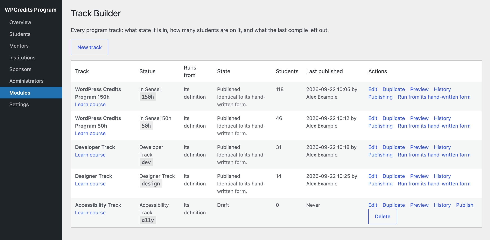

*In this sample list, the program's four tracks run from their definitions, and a track of your own, the Accessibility Track, stays a draft until you publish it.*

One row per track, in the order they were made:

| Column | What it shows |
| --- | --- |
| Track | The track's name |
| Status | The Airtable status a student holds to be on this track |
| State | *Draft*, *Published*, *Unpublished changes* or *In the trash*; under it, a line when the last compile left the track out, and a line when a live track's status is missing from **Currently mentoring** in Settings |
| Students | How many synced students hold its status now |
| Last published | When, and by whom |
| Actions | **Edit**, **Duplicate**, **Preview**, **History** and **Publish** (**Publishing** once it is), then the buttons only some tracks get |

**New track** sits above the list. The only button a row gets sometimes is **Delete**, offered on a
track that was never published. Delete asks first and cannot be undone, and it deletes that draft and
nothing else. A track that was ever published keeps its row, because its columns and its status live
on in Airtable; the program's four original tracks are published from the moment a site exists, so
none of them is ever offered it.

#### Starting a track

Three ways, each ending on the new track's page, as a draft.

- **New track** asks for the three things two tracks can never share: the **Name**, the **Airtable
  status** and the **Key**, the short word on the chip, plus the **Learn course** link when the
  track follows one. A name, status or key another track holds is refused, even when that track is
  a draft, since publishing the draft would claim it. With a link, the course's lessons are listed
  beside the questions, and the name is taken from the course when it is left empty. The chip color
  is chosen for you, the first one no other track holds, drafts included. The form starts empty; the
  questions are added on the track's page.
- **Duplicate** copies every question of an existing track, the four original tracks included, and asks
  for a name, a status and a key of its own, refused as New track's are when another track holds
  them. The copy starts with no Learn course, no hours target, no partners and no partners'
  narrative; set them on its page. This is the usual way to start a track that resembles one you
  run: duplicate the 150-hour track and change what differs.
- *From a Learn course link* is New track with the link filled in. The lessons appear under the
  groups that are their modules, and each lesson offers **Add a question under this lesson**, which
  is how a form gets built lesson by lesson.

#### The track's page

The properties come first: **Name**, **Airtable status**, **Key**, **Learn course**, **Hours
target** and **Key chip color**, which is one of blue, cyan, teal, green, red, pink or purple. The
hours target may stay empty. After the chip color, **Partners** offers the sponsors Approved at the
Partner tier today plus any the track already names, ticked, so a lapsed one stays until you
untick it. Under them, **Partners' narrative** is one text for all of the track's partners, up to
5,000 characters, which you rewrite each term: when a partner's annual report is drafted, which the
site does the day after that partner's term ends, its block for this track starts with the text as
the track was last published, so after rewriting it, publish the track before the next partner's
term ends. Each report keeps its own copy, edited on the report: a report drafted before a change
keeps the words it started with, and **Regenerate** keeps them too. **Save the track** saves the
properties; the questions save themselves as they are added, edited and moved. Save refuses a name,
status or key another track holds, drafts included, and a refused Save draws the boxes again as you
left them.

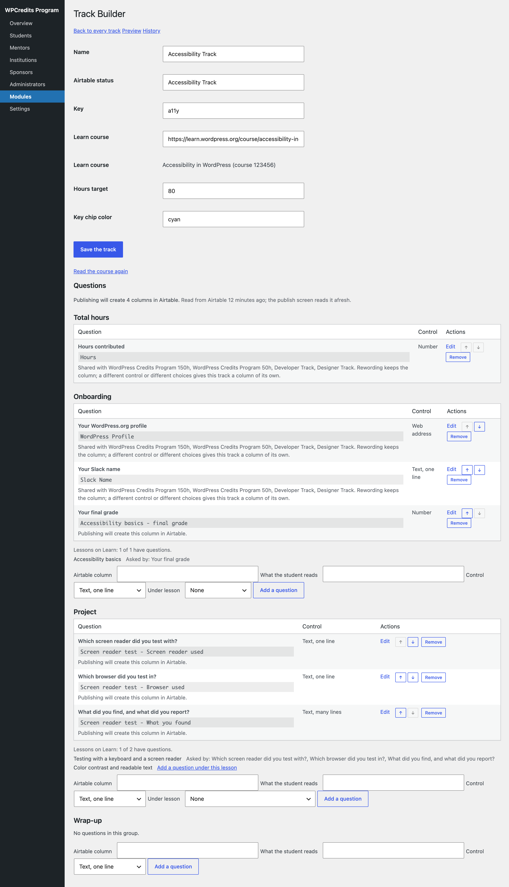

*On a track's page you set its properties and build its form group by group and lesson by lesson, and a line above the questions says what publishing would create in Airtable.*

The **Learn course** row shows what the link resolved to, the course's title and number. **Read the
course again** asks Learn afresh; otherwise the site keeps a day's reading, so a lesson renamed on
Learn shows up here within a day. When Learn cannot be reached, the link the track already has is
kept with a warning, the lessons cannot be listed, and the track still saves and publishes. A new
link is not taken while Learn cannot be reached, and the notice says so; the box keeps the link you
typed, so pressing **Save the track** again once Learn answers takes it.

Changing the link to another course matches every question that carried a lesson against the new
course's lessons by its heading. Only a lesson's first question carries the lesson's title as its
heading, so the other questions of that lesson follow it; only the questions of a lesson none of
whose questions matched are left with no lesson. The notice names the questions matched and the
ones that no longer point at a lesson.

Then **Questions**, by group: Total hours, Onboarding, Project and Wrap-up, the four parts of the
Student Report Card's form. Total hours holds one question, Hours, which students see as the hours
box. Any other question goes in Onboarding, Project or Wrap-up: the question screen offers Total
hours to Hours alone, and Save and Publish refuse anything else. On a track with no Learn course,
students see the hours box in a section of its own, **My hours**.

Each question is a row with what the student reads, its Airtable column and its control, and beside
it **Edit**, **Move up**, **Move down** and **Remove**. The arrows move a question at once; if the
site cannot keep a move, the question goes back and a notice above the list says why. Remove takes
the question off the form; the column, and whatever students wrote in it, stay in Airtable, and the
confirmation says so.

Each group ends with **Add a question**: the Airtable column, what the student reads, the control and,
when the group's module has lessons Learn answered, **Under lesson**. Total hours offers it only
while the track has no Hours question. Adding opens the new question's page.

When the track follows a course, the lessons of each group's module are listed under the group's
questions, with a count such as *Lessons on Learn: 3 of 13 have questions.* Each lesson names the
questions that report on it, or offers **Add a question under this lesson**. A question added that way
is placed after the lesson's last question, carries the lesson, and takes the lesson's title as its
heading when it is the lesson's first question.

A line above the questions says what publishing would create in Airtable, *This track needs no new
Airtable columns.* or *Publishing will create 3 columns in Airtable.*, and how long ago the base was
read.

#### Controls and columns

Ten controls: Text, one line; Text, many lines; Rich text; Web address; Email address; Number;
Checkbox; One choice of several; Screenshot; Contribution team. The control decides the Airtable
column type: a new column is created with the type the control needs, and a column that already
exists has to be of that type, or the publish screen refuses.

A duplicated track shares its columns with the track it came from, and the question's page says so,
naming every other track that writes the column. Rewording a shared question keeps the column.
Changing its control, or the choices of a select, gives it a column of its own, named after the track,
which can still be renamed until the track is published. A different control is a different column.

#### One question

Each question has a page of its own: the column and the control at the top, then the rows that apply
to that control.

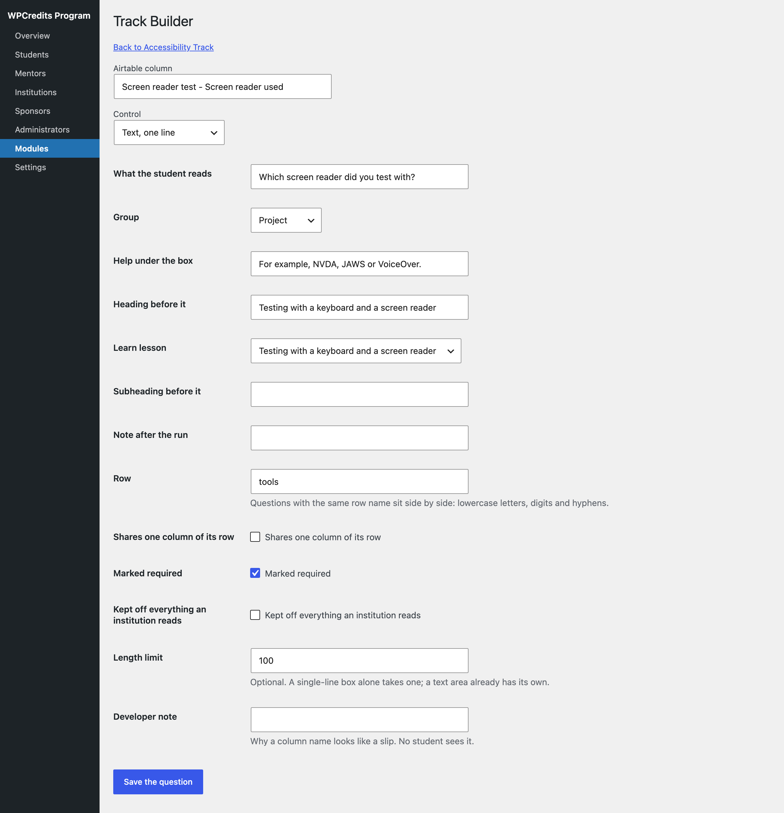

*On a question's page you set its column and its control, then the rows that apply to that control, here for a required line of text under a Learn lesson.*

| Row | What it does |
| --- | --- |
| What the student reads | The label above the box |
| Group | Onboarding, Project or Wrap-up; Total hours for the Hours question, which goes in no other group |
| Help under the box | A sentence under the control |
| Heading before it | A heading printed before this question; the first question under a lesson carries the lesson's title here |
| Subheading before it | A second heading before this question, drawn like the first |
| Note after the run | A sentence after the run of questions this one ends |
| Row, and Shares one column of its row | Questions with the same row name sit side by side |
| Marked required | Draws the word *Required* beside the label; nothing is enforced |
| Kept off everything an institution reads | The answer is left off the Student Report Card an institution sees |
| Lowest value, Highest value, Step | A number's limits; the step also sets how many decimal places a new column keeps |
| Length limit | A single-line box's limit; a text area has its own |
| Monospace, for code | A text area drawn in a monospace face |
| Choices, one a line | The choices of a select; a column that already exists must offer every one of them |
| Learn lesson | The lesson this question reports on: the course's lessons by module, *None* first, or a number box when Learn cannot be read |
| Developer note | Why a column name looks like a slip; no student sees it |

**Save the question** returns to the track. A refusal redraws the question with what was typed, and
the reason.

**Once a track is published, its questions are locked**: the column, the control and the choices are
fixed, because the column in Airtable holds what students wrote, in that shape. The words can still
change. To ask something differently, remove the question and add a new one with a column of its own.

#### Preview and History

**Preview** draws the draft's form as a student sees it: empty answers, no student's record, the same
renderer and the same stylesheet as the Student Report Card. Nothing typed there is kept. The hours
box sits where the Student Report Card puts it: with the button that opens the course when the track
has a Learn course, side by side on the student's page and one under the other here in wp-admin, and
on its own when the track has none.

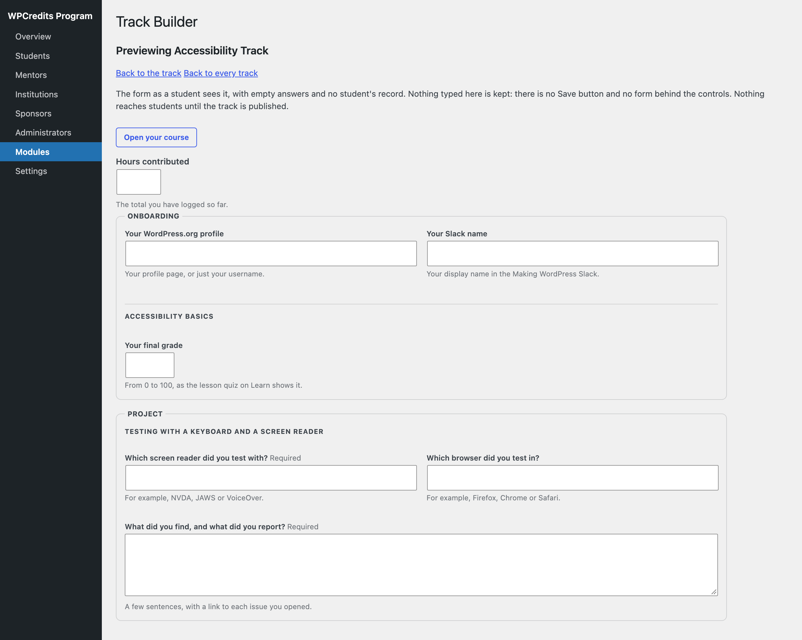

*Preview draws the form a student on the track fills in, the same questions in the same order, and nothing you type there is kept.*

**History** has three parts: what publishing would change, the published copy against the draft;
every save, newest first and at most twenty, with who saved it, when, and what changed since the one
before; and the publish log, every publish, unpublish, switch, column created and checklist item
ticked, with who and when.

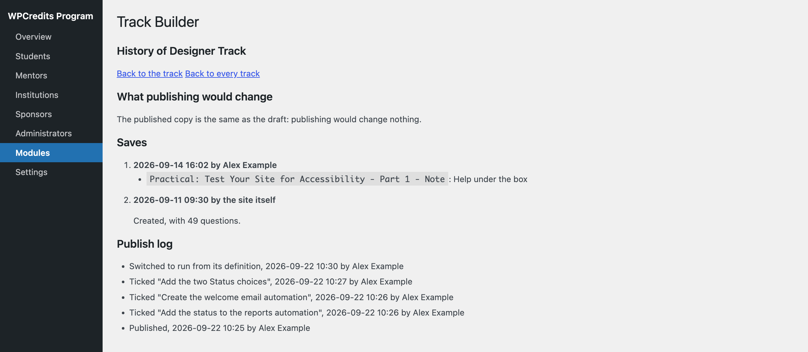

*History shows you what publishing would change, every save with who made it, and the publish log, here with sample entries for one of the program's four tracks.*

#### Publishing

**Publish** opens the publish screen. Nothing happens until the button at the bottom is pressed; the
screen first reads the base and says what it found.

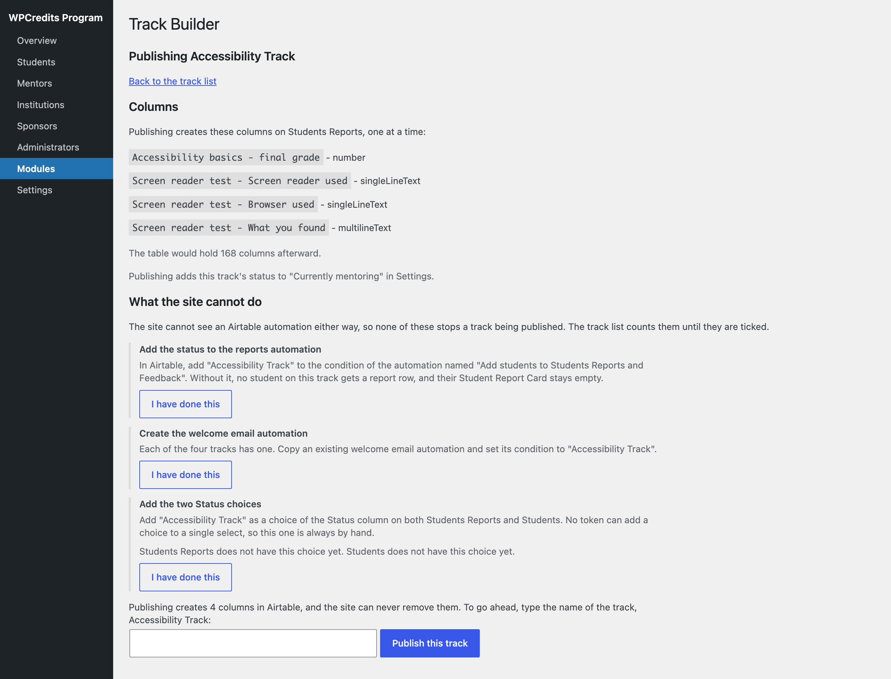

*Before you publish, the screen lists the columns it will create and the three steps only you can take in Airtable, then asks you to type the track's name.*

- **This track cannot be published yet** lists what stops it: a column in Airtable with a question's
  name but another type, a control that cannot have a column created for it, a table that would pass
  Airtable's limit of 500 columns, a status, key or name another track holds, a draft's included, a
  question other than Hours in Total hours or Hours in another group, and a **Students Reports
  table** setting that holds anything but the table's ID, its name for example. **Check it against
  Airtable** refuses the same way while that setting is wrong.
- **Worth knowing before you publish** lists what does not stop it: a choice of the Status column on
  Students Reports or Students that nearly matches the track's status but not exactly, which the
  syncs would never match; a Learn course link that does not resolve; a table past 450 columns. A
  choice that is missing altogether is not a warning: the third checklist item below says, for each
  table, whether it has the choice yet.
- **Columns**: every column the track writes to, and whether it exists or will be created. With a
  schema token, the optional second token on the Connection tab of **WPCredits Program > Settings**,
  the site creates the missing columns when you publish. Without one, the screen lists the exact
  columns to create by hand, name and type, and Publish waits until the next reading finds them.
- **What the site cannot do**: the three Airtable steps no token can take, with the exact values to
  use. Add the status to the condition of the automation *Add students to Students Reports and
  Feedback*; create the track's welcome email automation, as each of the four tracks has one; add the
  status as a choice of the Status column on both tables. Tick each with **I have done this** once it
  is done, and the tick records who and when. An unticked item never blocks publishing, but until
  the automation item is ticked, students cannot be put on the track from the institution import,
  because they would never get a report row.
- Publishing any track adds its status to **Currently mentoring** in Settings, unless it is there
  already. The four original tracks' statuses are there from the start, so publishing one of them
  adds nothing new. A Settings save that would take a live track's status out saves everything else,
  leaves Currently mentoring as it was, and names the track.

When publishing would create columns in Airtable, Publish comes with a box: type the track's name
exactly as it is written, then press the button. Capitals count; spaces around the name do not. The
site can never remove a column it created, so a press whose text is not the name creates nothing and
says so. The name confirms the columns the screen lists: if the columns publishing would create
change before the button is pressed, nothing is published and the screen comes back with the new
list to read and confirm again. With nothing to create, Publish is one press; a press that finds
columns gone from the base since the page was drawn creates nothing, and the screen comes back to
show them.

Publishing runs its steps one at a time and records each. If Airtable refuses part-way, the notice
carries Airtable's own message, and pressing Publish again picks up at the first step not done. If
the page stops part-way instead, because the server gave up on a long run, the columns made so far
are already recorded, but for up to twenty minutes Publish on every track says another track is
being published. After that, press Publish again: it creates only the columns the base still lacks,
and the log names every column the site made.

What goes live is the track as it stood when Publish was pressed. An edit saved while Publish runs,
in another tab or by another Administrator, is not part of that publish: the track then
shows *Unpublished changes* until **Publish the changes** is pressed.

After publishing, the same screen offers **Check it against Airtable**, which reads the base again and
says whether every column is still there with its type and the status is a choice on both tables, and,
for every track but the program's four original ones, **Take it off the live site**. The four never
offer it: a line beside the other actions says the program's original tracks always run, and to edit
the track and publish the change instead. Unpublishing any other track is refused while any student
holds the status, with the count; otherwise the track becomes a draft again, nothing in Airtable
changes, and the status stays in Currently mentoring: removing it there takes the Student role from
everybody on the track, which is a decision of its own.

Editing a published track's words makes it *Unpublished changes*; students keep the published copy
until **Publish the changes** is pressed.

#### The four original tracks

The 150-hour, 50-hour, Developer and Designer tracks are the program's own four. Each has run from its
definition in the Track Builder since 22 September 2026, and there is nothing left to switch between:
no hand-written form and no plugin update can move one of them, and you edit, duplicate, preview and
publish them exactly like a track you make yourself.

A fresh site seeds and publishes all four at once, with their publish checklist already ticked, from
the seed files the plugin ships, so the program runs on day one with nobody pressing Publish. If one
of the four is ever missing, `wp wpcredits seed_tracks` on the command line puts it back; it is the
same command a site runs on itself the first time it reaches the Track Builder.

**Their statuses and keys belong to them.** No other track can take the Airtable status or the key of
one of the four, whether you are starting a new track, duplicating one, or saving one you already
have: the refusal names which of the four original tracks keeps it. And the four cannot be deleted or
unpublished at all; if something about one of them needs to change, edit the track and publish the
change instead.

A site already on an earlier version upgrades once, on its first load after 1.116.0 arrives: nothing
for you to press, and a load that is cut short partway is finished by the next one. On a fresh site a
seeding cut short leaves no half-made track behind, and `wp wpcredits seed_tracks` puts back any of
the four that is missing, then as at any other time.

### Need help?

**WPCredits Program > Tools > Need help?** The question box over the WordPress documentation: its
settings at the top of the screen, then how answers are produced, with the provider and the sites it
is told to use, and a box for trying a question as somebody on the program would ask it.

#### Settings

At the top of the screen, a form with its own **Save settings**. One sentence says what the question
box is, and its **Details** fold says where each question goes: the provider does the searching, so
nothing is stored on this site, and each question, and the pages found for it, go to that company.

- **Need help?** - its box, **Switch it on**, is on by default. Off means the box answers nobody, the
  header button disappears and the page it lives on is unpublished. Nothing is deleted, so switching
  it back on restores all of it.
- **Where answers come from** - the provider searches wordpress.org, make.wordpress.org,
  learn.wordpress.org and developer.wordpress.org itself. Nothing is copied to this site, so there is
  nothing to configure and nothing to refresh.
- **Answer provider** and **Provider API key** - leaving the provider as *None* keeps everything on
  this site and means there are no answers at all. Choosing one sends each question, and the extracts
  that match it, to that company. The key is stored in the database and never sent back to the
  browser; left blank, it keeps the current key. A key for the Gemini provider is free at
  aistudio.google.com.
- **Model** - typed, `gemini-flash-latest` by default: the provider lists no models to choose from,
  so the field holds whatever model is saved. Leave it as the default unless you have a reason not to.
  It is an alias that always points at the current Gemini Flash, so it cannot be retired out from
  under the site.
- **Who can ask** - mentors and administrators by default; optionally students and institutions as
  well, anybody logged in, or administrators only. Never anybody logged out, whatever this says.
  The documentation describes running the program rather than being on it, which is why students
  are not included by default.
- **Questions per person per hour** - from 0 to 200, 20 by default, so a free tier cannot be spent in
  an afternoon. Past the limit, people are asked to come back shortly. `0` removes the limit.

While it is switched off, a notice above the section says so, with a link down to the switch; while it
has no provider, the **Provider** row under the section says so, with a link back up. Its card on the
**Tools** screen says which of the two it is, never the Airtable connection, which Need help? does not
use. And a question that cannot be answered for want of a provider, a working model or a valid key
tells the person asking that an Administrator can put it right in the Settings section of the
Need help? screen, under **WPCredits Program > Tools**.

## Who can read what

Every post and page carries a **Program access** control in the editor sidebar.

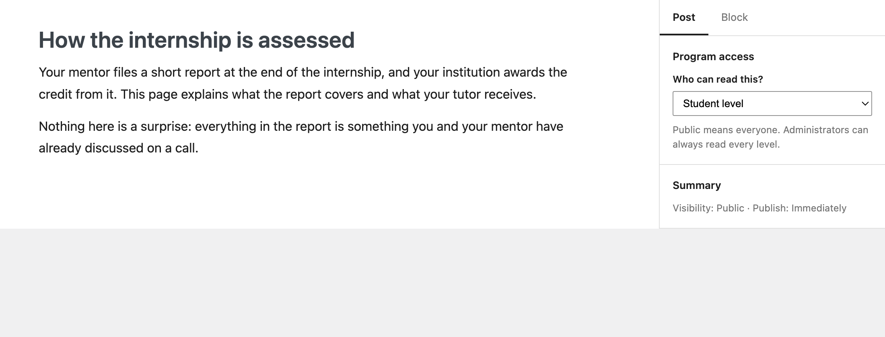

*The access control sits with the post's own settings. Administrators can always read every level.*

The levels come from the roles, so there is one per audience plus the two ends:

| Level | Who can read it |
| --- | --- |
| Public | Everyone, including logged-out visitors. |
| Student level | Accounts holding `wpcpm_student`, plus Administrators. |
| Mentor level | Accounts holding `wpcpm_mentor`, plus Administrators. |
| Institution level | Accounts holding `wpcpm_institution`, plus Administrators. |
| Sponsor level | Accounts holding `wpcpm_sponsor`, plus Administrators. |
| Students and mentors | Accounts holding `wpcpm_student` or `wpcpm_mentor`, plus Administrators. The level sponsor posts default to; an Administrator may widen a post to Public or narrow it in the post's Program access box. |
| Administrators only | Accounts with `wpcpm_manage_program`. |

**The levels do not nest.** A mentor holds the mentor capability and nothing else, so a mentor cannot
read a Student-level page. That is why documentation written for mentors has to repeat what students
are told rather than link to it.

Gating is applied in four places, so there is no back way in: front-end listings filter restricted
posts out, direct URLs send logged-out visitors to the login form and logged-in ones to an
explanation, the rendered content and excerpt are filtered, and the REST API is filtered too.

### Program updates and announcements

The column at the foot of both the Student Report Card and the Mentor Report Card lists recent posts
from the *Updates* category, filtered by the same access levels - so a post set to Mentor level
appears on the mentor's card and on nobody else's. Set the access level on the post and it lands in
the right place; there is nothing else to configure.

The Administrator Dashboard's column lists private posts too: a post in *Updates* whose visibility
is *Private* and whose access level is *Administrators only* appears there for the Administrators,
and on no other card. The biweekly site update is one, filed under *Site updates* as well; the link
to it in the Administrators' Slack channel opens it for anybody signed in as an Administrator. A
private post is never emailed to the site's subscribers or shared outside the site, which is why the
update is private rather than published.

### Viewing a page as its owner

The Student Report Card, the Mentor Report Card, the Institution Dashboard and the Sponsor Dashboard
each open, for an Administrator, with a switcher above the page whenever there is more than one to
choose from: **Viewing as student**, **Viewing as mentor**, **Viewing as institution** or **Viewing as
sponsor**. Pick a name in it and press **Show** to open that person's or that organization's page.
Only Administrators are shown the switcher, and the note with it says so.

The switcher is one field, showing the name you are viewing until you pick another. Click it, or
press Down, and the whole list opens under it, with the name in the field highlighted. The list runs
A to Z without regard to capitals or accents, so Álvaro is among the A's, with numbers read as
numbers, so Student 2 comes before Student 10, and with a space before any letter, so Teo
Polytechnic comes before Teodora School. Type in the field and the list narrows to the names that
hold what you typed, anywhere in the name and again without regard to capitals or accents, so
"alvaro" finds Álvaro, with the first match highlighted; the field's placeholder, **Find a
student**, **Find a mentor**, **Find an institution** or **Find a sponsor**, shows while it is
empty. Up and Down move through the list, and Home and End go to its first and last names. Press
Enter, or click a name, to pick it: the field shows it, and **Show** opens its page; picking alone
opens nothing. Click the field again, press Escape or Tab, or click anywhere else, and the list
closes with the name you picked last back in the field. When no name matches, the list says so. Come
back to a page with your browser's Back button and the field shows the name that page is about,
which is the one **Show** opens. Enter in the field never sends the form, and a screen reader hears
how many names the list shows. In a browser running no JavaScript the field is not shown, and the
plain sorted list works on its own.

### The details card on an institution's page

At the head of the **Representatives and agreement** module on an institution's Institution Dashboard,
above the people who act for it and its Collaboration Agreement, is the card **Your institution's
details**, with the line "What the program has on record." It is drawn to every account of an
institution whose agreement is settled and to an Administrator on any institution's page, opened through
the switcher or reached as the page you land on. An institution whose agreement is not settled has no
card: its accounts see the agreement panel alone, where they set its name on the agreement document.

The details read as rows under two small headings, in this order. **Contact and agreement**: the contact
person, their role, who signs the agreement, their title, the languages the students study in, and the
institution's page about WordPress Credits. **Name and address**: the name, the website, the city, the
country and the contact's email. A detail the program holds nothing for reads "Not given yet".

Under each list a closed section opens the form for that group alone, with the application's own
questions, labels and help, and the application's rules:

- **Correct these** (saved at once) is under the first list. Saving writes the contact person to the
  Institutions table in Airtable and to the program records here, and the other answers to the
  institution's record on this site. It adds a line to the institution's history that names the details
  changed and none of their values, emails the people **Who is emailed about institutions** names what
  changed, from what to what, and says "Your institution's details are saved."
- **Ask to correct these** (an Administrator checks first) is under the second. A member's press on **Send
  to an Administrator** writes nothing: it raises a request, shown on the Administrator Dashboard's
  *Requests from institutions* card, emails the same people with a link to it, and says "Sent: an
  Administrator checks the change, and you will see it here once it is decided." An Administrator is
  drawn this second form as **Correct these** (saved at once), with **Save the details**, as the first:
  their press saves at once, in either form, and emails as a save does, since an Administrator is the one
  who checks, and nobody approves their own change. While the school's request waits, an
  Administrator is offered no second form either: under the second list they read "A request from the
  school is waiting. Decide it in Requests from institutions on the Administrator Dashboard.", linked to
  that card while the page is published, and a post of that form is refused with the same sentence. The
  first form stays open to everyone allowed.

While a request waits, every account of the institution reads, under each row it would change, "Waiting
for an Administrator:", what was asked and the day it was asked, with **Withdraw it**; an Administrator
reads the same lines without the button, since the request is decided on the Administrator Dashboard. The
second list then offers no form, because an institution has one request at a time. A second account, or a second tab,
that asks meanwhile is told "One change is already waiting for an Administrator." and nothing is made.
Once the request is decided, every account of the institution reads its outcome until the next request is
sent: "Updated on" and the day after an approval; "An Administrator did not make the change you asked for:"
and the note after a decline; nothing after a withdrawal. Withdraw it brings the account back to this card.

A form posted with nothing changed says "Nothing was changed." and sends no email; a value posted back as
it was drawn is not a change, even one the program holds in a form the application would not accept. A
refused post gives back what was typed, with the problem under the field that has one, and a text that
WordPress would take words from is refused whole, as on the application. If Airtable refuses the contact
person's save, nothing is saved on this site either, the typed values come back, and the card says
"The program records could not be updated, so nothing was saved. Please try again in a while." The card
never names Airtable to the institution.

A save at once is made under a lock of the institution's own, the option
`wpcpm_req_lock_details_<record>` its request is raised under, with what the program has on record read
again under it. Two tabs, or two accounts, posting the same correction save it once: the second is told
"Nothing was changed." and writes, emails and records nothing. A save that finds the lock held, and a
request sent while it is held, is told "Someone else is saving your institution's details at this
moment, so nothing was done. Try again in a moment.", saves or makes nothing, and gives back the typed
values; "One change is already waiting for an Administrator." is for a request that truly waits. The
forms leave every rule to the site, so a box the browser would refuse, such as a stored contact's email
that holds two addresses, does not stop a post of the rest.

### A student's card on an institution's page

An institution's accounts open a student's card from the roster, and an Administrator opens the same card
through the switcher. The card shows the student's name and program, whether they have signed in yet, the
internship dates and cohort, the field of study, the tutor, the WordPress.org profile, the contribution
teams and the personal website, then the mentor, the Student Report Card (read only, fetched when it is
opened) and a link that downloads the student's details and course grades as a CSV file.

A mentor is optional in the program, and a student without one reads as normal. The **Mentor** row says
"No mentor yet", in the roster's words, and the **Mentor email** row is left out, since there is nobody to
write to. A mentor known by name and not by address keeps the row, which then reads "Not set". The card
asks for no mentor and offers no way to ask for one.

Under the Student Report Card, a closed section named **Correct this student's details** holds the form
that corrects five details: the name on the Student Report Card, the full name, the start date, the end
date (at most a year after the start) and the field of study, which must be one of the program's own
choices. It is shown to every account of the student's institution and to an Administrator, and to
nobody else; a student with no progress record yet has no Student Report Card and no section. Saving
writes to the program records at once, through a live read that places the student with the institution,
and adds a line to the institution's history. When a value is refused the section names what was refused
and says whether the rest was saved, and the form comes back with what was typed and not saved, for the
account that typed it, while what was saved shows as the program records now hold it. The section opens
by itself when the last save left something to say, so its sentence is not hidden in a closed section.
Nothing on this card asks for a mentor or keeps notes. A mentor request already on record is still on
the Administrator Dashboard's *Requests from institutions* card, where an Administrator closes it as
before.

### The For Administrators section of an institution's page

At the foot of an institution's Institution Dashboard, under its sections and above the line that says
when its records were last read, an Administrator is shown **For Administrators**, with the line "Only
Administrators see this section." It is drawn on any institution's page, opened through the switcher or
reached as the page you land on. Nobody who acts for the institution sees it, or anything in it, whatever
state their agreement is in. It holds two folded cards.

**From the application** lists the answers the institution's application gave that Airtable has no column
for, each under the question it was asked: the contact's role, the languages the students study in, who
will sign the agreement, their title, and the institution's page about WordPress Credits. They are kept
when the application is approved and stay after the application itself is removed. An institution approved
before 1.123.29 has none, and the card says "Nothing kept from the application."

**History** lists the latest 100 things that happened to the institution, newest first. Each row gives
when, in the site's date and time formats; who, as the account's name, "The site" when the site did it
itself, as when an invitation expires, or "A removed account" when the account is gone; and what happened,
in a plain sentence. It covers the institution's members and invitations, with the address each invitation
went to, its application and its agreement from the template being generated to a revoke, which also gives
the note it was revoked with after "Note:", its details (the corrections it saved, and its requests to
correct them), its requests, its imports, the changes made to its students, and the roster's refusals; a
line about a note on a student, if the history holds one, reads "A note about a student was added." or "A
note about a student was deleted." When there are more than 100, the card says "Showing the latest 100."
An institution with nothing recorded says "Nothing has been recorded for this institution yet."

A row reads in today's words whatever the day it was written. A member row names the account as it is
called now, "A former member" when the account is gone, says that it was added as a member or is no longer
one, and then says how it joined or left in the words of the People card ("Added by an Administrator",
"Joined by invitation", "Their access was removed", "They removed their own access"), never the code the row
was stored with. A request that was closed is worded by what became of it: "An Administrator closed a request
as handled.", "An Administrator declined a request.", "An Administrator approved a change to the
institution's details." or, for one taken back, "The institution withdrew a request." (or "An Administrator
withdrew a request." when an Administrator withdrew it), with the Administrator's note after it when the note
can be shown, and the outcome alone when it cannot. A school's request to correct its details reads "The
institution asked to correct its details.", and a correction it saved "Details were corrected:" and the names
of the details. A line written before the Administrators were named is read in the words used now.

### Arranging the Student Report Card

Under a student's profile and mentor columns the Student Report Card is a stack of modules: the
**program updates with the resources**, **My course** (**My hours** when there is no course to open),
the **report form with the feedback forms**, **My mentor call**, and **Tools from our sponsors** when
its setting on the Sponsors tab of Settings shows it. Each carries two small arrows at its top right,
and pressing one moves the module up or down at once, the way the block editor moves blocks. The
order belongs to the student: they arrange their own card, and it stays as they left it. When you
open a student's card through the switcher you see their order and can arrange it for them with the
same arrows. Nobody else sees the arrows.

### Group sessions, from a student's card or a mentor's

On a student's card, opened through the switcher, the group sessions they are on are listed under
*My mentor call*, and each one that has not started offers **Take them off the session**. It asks
first, then takes the student off, gives their place back and emails them a file that takes the
session out of their calendar, as their own **Leave the session** would.

On a mentor's card you can change or cancel their group sessions as they can. When you move one, the
mentor is emailed as well as the students on it, with an invitation that moves it in their calendar.

## Running it day to day

### The sync

The students and the mentors syncs read Airtable and reconcile accounts: create what is missing,
update what has changed, and apply your *when they are no longer active* setting to the rest. Run
one by hand from the Students or Mentors screen, or leave **Automatic sync** on - students and
mentors every three hours, half an hour apart.

They start half an hour apart on purpose. The student rows carry what students and mentors are
shown on their cards, so a stale copy is a stale card, and it is the expensive half of the pair:
it reads one WordPress.org profile per mentor, cached for twelve hours, while building the mentor
cards. The mentors run reads three Airtable tables and makes no WordPress.org request. Two runs in
the same request would be one long request. A run still going when the next one is due is left to
finish rather than restarted.

**Syncs every three hours (1.98.2).** All three Airtable syncs - students, mentors and
institutions - share one three-hour clock, and the first runs are staggered so each starts at its
own point in the cycle: students half an hour in, mentors an hour, institutions an hour and a half.
WordPress cron runs each event at or after its scheduled time, so the cadences
drift apart after that and on a busy site two can still land close together, each safe behind its
own lock. Before this only the students sync ran every three hours and the other two ran once a
day, which meant an institution changed in the base was a day old on the site. Nothing
has to be switched off and on again for the change to take: on the first request after the update
each sync sees its own event still on the daily schedule, clears it and puts it back on the
three-hour one. The housekeeping jobs are not syncs and stay daily - the two application retention
runs, the two agreement discards, the nightly reminder of agreements waiting, invitation expiry, the semester report
drafting and the ceiling's sweep - because the settings behind them are in days and a base that is
down must not stop a file being forgotten on time. The Mentor Status Checker is not a sync either: it
reads WordPress.org profiles rather than Airtable, and its automatic run is daily (weekly until 1.122.4).

**A correction made while the institutions sync reads (Institutions release 2).** A school's details
corrected on the site, on its Institution Dashboard or by an Administrator's approval of its
request, are written to Airtable and then to the site's copy of the Institutions table, one
correction at a time, under the option `wpcpm_institutions_index_lock`; a correction that cannot
take it within a second is in Airtable and reaches the site with the next run. The institutions sync
writes that copy whole from what it read of the base, so a run that read before a correction could
put back the value it replaced. A correction made while a run holds its lock therefore asks for one
more run five minutes later, which reads the change from the base. Only one such run waits at a
time, and it keeps to **Automatic sync** and leaves a run still going alone.

Accounts are matched by the Airtable record the sync stored, then by email address, and, for
mentors, last by WordPress.org username. **No account is ever deleted by a sync** - the most it will
do is remove a role.

The sync report on each screen says what happened rather than only that it finished: created,
updated, skipped and why.

Since 1.122.33 the mentors sync makes and links its accounts through the same step that making a
mentor from an application uses, so there is one way to make a mentor: it matches as above, reports
an account matched by username alone for an Administrator to confirm is the same person, and makes
an account only when none matches. An application has no record id yet, so its lookup is the
address, then the username, then the profile an account holds. The sync leaves a mentor made from an
application alone while that mentor's Mentors row is not written (see *Applications to mentor*): it
does not revoke the account while the row is not written. If the sync itself links the account to an
Active row, that ends the wait, and the account is treated as any other mentor's. Nor does a run revoke a mentor who was made one,
or whose row was written or found, after the run began; the next run reads the row and decides. The
Mentors screen's **Sync** tab says how many wait.

Two commands go with the Mentors row an activation writes. `wp wpcredits mentor_airtable_row
<reference>` prints the row an application would write, each cell as its column takes it and what
would be left out, and writes nothing; it reads Airtable and prints the applicant's answers, so it is
for a test application. `wp wpcredits mentor_airtable_row --check --email=<address>` is for the
launch, run by hand before **Make mentors from applications** is switched on: it writes one synthetic
row to the Mentors table, with the address given and the Status Inactive, which neither the mentors
sync nor the Mentor Status Checker reads, reads it back, deletes it, and says which columns the base
kept. It deletes only the row it wrote, it changes nothing on the site, and it ends in an error while
a row may be left behind, which then has to be deleted in Airtable by hand, and while a column did
not take what the site sends.

### Invitations

An invitation is a password-reset link. Send them in bulk by switching **Invitation emails** on
before a sync, or one at a time from the Students and Mentors screens and the **Accounts** tab of
the Institutions and Sponsors screens - which is the safer habit, because a first sync creates
around ninety accounts at once. On those four lists you can also tick several accounts and choose
**Send invite** or **Resend invite** under **Bulk actions**: those are queued and go out a few at a
time.

Each invitation cancels the link in the one before it, so only the newest email works: somebody who
opens an older one is told the link appears to be invalid. For the same reason a second invitation
to the same person within fifteen minutes is not sent, on purpose. **Resend invite** on a person's
row says so and sends nothing, and so does a second press made while the first is still sending;
**Resend invite** on ticked accounts leaves out anybody invited in the last fifteen minutes and says
how many it left out; and a bulk send passes over anybody invited in the last fifteen minutes or
being sent one at that moment. Ask them to use their newest email, or send another once the fifteen
minutes are up. An invitation the mail host refuses does not count as sent: **Resend invite** on the
row says the mail host refused it, the fifteen minutes do not start, and the lists still show the
last invitation that did go, or none, as a bulk send that meets a refusal leaves them too, its card
counting how many it did not send. "Not sent" there covers anybody the mail host refused, anybody
another press was sending one to at that moment, anybody invited in the last fifteen minutes, and
an account deleted before its turn; the Emails tool's **Log** shows each refusal. That last
invitation's link no longer works, though, since the refused attempt made a new one: send another
once the site's email is working.

Since 1.122.33 the mentor's invitation carries the welcome a new mentor is sent, after the
invitation's own lines: the two **Start here** posts, one welcoming mentors to their Mentor Report
Card and one welcoming students to their Student Report Card; the five student courses on
learn.wordpress.org (the WordPress Credits Translation Track since 1.122.38), which a mentor joins
through each course's invitation link to see what is asked of their mentees; the program's private
Slack channel for mentors; the discount codes for students' tools, which are in that channel; the
mentor resource folder; and the sign-off. The courses' invitation links and the folder's link are
private, and are not in the plugin or in this guide: the shipped text holds one bracketed line where
they go, and the mentor coordinator types them into the template, **Invitation: mentor** in
**Tools > Emails**, before any mentor is sent it. A saved edit of that template is sent in place of
the shipped text, welcome or none, so an edit saved before the welcome existed has to be replaced,
and an edit saved before 1.122.38 keeps its own course list: the mentor coordinator adds the line
for the WordPress Credits Translation Track, and the track's invitation link, to that edit. A reply
to the invitation reaches the address under **Contact address in emails**, as the program's
Reply-To, which no other invitation carries.

The mentor's invitation is queued on every activation of a mentor application, whatever **Invitation
emails** says, and goes out a few at a time like the others, under the same rules: the fifteen
minutes, the lock, and a refused email writes no stamp. It is not queued for an Administrator, and
it is held when the account is not yet confirmed as the person's, linked by WordPress.org username
alone or with another account also answering for the applicant: **Send invite** or **Resend invite**
on its row in the Mentors screen's **Accounts** tab sends it once an Administrator has confirmed
which account is the person's. The **Activated** view of the Mentors screen's Waiting for review tab
says what became of it since the person was made a mentor.

Since 1.122.30 an institution sends a student's welcome invitation again itself. On a student's card
on the Institution Dashboard, a student with no sign-in on record since the site began recording
sign-ins, on October 15, 2026, shows a line saying so, with when their last invitation was sent or
that none has been, and a **Resend invitation** button (**Send invitation** when none has). Every
member of the student's own institution can press it, and so can an Administrator who opens that
institution's dashboard through the switcher. It sends the same invitation as **Resend invite**
here, with a new link that replaces the one before, and no Administrator is emailed. A student with
a sign-in on record shows no line and no button: a lost password has WordPress's own reset. A
student who also mentors, whose invitation was held when an application made them a mentor, shows
the line with no button: in its place the card says the program's Administrators send this
invitation once they have confirmed the account belongs to the student, and a press from a page
drawn before is told the same and sends nothing, taking none of the day's twenty. The institution
learns only whether a sign-in is on record, never when.

The fifteen minutes hold here too, and each institution can send twenty a day, the presses of an
Administrator through the switcher included. Two presses for one student at the same moment send one
invitation: the second is told what a press within the fifteen minutes is told. A press that sends
nothing takes none of the day's twenty, an email the mail host refuses included, and a refused email
does not start the fifteen minutes either. The card then says the invitation could not be sent and
that the link in any earlier invitation no longer works, and asks the school to try again in a few
minutes and to write to their program contact if it fails again; its line still names the last
invitation that went, though that one's link no longer works. Each send is in the Emails tool's
**Log**, which keeps its rows for 30 days, and the institution's history records each one in its
audit log, with who pressed it and whether as a member or as an Administrator. No screen lists those
audit log rows yet.

### Pages the plugin owns

Activation creates the Student Report Card and Mentor Report Card pages and gates them. If one goes
missing, re-activating the plugin recreates it; the settings screen warns you when a page it expects
is not there.
The institution application form's page is at /institution-application/ since 1.123.27, titled
"Bring WordPress Credits to your institution", moved once from /apply/ on the first request after
the update (its slug, title and content each only while still the plugin's own), and /apply/
takes a visitor there.

The Institution Dashboard's guide button follows a published page at `institution-guide` on this site when there is one, and the handbook's institutions page until that page exists.

### Uninstall

Uninstall removes the settings, the sync state, the access-level meta, the last sign-in and last visit the site records for every account, and the custom roles, and moves
affected accounts back to Subscriber; it also deletes the sponsors' offers, pools and locks, and the
claims meta, the sponsor applications with the logo files nobody approved, the mentor applications
with what deleted ones counted for the public feed of their figures, the sponsor reports and their
locks, forgetting the PDF each report held, the sponsor events with the people on them and their
locks, and the institution records that keep the five answers an application gave which Airtable has
no column for.
**Accounts are never deleted**, and their program details are untouched.

### When something is wrong

| Symptom | Where to look |
| --- | --- |
| A student or mentor is missing | Their Airtable status, against the status settings. The sync only creates accounts for the statuses you list. |
| Details are stale on a Student Report Card or Mentor Report Card | Run the sync by hand; the page renders from what the last sync stored. |
| A mentor sees the wrong students | The mentor↔student link in Airtable. The page joins on the records, not on names. |
| Nobody can book a call | The mentor has published no availability. Their Mentor Report Card says so. |
| Invitations are not arriving | **WPCredits Program > Tools > Emails**, filtered to the **Invitations** area. **Handed to the mail server** means the site passed it on; anything after that is between the site and its mail service. |
| A password link says it is invalid | An older invitation. Each one cancels the link in the one before, so ask them to use their newest email. |
| A gated page is readable by the wrong people | The post's **Program access** control, and the reader's role. Administrators can read every level by design. |

## Semester reports

The site drafts a report for each institution semester once the semester has ended and every student in it is finished, or 45 days after the end (the "Drafting grace" setting) if some are not. The job runs nightly and drafts at most ten reports a run; it never drafts a semester that ended before the feature was installed, so older semesters are drafted by hand with the Draft now button on the Institutions screen's Semester reports tab. Each draft is mailed to the addresses in "Who reviews reports", or to every Administrator when that is empty.

Review a draft on the Institution Dashboard, reached through the switcher from the Semester reports tab. Edit the narrative, choose the quotes, then press Approve. The institution sees the report from that moment, with a Download PDF button, and its accounts are mailed; an institution with no account is not mailed and the screen says so, so send the PDF by hand. Reopen takes the report back to a draft and out of the institution's view. Approval is refused while the students' consent answers cannot be read.

## The Administrator Dashboard

The Administrator Dashboard at /administrator-dashboard/ is the page to start the day on. It is gated to Administrators. Under its title one sentence says what it is: "Everything waiting for an Administrator, what to watch, and the program's numbers, read from the site and Airtable." Then come a strip of tiles for what needs an Administrator, the cards in three groups, **Waiting for you**, **Watch** and **Reference**, in that order, and last, below the cards, *Tools from our sponsors*, the program's updates and the resources.

**What it is for.** The site is the working layer on top of the program data. Airtable is the system of record for students, mentors and institutions for now: the site reads their records from it, writes back to it, and turns them into something people can use without asking an Administrator first; the sponsors' records live on this site. Students see their own Student Report Card and fix their own details. Mentors see who they are responsible for, publish their availability, and are flagged when someone goes quiet. An Administrator sees all of it in one place, plus the things only an Administrator should touch. The page is where you:

- check the cohorts' health at a glance instead of opening records one by one: the strip, the line on each card, and *Programs running*, which counts the students in progress per track and per institution;
- triage the students who need a call, are ending soon or are on track: each mentor's Mentor Report Card sorts their students into those three groups, and you open it through the switcher, while *Programs running* shows how many of each institution's students are waiting for a mentor and when their internships end;
- review the mentors' status and approvals: *Requests from institutions* holds what the institutions asked for, each mentor's status is on the Mentors screen, and the Mentor Status Checker moves a mentor from *Vetted - positive* to *Active* once their WordPress.org profile shows they completed the Credits Mentor's Course;
- keep the numbers that feed the public program dashboard current: *Syncs and health* says which sync needs a look, and *Duplicated students* how many students the Student Duplicate Finder's last scan found with more than one row in Airtable.

**The strip.** It has a tile only for a count that needs an Administrator today, in the order of the cards the tiles lead to: *Institution applications waiting*, *Collaboration Agreements to review*, *Semester reports to review*, *Requests from institutions open*, *Mentor applications waiting*, *Sponsor applications waiting*, *Sponsor posts to review*, *Sponsor offers to review*, *Events waiting* while Sponsor tiers is on, *Sponsor Collaboration Agreements to review* and *Sponsor reports to finish*, then, from the cards to watch, *Offers running low*, *Duplicated students*, *Syncs need a look*, which counts the syncs the *Syncs and health* card's line says need a look, and *Locked accounts*, which counts the accounts that card lists. A count at zero has no tile. *Mentor applications waiting* has no card here: the mentor applications are decided on the Mentors screen, and the tile opens its **Waiting for review** tab. Every other tile but the two of *Syncs and health* begins with the title of its card, and three of them say a second count: "2" over "Collaboration Agreements to review, 1 overdue", "Semester reports to review, 1 due for drafting" and "Requests from institutions open, 1 overdue". With no report to review, the semester reports' tile leads with the semesters due for drafting: "1" over "Semester reports due for drafting". Press any other tile and the page takes you to its card, opened. With nothing to show, the strip is one sentence, "Nothing is waiting for you today.", which it never is while *Syncs and health* says a sync needs a look.

**The cards.** A card folds and unfolds with one press on its title. The number beside a title is how many things it holds, and the words after it say where it stands, so a folded card still tells you what is in it: "2 waiting", "1 offer under its threshold", "3 duplicated students as of September 28, 2026", "Every audience's sync ran in the last six hours". Each card with a home in wp-admin links the tab that holds its items, *Open on the Institutions screen*, *Open on the Sponsors screen* or, on *Mentor engagement*, *Open the Mentors screen's Engagement tab*: beside its title while the card is folded, and as the last line of its body while it is open, on every draw, an empty card's too. The institutions' cards open the Institutions screen's **Waiting for review** tab, and *Semester reports* its **Semester reports** tab. The sponsors' cards open the Sponsors screen at the tab that holds their items: *Sponsor applications*, *Sponsor posts to review*, *Sponsor offers to review*, *Events* and *Sponsor Collaboration Agreements* each at its own card on the **Waiting for review** tab, *Offers running low* at **Offers and codes**, *New interests* at **Interests**, *Sponsor reports* at **Reports**, and *Sponsor terms ending* and *Sponsors* at the **Sponsors** tab, where a *Sponsor terms ending* row's sponsor opens its Edit form. *Institution applications* says how many it left out: under the fifty oldest open applications it lists, a line says how many more are waiting, listed here as these are decided, and under its fold of rejected and spam applications, how many more it keeps. Each application's title opens it in the Institutions screen's queue, its state is said in that screen's words (such as "new" or "waiting on the applicant"), and an application the anti-spam checks held carries a note to open it on the Institutions screen to read which checks. *Sponsor applications*, *Sponsor posts to review*, *Sponsor offers to review* and *Sponsor Collaboration Agreements* each list the fifty oldest in their queue, and while more are waiting, a line under the list says how many more, listed here as these are decided. None of these lines links anywhere, and a card's link to its screen comes last, under them. For those four sponsor cards the number beside the title, the words after it and the tile in the strip count everything waiting in the queue, the number the Sponsors screen shows for it: the applications in full, at any size, and the posts, the offers and the agreements up to 200, past which they read 200+, as their cards on the Sponsors screen do. *Duplicated students* keeps its own button, *Open the Student Duplicate Finder*, in its body as well as beside its title. The rows of *Syncs and health* each carry their own *Open* link to their sync's screen instead, since no one screen holds the audiences' three syncs and the outcome figures' weekly read. A tile, a link in a mail and the way back from a decision each open the card they land on.

**Waiting for you** holds what needs an Administrator's decision: *Institution applications*, *Collaboration Agreements*, *Semester reports*, *Requests from institutions*, *Sponsor applications*, *Sponsor posts to review*, *Sponsor offers to review*, *Events* while Sponsor tiers is on, *Sponsor Collaboration Agreements* and *Sponsor reports*. Each is open while it holds something, and folded with nothing, its line then saying "0 waiting". **Watch** holds what to keep an eye on this week, each card folded whatever it holds: *Offers running low*, *Duplicated students*, *New interests*, *Sponsor terms ending* and *Syncs and health*. *Syncs and health* counts the syncs that need a look: while Automatic sync is on, an audience's sync whose last run left an error or that has finished no run in the last six hours; while it is off, an audience's sync whose last run left an error, under the words "Automatic sync is off"; and, the switch on or off, the outcome figures' weekly read when its last read was held or failed, or when the read has stopped and the figures stored are more than 29 days old, so the homepage shows none. With nothing else to look at, the row says which: "The outcome figures are held for a look", "The outcome figures' last read failed" or "The outcome figures are no longer shown on the homepage"; with nothing to look at, "Every audience's sync ran in the last six hours". With the switch off, the row begins "Automatic sync is off;" before the first three, and says only "Automatic sync is off" when nothing needs a look. **Reference** holds the program's numbers, folded too: *Sponsors*, *Programs running* and *Mentor engagement*.

The queues are decided on this page, all but the mentor applications, which are decided on the Mentors screen. An open institution application, a signed Collaboration Agreement and a mentor request are decided here (a school has no way to make a mentor request now, so only one already on record is open): the Institutions screen's **Waiting for review** tab lists them to be read, each with a link to its card here, and keeps the record-keeping on a closed application and the four decisions on an open application past the fifty oldest this page's card lists, which no card here reaches. The sponsor queues are decided here the same way: an open sponsor application; a sponsor post, published with *Publish* or returned with *Return it with this note*, under *Return with a note*; a sponsor offer, or a change to what students see of a live one, approved with *Approve* or returned with *Return it with this note*, under *Return with a note*; a sponsor's planned event, approved with *Approve* or returned with *Return it with this note*, under *Return with a note*; and a sponsor's signed agreement, accepted with *Accept it* or returned with *Return it with this note*, while an agreement out of force is put back with *Reinstate*, under *Out of force* in the same card. *Accept it* and *Reinstate* ask before they act, since each records a new state for the agreement and emails everybody at the company. The Sponsors screen lists them to be read on its **Waiting for review** tab, each application, post, offer, event and document with a link to its own item here, and keeps the record-keeping on a decided application and every decision on an open one past the fifty oldest this page's card lists; its **Agreements** tab reinstates an agreement past the fifty oldest out of force that this page lists. *Reinstate* on an institution's Collaboration Agreement is offered on this page alone, and revoking one is offered on the Institutions screen's **Agreements** tab alone, with **Revoke this agreement**. A decision a wp-admin screen offers too is the same decision there, posted to the same handler with the same safeguards, and every decision lands back on the page with its card open (Draft now opens the new draft in the editor, and a refusal comes back to the page). A Collaboration Agreement is decided in the same words whoever signed it, an institution or a sponsor: *Accept it*, *Return it with this note* and, once it is out of force, *Reinstate*. What the page does not do: run a sync, change a setting, approve a semester report (that happens in the editor, where you have read it) or create an account by hand, beyond the one an approved sponsor application makes in the same press; those stay in wp-admin, where the rows of *Syncs and health* and the resources lead.

**A school's request to correct its details.** *Requests from institutions* also holds a school's request to correct the name, website, city, country or contact's email the program has on record for it, which the school makes with **Ask to correct these** on the details card of its Institution Dashboard (the card is described under *The details card on an institution's page*). A school has one such request open at a time, and an Administrator's own correction of the same details is saved at once on that card and raises none, except while the school's request waits, when the card sends the Administrator here to decide it. The item reads "<school> asks to correct its details", with who asked and on which day, how long it has waited (and *Overdue* past fourteen days), then a table of *Detail*, *On record now* and *Asked for*, a row to each detail it asks to change. *On record now* is read from the program records when the page is drawn, so a detail the program team has changed in Airtable since the school asked shows as it is now, and nothing is written over it unseen. Under the table are the box *A note for the school (required to decline)* and two buttons. **Approve and update the records** writes every asked value to the Institutions table in Airtable in one update, then to the program records here, closes the request, writes the history and emails the account that asked; if Airtable refuses, nothing is written here either, and the request stays open with "Airtable could not be updated, so nothing was changed here either. The request stays open." **Decline** needs a note of 20 to 2000 characters, which the school reads in the email it is sent; it writes nothing to Airtable, and a note it refuses is given back in the box. The school can withdraw its request until an Administrator decides it: it then closes as *Withdrawn*, the people *Who is emailed about institutions* names are emailed, and Approve or Decline on it says "Nothing was changed: the school withdrew this request." (or "Nothing was changed: an Administrator withdrew this request." when an Administrator took it back). Each decision is made under a lock of the request's own, the option `wpcpm_req_lock_<request>`, with its state read again under it, so two Administrators pressing Approve and Decline on one request together do not both act: the first decides it, and the second is told "Nothing was changed: that request had already been closed." (or "Nothing was changed: the school withdrew this request." when the school took it back first, "Nothing was changed: an Administrator withdrew this request." when an Administrator did) and writes, emails and records nothing. When the second press arrives while the first is still being made, so that the request's lock is held, it is told "Someone else is deciding this request at this moment, so nothing was done. Try again in a moment.", nothing is changed, and a note typed for Decline is given back in the box to send again. A Decline posted for a request that is already closed is answered with the sentence for its state before its note is looked at, so a note that was too short is not reported for a request nothing can be done with. The closed ones are listed under *Recently closed* as *Approved*, *Declined* or *Withdrawn*, and the Institutions screen's **Waiting for review** tab lists a school's request as **Details to correct**, counted with the rest. A mentor request already on record keeps its *Mark as handled* and *Decline*; nothing on an institution's pages asks for one, so no new one arrives from a school, and closing one is not shown to the institution.

**Below the cards.** *Tools from our sponsors* lists every live offer with its audience. Then come the program's updates and the resources: the program's Slack channel, the *WordPress Credits handbook*, *Need help?* when it is set up, and, under **For administrators**, links to the *Settings*, *Overview* and *Tools* screens in wp-admin.

**When something looks wrong.** If something on the page looks wrong, it almost always means the record underneath (in Airtable, or for a sponsor on this site) needs a fix. Ask in the Administrators' channel, so the record, or the sync that brings it here, can be looked at rather than the display patched.

The programs card counts students in progress per track and per institution from the roster index, so its numbers are as old as the last students sync; the read time is printed under the table. "Finished this semester" counts graduates only, not everyone who left the program; a graduate's row no longer says which track they were on, so it is one number rather than one per track. "Signed up this semester" per track counts the students who started in the semester and are still on that track; a student who started and has since paused, graduated or left is in the semester's finished count or in no count. Mentors are counted by distinct name, not by their Airtable record, because a roster row carries no mentor record ID: two mentors who share a name count once. The **Agreement** column says where the institution's Collaboration Agreement stands (Not started, Template generated, Awaiting review, Returned, Revoked, Accepted or On file) and the **Report** column the state of its newest semester report (Not drafted, Draft or Approved).

**Mentor engagement** (since 1.122.26) follows Programs running. It shows six figures about the active mentors, the mentors Airtable holds as Active (Administrators who also mentor are counted apart, and the card says how many): how many there are, how many were seen on the site in the last 30 days (and in the last 7), how many took a program action (and how many signed in without one), how many never signed in, how many have students now (and of them, how many offer weekly hours and how many wrote notes), and how many one-to-one calls were held (with a note, and to come) and group sessions held. The call and group session figures count every call on the site, whoever the mentor. A mentor was seen when the site recorded a sign-in or a visit in that time. **Open the Mentors screen's Engagement tab** lists every mentor behind the figures.

## Sponsors

Since 1.111.0 the record of every sponsor lives on this site: one private post per company, never a row read from Airtable. A sponsor already on the site before the upgrade keeps its old Airtable record ID as its key for ever; a sponsor added since gets a key the site mints. A sponsor arrives one of two ways: an Administrator approves an application, or presses **Add a sponsor** on the Sponsors screen's **Sponsors** tab for a company that never applied. Edit holds what an Administrator owns of the record: the name, website, status, contacts, the sponsorship shape, the assigned Administrator and their booking link (a field on that Administrator's own profile), the sponsored mentors, and private notes seen only here. An assigned Administrator who no longer holds the program's capability stays on the record, marked "(not an Administrator now)" on the Edit form, in the *Program contact* column of the **Sponsors** tab's table and on the Administrator Dashboard's *Sponsor terms ending* card until another is chosen, but is nobody's program contact: the mails a contact gets go to the "Interest mail" addresses, else every Administrator, and the Sponsor Dashboard does not name them. Moving a sponsor's status away from Approved detaches its accounts as well, if the setting "When a sponsor is no longer Approved" says to; renaming a sponsor renames its posts' category to match.

While that move is not yet complete, the Sponsors screen's **Sponsors** tab shows a "Moving sponsors onto the site" box at its top: how many of the old index's rows are posts so far, any sponsor whose Administrator could not be matched to an Administrator's account, and any sponsor still waiting for the draft primary offer the move owes it from its old offer text. The move runs by itself, retrying at most once a minute, and Run again presses it by hand; the box disappears once every row is a post and every draft offer due exists.

A public feed, at /wp-json/wpcpm/v1/sponsors, lists the Approved sponsors (name, slug, website, logo, how many mentors, and the month its record was made on this site) and how many applications came in and were approved each month for the last two years, a test sponsor and a company with a test name counted in neither (see *Test sponsors* below); it holds no contact details, no status but Approved, and its answer is cached for fifteen minutes. The WPCredits Tracker and the Credits Monthly Report, which used to read the Airtable table directly, switch to reading this feed in their own releases.

One step is the program team's, not the plugin's: retire the seven Airtable automations that answered the old interest form, since the site's own application form is now the only intake.

Adding or editing a sponsor's record is separate from giving it an account. An Administrator presses **Create account** on the **Accounts** tab's **No account** view, under one Approved sponsor's name or for the ticked ones, at most ten a press, which makes an account from the sponsor's contact email (or attaches the account that already holds that address), queues the welcome unless that account was invited before, marks the record's dashboard-account flag and writes a log row. Accounts are attached by address and removed on the sponsor's own view of the **Accounts** tab, which **Manage accounts** opens; a sponsor's Sponsor Dashboard is opened through the switcher link on its name on the **Sponsors** tab, or with **View page** under a row of the **Accounts** tab's list.

On the Sponsor Dashboard a sponsor can save four profile fields (website, contact person, contact email and the free-text field; the product type was a fifth until 1.123.22); every save writes an audit row naming the fields changed and nothing else. The offer's text, instructions and link are edited on the Offers card, not here. Interests, and interest in a mentor from the looking-for-a-sponsor list, mail the assigned Administrator, or the addresses in the "Interest mail" setting, or every Administrator, in that order of preference; five a day per account. What sponsors can never read is a student's name: their mentors card shows mentor names and student counts only.

**Offers, codes and the Tools section (1.94.0).** A sponsor's offers live on the site. Each is a pool of one-time codes the sponsor pastes or uploads as a .txt or .csv file on the Sponsor Dashboard, on the new-offer form or on the pool's own box (one per line, or a CSV's first column; a code can be a whole checkout link; all or nothing, refused by line number; a file is read once and never stored, up to a megabyte; up to 5000 codes), or one shared code or link for everyone. Since 1.94.1 the kind is two plain choices and the form shows only the box that belongs to the kind chosen. An account provisioned with no offer yet gets one seeded as an empty draft titled with the sponsor's name, for the sponsor to complete and send for review; for sponsors provisioned before 1.94.0 the Sponsors screen's **Offers and codes** tab has a button for each, *Create the first offer for* and the sponsor's name. The one live offer marked primary is the offer the profile card points to, and the **Offers and codes** tab marks it "(primary)". An offer goes live only with something to give (a code in the pool, or the shared link); ended is final; the kind cannot change once the pool holds anything.

Codes are encrypted at rest with the site key the stored agreements use and are shown only to the person who claimed one, on their own Student Report Card, Mentor Report Card or the Administrator Dashboard; nothing sends a code by mail. Who may claim is one function with seven clauses, asked only once the claimant is a real account: the offer is live and not past its last day; the person is a current student (their synced status is one of the student statuses and not a past one), or a mentor when the offer opens to mentors, or an Administrator when it opens to the program team; the Tools section is switched on for that audience; on a Partner's track, once the tiers are launched, the offer is one of the partners'; they have not claimed it; a pool has a code left; a shared offer has something to share. A second press returns the same code. A claim is written under a per-offer lock, so two students pressing together get two codes.

Sponsors read numbers, Administrators read names. The sponsor's Usage card counts claims by month and offer (and a CSV of the same); the Sponsors screen's **Offers and codes** tab lists every offer, the oldest hundred at most, with its counts and, for support, who claimed from it (name, address, date, the code's last four characters) with a *Void* button: voiding frees the person to claim again and keeps the code void for the count. A claimant's *Report a problem* mails the sponsor's assigned Administrator (else `sponsor_notify`, else every Administrator) the name, the offer and the last four characters, three a day per person. When a pool falls below its threshold, one mail goes to the sponsor's accounts and one to the Administrator, once, re-armed by adding codes. Nothing about a claim reaches Airtable.

The Tools section is drawn on a person's own Student Report Card (setting *Tools from our sponsors*, on by default), on their own Mentor Report Card (off by default) and on the Administrator Dashboard (every live offer, labeled with its audience). On an Administrator's view of a student it is one line, "N tools claimed".

**Logo and agreement (1.96.0).** A sponsor uploads its own logo on its Sponsor Dashboard, in color and optionally in white; the site checks the bytes rather than the name (PNG, JPEG or WebP, at least 300 pixels wide since 1.122.14, as on the application form, SVG refused; a logo already stored is never refused for its width; since 1.123.25 both the form and the card ask for a horizontal logo about twice as wide as it is tall, 600 pixels or more looking sharper, which they recommend and do not check) and re-saves the image through WordPress's editor. Five uploads a day per company. Remove takes the logo out of the site at once, and deletes nothing from the Media Library. The sponsor agreement is optional and is never a gate: a company's Sponsor Dashboard, offers and codes work without one. A sponsor uploads a signed PDF from its Sponsor Dashboard and can withdraw it while nobody has read it; the Sponsors screen's **Waiting for review** tab, and the Sponsor Collaboration Agreements card on the Administrator Dashboard, hold the review queue, with the facts, what the PDF scan noticed and a download that is always an attachment, and the dashboard's card decides each document with **Accept it**, which asks first, or **Return it with this note**, a note that is emailed verbatim. When a document arrives, the sponsor's assigned Administrator is mailed, or the addresses in the "Interest mail" setting, or every Administrator: the mail says it is accepted or returned on the Administrator Dashboard and read first on the Sponsors screen, and links to the **Signed agreements** card on that screen's **Waiting for review** tab. An accepted agreement can be taken out of force with a note on the Sponsors screen's **Agreements** tab, and put back with **Reinstate**, which asks first, on the Administrator Dashboard, or on that tab once it is past the fifty oldest out of force the dashboard lists; a company whose signed copy predates this site is recorded as on file on the same tab, with a link to the program's Drive folder. A withdrawn file is deleted the moment it is withdrawn, and a returned one by a daily run after the retention setting; accepted, superseded and revoked ones survive an uninstall and appear in the mailed manifest beside the institutions' files.

**The application form (1.97.0).** A company applies to sponsor the program on this site, at /sponsor-application/, instead of in the Airtable form: the same eight questions in the same order (company name, website, contact person and address, how it would like to support the program, a logo in color and in white, anything else, and the confirmation that the company has read the WordPress.org privacy policy, which the form links since 1.123.24), guarded exactly as the institution form is (a hidden field, a signed token, five submissions an hour per address, forty a day for the whole site before the rest are held, consent as a precondition with what was agreed to recorded, links counted, and a ceiling on acknowledgements). The form is off until "Applications from sponsors" is switched on in the settings. Every submission is a private row: the applicant gets an acknowledgement with a reference (SAPP-2026-0007), the Administrators named by the "Interest mail" setting (or every Administrator) get the facts and a link, and the **Sponsor applications** card on the Sponsors screen's **Waiting for review** tab lists what is waiting, oldest first, with a mark for a row the checks held, for another open application naming the same company or address, and for a company the sponsors index already holds under the same name or website. Under that list, *Recently decided* lists the applications somebody has already decided (marked as spam, rejected or approved), newest decision first, so a genuine application the checks filed as spam, or a rejection somebody pressed by mistake, can be opened and put back in the queue rather than waiting for the retention run to delete it. The logo files an applicant sends are kept in the Media Library as private files under a generated name until the application is approved, so nothing a stranger uploaded is listed or reachable before somebody has looked at it; approval publishes both halves and hands them to the sponsor's account. Open one to read the answers, the logo files, what was agreed to and what the sponsors index already holds. The decisions are the six the institution queue has: Approve, Send this question (mailed with your address to reply to), Reject (a short acknowledgement with no reason; your note stays on this site), Reject as spam (nothing is sent), Put back in the queue, Delete for good. An open application is decided on the Administrator Dashboard's own **Sponsor applications** card, and the dashboard's strip counts the queue; since 1.122.0 the Sponsors screen keeps the record-keeping on a decided application, **Put back in the queue** and **Delete for good**, and every decision on an open one past the fifty oldest that card lists. Approve creates the sponsor's record on the site with status Approved, the website, the contact, the sponsorship option, the free text and the two logo files, then in the same press the account (through the same path Create account uses), the company's category, the logo record and the first offer in draft, and queues the welcome unless that account was invited before. If a press got as far as the sponsor's record and then stopped, the row is marked *approval half done* wherever it is drawn, and Reject, Reject as spam and Put back in the queue are refused on it: pressing Approve again finishes whatever is left. A company the sponsors index already holds is never merged: reject the application and use **Create account** on the Sponsors screen's **Accounts** tab instead. The retention settings for institution applications govern this form too, the same three settings by the same names on both (spam after 30 days, rejected after a year, approved never, by default), and a held application is now purged on the rejected window on both forms alike. A spam, held or rejected sponsor application's logo files are deleted with it - the institution form keeps no logo files to delete - and an approved one's are the sponsor's logo and stay. After go-live, one manual step: change the form link on the handbook page to /sponsor-application/.

**The guide and the queues (1.98.0).** Sponsors have a guide of their own, composed by `bin/build-docs.php` as the `sponsors` audience from four sections (the dashboard, offers and codes, what a sponsor can and cannot see, posts) and published on the handbook beside the other three; the Sponsor Dashboard's guide button points at it. The Administrator Dashboard gained three sponsor cards after the Sponsor agreements card: *Offers running low* (every live pool under the threshold its sponsor set, the emptiest first, linked to the sponsor's Offers and codes card through the switcher), *New interests* (what sponsors sent in the last thirty days, as they wrote it: from *Offer more* until 1.123.22, from *Talk to your program contact* since) and *Sponsors* (Approved sponsors, how many hold an account, the offers live today, the claims since the semester began). The *Sponsor applications* card folds the whole application under *Read the application*, and the needs-attention strip has a twelfth tile for the pools running low. Nothing here is a new option or a new post type: the phase reads what the earlier phases wrote.

**The clean-up (1.98.1).** The two application forms share one stash-and-redirect class, `WPCPM_Form_Stash`. The Sponsors menu bubble is counted once a minute and forgets its count the moment an application, an agreement or a sponsor post changes. A dwell token has one shape. Recently decided reads a decision-time index instead of every decided row. The docs build escapes a section's text, so a literal angle bracket is a character on the page. The institution agreement retries a failed Airtable write on every sync run. A refused image store deletes the copy it made.

**The deep check fixes (1.99.0).** A line-by-line review of 1.98.1 on 7 September 2026 raised fifty findings, and all fifty are closed here. One was serious: a person removed from a sponsor kept the right to write posts and upload files, so they could still sign in to wp-admin, save drafts and put files in the Media Library. Removing somebody now takes those rights away for good, and the first admin page after the update repairs, once and silently, the accounts an earlier removal left holding them. Eight more were worth naming. A pasted list of offer codes was read line by line with a sentence written for every bad line, so a very long list of repeats could exhaust the site's memory; a paste is now measured and refused before it is read. A sponsor withdrawing its Collaboration Agreement wrote `Not started` over the `Returned` an Administrator had just set; a withdrawal now writes the status that is true at that moment and never an older one over a newer one. Three agreement transitions stored an empty Airtable status in an institution's option, and an empty status reads as an open gate, so the next generate could write over what the base already held; the option never stores an empty status now. The last five were gaps in the checks rather than in the plugin: nothing pinned the sponsor application post type's exposure flags, the PDF scan's stream and byte budgets were asserted as a pair of numbers rather than exercised, three of the five places the content gate is enforced had no assertion at all, and the largest suite printed no summary line, so the documented runner could not tell a pass from a failure. Each of the four has a check of its own now. The fifth was the seed fixture, which published three named people together with the program's private judgment of them: the fixture and every suite under `bin/` are synthetic, with no real record ID, name or address left anywhere on the public mirror. Two smaller changes belong here too: a held application row is purged on the rejected window on both the sponsor and the institution form, so nothing waits for ever; and `bin/check-standards.sh` exits 0 when it is clean, so a build script can read its status.

**The sponsor tiers (1.112.0).** A sponsor's tier says what its sponsorship includes, on a ladder of five, lowest first, as the program's partner page lists the levels: since 1.123.18 the page is the source of truth, and the *Sponsorship* card lists its lines for each level, under the page's lead from Supporter up, "Everything in" the level below "plus:", which the card prints as a line of its own over the checklist rather than as one of its items. A Friend, a company sponsoring the program's mentors through Five for the Future, has its company name on the partner page, a mention in the mentor feature and an acknowledgment in the annual partner thank you post; every sponsor with no tier set is one, and so is every sponsor whose term has ended. A Supporter adds its logo and description on the partner page, a badge for its own site and the annual program report. A Backer adds being named for the part of the program it funds in program communications, a report covering that cost line and one self-written educational post about the sponsored product. A Champion adds a second self-written post with factual, value-neutral information about additional products, an invitation to the annual education partners session and a webinar or event co-hosted with the education program. A Partner adds a complete program funded end to end: it is named as program partner on the program it funds, with the exclusive role in that program, named in launch communications and given a report specific to that program, and on the site it is co-branded on the track it sponsors and on its students' Student Report Cards. Products are not a level benefit: partners at any level may offer free access to their products for students, so no tier caps live offers. The ladder is one table, `WPCPM_Sponsor_Tiers`, which every gate asks, and it holds no amounts, because the site never handles money. What a tier includes is the program's promise, listed for the sponsor on its card; on the site, a tier decides the cap on posts, none for a Friend or a Supporter, one for a Backer and two for a Champion or a Partner, and what the sponsor's cards show.

An Administrator sets a sponsor's tier in the Tier box that follows *Assigned Administrator* on a sponsor's Edit form, the view of one sponsor on the Sponsors screen's **Sponsors** tab (Add a sponsor has no Tier box, so a new sponsor starts as a Friend): *Tier*; *Term ends*, the last day of the term, where empty means no term and the tier stands until an Administrator changes it; *Extra events this term*, for a Champion or a Partner, how many co-hosted events the sponsor may hold in that term beyond the one its tier includes, from 0 to 11; and *What the sponsorship funds*, one line the sponsor sees from Backer up, on its *Sponsorship* card and in its report; the Partners page and the *Listing for the handbook* never print it, since the partner page lists every partner in the same format. A Friend has no term, so a day left in the box is cleared on save. The extra events are kept in the row as `event_allowance`, with the last day of the term the save leaves, and count for that term alone wherever they are read: the Events card's list, the planner's form and its one-per-term rule; without a term nothing is kept there, since a sponsor with no term waits only for its last event to take place. A renewal that moves the day and leaves the number as it was drawn leaves it with the term it was granted for, which keeps it for the days it still runs, and starts the renewed term with none: the box then holds 0 and says what the term before was granted, for example "2 more events were granted for the term to January 31, 2027.", or "for the term that ended on" once that day has passed, until a number is set for the new term, which takes its place, since the row holds one number at a time. Once the Term ends day itself has passed, no event can use its number anymore, so the box holds 0 and says what that term was granted, and a renewal of a term that has ended, saved with the number typed in, grants it to the renewed term in one save. Once the application form asks which tier a company is considering, the box shows the answer as "Requested on the application". The last day of a term is still the tier; from the day after, the sponsor reads as a Friend wherever a tier is asked, until an Administrator moves the day forward (renewal is moving the day) or empties it. The Tier column of the **Sponsors** tab's table shows a tier with the last day of its open term, and a lapsed one as a Friend with the tier that ended and the day it ended.

Two settings decide when any of this reaches a sponsor. "Sponsor tiers" is the launch switch, off by default: until it is on, no sponsor sees a tier or meets a cap, and the daily run puts nothing to dormant and wakes nothing, while Administrators set tiers, terms and funded lines all along and the Sponsors screen and the Administrator Dashboard show them either way. With it on, the Sponsor Dashboard's first group, Your sponsorship, holds *Sponsorship* (the tier and its term, the funded line from Backer up, what the tier includes, what the next tier adds and a *Talk to your program contact* button), then *Events* from Champion up (the events the tier includes and, since 1.117.0, the planner for the co-hosted event, below), then *Reports* and *Badge*, both below; and the *Company profile and logo* card of every tier from Supporter up gains a *Description for the partner page*, 300 characters at most, the description the Partners page prints under the sponsor's logo and name. The button files a line in the sponsor's interests, mailed to its program contact and logged, five a day per account at most, as the *Offer more* form did until it left the page in 1.123.22: "wants to move to" and the tier above (for example "wants to move to Backer"), or "wants to renew as" and the tier whose term ended. "Tier grace date" (31 December 2026 by default) holds back the one move that takes something away: nothing goes dormant on or before that day, even with the switch on.

The caps, with the switch on: since 1.123.18 no tier caps live offers, since the partner page offers products at any level, separately from the levels, and drafts are never capped; Friend and Supporter include no post, Backer one at a time, in review or published, and Champion and Partner two (any number before 1.123.18). *Write a post* appears from Backer up, a post submitted beyond the cap stays a draft and the *Posts* card says why, and an Administrator's Publish is refused, with "Not published", once the sponsor's published posts fill its tier. What a tier no longer covers goes dormant, the program's state rather than the sponsor's, which since 1.123.18 only a post can be. A dormant post is unpublished, back in pending with a mark the run leaves on it, and the review queue on the Administrator Dashboard and the Sponsors menu bubble leave it out; the oldest published posts keep their slots, so the newest go dormant first, and an edit by the sponsor makes a dormant post a new submission that joins the queue. It comes back by itself, oldest first, on the first daily run that finds room for it under the tier, usually after an Administrator sets a tier that includes it. An offer the run put to dormant under the caps before 1.123.18 is shown to nobody and left out of every Tools section, a code already claimed from it stays with the person who holds it, and its sponsor can end it but never resume it; the first daily run with the switch on brings it back, since no tier caps offers now, and an offer whose last day has passed stays dormant. While the switch is off nothing wakes, so whatever is dormant waits, and its sponsor reads only that the program is holding it back.

The daily run, `wpcpm_sponsor_tiers_daily`, first due ten hours after the load that schedules it and at that hour every day after, takes every Approved sponsor at its effective tier: it puts what the tier does not cover to dormant (with the switch on and the grace date past), wakes what the tier covers again (with the switch on), and, switch or no switch, sends one mail per term once the term's last day is thirty days away or less, to the assigned Administrator, else the "Interest mail" addresses, else every Administrator, with a link to the sponsor's Edit form. A day with nobody to mail is tried again the next day, a moved day is a new term and is mailed again, and with the switch on the sponsor's own card counts the same thirty days down. A run that moved anything for a sponsor writes one audit row naming the tier and the counts, and mails nobody about it: the sponsor reads it on its own cards, so tell the sponsors the preview names. On or before the grace date, the Sponsors screen's **Sponsors** tab says above the table of sponsors what the run would put to dormant on the day after it, sponsor by sponsor and in total, as that day will find them (a term that ends first already counts as a Friend), and, while the switch is off, that nothing goes dormant until it is on; the line goes once the grace date has passed. The lines *Talk to your program contact* files land on the Administrator Dashboard's *New interests* card, where each sponsor's name opens its *Sponsorship* card through the switcher.

The Administrator Dashboard's *Sponsors* card counts the Approved sponsors by tier under its four tiles, and the *Sponsor terms ending* card, among the cards to watch, lists every term of an Approved sponsor that ends in the next sixty days, soonest first: the sponsor, linked to its Edit form, the tier, the day with how many days are left, and the Administrator. The record's six new fields (`tier`, `tier_until`, `funded_line`, `description`, `tier_requested` and `tier_mailed_for`, the term the thirty-day mail last went out for) live inside the row `_wpcpm_sponsor_row` already holds, so the record gains no meta key; the dormant mark on a post, the daily run's cron hook and its audit kind are in the table below, and uninstall takes the run off the clock and the mark off every post. The small findings the 1.111.0 review left are closed too: the public feed reads only the two years of applications it reports; a sponsor's record trashed outside the plugin still holds its key, so no new sponsor is given it, and an uninstall removes it; and an image download nothing called anymore is gone.

**The public face of the tiers (1.113.0).** The Partners page exists at `/partners/`, created as a draft on an Administrator's first admin request after the update (and on activation): a heading, *Our partners*, the sentence "Our partners are listed in alphabetical order." and the `Sponsors` block with the full listing. The theme's `page-partners.html` template prints the rest of the program lead's partner page around that content: the levels with their amounts and what each includes, the products partners may offer, and the ways to apply. Its content is written once, at creation, and is the program's to edit from then on; the switch publishes it, turning it off returns it to draft, a save that would publish it while the switch is off lands as a draft instead, and a visitor who asks for the page gets a 404 while the switch is off, an Administrator still reading it. The same `Sponsors` block draws the listing as the full list on the Partners page or as the strip of logos on the theme's landing page (theme 1.25.0 dresses the strip, the listing and two of the Sponsor Dashboard's cards): one list in alphabetical order by name rather than by tier, as the partner page lists its partners, in the same format, down to a lowest tier set in the block. A Friend is listed by its name; every tier from Supporter up by its logo, its name and its description, with no tier heading, no prominence and no line naming what a sponsor funds. The strip shows the logos from Supporter up in the same order and counts the Friends, with *All partners* linking the Partners page. An Administrator sees the Partners page and the block while the switch is off, under a note that visitors do not see them yet. A Supporter and up also gets a badge for its own site, `/sponsor-badge/<slug>` and `/sponsor-badge/<slug>-dark`, naming the program, the tier and the current year, served only while the switch is on, cached an hour (a day until 1.123.22) and metered per address like the public feed; a lapsed term keeps its badge and names the year that term ended. The Sponsors screen's **Handbook listing** tab, in the bar only while the switch is on, shows the same list as plain HTML with the logos' public addresses and a Copy button, for pasting into a Custom HTML block in the handbook or on the WordPress Foundation's page. The application form asks, optionally and only while the switch is on, *Which level are you considering?* (the word "level" since 1.123.24, as on the Partners page), the five tiers and *Not sure yet*. Under the choices, a closed section, *What each level includes*, opens each level's name, amount, lead line and what it includes, as the WordPress Credits theme hands them over from the Partners page's own list (through the `wpcpm_partner_levels` filter, so the form and the page say the same), then a line linking the page's levels in a new tab; with no level handed over, the theme not active or older, the hint under the choices links the Partners page instead, and while the page is not published neither link is drawn. The answer shows on the Sponsors screen's **Waiting for review** tab and the Administrator Dashboard's queue ("Considering: Backer", or "Tier: not sure yet"), in the application's folded answers and, once a sponsor is approved, on the Tier box's note naming what was asked for, "Requested on the application: Backer." Since 1.123.12 the form no longer asks *How would you like to support WP Credits?*, nor gives its note that sponsoring tools or services also means sponsoring a mentor, since the tiers cover both: the tier question is the one question under *How you would like to support the program*, and while the switch is off the form has no such section. An application filed before keeps its answer, which its answers show, on the Sponsors screen and under *Read the application* on the Administrator Dashboard, as *How would you like to support WP Credits? (older answer, no longer asked)*, and which Approve still copies to the sponsor's *Sponsorship option*; an application filed since has no row for it, and the sponsor it becomes starts with *Sponsorship option* empty, for an Administrator to set on the Edit form if the program wants one.

**A Partner's tracks (1.114.0).** On a track's page, the Partners picker follows Key chip color in the properties form: every sponsor Approved at the Partner tier today, plus any sponsor the track already names, ticked and carrying a note when it no longer qualifies ("no longer a Partner") or the sponsors store does not know it ("unknown sponsor"); with nothing to offer and nothing named, the row says so and draws no box. Save the track keeps a ticked partner whether or not it still qualifies and drops one left unticked, so a lapsed partner is removed only on purpose; the definition's `sponsors` property holds at most ten sponsor keys and is checked for shape alone, never against the sponsors store. Under the picker, *Partners' narrative* is one text for all of the track's partners, rewritten each term, the definition's `partners_narrative` property: at most 5,000 characters, a line break counted once, measured when the track is saved or published and never when it compiles, so no text a live track holds takes it off the site, and left out of the compiled index, which every request loads. A copy starts without it, as it starts without partners, and a save that changes it is named Partners' narrative on the track's History screen. The list names a track's partners, lapsed and unknown ones included, under its name, and a save that changes them is named Partners on the track's History screen, the word the picker uses too. While "Sponsor tiers" is on, a track's students see its partners on their Student Report Card - "In partnership with" and each partner's logo and name, linked to its website - inside My course, inside My hours on a track with no course, or, with neither drawn, in a section of its own, "Partners of your track"; and their Tools section offers the partners' live offers alone, a code already claimed from anybody else's staying under Your codes and a claim pressed for another sponsor's offer refused. Since 1.123.18 the Partners page names no track: a Partner is listed in the same format as every partner, and is named as program partner on the track it funds and on its students' Student Report Cards. The Tier box on the Edit form gains a read-only *Tracks* row for an effective Partner, each track linked to its own page on the Track Builder, or, with none, "None yet. A track names its partners on the Track Builder; they show here once the track is published."

**Sponsor reports (1.115.0).** The annual sponsor report is the program's account of itself and of one sponsorship, for the twelve months ending on the sponsor's term's last day. For every sponsor from Supporter up the site drafts one the day after its term ends, once, stamping the row's `report_drafted_for` so it is not drafted twice; an Administrator may draft one at any time, for any period end on which the sponsor's tier carried a report, from the *Reports* card on the Sponsors screen's **Reports** tab, where each Approved sponsor is listed with its reports and, where its tier still earns one, the form that drafts the next. A draft is made under a lock per sponsor, the option `wpcpm_sreport_lock_<key>`, read from the options table itself, so that a request's own copy of the options on a site with a persistent object cache cannot pass it as free, taken with `add_option()` and taken over after five minutes as one a dead request left, so the daily run and an Administrator drafting the same term at the same moment cannot store two reports: a draft asked for while another of the sponsor's reports is being drafted is refused, on the Sponsors screen and the Administrator Dashboard alike, with "A report for this sponsor is being drafted right now. Try again in a minute.", and the daily run, refused the same way, stamps nothing and tries the term again at its next run. When an Administrator renews a term - moves *Term ends* forward on the Edit form - before its report exists, the term the renewal moved off keeps its report owed on the row (`report_owed`: its tier, its last day and its funded line) rather than losing it, and is drafted for on its own last day with its own tier and funded line, whatever the row holds by then; the Tier box's *Report due* row then reads, for example, "A report for the term to June 30, 2027 is still due.", with a *Not a renewal* button for a day that was corrected rather than renewed, which clears the debt, writes a `sponsor_report_owed_cleared` row on the trail and says so, for example "Done: the term to June 30, 2027 was a corrected day, not a renewal, so no report is owed for it."; pressed when nothing is owed, it changes nothing and says "Nothing changed. No term of that sponsor was waiting for its report."

A report's sections, in the order they print: *The program this year* and *Your sponsorship*, for every tier that earns a report at all (Supporter up); *The cost line*, from Backer up; one track block, titled *The track* or *The tracks*, for each track a Partner sponsors - left out entirely for a Partner that sponsors none; and *Looking ahead*, always. A draft starts each track block's narrative with the *Partners' narrative* its track was last published with, read from the track's published copy under the same lock as the rest of the draft, and keeps its own copy from then on: a track published with other words later changes the reports drafted after it, never one drafted before, *Regenerate* keeps the report's words, pulled or written, and a track published with none leaves its block empty. The program's figures - students started, finished and active, the hours logged to date by the active ones, their contributions, and the teams, institutions and countries among them - are `WPCPM_Sponsor_Report_Numbers`'s alone, read over every institution's roster and the students the Students table files under none. Active counts a student not started after the period's last day and not already ended before its first: an end day within that stretch is enough by itself, which is how a graduate with no start day on record is still active in the very year she finished; with no end day, a status the program currently counts as active keeps counting the student whether or not a start day is on record, while any other status counts them only for the period they actually started in - so a row with neither date at all is active only while its status is current. A track's block carries the same figures but no finished count, since the record keeps no graduate's track. The sponsorship section holds the tier and the term, what it funds, the mentors the sponsor sponsors who are Active and still linked when the report is generated, each with how many of their mentees started in the period, its offers and their claims by calendar month, the posts it published in the period (including any the daily run has since put dormant), and the events its tier is invited to. No student is ever named.

A report is written in its own editor, opened from that card as a view of the **Reports** tab, in the card's place, at `?wpcpm_sreport=<id>`, with *Back to the reports*: the generated tables are read-only, and one textarea per narrative section - read-only once the report is final - is saved as a revision every time it is written, so every saved version keeps the words beside the figures they were written against. *Preview* opens the report exactly as the sponsor will print it; a PDF exported elsewhere can be attached, replaced or removed through the buttons under *The PDF*, even once the report is final; *Mark final* hands the report to the sponsor and *Reopen* takes it back for more writing; *Regenerate* reads a fresh snapshot from the program's records for the same twelve months and keeps every narrative as written. The card's own draft form only appears for a sponsor whose tier, on the form's own day, still earns a report, or while a term is owed its report; for any other sponsor it reads "No report for this tier." instead of a form.

One PDF per report is kept through the private files, checked exactly as a signed Collaboration Agreement is. The PDF is downloaded under a name the site builds, `wordpress-credits-report-<slug>-<until>.pdf`; the printed document is a page titled with the report's title, which the browser proposes when it is saved as a PDF. Both go to an Administrator always, and to a member of the report's sponsor once the report is final and the switch is on - the same two conditions the Sponsor Dashboard's own *Reports* card reads before it shows *Open* and *PDF*; a signed-out reader is sent to sign in first rather than simply refused.

The Administrator Dashboard's *Sponsor reports* card, counted by the strip's *Sponsor reports to finish* tile, lists in three parts what an Administrator still has to do, each under its heading with one short sentence when it is empty: *Drafts to finish*, each opening straight into its editor; *Terms ended with no report*, each with its own *Draft now*, the **Reports** tab's own draft form bound for this card, so a refusal comes back here and names why; and *Final this semester*, each opening its editor too, a record of what is done rather than a queue, so it adds nothing to the tile's count. With nothing in any part, the card says "Nothing to finish." alone. The five audit kinds a report writes - `sponsor_report_drafted`, `sponsor_report_final`, `sponsor_report_reopened`, `sponsor_report_pdf` and `sponsor_report_owed_cleared` - and the new post type are in the table below; nothing here is a new setting, since the switch and the grace date are the ones Settings already holds.

**Sponsor events (1.117.0).** A Champion or a Partner plans its co-hosted webinar or event on the Sponsor Dashboard's *Events* card, under the list of what its tier includes, where the *Plan it now* buttons and their "wants to plan it" line used to be; the partners session and a Partner's launch communications stay the program's to plan with the sponsor, as the card says. The planner takes a date and a start time, read on the clock of the person planning, which the form names, and kept as a moment in UTC with that clock's name; a length of 15 to 480 minutes; the places, blank for no limit and 500 at most; a title of up to 120 characters; a description of up to 2,000; and the call link, an http or https address of up to 500. Each event is one private post of the type `wpcpm_sponsor_event`, planned, approved or canceled; a change keeps its state, so the program approves an event once. A sponsor plans one kind of event, one at a time, and one a term unless the program grants more: nothing while it is not Approved or its tier on the day has no co-hosted event (a lapsed term reads as a Friend); nothing new while one of its events is planned or approved and not over; while a term runs, nothing new once the approved events dated in the term's twelve months are the tier's one and as many more as the Tier box's *Extra events this term* granted for that term, and no day after the term's last; and never a start that has passed. A sponsor with no term waits only for its last event to take place, and a canceled event, or a planned one whose day passed without an approval, spends nothing. The card puts the waits in the form's place: while an event is still to take place, "Your event for this term is planned already." for a sponsor whose term runs, and "Your next event can be planned once this one has taken place." for one with no term; for a term granted more, the same "Your next event can be planned once this one has taken place." while the term can still hold another after it, and "Your events for this term are planned already." once the event still to take place is the last the term holds; and once the term's event has taken place, "Your event for this term has taken place already.", or "Your events for this term have taken place already." for a term granted more. A plan pressed anyway is refused in the same words. For a term granted more, the card's list says so under the co-hosted event, for example "and 2 more this term, granted by the program", and the form says how many events the term allows, for example "Your term allows 3 events." The card also shows the note a returned plan came back with above the form; shows the sponsor its event still to take place with where it stands and how many joined, never who, with *Change the event* and *Cancel the event* until it is over; and lists the events held under *Past events*, each with how many joined. A sponsor that no longer holds the planner, set to Paused or on a tier without events, keeps the card only while an event of its own is still to take place, reads an approved one as "Approved, but no longer offered: your company's sponsorship does not include events at the moment.", and has *Cancel the event* alone. An Administrator can plan, change or cancel for a sponsor through the switcher, on the Administrator's own clock, and the mails to the program contact and to the sponsor's members then say an Administrator did it on the sponsor's behalf.

The Administrator Dashboard's *Events* card, which holds the sponsors' events and the program's own, follows the sponsor offers' card, and the strip's *Events waiting* tile, right after *Sponsor offers to review*, counts what waits; the card, the tile, the lists below and every press behind them exist only while "Sponsor tiers" is on. The card has three parts, each read on the viewing Administrator's own clock, the third the program's own plan, below. *Waiting for the program's OK* lists every sponsor's planned event not over yet, the one planned first at the top: its title and sponsor, when it runs, its length and places, its description (folded under *Read the description* past 300 characters) and its call link, which the program vets with the rest. *Approve* opens it to its audiences; *Return with a note* cancels it and mails the note to the sponsor's members, who find it above the planner's form if they plan again. *Coming up* lists every approved event not over yet, the program's own among them, the soonest first, whatever its sponsor's standing, with how many have joined and, under *Who joined*, their names, which reach no page or mail a sponsor reads; each carries the Administrator's own *Join* or *Leave*, as themselves, and *Cancel with a note*, which asks first and cancels it for everyone (an event of the program's own carries *Change the event* and *Cancel the event* instead, below). A return and a cancel both need a note. An event whose sponsor no longer offers events (not Approved, gone from the store, or without a tier that has events today) says "No longer offered": waiting, it has no *Approve*, and an approval posted anyway is refused with "Nothing was changed. That sponsor no longer offers events, so its event cannot be approved. Return it with a note."; approved, it stays under *Coming up*, since the people on it still expect it, and nobody new can join it. Every other refusal opens "Nothing was changed." too: a Return pressed on an event another Administrator approved meanwhile, which says to cancel it under *Coming up* instead; an Approve, a Return or a Cancel with a note sent for an event of the program's own, which says to change or cancel it under *Coming up*; an event canceled already, over, or no longer on the site; another change to the sponsor's events going through; and a press made after the switch went off.

**The program's own events.** The card's third part, *Plan an event of the program's*, plans an event the WordPress Credits Program hosts itself, with no sponsor: the partners session and the launch communications are such events. *Plan an event* opens the planner's own form, the same date, start time (read on the Administrator's own clock, which the form names), length, places, title, description and call link, under the same limits, with no last day, since no term binds the program; *Plan the event* saves it approved, as the program's own events wait for nobody's OK. None of a sponsor's rules applies to them: no tier, no term and no one event at a time, so the program may plan as many as it holds, for any day still to come. Each is listed under *Coming up* with the sponsors' events, named "the WordPress Credits Program" where a sponsor's event names its sponsor, and offered to the same four audiences, a sponsor's own members among them when they are also students, mentors, Administrators or institution contacts, since the event is nobody's own. It carries the Administrator's own *Join* or *Leave*, *Change the event*, the same form filled from the event, and *Cancel the event*, which asks first and needs no note. A change of the date, the start time, the length, the title or the call link tells everyone on it, and a cancel tells them with the file that takes it off their calendars, as for a sponsor's; nobody else is mailed, a plan included, since the program has no members to write to and is its own contact. The day before, the reminder reaches the people on it alone. A refusal opens "Nothing was changed." as the card's others do and names the program where a sponsor's names the sponsor: a start that has passed, fewer places than the people on it, details missing or not valid, or another change to the program's events going through. Such a refusal, or a save that failed, brings the plan or change form back once with what the Administrator who pressed typed, for that Administrator alone, its fold drawn open, and a value longer than its box allows comes back empty, as on the Sponsor Dashboard. An event of the program's own never counts toward a sponsor's events, never shows on a Sponsor Dashboard or in a sponsor's annual report, whatever its rows hold, and the planner on the Sponsor Dashboard refuses to change or cancel it, an Administrator's press through the switcher included.

Once approved, an event is listed as *Events from our sponsors* for the people it is for, headed *Events from our sponsors and the program* while one of the program's own is among them, each on their own page and their own clock: current students, as the Tools section counts them, which includes Paused, under their group sessions in *My mentor call* on the Student Report Card; Active mentors under the sessions panel on the Mentor Report Card; institution contacts on their own Institution Dashboard, after its sections; and Administrators on the card above, which is their list. A sponsor's own members never find their own event there: it is on their card. The list is drawn for the signed-in person on their own page alone, since a press acts as whoever presses it, so an Administrator reading a student's, a mentor's or an institution's page through the switcher sees none there, and joins on the Administrator Dashboard. Each item gives the title, the sponsor's name (the WordPress Credits Program for one of the program's own), when, how long, the places left ("Full", or "Open to everyone" with no limit) and the description, then *Join*, which a full event does not offer; a person on it reads "You are on it." with *Leave* and the *Join the call* link, which is drawn for nobody else. Join takes the last place under the event's lock, the sponsor's or the program's, and Join and Leave work until the event ends. Once a sponsor stops offering events, its event drops off the lists of everyone who could join it and stays, marked "No longer offered" and with *Leave* alone, on the list of each person already on it, whatever became of their own place in the program since, so nobody is left on an event they cannot get off. A Join or a Leave from a login that has lapsed, or made while the switch is off, stops on a WordPress error page and changes nothing. The Partners page lists the same events for everyone, signed in or not, at the end of the `Sponsors` block's full list, under *Upcoming events*: every approved event not over yet whose sponsor still offers events on the day, and every one of the program's own, the soonest first, each with its title, its host (the sponsor's name linked to its website, or the WordPress Credits Program), its day and time on the site's clock with the zone named, its length and its description with every address that starts with http://, https:// or mailto: taken out and its line breaks run together, then the way in: for a visitor who is not signed in, *Sign in to join*, a button to the login screen; for a signed-in viewer who is one of the four audiences above, as the lists count them (an Administrator first, then a current student, an Active mentor, an institution contact), one link to their own page at the list instead, *Join it on your Administrator Dashboard*, *Join it on your Student Report Card*, *Join it on your Mentor Report Card* or *Join it on your Institution Dashboard*, since the login screen draws its form again for somebody signed in already, which reads as a failed login; and for anybody else signed in, a sponsor's member or a subscriber, or one whose page is not published, nothing. A page cache never keeps a signed-in response, so the cached page, which every signed-out visitor is served, keeps the button. The page never shows the call link, the places or anybody on an event, by name or number. An address written without http://, https:// or mailto:, such as a bare www. one or a bare email address, stays in the description as it was written, which is why the planner's description box says the description is public and that the call link goes in its own box. A floor set in the block leaves the events whole; the landing page's strip and the **Handbook listing** tab's listing hold none, and nothing of an event shows there while "Sponsor tiers" is off, an Administrator's preview included. An approval, a change or a cancel of an approved event, and a plan of the program's own, each tell the host's page cache that the Partners page changed (`clean_post_cache()` of the page), so a signed-out visitor, who is served the cached page, sees the list as it now stands rather than when the cache expires.

Every mail about an event is one of the Sponsor events area's emails in **WPCredits Program > Tools > Emails**, each logged under its own id (`event-joined`, `event-approved`, `event-planned` and the others), is written in its recipient's language, puts any time it gives on the recipient's own clock with the zone named (the site's for a bare address), and names nobody on the event to anybody. The program contact (the assigned Administrator, else the "Interest mail" addresses, else every Administrator) is mailed when an event is planned, changed or canceled on the Sponsor Dashboard, with its call link, its description and how many have joined, and a link to this card while it waits or stays approved. The sponsor's live members are mailed each decision: an approval, with the event's calendar file; a return, with the note; and an Administrator's cancel, with the note, how many of the people on it were told, when that is every one of them, or that they are being told while some wait for the drain below (an account that is gone, or a send that failed, leaves the number unsaid; the mail log keeps each failed send), and, once the event had been approved, the file that takes it out of their calendars; a reply to a return or a cancel goes to the Administrator who made it. They are mailed a change or a cancel of an approved event made on the Sponsor Dashboard too, with the file that updates or removes it. The people on an event are mailed by the store itself on a cancel, and on a change of the date, the start time, the length, the title or the call link, whoever made it, each with a calendar file that replaces theirs or takes the event off, and each naming the sponsor, or saying "Hosted by the WordPress Credits Program" for an event of the program's own; a change of the description or the places alone mails only the sponsor's members and the program contact, and a Save that changes nothing writes nothing, mails nobody and says "Nothing changed." The store writes each person to tell down on the event first, a `_wpcpm_sevent_pending` row each, tells the first fifty in the request itself, and leaves the rest to the cron event `wpcpm_sevent_drain`, due a minute later, which tells fifty a run, a minute apart, until no row is left; each row comes off the event before its mail is handed off, so a request that dies part way tells nobody twice, and whoever it had not reached is told by the next run. The Sponsor Dashboard's outcome then says everyone who joined is being told rather than has been told; a person who joins is mailed the call link with the file that adds the event to their calendar, and one who leaves the file that takes it off theirs alone. Each file names the program's sender as its organizer and the person it is sent to as its attendee, and nobody else, so every person gets a file of their own. The day before an event, the people on it and the sponsor's live members are reminded of it, once. While "Sponsor tiers" is on, the daily run `wpcpm_sponsor_tiers_daily`, as its last step, finds every approved event whose sponsor still offers events, or that is the program's own, and whose start falls in the run's window, normally from 12 to 36 hours after the run; writes a row for each person on it and for each member who is not, a person who is both once; and marks the event with the version it was reminded at, in `_wpcpm_sevent_reminded`. The drain above sends them, fifty a run, and nothing is mailed in the run itself. The window is counted in hours rather than by the site's calendar days, and it starts 12 hours after the run or, when that is sooner, where the last complete one stopped, which the option `wpcpm_sevent_reminder_edge` keeps: on the daily cadence the two are one moment, and when the run fires late (WP-Cron fires a due event on the first page load after its time) the edge is the sooner, so the late run still covers what the window before stopped short of, though never an event that has started. So the reminder normally comes the day before the event, sometimes closer to it, and never twice. An event approved after a run is reminded only if it starts inside a later run's window, which normally opens 12 hours after that run, so one approved less than a day and a half before it starts may get none. When another write to a sponsor's events, or to the program's, holds their lock at the run's moment, that event is left to one retry of the run five minutes later, the cron event `wpcpm_sevent_remind_retry`, which covers the same window: the edge moves on only once a run has reminded everything its window holds. A person on the event is reminded of the sponsor (or that the WordPress Credits Program hosts it), the title, when it starts on their own clock, the length and the call link; a member, of the title, when, and how many have joined so far, never who; neither mail carries a calendar file. A marked event is never reminded again, so after a change the people on it have the change's own mail with the new time. A cancel before the drain has sent the reminders replaces them with its own rows, and a reminder still waiting when its event has ended or been canceled is dropped. Each row still to tell ends with what it is for, `change`, `cancel` or `reminder`; a row an earlier release wrote without it is read as the change or the cancel its event's state says.

Every move but a join or a leave writes one row of its own kind on the Sponsors audit trail, `sponsor_event_planned`, `sponsor_event_approved`, `sponsor_event_returned`, `sponsor_event_changed` or `sponsor_event_cancelled`, on the member or the Administrator ground: its message names the day, and its data holds the start, the length, the places and how many are on it, never the title, the link, the description, the note or a name. An event of the program's own writes its rows the same way, on the Administrator ground, naming no sponsor ("A program event was planned for ...", "The program event was changed; ..." and "The program event on ... was canceled."), marked as the program's with `_wpcpm_log_program`, so no sponsor's history lists them. Every write, a join and a leave included, happens under a lock per sponsor, the option `wpcpm_sevent_lock_<key>`, or, for the program's own events, the one option `wpcpm_sevent_lock_program`, read from the options table itself, taken with `add_option()` and taken over after two minutes as one a dead request left, and the event is read again under it; every write after the plan raises the event's calendar version, so each file sent outranks the one before. The annual sponsor report gains a table right under the brief of *Your sponsorship*, "Events held in this term" (Date, Event, Joined): the approved events whose end fell in the period on the site's clock, each dated by the day it began, with how many were on it, whatever tier the sponsor held on the term's last day, and nothing at all when none was held. It holds no name, no link and no description, a report drafted before 1.117.0 reads as holding none, and the Administrator's editor shows it whatever the switch says, as it shows the rest of the report. Uninstall deletes every event, a trashed one included, with the people on it, the rows still to tell them and its link, every lock and the reminders' edge, takes the drain and the reminders' retry off the clock, and leaves the accounts. The post type, the five audit kinds, the lock prefix, the reminders' edge and the two cron hooks are in the table below.

**The offers' review (1.123.18).** An offer waits for an Administrator's review before students and mentors see it, as a sponsor post does. A member's new offer starts as a draft; *Send for review* puts it in a state of its own, *Waiting for review*, which nobody but its sponsor sees, and from which a member takes it back to a draft or ends it. Once an offer has been approved, a member's change to what students see of it, its title, what a person gets, how to redeem it, its link and, for one shared code, the code itself, is held beside the offer, and students and mentors go on seeing the approved version until the change is approved; the member may discard the change meanwhile. Everything else a member does takes effect at once: pausing, resuming and ending, the last day, the audience, the warning threshold and voiding codes; codes a member adds to an approved offer wait for review since 1.123.20, as the next paragraph says. Both kinds of wait are listed on the Sponsors screen's **Waiting for review** tab, under *Sponsor offers to review*, and decided on the Administrator Dashboard's card of the same title: each item shows what students would see, every field of a new offer and, for changes, each changed field as it reads now and as it was asked for, with *Approve* and, under *Return with a note*, *Return it with this note*. *Approve* puts a new offer live, or the changes in place of what students saw; an offer with nothing left to give is not approved, and the refusal says to return it so the sponsor adds a code. A return needs a note of up to 2,000 characters: a new offer goes back to a draft, changes stay with the member while students see the offer as it was, and the note is shown on the offer on the Sponsor Dashboard and mailed to the person who sent it, through the template *Sponsor offer returned with a note* (`sponsor-offer-returned`, on Tools > Emails). Both decisions are on the sponsor's trail (`offer_approved`, `offer_returned`), naming the offer and never its words. Since 1.123.23 a decision covers what its item showed and nothing else: both forms carry a fingerprint of everything that waits on the offer and is shown, and when any of it changed after the page was drawn, a code added, the held words changed, or the offer paused or resumed, *Approve* and *Return it with this note* change nothing and say "This offer changed after you opened it, so nothing was decided. Read it again, then decide."; the item then shows what waits now, and a typed note is kept in its fold. A page drawn before 1.123.23 carries no fingerprint and is refused the same way. What a student claims meanwhile changes nothing the item shows, and refuses nothing. The strip's *Sponsor offers to review* tile and the Sponsors menu bubble count what waits. The program's own staff, an Administrator working on a sponsor's Sponsor Dashboard, create, change and switch on offers with no review, and the *New offer* form says so. The review is the program's, not a tier's: it applies with Sponsor tiers on or off, and nothing it says names a tier. Offers that were live, paused or dormant when 1.123.18 was installed carry no mark of approval and read as approved, so they stay as they were, with no migration and nothing for the upgrade to change; a draft from before then is sent for review like a new one.

**Codes added to an approved offer (1.123.20).** A code can be a whole checkout link, so the codes a sponsor's member adds to an offer students can see or could see again, live, paused or dormant, one approved before 1.123.18 among them, wait for an Administrator's review too. They are kept beside the pool, sealed and checked for repeats like every code and counted toward the 5,000 an offer holds, but nobody can claim them, they are not among the codes available or what students see as left, and they neither re-arm nor answer the low-stock warning. The offer waits in the same queue as a change, on the same tab, card, tile and menu bubble: an offer with codes added and a change held is one item and one decision. Its *Codes added* line says how many codes there are and how many are web addresses (a line that starts with `http://`, `https://` or `www.`, in any case), then lists the codes themselves, the web addresses first, at most 20, and says how many more are not shown; every code is printed as plain text, never as a link. A new pool sent for review shows the codes it holds under the same *Codes added*, so an Administrator approves a new pool having read what is in it. *Approve* puts the codes in the pool with any change, as available, and clears the low-stock stamp as adding codes does; *Return it with this note* takes them out of the offer entirely, not as void, so the member can add them again, mails the note as for any return, says in its fold that the codes added are taken out, and the Offers card says how many were taken out beside the note; the member's *Discard the changes* takes them out too. Codes a member adds to a draft, or to an offer waiting for review as a new offer, are read with the offer itself: a draft that carried the program's OK, a sponsor's seeded first offer or one an Administrator drafted for it, loses it, as it does when a member changes its words, so the member sends it for review rather than switching it on, and its review lists the codes. An Administrator's codes, on a sponsor's Sponsor Dashboard, go in at once, and keep a draft's OK. *Void unclaimed codes* leaves codes that wait as they are, so a sponsor replacing a batch can void the old one and add the new in either order, and ending an offer takes the codes that wait on it out of the offer. Every one of these moves takes the pool's lock, a press decides only the codes its item showed, read again under the lock, so codes a member adds after the page was drawn are neither put in the pool nor taken out by it, codes a member adds while an Approve or a Return is going through stay listed for review, a Return the lock refuses gives its fold back with the note as it was typed, and a press that finds nothing held, because another Administrator approved or returned it a moment before, changes nothing and says that nothing of the offer waits. On the sponsor's side the press says the codes wait instead of saying they were added, and the offer says how many wait. Nothing in a pool at the update waits: every pool stays as it was. Approvals and returns that moved codes say how many on the sponsor's trail, and since 1.123.23 so does the move of an offer that ended with codes waiting on it, and a member's press says whether its codes wait, never naming a code.

**Sponsor posts and the site's email subscribers (1.123.18).** Sponsor posts are never sent to the site's email subscribers. Jetpack Subscriptions emails a post to them whenever it moves to publish, each time it does, so without a guard a sponsor post would be mailed when an Administrator publishes it and again whenever the daily run wakes it from dormant. Two guards keep it out, either one enough: the Sponsors category and every sponsor's own category under it are on the list of categories Jetpack never emails (its filter `jetpack_subscriptions_exclude_these_categories`), and every sponsor post carries Jetpack's own mark, `_jetpack_dont_email_post_to_subs`, set on a member's save, on *Publish* and on a wake, before the post goes live. Without Jetpack the filter is never called and the mark is read by nobody, so nothing here needs Jetpack.

**Test sponsors (1.123.18).** A test sponsor is a sponsor record for trying the sponsor side of the site, never listed publicly. Its flag, *Test sponsor: not listed publicly*, is a box right after Status on a sponsor's Edit form and on the Add form, and beside *Approve* on an open application, on the Administrator Dashboard's *Sponsor applications* card and on the application's own view on the Sponsors screen, so a test application is approved straight into a test sponsor, and since 1.123.20 the question *Approve* asks before it acts ends with what a ticked box does; the box is ticked already for a company whose name, trimmed, starts with the word "TEST" in capitals, and for a half-done approval of a test sponsor. Since 1.123.23 the word is "TEST" alone, or followed by a character that is neither a letter nor a digit in any script, such as a space, a hyphen, a colon or a bracket: "TEST", "TEST - Acme", "TEST: Acme" and "TEST(1)" are test names, while "TESTAMENT", "TESTIFY", "TEST2 Labs", "Test Acme" and "test acme" are not; before then any name starting with the four capital letters counted. The Sponsors card's list marks such a row "(test sponsor, not listed publicly)". A test sponsor is left out of every public surface whatever its status and tier: the Partners page's listing and its upcoming events, the strip on the hub and the front page and its count of the companies sponsoring mentors, the handbook listing, and the public feed at `wp-json/wpcpm/v1/sponsors`, whose list and approval counts leave it out and whose enquiry counts leave out the application approved into it. Since 1.123.23 the feed's two counts, the applications received and approved each month that the Credits Monthly Report reads, also leave out every application from a company with a test name, whether it is open, rejected or approved, and every sponsor with one, even while its flag is cleared for a trial. Students, mentors and institution contacts are shown none of it either: its offers, and the guides under them, are in no Tools section and cannot be claimed, its events are on nobody's list and cannot be joined, its posts are in no front-end listing anybody but an Administrator reads, and as a Partner it is named on no student's card and binds no track's students to its offers, though the Track Builder's picker still offers it. Since 1.123.20 its posts are not found by their own links either: for everyone but an Administrator, a member of that sponsor and the post's author, a post's page is the site's 404 page with a 404 status, its REST route answers `rest_post_invalid_id` with a 404, as for a post that is not there, however the route is spelled, its oEmbed answers as not found, and a 404 for it, by `?p=`, `?page_id=`, part of its slug or an old slug, redirects nowhere; wp-admin is as it was, and so is the block editor's own read of a post for anybody who may edit it. Its own accounts see their Sponsor Dashboard as any sponsor's do, and Administrators see it everywhere they see a sponsor: the Administrator Dashboard, its *Tools from our sponsors* and its events, the Sponsors screen. The move onto the site and an upgrade routine, once per site on the first request after 1.123.18 is installed, mark as a test sponsor every sponsor whose name is a test name, so a test record already on the site is listed nowhere from that request on; a flag cleared after that stays cleared. The narrower rule of 1.123.23 changes no flag already set or cleared, and the upgrade does not run again. **To test with a test sponsor:** apply through the form on the site with a company name that starts with "TEST" and a space, such as "TEST - Acme", and a test address, and approve the application with the box ticked, or add the sponsor on the Sponsors tab with the box ticked and give it an account on the **Accounts** tab; then sign in as its account, or open its Sponsor Dashboard from the Sponsors card, and create offers, posts and events as a sponsor would. An Administrator sees and can claim its offers opened to the program team and join its events; to see what a student or a mentor would, clear the flag for the trial and tick it again when you are done, since while it is cleared the sponsor is listed on every public surface like any other.

**The Sponsor Dashboard after the levels (1.123.22).** *Offer more*, the card where a sponsor ticked what else it would support and named flagship events, is gone from the Sponsor Dashboard, and so is its *Tell us* button: its six choices were the sponsor application's before the levels, which the application stopped asking in 1.123.12 and the program's partner page names none of, and its *Tell us* said what *Talk to your program contact* on the *Sponsorship* card says. What sponsors sent from it stays where Administrators read it: the newest fifty lines on the Sponsors screen's **Interests** tab, the last thirty days on the Administrator Dashboard's *New interests* card, and the ticks on each sponsor's Edit form under *Would like to support*. Right under them, the Edit form now lists, read only and newest first under *Interests*, the whole history the sponsor's record keeps of what the company told the program from its Sponsor Dashboard, on *Offer more* and through *Talk to your program contact*, the history every interest email points to; a sponsor with none has no such row. The type of product (Hosting, Plugin or Service) is no longer under the company's name in the Sponsor Dashboard's header, nor a box on its *Company profile and logo* card, whose line now counts three details (the website, the contact person and the contact email): the application form no longer asks it and nothing public shows it. It stays on each sponsor's record, in the Sponsors screen's column and on its Edit form, and a sponsor's own save never reads or clears it. The *Sponsorship* card's line links to the Partners page (*See the program's partners.*) at every level once the page is published, not at Friend alone, since every level is in the page's one alphabetical list since 1.123.18; while a term runs the link follows the term's last day, and the sentence for a term that has ended stands without it. The line under *Your sponsorship* names the cards the group holds for that sponsor, in their order, where every sponsor read "Your tier, your events, your reports and your badge.": "Your tier and what it includes." for a Friend with no report, for example, "Your tier, your reports and your badge." for a Supporter or a Backer once its first yearly report is finished, and the whole line for a Champion or a Partner with a report. At Friend and Supporter, the levels with no posts, the *Posts* card is drawn only while the sponsor has a post of its own (a draft, a returned one, one waiting or held back by the daily run, or a published one; not one in the trash), for its members and for an Administrator through the switcher alike, and then says the level includes no posts and keeps the link to the member's posts in wp-admin; with none, the page has no *Posts* card. From Backer up, and while "Sponsor tiers" is off, the card is as before. The line under *What you offer* says "and what it wrote for them" only while the group holds the *Posts* card. The badge is cached an hour where it was cached a day, under an ETag, so a browser that holds it is answered "not modified" with no image while it is still the same: after an Administrator changes a sponsor's tier, the Sponsor Dashboard's header and *Badge* card show the new badge at once, since they draw it at an address that names the tier and the year, and the sponsor's own site within an hour, its embed code unchanged.

## Where the plugin keeps its data

Every option the plugin writes, by the name it has in the database and the constant that owns it
in the code. Every option constant is spelled `OPT_` since 1.90.0 (three spellings coexisted
before, which is how a search for one of them missed the others). Options named after a record
or a batch (`wpcpm_roster_<record>`, `wpcpm_agreement_<record>`, the import and report locks)
are formed from the prefix constants listed here. Post meta and user meta keep the keys they had:
renaming a stored key is a migration, and nothing here warranted one.

| Option | Constant |
| --- | --- |
| `_jetpack_dont_email_post_to_subs` | `WPCPM_Sponsor_Posts::META_NO_SUBSCRIBER_MAIL` (post meta: Jetpack Subscriptions' own mark, `1` on every sponsor post, so it is never emailed to the site's subscribers) |
| `_wpcpm_log_mcp` | `WPCPM_Institution_Audit::META_MCP` (post meta: marks a row of the audit trail as one call to a Claude access ability, answered, refused or failed, so no institution's, sponsor's or program's history lists it; it holds `mcp`, and the call's facts are in the row's data: the ability, the outcome and the reason, the input with every string cleaned, how many rows went out and their record ids (25 at most), the time taken in milliseconds, and the name and id of the application password that signed the call, never the answer and never the password; a refusal by the address's door or its password fence is a row of the same shape with no ability, no input and no rows, and a refusal by the fence also holds the route that was asked for, at most 60 rows an hour for each account (a call refused for being over the hour's or the day's limit counts in the same 60); the newest 100 are listed on Settings > Security under **Latest calls**, and `wp wpcredits mcp_log` lists up to 1,000; they are kept for the days of the **Keep the log for** setting, 90 by default, and the daily sweep, `wpcpm_mcp_log_sweep`, calls `WPCPM_Institution_Audit::delete_mcp_before()`, which deletes the older ones, oldest first, in batches of 500, and no row under another key) |
| `_wpcpm_log_program` | `WPCPM_Institution_Audit::META_PROGRAM` (post meta: marks a row of the audit trail as the program's own, the plan, change or cancel of an event of the program's own, so no institution's or sponsor's history lists it; no screen lists these rows yet, so they are read from the trail itself, the `wpcpm_audit_entry` posts holding this key) |
| `_wpcpm_offer_approved` | `WPCPM_Sponsor_Offers::META_APPROVED` (post meta: `1` when an offer's words have an Administrator's OK, `0` when they wait for it; an offer from before 1.123.18 has none and reads as approved while students can see it) |
| `_wpcpm_offer_codes_held` | `WPCPM_Sponsor_Offers::META_CODES_HELD` (post meta: how many codes a member added to an approved offer wait for review, the mark the review queue finds the offer by; the codes themselves are in the pool's option, `wpcpm_codes_<offer>`, under `held`) |
| `_wpcpm_offer_codes_returned` | `WPCPM_Sponsor_Offers::META_CODES_RETURNED` (post meta: how many held codes the last return took out of the offer, said on the Offers card beside the note) |
| `_wpcpm_offer_proposed` | `WPCPM_Sponsor_Offers::META_PROPOSED` (post meta: a member's change to what students see of an approved offer, held for review, its shared code sealed) |
| `_wpcpm_offer_return_note` | `WPCPM_Sponsor_Offers::META_RETURN_NOTE` (post meta: the note an Administrator returned an offer or a change with) |
| `_wpcpm_offer_returned` | `WPCPM_Sponsor_Offers::META_RETURNED` (post meta: when an Administrator returned it) |
| `_wpcpm_offer_submitted` | `WPCPM_Sponsor_Offers::META_SUBMITTED` (post meta: who sent an offer or a change for review, and when) |
| `_wpcpm_spost_dormant` | `WPCPM_Sponsor_Posts::META_DORMANT` (post meta: the day the daily run put a published sponsor post back to pending) |
| `mcp_call` | `WPCPM_Institution_Audit::KIND_MCP_CALL` (audit kind: one call to a Claude access ability, answered, refused or failed, or one refusal by the MCP address's door or password fence; every row under `_wpcpm_log_mcp` has this kind) |
| `offer_approved` | `WPCPM_Sponsor_Offer_Review::LOG_APPROVED` (audit kind: an Administrator approved a sponsor's offer or a change to it) |
| `offer_returned` | `WPCPM_Sponsor_Offer_Review::LOG_RETURNED` (audit kind: an Administrator returned a sponsor's offer or a change to it with a note) |
| `sponsor_event_approved` | `WPCPM_Sponsor_Event::LOG_APPROVED` (audit kind: an Administrator approved a sponsor's event) |
| `sponsor_event_cancelled` | `WPCPM_Sponsor_Event::LOG_CANCELLED` (audit kind: a sponsor's event was canceled, by one of its members or an Administrator, or an event of the program's own by an Administrator) |
| `sponsor_event_changed` | `WPCPM_Sponsor_Event::LOG_CHANGED` (audit kind: a sponsor's event was changed, by one of its members or an Administrator, or an event of the program's own by an Administrator) |
| `sponsor_event_planned` | `WPCPM_Sponsor_Event::LOG_PLANNED` (audit kind: a sponsor's event was planned, by one of its members or an Administrator, or an event of the program's own by an Administrator) |
| `sponsor_event_returned` | `WPCPM_Sponsor_Event::LOG_RETURNED` (audit kind: an Administrator returned a sponsor's event with a note, which canceled it) |
| `sponsor_report_drafted` | `WPCPM_Sponsor_Report::LOG_DRAFTED` (audit kind: a sponsor report was drafted, by the daily run or an Administrator) |
| `sponsor_report_final` | `WPCPM_Sponsor_Report::LOG_FINAL` (audit kind: a sponsor report was marked final) |
| `sponsor_report_owed_cleared` | `WPCPM_Sponsor_Report::LOG_OWED_CLEARED` (audit kind: Not a renewal cleared a term's owed report) |
| `sponsor_report_pdf` | `WPCPM_Sponsor_Report::LOG_PDF` (audit kind: a sponsor report's PDF was attached, replaced or removed) |
| `sponsor_report_reopened` | `WPCPM_Sponsor_Report::LOG_REOPENED` (audit kind: a final sponsor report was reopened as a draft) |
| `sponsor_tier_run` | `WPCPM_Sponsor_Tiers_Run::LOG_KIND` (audit kind: the daily run's row for a sponsor whose posts it put to dormant, or whose offers or posts it woke; no offer has gone dormant since 1.123.18) |
| `wpcpm_administrator_page_id` | `WPCPM_Administrators_Dashboard::OPT_PAGE` |
| `wpcpm_administrator_page_title_fixed` | `WPCPM_Administrators_Dashboard::OPT_TITLE_FIXED` |
| `wpcpm_agreement_` | `WPCPM_Institution_Agreement::OPT_PREFIX` |
| `wpcpm_agreement_reminded` | `WPCPM_Institution_Agreement::OPT_REMINDED` |
| `wpcpm_application_log` | `WPCPM_Institutions::OPT_APP_LOG` |
| `wpcpm_application_page_id` | `WPCPM_Institution_Application::OPT_PAGE` |
| `wpcpm_application_page_moved` | `WPCPM_Institution_Application::OPT_MOVED` (the one-time move of the application form's page to its new address, 1.123.27) |
| `wpcpm_badge_rewrite` | `WPCPM_Sponsor_Badge::OPT_REWRITE` (the badge route's rewrite rule, flushed once per site) |
| `wpcpm_booking_url` | `WPCPM_Manager_Booking::META` (user meta: an Administrator's own booking link) |
| `wpcpm_claim_` | `WPCPM_Sponsor_Codes::LOCK_PREFIX` |
| `wpcpm_claims` | `WPCPM_Sponsor_Claims::META_CLAIMS` |
| `wpcpm_codes_` | `WPCPM_Sponsor_Codes::OPT_PREFIX` |
| `wpcpm_countries` | `WPCPM_Countries::OPT_NAME` |
| `wpcpm_handbook_model_fixed` | `WPCPM_Handbook::OPT_MODEL_FIXED` |
| `wpcpm_handbook_page_id` | `WPCPM_Handbook_Assistant::OPT_PAGE` |
| `wpcpm_handbook_page_visible` | `WPCPM_Handbook_Assistant::OPT_APPLIED` |
| `wpcpm_institution_modules_` | `WPCPM_Institutions_Dashboard::OPT_MODULES_PREFIX` (each institution's module order) |
| `wpcpm_institution_page_id` | `WPCPM_Institutions_Dashboard::OPT_PAGE` |
| `wpcpm_institution_page_title_fixed` | `WPCPM_Institutions_Dashboard::OPT_TITLE_FIXED` |
| `wpcpm_institutions_index` | `WPCPM_Institutions_Index::OPT_NAME` |
| `wpcpm_institutions_index_lock` | `WPCPM_Institutions_Index::OPT_LOCK` (the lock a correction of one row holds while it rewrites the index) |
| `wpcpm_institutions_last_error` | `WPCPM_Institutions_Sync::OPT_ERROR` |
| `wpcpm_institutions_last_sync` | `WPCPM_Institutions_Sync::OPT_LAST` |
| `wpcpm_institutions_lock` | `WPCPM_Institutions_Sync::OPT_LOCK` |
| `wpcpm_institutions_report` | `WPCPM_Institutions_Sync::OPT_REPORT` |
| `wpcpm_institutions_state` | `WPCPM_Institutions_Sync::OPT_STATE` |
| `wpcpm_mapp_lock_` | `WPCPM_Mentor_Application::LOCK_PREFIX` (the per-application activation locks) |
| `wpcpm_mcp_log_sweep` | `WPCPM_MCP::CRON_SWEEP` (cron hook: the daily sweep of the Claude access log, which deletes the calls older than the **Keep the log for** setting, never fewer than 7 days, in batches of 500, oldest first, up to 20 batches (10,000 rows) a run and the rest the next day, whether the switch is on or off; scheduled on `init` when it is not on the clock, taken off it on deactivation and again on uninstall) |
| `wpcpm_mentor_application_counts` | `WPCPM_Mentor_Application::OPT_KEPT` |
| `wpcpm_mentor_application_log` | `WPCPM_Mentor_Application::OPT_LOG` |
| `wpcpm_mentor_application_page_id` | `WPCPM_Mentor_Application_Form::OPT_PAGE` |
| `wpcpm_mentor_page_id` | `WPCPM_Mentors_Dashboard::OPT_PAGE` |
| `wpcpm_mentor_page_title_fixed` | `WPCPM_Mentors_Dashboard::OPT_TITLE_FIXED` |
| `wpcpm_mentors_field_meta` | `WPCPM_Mentors_Sync::OPT_FIELDS` |
| `wpcpm_mentors_last_error` | `WPCPM_Mentors_Sync::OPT_ERROR` |
| `wpcpm_mentors_last_sync` | `WPCPM_Mentors_Sync::OPT_LAST` |
| `wpcpm_mentors_lock` | `WPCPM_Mentors_Sync::OPT_LOCK` |
| `wpcpm_mentors_lookups` | `WPCPM_Mentors_Sync::OPT_LOOKUPS` |
| `wpcpm_mentors_report` | `WPCPM_Mentors_Sync::OPT_REPORT` |
| `wpcpm_mentors_sponsorship` | `WPCPM_Mentors_Sync::OPT_SPONSORSHIP` |
| `wpcpm_mentors_state` | `WPCPM_Mentors_Sync::OPT_STATE` |
| `wpcpm_notices` | `WPCPM_Notices::OPT_NAME` |
| `wpcpm_notices_migrated` | `WPCPM_Notices::OPT_MIGRATED` |
| `wpcpm_notices_plain` | `WPCPM_Notices::OPT_PLAIN` |
| `wpcpm_offer` | `WPCPM_Sponsor_Offers::POST_TYPE` |
| `wpcpm_privacy_version` | `WPCPM_Privacy_Guard::OPT_VERSION` |
| `wpcpm_private_key` | `WPCPM_Secret::OPT_KEY` (aliased by `WPCPM_Private_Files::OPT_KEY`) |
| `wpcpm_private_probe` | `WPCPM_Private_Files::OPT_PROBE` |
| `wpcpm_report_autodraft_since` | `WPCPM_Semester_Report::OPT_AUTODRAFT_SINCE` |
| `wpcpm_report_epoch` | `WPCPM_Semester_Report::OPT_EPOCH` |
| `wpcpm_report_log` | `WPCPM_Semester_Report::OPT_LOG` |
| `wpcpm_report_state_version` | None since 1.123.27: no longer written. It recorded the flip of semester reports marked final to approved in 1.91.0; a site that ran the flip keeps the row until uninstall, which deletes it by name |
| `wpcpm_roles_version` | `WPCPM_Roles::OPT_VERSION` |
| `wpcpm_roster_` | `WPCPM_Roster_Index::OPT_PREFIX` |
| `wpcpm_roster_counts` | `WPCPM_Roster_Index::OPT_COUNTS` |
| `wpcpm_roster_unlinked` | `WPCPM_Roster_Index::OPT_UNLINKED` |
| `wpcpm_sapp_decided_backfilled` | `WPCPM_Sponsor_Application::OPT_BACKFILL` |
| `wpcpm_sapp_lock_` | `WPCPM_Sponsor_Approval::LOCK_PREFIX` (the per-application approval locks) |
| `wpcpm_settings` | `WPCPM_Settings::OPT_NAME` |
| `wpcpm_settings_version` | `WPCPM_Settings::OPT_VERSION` |
| `wpcpm_sevent_drain` | `WPCPM_Sponsor_Event::CRON_DRAIN` (cron hook: tells the people a change or a cancel of a sponsor event left to tell, and the day before's reminders, fifty a run) |
| `wpcpm_sevent_lock_` | `WPCPM_Sponsor_Event::LOCK_PREFIX` (the per-sponsor locks every write to a sponsor's events takes, and `wpcpm_sevent_lock_program`, with `WPCPM_Sponsor_Event::PROGRAM_LOCK`, the one lock the program's own events take) |
| `wpcpm_sevent_remind_retry` | `WPCPM_Sponsor_Event::CRON_RETRY` (cron hook: the one retry of the sponsor events' reminders, five minutes after a run that found a sponsor's lock held) |
| `wpcpm_sevent_reminder_edge` | `WPCPM_Sponsor_Event::OPT_REMINDER_EDGE` (where the last complete window of the sponsor events' reminders stopped, a timestamp: the next run's window starts there when that is sooner than 12 hours on) |
| `wpcpm_sign_ins_since` | `WPCPM_Sign_Ins::OPT_SINCE` (when the sign-ins from before 1.122.26 were read; the Engagement tab's note names it) |
| `wpcpm_sign_ins_version` | `WPCPM_Sign_Ins::OPT_VERSION` |
| `wpcpm_sponsor_agr_` | `WPCPM_Sponsor_Agreement::OPT_PREFIX` (the per-sponsor transition locks) |
| `wpcpm_sponsor_application_log` | `WPCPM_Sponsor_Application::OPT_LOG` |
| `wpcpm_sponsor_application_page_id` | `WPCPM_Sponsor_Application::OPT_PAGE` |
| `wpcpm_sponsor_co` | `WPCPM_Sponsors_Index::POST_TYPE` (one private post per sponsor; the meta keys are `_wpcpm_sponsor_key` and `_wpcpm_sponsor_row`) |
| `wpcpm_sponsor_event` | `WPCPM_Sponsor_Event::POST_TYPE` (one private post per sponsor event and per event of the program's own, which `_wpcpm_sevent_kind` tells apart, `co_hosted` or `program`, the program's with no `_wpcpm_sevent_sponsor`; its meta keys start `_wpcpm_sevent_`, the call link in `_wpcpm_sevent_link`, one `_wpcpm_sevent_person` row per person on it, one `_wpcpm_sevent_pending` row per person still to be told of a change or a cancel or reminded the day before, and `_wpcpm_sevent_reminded` once they have been written down to be reminded) |
| `wpcpm_sponsor_logo_` | `WPCPM_Sponsors_Index::OPT_LOGO_PREFIX` |
| `wpcpm_sponsor_page_id` | `WPCPM_Sponsors_Dashboard::OPT_PAGE` |
| `wpcpm_sponsor_page_title_fixed` | `WPCPM_Sponsors_Dashboard::OPT_TITLE_FIXED` |
| `wpcpm_sponsor_report` | `WPCPM_Sponsor_Report::POST_TYPE` (one private post per sponsor per term; the row keys `report_drafted_for` and `report_owed` live inside `_wpcpm_sponsor_row`) |
| `wpcpm_sponsor_tests_marked` | `WPCPM_Sponsors_Index::OPT_TESTS_MARKED` (set once the upgrade of 1.123.18 has marked the sponsors with a test name as test sponsors) |
| `wpcpm_sponsor_tiers_daily` | `WPCPM_Sponsor_Tiers_Run::CRON_HOOK` (cron hook: the tier ladder's daily run) |
| `wpcpm_sponsors_attention` | `WPCPM_Sponsors::TRANSIENT_ATTENTION` (a transient, a minute long) |
| `wpcpm_sponsors_feed` | `WPCPM_Sponsors_Feed::TRANSIENT` (the public feed's built answer, fifteen minutes) |
| `wpcpm_sponsors_migrate_lock` | `WPCPM_Sponsors_Migration::OPT_LOCK` (held while the migration runs, so two runs never overlap) |
| `wpcpm_sponsors_migrated` | `WPCPM_Sponsors_Migration::OPT_REPORT` |
| `wpcpm_sponsors_migrating` | `WPCPM_Sponsors_Migration::TRANSIENT_RUNNING` (the migration's once-a-minute guard) |
| `wpcpm_sponsors_page_id` | `WPCPM_Sponsors_Page::OPT_PAGE` |
| `wpcpm_sreport_lock_` | `WPCPM_Sponsor_Report::LOCK_PREFIX` (the per-sponsor locks a sponsor report's draft takes, so the daily run and an Administrator's draft cannot store two reports for one term) |
| `wpcpm_student_page_id` | `WPCPM_Students_Dashboard::OPT_PAGE` |
| `wpcpm_student_page_title_fixed` | `WPCPM_Students_Dashboard::OPT_TITLE_FIXED` |
| `wpcpm_students_last_error` | `WPCPM_Students_Sync::OPT_ERROR` |
| `wpcpm_students_last_sync` | `WPCPM_Students_Sync::OPT_LAST` |
| `wpcpm_students_lock` | `WPCPM_Students_Sync::OPT_LOCK` |
| `wpcpm_students_report` | `WPCPM_Students_Sync::OPT_REPORT` |
| `wpcpm_students_state` | `WPCPM_Students_Sync::OPT_STATE` |

## The feedback surveys

Students are asked how the program is going three times - at the start, half way, and at the end -
from their own Student Report Card, under their report form. Anyone who leaves without finishing is
asked a fourth set instead: four questions about how far they got and what stopped them.

The question set is the one settled in
[#123](https://github.com/WordPress/WPCredits/issues/123) after the analysis of 242
responses from December 2025 to June 2026. Three things about it are worth knowing before anybody
changes a question.

### The three anchors

*Overall experience*, *how confident do you feel contributing* and *how well is your mentor's support
helping* repeat **word for word** in all three stage forms, on the same 1-to-5 scale. That is the
whole reason the surveys are split by stage rather than being one long form: the same student's
answers can be read as a line over time, and mentor support can be correlated against belonging and
intent to keep contributing.

Reword one of them in one form and the comparison quietly stops meaning anything. The test suite
asserts all three are identical across the three forms, so that mistake fails a build rather than
appearing in an analysis six months later.

### The retired questions

Eight questions were dropped by that analysis - for duplicating the question beside them, or for
returning the highest rate of empty answers. They still exist as columns in the table, so nothing
but a test stops one being added back. `bin/test-feedback.php` names all eight.

### One stage at a time

A student sees *Getting started* first; *Half way* appears once it is fully answered, and *Finishing
up* once both are. The reason is the anchors above: three identical questions are only comparable if
the answers are months apart, and a student who opens all three on their last day gives three copies
of one opinion.

Two things keep that from trapping anybody. A conditional follow-up that was never triggered does
not count as unanswered, so a form cannot sit one question short of complete for a question nobody
was asked; and a form somebody has already written in is never taken away, however incomplete the
one before it is.

The optional permissions at the end of Form 3 are not required either - a student who declines both
has still finished.

### Where the answers go

One row per student in the **Feedback table**, matched on email address, with a column per question
prefixed `F1`-`F4` for the stage that asked it. A stage fills in its own columns and leaves the rest
alone, so one row is one student's account of the program from beginning to end.

Two consequences:

- **Mentors do not see any of it.** The answers are not on the mentor's page, and several questions
  are about the mentor. Keep it that way - a student who thinks their mentor is reading writes
  something politer than the truth.
- **The row is matched by email.** A student whose feedback email differs from the one on their
  roster record gets a second row. The table's `Students` link would be the better key and nothing
  populates it yet; that is the open question in #123.

### Changing a question

Questions live in `WPCPM_Student_Feedback::forms()`, keyed by the exact Airtable column name.
Airtable refuses a whole record when one field name does not match, so a typo does not spoil one
answer - it loses the student's entire submission, and they are told only that it could not be sent.

`bin/test-feedback.php` pins all 44 column names and every single-select's choices against the
base's own schema. Run it after any change to the base:

```bash
php bin/test-feedback.php
```

A single-select answer is checked against the choices the column actually has before it is sent, so
a hand-edited form cannot add an option to the base or take a submission down with it.

## What is on your Mentor Report Card

The page you land on after logging in lists the students assigned to you and nothing else - it is
built from the program records, so there is no list to keep and nobody to ask for access.

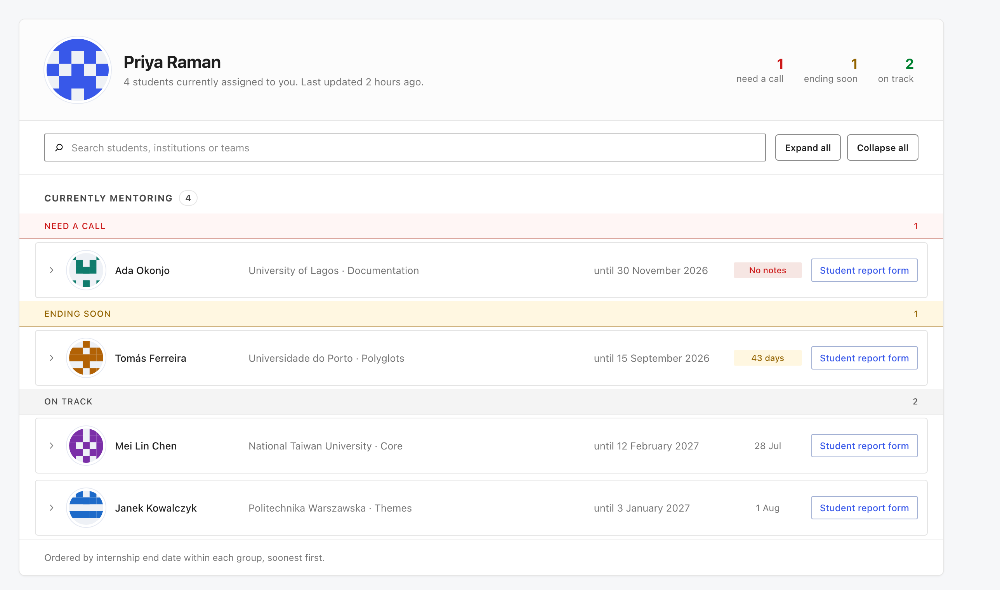

*The counts at the top are also filters - press one to see only that group. Names shown are examples.*

A card at the top of the page may invite you to set up a code for signing in, or tell you the
program asks for one: *Signing in*, at the start of this guide, covers it.

### Your students, triaged

Rather than one long list, your students are grouped by what needs your attention, and the counts
at the top double as filters:

- **Need a call** - no note for longer than the program's window, so nobody knows how they are
  getting on.
- **Ending soon** - the internship end date is close.
- **On track** - everybody else.

A student falls into the first group they match, so somebody who needs a call is never filed under
"ending soon" instead. Within each group they are ordered by internship end date, soonest first.

### Students waiting to graduate

A student who has finished the work and whose graduation is not recorded yet is marked **Pending
graduation** in their **Program** row when you open them, and on a phone or a narrow window by a
badge beside their name too. They are still your student. They stay in the main list and
are counted among the students currently assigned to you, and they are sorted into **Need a call**,
**Ending soon** or **On track** like everybody else, so one without a recent note still appears
under **Need a call**. You can still add notes, and they can still book calls with you. Their
record names the course they took when the site knows it, as it does for any other student; when
it does not, their **Program** row shows **Pending graduation** alone.

The status is not yours to change, and not the student's either. The program's Administrators move
it on by recording the graduation in the program records, and your page follows at the next sync.
Only then does the student move to **Past students**, where no new notes can be added. If a student
has plainly finished and still shows as pending, tell whoever runs the program.

### Finding and reading a student

**Search** matches students, institutions and teams, and tells you how many of your students match.
Opening a student shows their full record: program and track, internship duration, educational
institution, tutor, field of study, contribution teams, accessibility needs and their contact links.

Under **Program**, **Hours** shows the hours the student has logged: against their course's
target, as in "12 of 150", or the hours alone, as in "7.5 h", on a track with no target and for a
student whose **Program** row names no course, such as one who is paused or has finished. It says
"Not set" while nothing is logged. The row is there only when the student's track asks for hours
on its report form, so it never shows a gap nobody can fill.

Under the record, **Report form** opens the student's own report where it stands - their hours, grades,
project and posts - without leaving the page. It is read only; see *Their report form* below for
why. The first time you open one it is fetched, so it takes a moment: a page listing sixty students
does not read sixty reports nobody asked for.

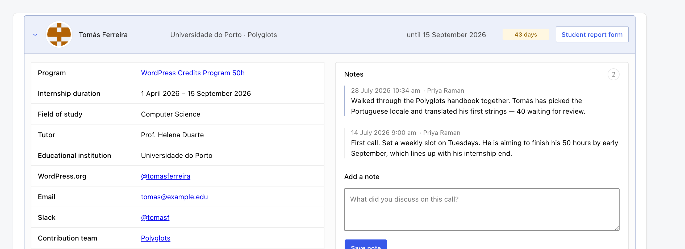

*Opening a student shows their record on the left and your notes on the right. Names shown are examples.*

**Expand all** and **Collapse all** work on the whole list. Two things worth knowing: some browsers
will not find text with Ctrl+F inside collapsed sections, so expand first if you are hunting for
something specific - and printing opens every student for you automatically, so a printed list is
always the complete one.

### Notes

Every student takes notes: what you discussed, what they are working on, what to follow up. **Add a
note** after each call - that is also what keeps them out of the "Need a call" group. You can delete
your own notes; notes written by somebody else stay theirs. Once a student's mentoring has finished,
their notes are kept as a record but no new ones can be added.

### Tools from our sponsors

When the program switches the section on for mentors, offers a sponsor opened to mentors appear on your card too, laid out as students see them: *Get my code* beside the offer's *More information* link, and your codes under *Your codes*, each with *Report a problem with this code* beside it. Offers for students only are not shown here.

### Resources

At the foot of the page: the mentors Slack channel, the Mentor guide in the handbook, and **Need
help?** - a question box answered from the WordPress documentation. Beside them, **Program updates
and announcements** carries anything recently posted for mentors.

## Setting your availability so students can book

This is the one thing worth doing today. Until you publish some hours, your students see "No
availability set, so you cannot book a call yet" and have no way to reach you except Slack.

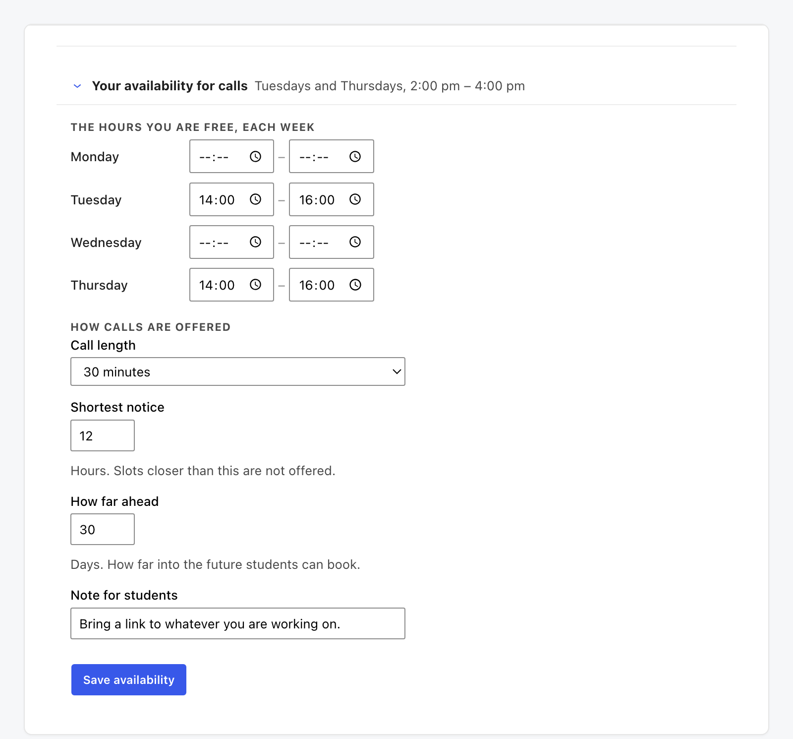

*Set the hours you are free each week, then how calls are offered.*

Open **Your availability for calls** on your Mentor Report Card and set:

- **The hours you are free, each week** - a start and end time per weekday. Leave a day blank to
  offer nothing on it. The slots are generated from these windows, so you are publishing hours, not
  individual appointments.
- **Call length** - how long one call runs, which decides how many slots a window holds.
- **Shortest notice** - hours. Slots closer than this are not offered, so nobody books you for
  twenty minutes from now.
- **How far ahead** - days. How far into the future students can book.
- **Bookings per student** - how many upcoming calls one student may hold at once.
- **Days off** - one date per line, as `2026-12-24`. Nothing is offered on those days, which is how
  you take a holiday without clearing your weekly hours.
- **Where we meet** - your meeting link, sent to the student with the booking.
- **Note for students** - shown above the slots on the booking calendar. A good place for "bring a
  link to whatever you are working on".

Press **Save availability** and the slots it opens are immediately bookable.

Everything is in your own timezone, and each student sees the same call in theirs.

## When a student books

You both get an email with a calendar invitation attached, so the call lands in your calendar rather
than only on the page. A reminder goes out 24 hours before, and either of you can cancel - which
puts the slot straight back on the calendar.

Booked calls appear under **Upcoming calls** beside your availability, so you can see what is coming
without leaving the page. Each one shows the time in your timezone and in theirs, and whatever the
student wrote when booking. A group session appears there too, as *Group session* with how many of
its places are taken, and its **Cancel** asks whether to cancel it for everybody on it.

## Group sessions

Sometimes the useful thing is one call with several students rather than five separate ones - a
walkthrough, a question hour, a session for everybody starting the same week.

**Plan a group session** under *Group sessions* on your Mentor Report Card. You choose:

- **Date and start time**, in your own timezone. Your students see it in theirs.
- **Length** in minutes.
- **Places** - how many students may join, between 2 and 50.
- **What it is about**. Your students read this beside the session, so it is how they decide
  whether it is for them.
- **Repeat**, for a regular series: every week, every two weeks, every four weeks or every month,
  and how many sessions in all, counting the first date, up to sixteen. Every month keeps the
  weekday and its place in the month, so a second Tuesday stays a second Tuesday. The rule fills
  the dates after the first one, and the **Sessions** box opens once you pick a rule.
- **More dates**, for the odd dates of a series: up to eight further dates with the same time,
  length, places and topic. Leave the ones you do not need empty.

A session is not carved out of your weekly hours; you pick any time, including one you would never
offer for private calls. It does **block that time from one-to-one booking**, for its whole length,
not only its start: no slot that overlaps it is offered, so nobody books you privately over a
session you are running. For the same reason a session cannot be planned or moved onto a time that
overlaps a call or another session of yours, though one may start as another ends.

Your students see it under *My mentor call* and can **join** while there are places left, and
**leave** again if something changes - which frees their place for somebody else. Joining does not
count towards the limit you set for how many upcoming calls one student may hold: that limit is for
one-to-one calls, and a session's places are its own.

Everybody who joins gets an email with a calendar invitation, and the reminder 24 hours before goes
to all of them. Move a session after its reminder has gone out and everybody on it is reminded again
before the new time. **Cancel the session** asks before it goes, and if you cancel it, every student
on it is told. An Administrator can change your session too; if they move it, you are emailed as
well, with an invitation that moves it in your calendar.

A series is planned all or nothing: a date that has passed, a date given twice, a date on which
something of yours overlaps that time, or a start time that does not exist on one of the dates
because the clocks jump over that hour refuses the whole list and names the date, so nothing is
created until the list is right. More than sixteen dates in all - a rule of sixteen with a box
beside it - is refused before any of them is read, since sixteen is all a series holds. Your
students see the series under one heading and can **Join all** in one press, which sends them one
email with one calendar file that holds every date; each date keeps its own row, so a student can
still join or leave a single one. Changing or canceling a session touches that session alone, and
the rest of the series stands.

### One note for the whole group

Under a session you have run, **Add a note for everybody on this session**. You write it once and it
appears on every attendee's card - and it counts for each of them, so nobody who was there is left
sitting in *Need a call*. Deleting it removes it from everyone. You can note everybody who was on
your session, a student who has since moved to another mentor included.

## Events from our sponsors

When a sponsor holds a webinar or another online event with the program and the program has approved
it, it is listed under *Group sessions* on your Mentor Report Card, as *Events from our sponsors*, in
your own time zone: the title and the sponsor's name, when it runs and for how long, how many places
are left and what it is about. **Join** takes a place and emails you a calendar invitation with the
link to the call; **Leave** asks first, then frees the place and emails you the calendar file that
takes the event out of your calendar. If the event is changed or canceled, you are told by email,
with a calendar file that brings your calendar up to date. Usually the day before the event, an
email reminds you of it, with the link to the call. The sponsor sees how many people joined, never
who. Your students see the same events on their Student Report Card. The program's own online events
are listed there too, each naming the WordPress Credits Program where a sponsor's names the sponsor,
and while one of them is listed the list is headed *Events from our sponsors and the program*.

## If something looks wrong

Student details come from the program records rather than being typed in here, so if a student's
dates, institution or contribution teams are wrong, that is where it has to be corrected. The page
catches up at the next sync.

A student who has left the program moves to **Past students**, a collapsed section at the foot of
the list. Their details and your notes are kept for reference; no new notes can be added.

If a student you are mentoring is missing from the list entirely, the link between you is missing in
the program records. That is one for the Administrators.

## What your students see

Your students have their own page - a Student Report Card - and it is worth knowing what is on it,
because most of what they ask you about is on it somewhere. You cannot open theirs (the gating is by
role, not by seniority), so here it is.

The section that matters most for you is the booking calendar: what a student sees there is entirely
decided by the availability you publish.

## Their report form

A student's *Report form* section holds the fields they fill in - hours, grades, what they
contributed, their reflection posts. You can read it on their card, but not type in it: the report is
the student's own account of their work, and a mentor filling it in would make the record say
something it does not mean. If something in it is wrong, that is a conversation rather than an edit.

An Administrator can edit it - but from the student's own card, not from yours. Opened from a
mentor's page a report is a record whoever is reading it, so an Administrator helping you with a student
sees exactly what you see.

## Their feedback forms

Under the report are three short forms asking the student how the program is going: at the start,
half way, and at the end. Two things about them are worth knowing.

They ask about your support by name - how much it is helping, what was most helpful, what could be
better - and **you do not see the answers**, on your page or anywhere else on this site. They are
read by the Administrators in aggregate. That is deliberate: a student who thinks their mentor is
reading over their shoulder writes something politer than the truth, and the answers stop being
worth collecting.

They are also not part of the report and are not marked, so a student who has answered none of them
is not behind on anything. Please do not chase them.

## What is on your Student Report Card

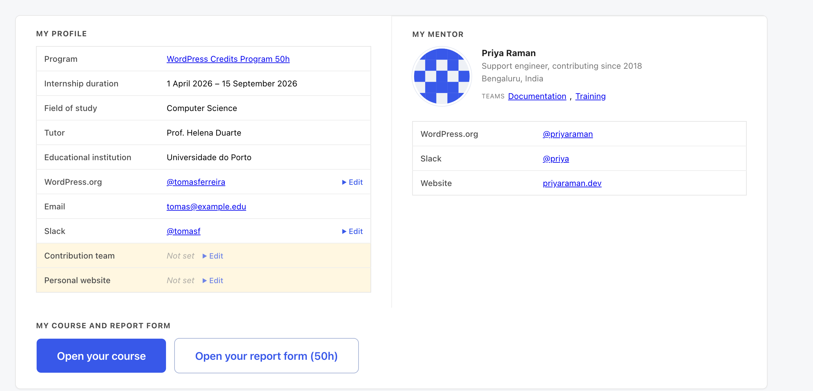

*Your details on the left, your mentor on the right, and the two buttons you came for underneath. Names shown are examples.*

A card at the top of the page may invite you to set up a code for signing in, or tell you the
program asks for one: *Signing in*, at the start of this guide, covers it.

### Arranging your Student Report Card

Below your profile and your mentor, the page is a stack of blocks: the program updates with the
resources, your course, your report form with the feedback forms, your mentor call, and the tools
our sponsors offer. Each block has two small arrows at its top right. Press one and the block moves
up or down at once, and the page remembers your order the next time you open it. The program updates
come first until you move them.

### My profile

Your program details as the program records hold them: your track, your internship dates, your
educational institution, your tutor and your field of study, followed by your WordPress.org profile,
your Slack name, your contribution teams and your personal website.

Nothing here is typed in on this table. The last four come from your **report form** below - fill
them in there and they appear here as soon as you save. The rest - your dates, your institution,
your tutor - come from the program records and cannot be changed from this site at all. If one of
them is wrong, see *If something looks wrong* below.

### My mentor

Who your mentor is and how to reach them: their WordPress.org profile, their Slack handle, their
website, and the contribution teams they work in. This is the person to ask first about anything
to do with your contributions.

### My course

**Open your course** takes you to your course on Learn WordPress - the syllabus for the track you
are on.

Beside it is **Hours contributed**: the running total of the hours you have put in. It is the one
number you will come back to change most often, so it sits here on its own rather than inside the
report form. Type the new total, press **Save hours**, and that is the whole errand.

If your track has no Learn course, or you are not on a track at the moment (paused, for example),
there is no course to open, and the hours box is a section of its own, **My hours**.

### When your graduation is pending

Once you have finished the work and your graduation has not been recorded yet, the program records
hold your status as **Pending graduation**. It is a waiting state, not an ending. You are still on
the program and still your mentor's student.

The status shows on the **Program** row of *My profile*: the row still names the course you took,
linked to Learn WordPress as before, with a **Pending graduation** badge beside it. Everything else
stays as it was while you were working through the course: your course and your hours, your report
form with your course's questions and the answers you saved, and the calendar for booking a call.

If this site has no record of the course you took, the Program row says **Pending graduation**
alone, with no link, your hours have a section of their own, *My hours*, and the report form asks
the 150-hour course's questions.

The status is not yours to change, and not your mentor's either. The program's Administrators move
it on by recording your graduation in the program records, and your card catches up at the next
sync. From then on your time on the program counts as finished, and calls can no longer be booked.
If your graduation looks overdue, ask your mentor, or whoever runs the program.

If your track has partners, you see **In partnership with** and their logos here or in **My
hours** - or, when neither section is on your card, under a heading of their own, **Partners of
your track**.

### Report form

Your report, filled in here on the page. It is the record of your work on the program, and it is
what your mentor reads. When a mentor or an Administrator opens your card, your report appears as
plain text rows rather than as a form, so nothing there can be edited by mistake.

Open **Your report form** and the questions are grouped in the order you meet them:

- **Onboarding** - your WordPress.org profile and Slack name, the final grade for each course
  module, and your personal website with the reflection post about building it.
- **Project** - your **contribution team**, what you contributed, the meetings and discussions you
  took part in, and the reflection posts for each stage.
- **Wrap-up** - your closing post.

What is asked depends on your track. The 150-hour course asks for the reflection posts and the
module grades; the 50-hour course asks instead for one final project report; the Developer Track
asks the 150-hour questions with seven more of its own; and the Designer Track follows its own
Learn course lesson by lesson - the course grades and your portfolio first, then the eight practical
lessons, each with its own notes and its own screenshots, then your contribution team and project,
then your reflection posts, the alumni program section with the meetings you took part in, the event
you attended and your closing post.

**Screenshots, on the Designer Track.** The practical lessons ask you to show your work, so those
questions take a picture instead of a link: a PNG, JPEG or WebP file of up to 4 MB, and twenty
uploads a day across all of them. The file is kept on this site and a copy is sent to the program
records, which is why the picture on your card is this site's copy and still there tomorrow.
Under each picture, choosing a new file **replaces** what is there, and **Remove** deletes it from
both places at once. Your mentor and the Administrators see your screenshots when they open your
Student Report Card, so treat one as part of your report rather than as a private note.

The grades are yours to copy across from wherever you were marked - this form records them, it does
not decide them. Fill in what you have and press **Save my report**; you can come back and add the
rest whenever. Everything goes straight into the program records, so your mentor sees it as soon as
you save, and the four fields that also appear in *My profile* above update there at the same time.

### Feedback forms

Under your report, and nothing to do with it: three short forms asking how the program is going for
you. See *Telling us how it is going* below.

### Tools from our sponsors

The program's sponsors offer their tools to current students: a year of hosting, a premium plugin, a course. When a sponsor switches an offer on, it appears here with the sponsor's logo, what you get and how to redeem it. Press *Get my code*, beside the offer's *More information* link, and your code appears below, under *Your codes*, yours to keep; where the sponsor gives one link for everyone, *Show me the code* puts it there. Once you have claimed an offer, its card shows only the offer and the day you claimed it. Everything you have claimed stays under *Your codes*, even after an offer ends.

Only you see your codes. Nobody is sent a code by mail, and sponsors see how many people claimed, never who. If a code does not work, press *Report a problem with this code* beside it: your program contact is told the offer and the last four characters and gets back to you. An Administrator looking at your card sees only how many tools you claimed.

### Resources

At the foot of the page: the WordPress Credits Slack channel, the Student guide in the handbook, and **Need
help?** - a question box answered from the WordPress documentation, if the program has switched it
on. Beside them, **Program updates and announcements** lists anything recently posted for you.

## Booking a call with your mentor

Your mentor publishes the hours they are free, and you pick from them. There is no email back and
forth about what suits.

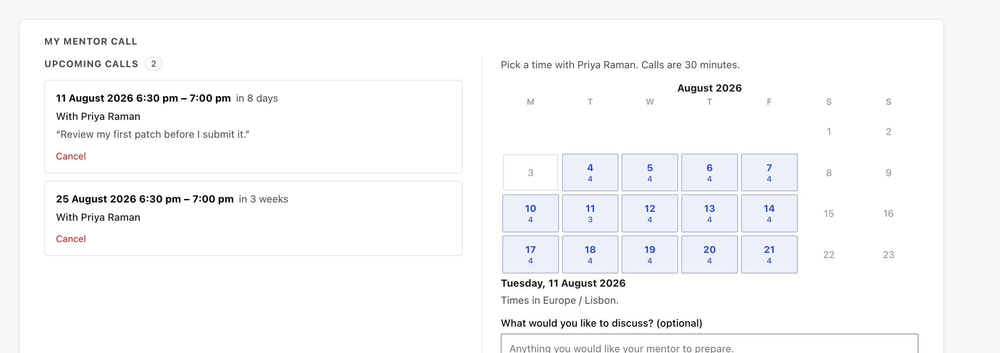

*Days with times available are highlighted. Pick a day, then a time.*

Days with something open carry a count. Press one and the times for that day appear underneath.
Booking is a single press, with an optional note about what you would like to discuss - worth
writing, because it is what lets your mentor prepare.

Both of you get an email with a calendar invitation attached, so the call lands in your calendar
rather than only on this page. A reminder goes out 24 hours before.

If something comes up you can cancel from the same section, and the slot goes straight back on
your mentor's calendar for somebody else.

A few things worth knowing:

- Slots closer than your mentor's shortest notice are not offered at all.
- Your mentor sets how far ahead you can book, so the calendar stops at some point in the future.
- There may be a limit on how many calls you can hold at once. Cancel one you no longer need and
  the next becomes bookable.
- Times are shown in your own timezone, and in your mentor's on their side. Neither of you has to
  do the arithmetic.

**If your mentor has published nothing yet**, the section says so. That is not a fault on your
side - ask them in Slack to set their hours.

## Group sessions

Your mentor may run a session for several students at once - a walkthrough, a question hour,
something for everybody who started the same week. Those appear under *My mentor call* in a list of
their own, *Group sessions with your mentor*, apart from the calls you book, with what the session
is about and how many places are left.

**Join this session** puts you on it, and you get an email with a calendar invitation the same as a
private call. If something changes, **Leave the session** asks first, then takes you off and frees
your place for somebody else. Once a session has started, its row says so instead of offering either
button, and its time reads how long ago it began; the row stays on your list for an hour so you can
still find the link.

A session does not count towards the number of upcoming calls you may hold at once: join every
session that has a place, and your one-to-one booking is unaffected.

Your mentor may plan a **series**: several sessions on several dates, with the same topic, length
and places. The list shows a series under one heading, each date as its own row. **Join all** puts
you on every date that still has a place and sends you one email with one calendar file that plans
them all; a date that is already full is skipped, and the message says so. You can still join or
leave a single date from its row.

If your mentor changes, a session of your former mentor's that you are on stays on your list, with
their name and **Leave the session**, and the list is headed simply *Group sessions*. Once the
program records show the change for you and for both mentors, you are taken off it and sent an email
whose calendar file takes it out of your calendar.

## Events from our sponsors

The program's sponsors may hold a webinar or another online event with the program. Once the program
has approved one, it appears under *My mentor call*, below your group sessions, in a list of its
own, *Events from our sponsors*, in your own time zone: the title and the sponsor's name, when it
runs and for how long, the places left - *Open to everyone* when there is no limit, *Full*, with no
**Join**, when every place is taken - and what it is about.

The program holds online events of its own too. They are listed in the same place, each naming the
WordPress Credits Program where a sponsor's event names the sponsor, and while one of them is listed
the list is headed *Events from our sponsors and the program*. You join and leave them in the same
way.

**Join** takes a place and sends you an email with a calendar invitation and the link to the call;
the event then says *You are on it.*, with a **Join the call** link. If something changes, **Leave**
asks first, then frees your place for somebody else and sends you the calendar file that takes the
event out of your calendar. You can join or leave until the event ends. If the sponsor or the
program changes the event or cancels it, you are told by email, with a calendar file that brings
your calendar up to date. Usually the day before the event, an email reminds you of it, with the
link to the call.

The list names each event's sponsor and nobody else: it does not show who has joined.
Administrators can see who is on an event; the sponsor sees how many people joined, never who. If a
sponsor stops offering events, an event of theirs that you are on stays on your list, marked
*No longer offered*, with **Leave** alone.

## Telling us how it is going

Under your report form are three short forms - **Getting started**, **Half way** and **Finishing
up** - one for each stage of the program. Each takes a couple of minutes.

**They open one at a time.** *Half way* appears once you have answered everything in *Getting
started*, and *Finishing up* once you have finished both. That is not a hoop to jump through: the
three forms ask the same three questions at three different points, and the answers are only worth
anything if they are given months apart rather than all on your last day.

They are feedback about the program, not part of your report. They are not marked, your institution
does not see them apart from the one exception below, and leaving them alone has no effect on your
place on the program or on your credits. That is the whole reason they are separate: they are only
useful if you say what you actually think.

**The exception is yours to grant, and nobody can grant it for you.** At the end of a term the
program drafts a semester report about the students your institution sent - how many took part,
which teams they contributed to, and what they published. An Administrator reviews and approves
it, and only then can your institution read it. Two questions on the *Finishing up* form, and
only those two, decide what of yours goes into it - whether your institution may list you (by name,
or by your blog address alone), and whether it may quote your feedback (with your name, or without
it). Nothing else you write in these forms is shown to your institution, and a quote you have not
released is not shown to them either: not as a draft, and not to ask. Answer *No*, or leave both
alone, and the report is built without you.

You can change your mind at any time. Reopen *Finishing up*, change the answer, and you drop out of
your institution's report the next time anyone opens it - including a report that was written weeks
ago and has already been printed once.

### What they ask

Three questions repeat word for word in all three forms - your overall experience, how confident you
feel contributing, and how much your mentor's support is helping. Answering the same three at each
stage is what lets the program see how the experience changes over time rather than only how it
ended.

The rest are about the stage you are at: how easy it was to get started, whether you feel part of the
WordPress community, whether the hours feel achievable, what you would change. A few questions only
appear when they apply - say the hours are hard to reach and a box opens asking why.

**Finishing up** ends with four optional permissions, in a box of their own: whether a quote about
your experience may be shared publicly, whether the program may contact you about WordPress events
and opportunities, and the two questions above about your institution's semester report. All four
are yours to decline, and declining changes nothing else. Only you can answer them - an
Administrator looking at your form sees them and cannot fill them in for you.

### Filling one in

Open the form for the stage you are at, answer what you want to answer, and press **Save my
answers**. Nothing is required - a form with two answers in it is worth more than one nobody filled
in.

You can change any answer later: open the form again and your answers are still there. The form's
title tells you how many of its questions you have answered, and says *all answered* when you have
finished it - which is also when the next one appears.

The count only ever includes the questions you are actually being asked. A follow-up that did not
apply to you is not a question you have left blank.

Your mentor does not see these answers on their page.

### Leaving the program

If you finish early or do not complete the program, the three forms above are replaced by a single
short one, **Leaving the program** - four questions about how far you got and what stopped you. It
is the part of the program we hear about least, and the part most worth hearing about.

## If something looks wrong

Your program details come from the program records, so if your dates, institution or tutor are not
right, that is where it has to be corrected - changing it here would be overwritten at the next
sync. Ask your mentor, or whoever runs the program.

Your WordPress.org profile, Slack name, contribution team and personal website are the exceptions.
Those four are asked for on your **report form**, and saving it writes them back to the records - so
they are yours to keep current, and the way to correct them is to correct them there.

If the page shows nothing at all, or says it cannot find your record, your account exists but is
not linked to a program record yet. That is one for the Administrators.
