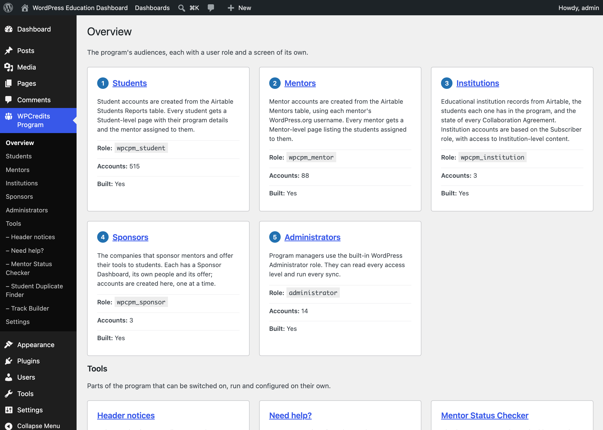
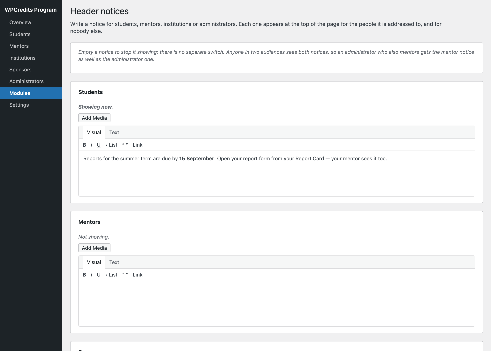
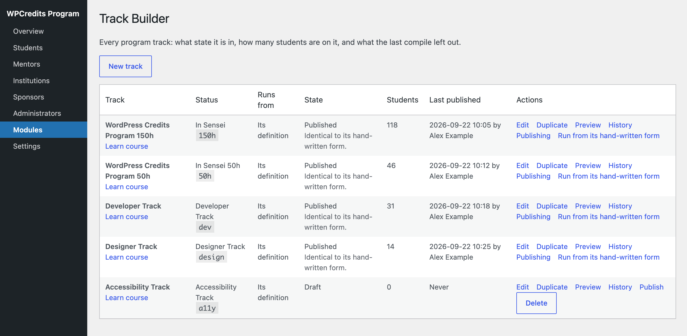
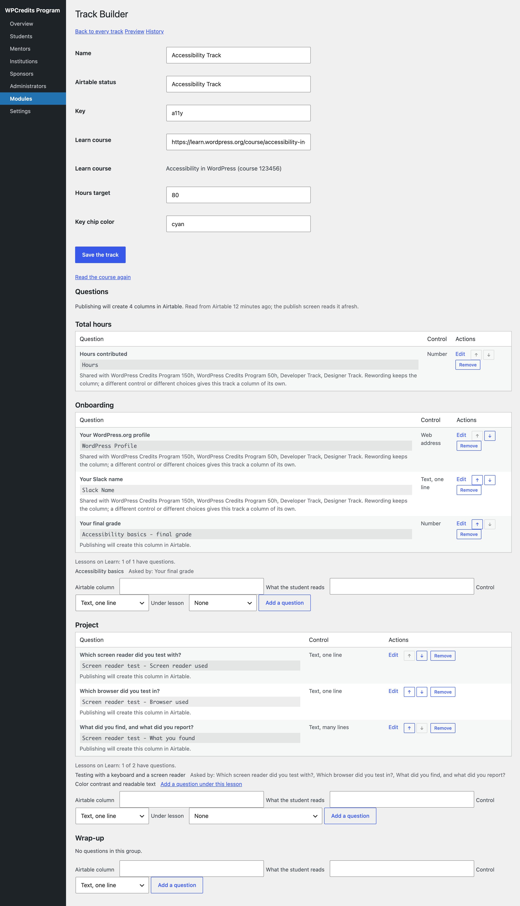
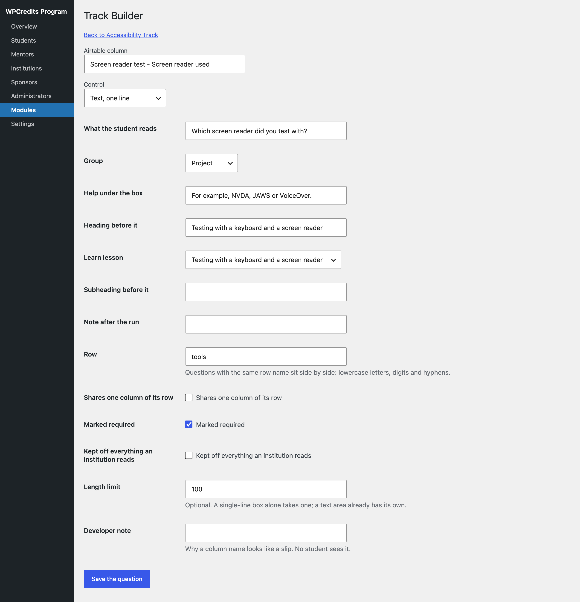
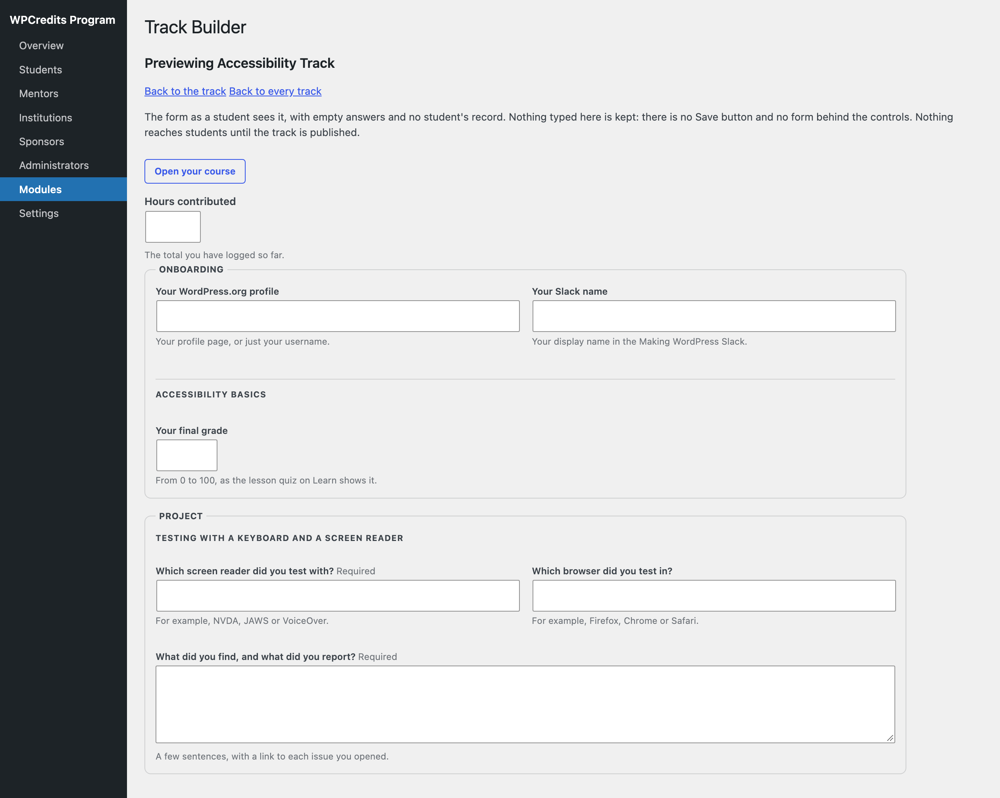
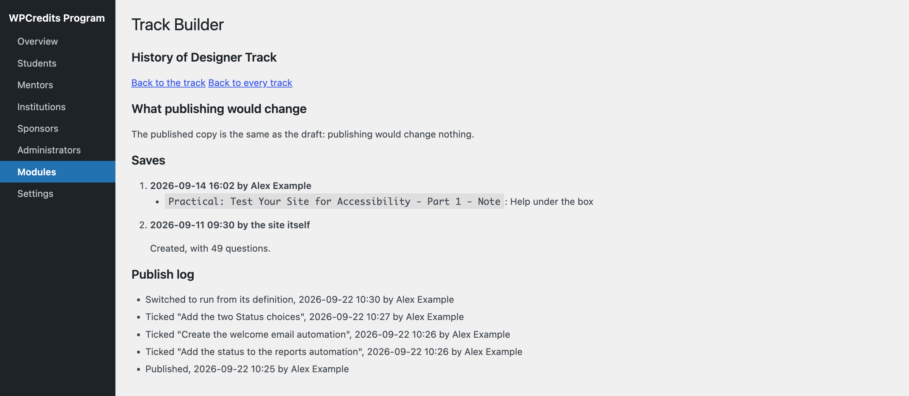
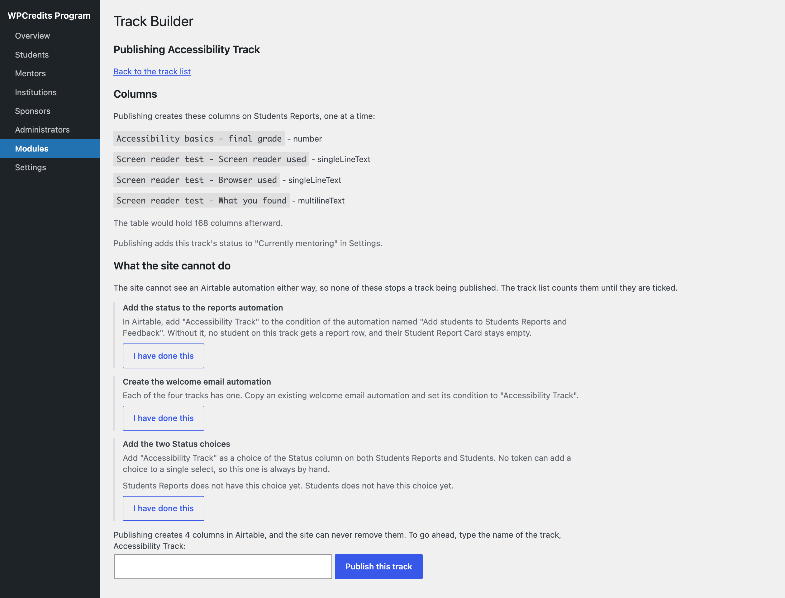
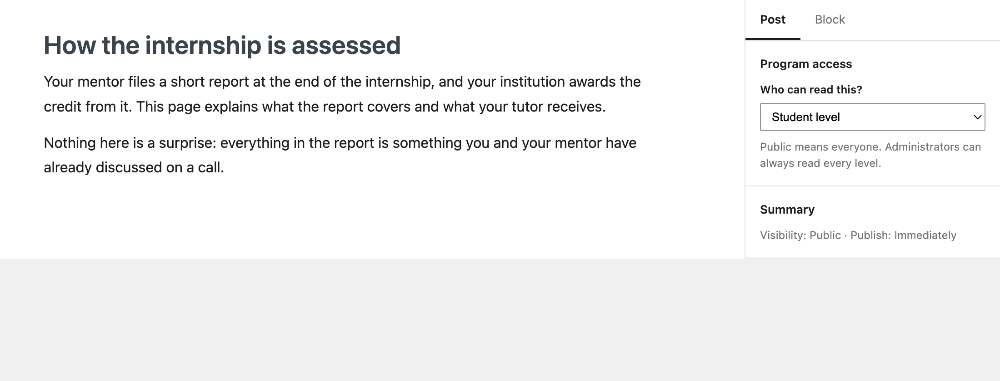

# Administrator guide

*What to do, step by step, for institutions, students, mentors and sponsors, and a reference for every screen and setting.*

This guide is for the program's Administrators. It starts with the jobs you do, each as numbered steps with the names you will see on the screen. Under them is a reference for every screen, setting and tool.

Use the search box, or the list of sections beside the guide, to find a job.

## Start here

Here you decide applications, agreements, schools' requests and sponsors' posts and offers. Sponsors are kept on the site.

Students, mentors and schools are kept in Airtable. The site sets a school's first stage on approval, *Confirmed* when you accept its agreement, and a new mentor's Status; every other stage or status, and a student's mentor, you change in Airtable. While **Automatic sync** is on, the site reads Airtable every three hours; you can also run a sync.

### The Administrator Dashboard at a glance

The page is created at `/administrator-dashboard/`. Its side menu, in order:

- **Overview**: what waits for you. Its red number counts the decisions, as *2 wait*.
- **Watch**: what to keep an eye on this week. Its amber number counts which of **Offers running low**, **Duplicated students**, **Syncs and health** and **Students gone quiet** have something to look at.
- **Cohort timeline**: the next twelve months' students, and whether mentors have places.
- **The program**: sponsors, programs running and mentors' use of the site.
- **Program updates**: the newest update for Administrators, while there is one.

Under **In wp-admin** are the screens **Students**, **Mentors**, **Institutions**, **Sponsors and offers**, **Tracks**, **Tools** and **Settings**. **Mentors** counts the mentor applications waiting.

Under **Help**: this **Administrator guide**, the **WordPress Credits handbook**, **#wpcredits on Slack**, and **Ask about the program** when it is on.

Each card that waits for a decision has a **How to do this** link, which opens that job in this guide.

Where to start:

| You want to | Go to |
|---|---|
| Decide the oldest thing that waits | **Overview**, **Review the oldest** |
| Decide a school's application, agreement or request | **Overview**, the row **Institution applications**, **Collaboration Agreements** or **Requests from institutions** |
| Review or draft a semester report | **Overview**, **Semester reports** |
| Decide a mentor application | **Overview**, **Mentor applications**, **Review**. It opens `Mentors > Waiting for review`. |
| Decide a sponsor's application, post, offer or agreement | **Overview**, the sponsor's row, such as **Sponsor applications** |
| Read new student registrations | `Students > Registrations` |
| Read a student's interest in a school not in the program | `Students > Interests` |
| See which students have gone quiet | **Watch**, **Students gone quiet**, shown while **Daily list** in `Settings > Students and mentors` is not *Off* |
| Check that the syncs ran | **Watch**, **Syncs and health** |
| Run a sync now | `Students > Sync`, `Mentors > Sync` or `Institutions > Sync and storage` |
| See whether there are enough mentors | **Cohort timeline** |
| Find a school | `Institutions > Pipeline`, **Find an institution** |

### Open someone's page as they see it

*When:* you want to see what someone else sees.

1. In the WordPress toolbar, point to **Dashboards**.
2. Choose **Institution Dashboard**, **Mentor Report Card**, **Student Report Card** or **Sponsor Dashboard**.
3. At the top of that page, find **Viewing as institution**, **Viewing as mentor**, **Viewing as student** or **Viewing as sponsor**.
4. Type part of the name in the field, then choose the name from the list.
5. Press **Show**.

**What happens next**

- The page is drawn as theirs, with extras for you, such as *Stage: Confirmed*.

**Good to know**

- Shorter ways in: a school's name on an **Overview** card such as **Collaboration Agreements**; **Open its page** on `Institutions > Pipeline`; a sponsor's name on `Sponsors > Sponsors`; **View page** on a row of the Students, Mentors or Sponsors **Accounts** tab.
- The control shows only when there are two names or more.
- If **Dashboards** is missing in the toolbar, the page may not be published, or the toolbar may be switched off in your profile.

### If you are stuck

- To find a job in this guide, use **Search the guide** (press `/` to reach it), or the list **On this page** beside the guide.
- To ask, use **Ask about the program** under **Help**, when it is there, or **#wpcredits on Slack**.
- If a screen refuses you, ask the Administrator who runs the site.

## Step by step: institutions

### From application to first students: the whole path

*When:* you want to know what comes next for a school, and who does it.

**Approve** is not a spam check. It creates the school's record and its first account, so press it only when the program has decided to take the school.

1. The school sends the application form on the site. Detail: [A school applied](#a-school-applied).
2. The school follows the link in its acknowledgement email to confirm its address. Detail: [The application's address is not confirmed](#the-application-s-address-is-not-confirmed).
3. You talk with the school. The acknowledgement email gives them a link to book a call with you, when you have a booking link.
4. You press **Approve**. The site creates the Airtable record and the account, and emails a password link. Detail: [A school applied](#a-school-applied).
5. The school sets its password, signs the Collaboration Agreement and uploads it. Detail: [A signed Collaboration Agreement arrived](#a-signed-collaboration-agreement-arrived).
6. You press **Accept it**. The site opens the school's account and sets Current Stage to Confirmed in Airtable.
7. The school, or you, enrolls students, if enrolling by list is on. Detail: [Enroll students for a school](#enroll-students-for-a-school).
8. After the semester the site drafts the semester report, if **Drafting** is on, and you approve it. Detail: [A semester report: draft, review, approve, reopen](#a-semester-report-draft-review-approve-reopen).

**Good to know**

- The booking link in step 3 is the **Booking link** on the assigned Administrator's own WordPress profile. With nobody assigned, it is the country contact's link as it stood when the school applied. With no link, the email leaves the call out.
- A school that came in through the old Airtable form skips steps 1 to 4. Detail: [A school came in through Airtable, not the site's form](#a-school-came-in-through-airtable-not-the-site-s-form).

### A school applied

*When:* the school is on `Administrator Dashboard > Overview`, card **Institution applications**. You may also get an email "{school} is assigned to you" or "New institution application from {school}".

1. Open `Administrator Dashboard > Overview` and find the school on the **Institution applications** card.
2. Press **Read the application** and read the answers.
3. To ask the applicant something, type it in the box above **Send this question** and press it. The question must be 10 to 2000 characters.
4. Once you have talked with the school and the program wants to take it, press **Approve** and confirm.
5. If the program will not take it, type the reason for the next Administrator, press **Reject** and confirm.
6. If it is not a real application, press **Reject as spam** and confirm.

**What happens next**

- **Approve** creates the school in Airtable, at the stage set in **Institution starting stage** (*First Contact Made* unless changed), with Agreement Status *Not started*. If Airtable already holds the school by name or contact address, that record is used instead. It keeps its own stage and Agreement Status.
- It also makes the school's first account from the contact's address, and queues the email "Your institution account is ready". It tells them to set a password and then do the Collaboration Agreement.
- **Send this question** emails your words as written, with your address to reply to. The state becomes *waiting on the applicant*, and **Put back in the queue** appears on the application: it puts the application back in the queue as a new one.
- **Reject** sends the applicant "About your application to the WordPress Credits Program", with no reason in it. Your reason stays on the site.
- **Reject as spam** sends nothing at all.

**Good to know**

- The site does not check that a call took place. Talking first is the program's rule.
- **Approve** is refused until the applicant has confirmed the address. See [The application's address is not confirmed](#the-application-s-address-is-not-confirmed).
- **Approve** is also refused when the applicant's address already has an account on the site: "Nothing was created. An account on this site already holds that address." Look at that account first.
- The Airtable record that **Approve** creates cannot be removed from the site.

### The application's address is not confirmed

*When:* the application shows **Send the confirmation link again**, or **Approve** says "Nothing was created. The address on that application has not been confirmed...".

1. Find the application on the **Institution applications** card.
2. Press **Send the confirmation link again** and confirm.
3. Tell the applicant, by your own email or call, to follow the link in that email.
4. Press the school's name on the card. It opens the application on `WPCredits Program > Institutions`, where you look for "The applicant confirmed their address on {date}." On the card, **Send the confirmation link again** is then gone.
5. Press **Approve**.

**What happens next**

- The applicant gets the acknowledgement again, with the same link. The screen says "The confirmation link was sent again."
- Confirming sends nobody an email. You see it only on the application, where **Send the confirmation link again** is gone.

**Good to know**

- Only the applicant can confirm the address. No Administrator can do it for them.
- The site sends at most 200 acknowledgements a day, and a resend counts. Past that, try again the next day.
- An application marked as spam that was never acknowledged gets the acknowledgement once when you press **Put back in the queue**.

### Finish an approval that stopped halfway

*When:* **Approve** said "Nothing was finished", or the application says "Approving this application stopped partway..." or carries the mark *approval stopped partway*.

1. Find the application on the **Institution applications** card.
2. Press **Approve** again and confirm.
3. Read the message at the top of the page.

**What happens next**

- The steps that already worked are kept. A second press does only the rest.
- On success the screen says "The application is approved..." and the invitation is queued.

**Good to know**

- While the application says the approval stopped partway, **Reject**, **Reject as spam** and **Put back in the queue** are refused until it is finished. If nothing was created before it stopped, the application shows no such line and those buttons still work.
- "The account for that address already acts for a different institution" means pressing again cannot help. Decide who the account belongs to first, and remove it from the other school if this application is the right one.
- "An account on this site already holds that address" means somebody already has an account with it. Find out whose before you try again.

### A school came in through Airtable, not the site's form

*When:* the school applied through the old Airtable form. It is on `WPCredits Program > Institutions`, tab **Pipeline**, and while its Current Stage is empty it is under **Not counted above**, in *No stage*. It is not on **Institution applications**.

1. In Airtable, set the school's Current Stage to a stage listed in **Institution pipeline stages** on `Settings > Advanced`.
2. Open `WPCredits Program > Institutions`, tab **Sync and storage**, and press **Sync institutions now**. The sync also runs by itself every three hours.
3. Open the **Pipeline** tab, find the school under its stage, and press its name. Its Institution Dashboard opens.
4. Read **Assigned Administrator** on its details card. If it says *Nobody yet*, see [Assign a school to another Administrator, or to nobody](#assign-a-school-to-another-administrator-or-to-nobody).
5. Give the school its first account. See [Give a school its first account](#give-a-school-its-first-account).
6. Then the agreement: the school uploads it, or you upload it for them, or you record one on file. See [A signed Collaboration Agreement arrived](#a-signed-collaboration-agreement-arrived) and [Record an agreement the program already holds](#record-an-agreement-the-program-already-holds).

**What happens next**

- Unless **Create accounts automatically** is on and the school is *Confirmed* with its agreement recorded, the site sends the school nothing until you add its account.
- If the record names a country in an Administrator's area, the sync may already have assigned it to them and emailed them.

**Good to know**

- Such a school has no address check and no **Approve** step.
- At a stage outside the active ones, each sync takes away its agreement record. With the default setting it also removes the school's accounts from it. A school with no stage at all is left alone, and so are its people.
- What Airtable's own form sends the school is not part of the site.

### Give a school its first account

*When:* a school has no account on the site. Its **Representatives and tutors** card says "Nobody can act for this institution on this site...". An approved school already has one.

1. Open the school's Institution Dashboard. See [Open a school's Institution Dashboard](#open-a-school-s-institution-dashboard).
2. In **Representatives and tutors**, press **Add or re-add an account on the Institutions screen**.
3. Under **Add an account**, type the person's **Name** and **Email address**.
4. Press **Add account**.

**What happens next**

- The site makes the account and joins it to the school. The screen says "The account was added and an invitation is queued."
- The person gets "Your institution account is ready". Before the agreement is settled it tells them to do the agreement. After, it says the account is open.

**Good to know**

- An address that already has an account is refused, unless it is a former member of this school or a mentor's account.
- For a school at *Confirmed* with its agreement settled, `Institutions > Accounts`, view **No account**, shows **Create account** on its row. It uses Airtable's Contact Email. A row that is not *Ready* says why, for example when the school has had a member before or the address already has an account.
- A school with no stage is left alone, but give it an active stage in Airtable first: at a stage outside the active ones, or once Airtable no longer has it, the next sync takes the account off the school. See [A school came in through Airtable, not the site's form](#a-school-came-in-through-airtable-not-the-site-s-form).

### A signed Collaboration Agreement arrived

*When:* `Administrator Dashboard > Overview`, card **Collaboration Agreements**, shows the school under **Awaiting review**. The people in **Who is emailed about institutions**, or every Administrator, get "Signed agreement from {school} is waiting for review".

1. Open the **Collaboration Agreements** card and find the school under **Awaiting review**.
2. Press **Download the signed agreement** and open the file in your own PDF viewer.
3. Check it against the list under "Review the signed agreement from {school}".
4. If it is right, press **Accept it** and confirm.
5. If something must change, write it in the box (20 to 2000 characters) and press **Return it with this note**.

**What happens next**

- **Accept it** sets Agreement Status to Accepted in Airtable, and Current Stage to Confirmed when the stage was earlier. The school's account opens.
- Everybody at the school gets "Your agreement is accepted".
- **Return it with this note** emails your note to everybody at the school as you wrote it, with your address to reply to. Subject: "Your signed agreement needs a change". The school uploads a new copy.

**Good to know**

- **Accept it** is refused while Airtable's Current Stage is *Not Moving Forward*, *SPAM* or *Revisit Later*. Change the stage in Airtable first.
- A signed copy that came by email: open the school's Institution Dashboard, press **Add or re-add an account on the Institutions screen**, and use **Upload a signed agreement on the institution's behalf**. It lands under **Awaiting review** like the school's own.
- An agreement is marked *Overdue* after the days set in **Agreement review** (3 unless changed).

### Record an agreement the program already holds

*When:* the school signed before the site existed, and the program holds the signed copy. `Institutions > Agreements`, card **Agreements on file**, lists the *Confirmed* schools with no agreement recorded.

1. Open `WPCredits Program > Institutions`, tab **Agreements**, and press the school's name under **Agreements on file**. Its Institution Dashboard opens at the agreement.
2. Under **Record an agreement the program already holds**, paste the link in **Drive link to the folder or the file (required)**.
3. Fill in **Date signed (optional)** and **Where it is, in one line (optional)** if you know them.
4. Press **Record it** and confirm.

**What happens next**

- Agreement Status is set to *On file* in Airtable, and the school's account opens. The screen says "The agreement is recorded as on file. The institution's account is open."
- Current Stage in Airtable is not changed.

**Good to know**

- The link must be an https address on drive.google.com or docs.google.com.
- The form is there only while the school's agreement is not settled. It refuses a school that already has an accepted agreement.
- You can record one for any school this way, from its Institution Dashboard, not only those on the list.

### Take an agreement out of force, or put it back

*When:* a partnership ends or is paused, or an agreement was revoked by mistake.

1. To revoke: open `WPCredits Program > Institutions`, tab **Agreements**, card **Agreements in force**.
2. Under the school, open **Revoke this agreement**.
3. Write the reason in **Why it is revoked, in your own words** (20 to 2000 characters).
4. Press **Revoke this agreement** and confirm.
5. To put one back: open `WPCredits Program > Institutions`, tab **Agreements**, card **Revoked agreements**. It lists each school whose agreement was revoked, with the day and your note.
6. Press **Reinstate** next to the school and confirm.

**What happens next**

- Revoke: the school's people keep their accounts but see only the Collaboration Agreement card. Waiting invitations are canceled. Everybody there gets your note in "Your agreement has been revoked".
- Reinstate asks "Reinstate the agreement with {school}? It is back in force at once, and everybody at the institution is emailed." Once you confirm, the account opens again, and everybody at the school gets "Your agreement is in force again". You land back on the **Agreements** tab.

**Good to know**

- Revoking does not change Current Stage in Airtable. If the partnership has ended, change the stage there.
- **Reinstate** is refused when an accepted agreement already stands for the school. It works only on the school's most recently revoked agreement.
- **Revoked agreements** lists a school at any time while it has a revoked agreement and nothing accepted or waiting for review, also one that has since started a new agreement or had one returned. The Administrator Dashboard's **Collaboration Agreements** card also offers **Reinstate** while a signed agreement waits for review.
- A school at a stage outside the active ones is listed without **Reinstate**: reinstated, the next institutions sync would close it again. In its place the row says "At the stage "{stage}", which is outside the pipeline. Move it to an active stage in Airtable first: reinstated now, the next institutions sync would close it again." A school with no stage keeps the button.

### Assign a school to another Administrator, or to nobody

*When:* someone else should follow a school up, or it has *Nobody yet*.

1. Open the school's Institution Dashboard.
2. On the details card, find **Assigned Administrator**.
3. Open **Change who follows it up**.
4. In **Administrator**, type part of the name and pick the person, or pick **Nobody**.
5. Press **Save**.

**What happens next**

- The new Administrator gets "{school} is assigned to you", unless they made the change themselves. The screen says "The assigned Administrator is saved, and they have been emailed."
- The school sees that person under **Your contact at the program**, with **Book a call** when they have a booking link.

**Good to know**

- **Nobody** is a choice that stays. Approval and the sync never replace it.
- Only accounts that can manage the program are in the list. A person who loses that shows as "{name} (not an Administrator now)".
- New schools are assigned by country. The countries are set in **Areas of responsibility** on `Settings > Institutions`.

### A school asks to correct its details

*When:* `Administrator Dashboard > Overview`, card **Requests from institutions**, shows "{school} asks to correct its details". The people in **Who is emailed about institutions**, or every Administrator, are emailed.

1. Open the **Requests from institutions** card and find the request.
2. Read the table: **Detail**, **On record now** and **Asked for**.
3. To make the change, press **Approve and update the records**.
4. To refuse, write a note in **A note for the school (required to decline)** (20 to 2000 characters) and press **Decline**.

**What happens next**

- **Approve and update the records** writes Airtable first, then the site. The person who asked is emailed "Your institution's details are updated".
- **Decline**: the person who asked is emailed your note, and every account at the school reads it on the details card.

**Good to know**

- The request covers the school's name and address part: **Name**, **Website**, **City**, **Country** and **Contact's email**. The school saves its other details itself.
- If Airtable cannot be written, nothing changes and the request stays open.
- A request is marked *Overdue* after 14 days.

### A school's other requests (a student to add, a mentor wanted)

*When:* the **Requests from institutions** card shows *A student to add* or *A mentor is wanted*. A school's enrollment raises *A student to add* for each student it creates. For a request that says "{school} asks to correct its details", see [A school asks to correct its details](#a-school-asks-to-correct-its-details).

1. Open the **Requests from institutions** card and find the request.
2. Read "The student is {name}. Raised by {who}."
3. Do the work in Airtable, such as assigning the student a mentor.
4. If you like, write what you did in the note box. It is for the log and is not sent to the school.
5. Press **Mark as handled**, or **Decline**.

**What happens next**

- The request closes and moves to **Recently closed**, as *Handled* or *Declined*.
- The school is not emailed.

**Good to know**

- A mentor assigned in Airtable reaches the site at the next students sync.
- Closing the row does nothing in Airtable. It only says the request is dealt with.

### Open a school's Institution Dashboard

*When:* you need to act for a school, or see what it sees.

1. In the WordPress toolbar, point to **Dashboards** and choose **Institution Dashboard**.
2. In **Viewing as institution**, type part of the school's name and pick it.
3. Press **Show**.

**What happens next**

- You see the school's whole page, even before its agreement is settled. A banner then says "This institution's agreement is not settled: {state}. Members see only the Collaboration Agreement card."
- A section **For Administrators** holds the school's **History**: what was done, when and by whom.

**Good to know**

- Other ways in: a school's name on the **Pipeline** tab, **Find an institution** with **Open its page** on the same tab, or a school's name on an Administrator Dashboard card. On the **Institution applications** card, a name opens the application on the Institutions screen instead.

### Correct a school's details yourself, and set the tracks it offers

*When:* a school's details are wrong, or it offers a new track.

1. Open the school's Institution Dashboard and find the details card.
2. Under **Contact and agreement** or **Name and address**, open **Correct these**.
3. Change the details and press **Save the details**.
4. For tracks: under **Tracks**, open **Change the tracks**.
5. Tick the tracks the school offers and press **Save tracks**.

**What happens next**

- Your changes are saved at once. Nobody approves them.
- The tracks screen says "The tracks offered are saved." Students are asked which track they want when two or more are ticked.

**Good to know**

- While a request from the school waits, **Name and address** cannot be changed here. Decide the request first. See [A school asks to correct its details](#a-school-asks-to-correct-its-details).
- The school cannot change its tracks. It is told to write to the program.
- Changes to **Name and address** are written to Airtable. If Airtable cannot take them, nothing is saved and the card says so.

### Invite a representative or a tutor for a school, and keep its tutor list

*When:* a school asks you to add a colleague, or its tutor list needs a name.

1. Open the school's Institution Dashboard and find **Representatives and tutors**.
2. Under **Invite a colleague**, type the address in **Their email address**.
3. Under **Level**, choose **Representative** or **Tutor**.
4. Press **Send invitation**.
5. For the tutor list: under **Tutors**, in **Add a tutor**, type the **Name** and **Email**, then press **Add**.
6. To take a tutor off the list, press **Remove** beside them.

**What happens next**

- The person gets "An invitation to {school}". Its link is good for 14 days.
- The invitation cannot be accepted until the school's agreement is settled.
- A tutor on the list appears in the **Tutor** box when students are enrolled.

**Good to know**

- A Tutor sees the students, their Student Report Cards and the semester reports, and changes nothing.
- A school can have up to 10 invitations waiting. Each person can send 5 a day for one school.
- A listed tutor needs no account. Removing a tutor from the list keeps their account.

### Enroll students for a school

*When:* a school sends you its students. **Enrollment lists from institutions** ("Let an institution send a list of students to enroll") must be on in `Settings > Institutions`. It is off unless changed.

1. Open the school's Institution Dashboard and find **Enroll students**.
2. Choose the **Program** and the **Start date**, and the end date if you know it.
3. Tick the box that says the students have been notified.
4. Fill in **One student**, or give **Or a list** as a CSV file or pasted text.
5. Press **Check the list** and read what it says for each row.
6. Press **Create these student records**, or **Throw this list away**.

**What happens next**

- The student records are created. Nobody is emailed now.
- Each created student raises *A student to add* on the **Requests from institutions** card.
- A long list is created in parts. The page shows how many are done, and **Continue** carries on at once. It also carries on by itself.

**Good to know**

- Enrolling stops while the school's agreement is not settled, whoever presses.
- Do not send these students to the registration form. It would create a second record.
- The **Tutor** box lists the school's tutor list and can stay *Not recorded*. Add tutors first only if you want one chosen.

### A semester report: draft, review, approve, reopen

*When:* `Administrator Dashboard > Overview`, card **Semester reports**, lists drafts under **To review** or semesters under **Due for drafting**.

1. For a semester under **Due for drafting**, press **Draft now**.
2. For any other semester: open `Institutions > Semester reports`, under **Draft any semester** pick the **Institution** and the semester, and press **Draft now**.
3. Under **To review**, press **Review** on the draft. It opens on the school's Institution Dashboard.
4. Write what you want in the sections and press **Save the report**.
5. Press **Approve this report**.
6. To change an approved report, press **Reopen for editing**.

**What happens next**

- A new draft says "The draft is ready for review." The school cannot see it.
- **Approve this report**: the school can read and download it, and its accounts are emailed. With no account the screen says "send the PDF by hand".
- **Reopen for editing** makes it a draft again, and the school no longer sees it.

**Good to know**

- While **Drafting** is on in Settings, the site also drafts reports by itself after a semester has ended.
- The school sees only approved reports.
- **Draft now** opens the new draft at once. If the semester already has a report, it opens that one. It is refused when the school has no students in that semester, and after 20 drafts by one Administrator in a day.

### Find an application or agreement past the fifty the dashboard lists

*When:* the **Institution applications** card says "N more are waiting; they are listed here as these are decided." The steps are for applications: agreements have no such line.

1. Decide the oldest applications. The next ones move onto the card as you do.
2. To decide a newer one now, open the link in the email about it. It opens the application on the Institutions screen.
3. Read "The Administrator Dashboard's card lists the 50 oldest open applications, and this one is past them, so it is decided here."
4. Use the same buttons as on the card: **Approve**, **Send this question**, **Reject** or **Reject as spam**.

**What happens next**

- Each press comes back to the Institutions screen with the result above the tabs.

**Good to know**

- The **Waiting for review** tab also lists only the 50 oldest items.
- **Awaiting review** on the **Collaboration Agreements** card lists up to 200 agreements, and the **Requests from institutions** card up to 200 requests. Neither says when more wait. The folds of returned and revoked agreements list 50 each.

## Step by step: students

### From first interest to graduation: the whole path

*When:* you want to know where a student is and who acts next. Part of the path is on the site and part is in Airtable.

1. The student, if their school is not in the program, sends the student interest form: see *A student is interested in a school that is not in the program*.
2. The student fills in the **Student registration** form, or the school enrolls them from its Institution Dashboard: the site writes one row to Airtable's Students table and creates no account. See *A student registered*.
3. You read the registration on `WPCredits Program > Students`, tab **Registrations**: see *A student registered*.
4. You, in Airtable, set the **Status** (the track) and the **Mentor** on the student's row in the Students table; an Airtable automation then creates the student's Students Reports and Feedback rows, and the next mentors sync emails the mentor about the student. A student the school enrolled already has a Status, so set only the Mentor.
5. The site's students sync, every three hours while automatic sync is on or when you press **Sync students now**, creates the account from that Students Reports row: see *A student the sync skipped, and a held invitation*.
6. You send the invitation: see *Invite a student, or several*.
7. The student sets a password and works on their Student Report Card, and you follow them: see *Open a student's Student Report Card* and *Students who have gone quiet*.
8. You, in Airtable, change the **Status** when the student finishes, for example to `Graduate`; a graduate keeps the Student role and the Student Report Card, whatever the setting. The sync does not give the role back to a graduate who had already lost it.

### A student registered

*When:* a student sent the **Student registration** form. You are not emailed; the registration waits on `WPCredits Program > Students`, tab **Registrations**.

1. Open `WPCredits Program > Students` and choose the **Registrations** tab.
2. Read the line under the student's name. **Written to Airtable** means the row is in Airtable's Students table.
3. Open **Answers and consent** to read the answers, among them the track the student asked for, when the form asked for one.
4. In Airtable, on the student's row in the Students table, set **Status** to the track and choose the **Mentor**. At the next mentors sync the mentor is emailed about the student (**Student assigned, to the mentor**). To move the student to another mentor later, change the **Mentor** on their Students Reports row: the site reads it from there. Once both mentors' lists show the change, the next sync cancels the student's upcoming one-to-one calls with the former mentor and emails both of them. The new mentor is emailed about the student at the next mentors sync, and the former mentor is not emailed about the student.
5. Wait for the next students sync, or open the **Sync** tab and press **Sync students now**.
6. Open the **Accounts** tab, find the student and press **Send invite** under their name.

**What happens next**

- The student was emailed "Registration received - WordPress Credits Program", which says someone will be in touch by email with the next steps, including their mentor and their course.
- Once Airtable has the student's Students Reports row, the sync creates the account with the Student role and a random password. With **Invitation emails** on, it also queues the invitation; with it off, the student is sent nothing. The mentor's email has its own switch, **Students assigned to a mentor**.
- The invitation is "Welcome to the WordPress Credits Program", with a link to set a password.

**Good to know**

- **Already has an account** and **Already registered** need nothing from you: the student was emailed a sign-in link or told they are registered already, and no row was written.
- **Could not be written**, and **Waiting to be written** with "Held for an Administrator", have a **Write it now** button that tries again at once. **Spam** has **Put back** and **Delete for good**.
- With **Invitation emails** on, the sync has already queued the invitation, so skip step 6. The site never changes the Students row after it writes it: correct it in Airtable. The form itself must be switched on, and it stays closed while Airtable is not connected, no school is at a ticked stage or the languages are not read yet: see Step by step: running the site.

### A student is interested in a school that is not in the program

*When:* a student sent the student interest form. It waits on `WPCredits Program > Students`, tab **Interests**.

1. Open `WPCredits Program > Students` and choose the **Interests** tab. It opens on the **New** view.
2. Read the interest: **Institution**, **Department**, **Representative**, **Internships or practices** and **Anything else**.
3. Write to the representative yourself, from the address on the row.
4. Press **Mark contacted**.
5. When there is nothing more to do, press **Close**.

**What happens next**

- The student was emailed "We received your interest - WordPress Credits Program". The representative is sent nothing by the site.
- Nothing is written to Airtable, and no account, row or institution is made.
- A closed interest is deleted 365 days after it was closed.

**Good to know**

- **Held** holds an interest one of the form's checks flagged. Read the reason on the row, then press **Mark contacted**, **Close** or **Mark as spam**.
- **Put back to New** works on a held, a spam or a closed interest, and emails nobody.
- A new interest is emailed to the people in **Who hears of a new interest**, or to every Administrator when nobody is set there. Nobody in the program is emailed about one held for review or filed as spam.

### Invite a student, or several

*When:* the sync created accounts that were never invited, or a student lost their invitation. Work on `WPCredits Program > Students`, tab **Accounts**.

1. Open `WPCredits Program > Students`, tab **Accounts**.
2. For one student: find them with **Search students**, then press **Send invite** under their name (**Resend invite** if they were invited before).
3. For several: tick them, choose **Send invite** or **Resend invite** under **Bulk actions**, then press **Apply**.
4. For everyone at one school who was never invited: choose the school in **All institutions**, then press **Filter**.
5. In the **Invitations** card, press the button that counts them, such as *Invite 12 students at Example University who have never been invited*, and confirm.

**What happens next**

- Each student is emailed "Welcome to the WordPress Credits Program". Its password link stops working after a day.
- A bulk send goes out 10 at a time in the background. The **Invitations** card shows the count, and its button *Stop and cancel the remaining 30* stops the rest.

**Good to know**

- Nobody is sent a second invitation within fifteen minutes of the last one. Ask the student to use their newest email.
- Each new invitation replaces the link in the one before it.
- With **Invitation emails** switched on, the sync invites each account as it creates it: the switch is **Invitation emails**, `Settings`, tab **Students and mentors**, section **Accounts**, off by default.

### A student the sync skipped, and a held invitation

*When:* a student is in Airtable but has no account, or the **Invitations** card says some students are left out.

1. Open `WPCredits Program > Students`, tab **Sync**.
2. Read the **Last sync report**, and its **Warnings** under it.
3. For "Airtable has no valid email address", correct the address in Airtable, then press **Sync students now**.
4. For "That is a conflict and not a match", read which account holds the address: a mentor's account, an institution's account, or another role. The site has no control that settles it.
5. For a held invitation, make sure the account belongs to the student, then press **Send invite** on that account's own row.

**What happens next**

- An account in conflict is left as it is, and the same warning comes back at each sync until the conflict is settled.
- **Send invite** on the account's row, on the Students screen or the Mentors screen, sends the invitation at once and lifts the hold.
- The email is the mentor's invitation, "Your mentor account is ready", because the account is also a mentor's.

**Good to know**

- Students have no **Needs confirming** list. The sync finds a student's account by the record it stored, then by email address, never by username.
- A held invitation belongs to a student who also mentors and was made a mentor from an application. A notice may say to send it on the Mentors screen; the same account's row on the Students screen sends it too. See Step by step: mentors, *A held invitation, and an Airtable row that was refused*.
- A sync that stopped with **Run anyway** is covered in Step by step: running the site.

### Find a student

*When:* you need one student's account, or all students at one school or on one track.

1. Open `WPCredits Program > Students`, tab **Accounts**.
2. Type a name, username, email address, institution or record ID, and press **Search students**.
3. Or choose a school in **All institutions** and a status in **All statuses**, then press **Filter**.
4. Or press a chip under **Students by status:** to list the students with that status.
5. Press **Show all students**, shown while a school or status is chosen, to clear the choices.

**What happens next**

- The list shows **Student**, **Username**, **Status**, **Institution** and **Mentor**.
- **Status** is in plain words: a track by its name, *Graduated*, *Not continuing*, *Did not complete*, *Getting started*, any other status as it is, or a hyphen when there is none.

**Good to know**

- A student who is in Airtable but has no account yet is not on this list. See *A student the sync skipped, and a held invitation*.
- On any Student Report Card you can also type a name in **Viewing as student** and press **Show**.

### Open a student's Student Report Card, and what you can change there

*When:* you want to see what a student sees, or act for them.

1. Open `WPCredits Program > Students`, tab **Accounts**, and find the student.
2. Press **View page** under their name.
3. To switch to another student, type a name in **Viewing as student**, pick it, and press **Show**.

You can change:

- The report form, with **Save my report**, and the hours, with **Save hours**. Both are saved to Airtable.
- The feedback forms, with **Save my answers**, except **Permissions**: only the student can answer those.
- Calls: book one in **My mentor call**, which says "Booking on behalf of" the student, or press **Cancel** on a booked one-to-one call.
- **Take them off the session** on a group session they joined. This takes off the student alone; the session goes on.
- **Mark as done** on the last three items of **Your first weeks**, and **We've already talked** on a quiet student's note.
- The order of the modules, with their arrows. The order is kept as the student's own.

**Good to know**

- **My profile** has no editor. Dates, institution, tutor, field of study and status come from Airtable and are corrected there.
- **WordPress.org**, **Slack**, **Contribution teams** and **Personal website** come from the report form. Correct them there.
- The language switcher is never shown to Administrators.

### Students who have gone quiet

*When:* the **Students gone quiet** card on `Administrator Dashboard > Watch` lists students.

1. Open the Administrator Dashboard and choose **Watch** in the side menu.
2. Open the card **Students gone quiet**.
3. Read the group **Your students** first: **Days quiet**, **Last seen**, **Mentor** and **Reminder**.
4. Press a student's name to open their Student Report Card.
5. Get in touch with the student, or with their mentor.
6. Press **We've already talked** on the student's row.

**What happens next**

- The row leaves the card at once: "Noted. NAME is off the list until they go quiet again."
- The press counts as activity, so the count of quiet days starts again.

**Good to know**

- The card shows only while the quiet-students list is in Preview or On: see Step by step: running the site.
- In Preview nobody is emailed, and the **Reminder** column says **Would remind**. In On the student gets "Checking in" emails and you get a Monday list of your quiet students.
- A student with a call or group session booked ahead is never on the card.

### Take a student off a group session

*When:* a student joined a group session they cannot attend, and the session has not started.

1. Open the student's Student Report Card: see *Open a student's Student Report Card*.
2. In **My mentor call**, find the session under **Group sessions with your mentor** or **Group sessions**.
3. Press **Take them off the session**.
4. Confirm "Take them off this session? Their place goes back."

**What happens next**

- The student's place goes back for somebody else. The session goes on for everybody else.
- The student is emailed "You left the group session with" their mentor, with a calendar file that removes it.

**Good to know**

- The button is gone once the session has started.

### A student has duplicate rows

*When:* the **Duplicated students** card on `Administrator Dashboard > Watch` counts students with more than one row in Airtable.

1. Press **Open the Student Duplicate Finder** on the card, or open `WPCredits Program > Tools` and choose **Student Duplicate Finder**.
2. Read the counts: how many are **Ready** and how many **Needs a decision**.
3. Under *Ready: every older row is a clean delete candidate*, tick *Delete the 2 older rows of* a student, or press **Select all ready**.
4. Under *Needs a decision*, read **Why** on each row, then tick under **Delete** only the rows to go.
5. Press **Review selection**.
6. Read the list under **Confirm the delete**, then press the button *Delete 3 rows from Airtable*, which counts the rows.

**What happens next**

- The rows are deleted from Airtable, from whichever of Students, Students Reports and Feedback they were in.
- A sealed copy of each row is kept on the site for 30 days, under **Deleted rows**, with **View copy**.
- A row the site points at is listed but cannot be ticked, and its **Why** says so. One confirmation deletes at most 100 rows.

**Good to know**

- Deleting is switched on in the **Deleting duplicates** setting, in the Settings section above the list on the Student Duplicate Finder. Until then the list reads only.
- There is no automatic restore. Open **View copy** and type back by hand only what is needed.
- A scan runs every three hours. Press **Scan now** for a fresh list.

### Where a student's feedback answers are

*When:* you want to read what a student said about the program.

1. For one student, open their Student Report Card and scroll to **Feedback forms**, under the report form.
2. For every student, open Airtable's Feedback table: one row per student, with columns that start `F1` to `F4`.

**What happens next**

- The forms are **Getting started**, **Half way** and **Finishing up**, or **Leaving the program** alone for a student who left without finishing.
- The next form opens only when every question of the one before has been answered, unless the student has already started it. A follow-up that was never shown, and **Permissions**, do not count.

**Good to know**

- The mentor's page does not show the feedback forms. The school sees only what the student allowed under **Permissions**, in its semester report.
- You can answer for a student, except **Permissions**.

### A student with no institution

*When:* the **Reconciliation** card counts **Students rows with no institution**.

1. Open `WPCredits Program > Institutions` and choose the **Sync and storage** tab.
2. In the **Reconciliation** card, find **Rows with no institution**.
3. In the field beside the student's row, type the school's name and pick it.
4. Press **Link**, and confirm.

**What happens next**

- The site writes the school into the **Educational Institutions** column of the student's Students row in Airtable, and nothing else.
- The student is on that school's roster at once. The row stays on this list until the next sync.

**Good to know**

- A row with a reason beside it has no **Link**, because linking it would make a second Students Reports row. Do what the reason says, in Airtable.
- A row with no usable record ID cannot be linked here. Set **Educational Institutions** on it in Airtable.

## Step by step: mentors

### From application to mentoring: the whole path

*When:* you want to know who does what, and where, from the first application to a mentor with students.

1. The applicant fills in the form on the site's `/become-a-mentor/` page (see *A mentor applied*).
2. The applicant follows the confirmation link in the acknowledgement email (see *The applicant's address is not confirmed*).
3. You read the application on the Mentors screen and press **Select** (see *A mentor applied*).
4. The applicant takes the mentors' course from the link in the selection email, then writes back that it is done.
5. The site, with the Mentor Status Checker, or you, with **The course is completed**, makes the applicant a mentor (see *The course is completed: make the applicant a mentor* and *The Mentor Status Checker: check, then promote*).
6. The site makes or links the account, sends the invitation, and writes or updates the mentor's row in Airtable (see *A held invitation, and an Airtable row that was refused*).
7. In Airtable, the program gives the mentor students; the next mentors sync puts them on the mentor's Mentor Report Card (see *Open a mentor's Mentor Report Card*).
8. The mentor sets their hours for calls; you watch who has not (see *Find mentors who have gone quiet or have no hours*).

**Good to know**

- Moving a student to another mentor is done in Airtable: change the **Mentor** on the student's row in the Students Reports table, and the next sync moves the student. Once both mentors' lists agree, that sync also cancels the student's upcoming one-to-one calls with the former mentor, leaving a call already under way, and sends both of them the cancellation email with a calendar file; the student books again with the new mentor.
- A mentor is emailed about the students assigned to them at the next mentors sync: see [Emailing a mentor about a student assigned to them](#emailing-a-mentor-about-a-student-assigned-to-them).
- Stopping a mentor is done in Airtable: change the mentor's **Status** in the Mentors table to anything but **Active**, and the next mentors sync clears their student list and, by default, removes the Mentor role.
- To see where one mentor or applicant stands, use *Where does it stand?*.

### A mentor applied

*When:* the **Mentors** item in the Administrator Dashboard's side menu shows a count, or `Administrator Dashboard > Overview`, **Waiting for you** shows the **Mentor applications** row.

1. Press **Review** on the **Mentor applications** row, or open `WPCredits Program > Mentors`. The screen opens on **Waiting for review** while an application waits.
2. In the **Waiting** view, read the oldest application: the line under the name, its marks, its answers and its **History**.
3. If it carries **address not confirmed**, stop here and see *The applicant's address is not confirmed*.
4. Type a note in the box above the button you choose, if you want one. A note stays on the site and is never sent. **Mark as spam** has no box.
5. Press one decision:
   - **Select** sends the selection email with the mentors' course link.
   - **Ask for more information** sends a request for more details.
   - **Second opinion** asks a colleague to look. Its note is needed, at least 10 characters.
   - **Decline** sends the decline email.
   - **Mark as spam** sends nothing.
6. For **Select**, **Decline** and **Mark as spam**, accept the question the browser asks.
7. Read the notice at the top: it names the applicant and the reference and says what was sent.

**What happens next**

- **Select**: the applicant gets "WordPress Credits Program - Mentor welcome and mandatory course". The application moves to **Selected (course pending)**.
- **Ask for more information**: the applicant gets "WordPress mentorship application - request for further details". The application stays in **Waiting** and is also listed under **Asked for more information**.
- **Second opinion**: nothing is sent. The application stays in **Waiting** and is also listed under **Second opinion**.
- **Decline**: the applicant gets "Thank you for your interest in the WordPress Credits Program". The application moves to **Recently decided**.
- **Mark as spam**: nothing is sent. The application moves to **Recently decided**.

**Good to know**

- **Select** is refused while **Mentors' course invitation link** is empty. Setting it is in *Step by step: running the site*.
- The Administrators are emailed only about an application that passed every check. One marked **held** waits in the queue with no email to you.
- **Find by reference**, above the views, opens any application by its reference, such as `MAPP-2026-0007`, except one filed as spam.

### The applicant's address is not confirmed

*When:* the application carries **address not confirmed**, or a decision came back with "Nothing was sent. The applicant has not confirmed the address with the link in the acknowledgement...".

1. Open `WPCredits Program > Mentors > Waiting for review` and find the application.
2. Press **Send the confirmation link again**. It is the first button on the application. If the application carries **acknowledgement not sent** instead, press **Send the acknowledgement**.
3. Accept the question the browser asks.
4. Wait for the applicant to follow the link. The mark goes when they do.
5. Decide the application as in *A mentor applied*.

**What happens next**

- The applicant gets the acknowledgement again, "Mentor application received - WordPress Credits Program", with the same link. The link in the first email still works.
- The **History** adds "sent the confirmation link again".
- When the applicant follows the link, the page tells them their address is confirmed, and the mark leaves the application.

**Good to know**

- Until the address is confirmed, **Select**, **Ask for more information** and **Decline** are refused, because each emails the applicant. **Second opinion** and **Mark as spam** still work.
- An application marked **acknowledgement not sent** never had the link. Press **Send the acknowledgement** on it; for one filed as spam, **Put back in the queue** sends it.
- The resend counts against the day's limit on acknowledgements. When it is reached, the notice says "Nothing was sent. The day's limit on acknowledgements is reached..."; try again the next day.

### The course is completed: make the applicant a mentor

*When:* a selected applicant writes that they finished the mentors' course, or their application's course line says "the course shows on the profile".

1. Open `WPCredits Program > Mentors > Waiting for review`, view **Selected (course pending)**.
2. Find the applicant. Read the course line, such as "Checked on ...: the course shows on the profile."
3. Type in the box above **The course is completed** how you know, if you want. It is never sent.
4. Press **The course is completed**.
5. Accept the question "Make ... a mentor now?".
6. Read the notice. It says whether the account was made or linked, whether the invitation went, and whether the Airtable row was written.

**What happens next**

- The site makes the mentor's account, or links the one they have, and gives it the Mentor role. An Administrator's account keeps its own roles.
- The application moves to **Activated**, with "Made a mentor on ...".
- The mentor gets the email "Your mentor account is ready" (the subject starts with the site's name in square brackets), with a link to set a password and the welcome. It is never sent to an Administrator's account, and it is held in two cases: see *A held invitation, and an Airtable row that was refused*.
- The site writes the mentor's row in the Mentors table in Airtable, or sets the **Status** of the row that already holds their address to the value of **Mentor status to sync**, *Active* by default.
- It writes nothing to Airtable while that setting is blank, when two rows hold the address, or when the row is linked to another account. The mentor is made all the same.
- If the applicant is a mentor already, the application is only filed under **Activated** with a note. Nothing is sent or written to Airtable.

**Good to know**

- **The course is completed** shows only while **Make mentors from applications** is on. While it is off, the application says "Make mentors from applications is off in Settings: this applicant waits." Switching it on is for the person who runs the site.
- A selected applicant who drops out: press **Withdraw** with a note of what they wrote. The application moves to **Lapsed** and nothing is sent.
- A selected application moves to **Lapsed** by itself once the days in **Selected applications lapse after (days)**, 90 by default, have passed since it was selected. The daily run counts the days only and does not look at the course.

### The Mentor Status Checker: check, then promote

*When:* you want the site to look for the mentors' course on the WordPress.org profile of every selected applicant at once.

1. Open `WPCredits Program > Tools > Mentor Status Checker`.
2. Press **Run check (report only)**. It reads the profiles. It writes nothing to Airtable and makes nobody a mentor.
3. Wait for "Finished. Checked ... mentors."
4. Read the **Course** column (**Completed**, **Not completed**, **Could not check**) and the **Outcome** column.
5. To promote one person, press **Promote** on their row and accept the question. It checks that person again first. **Promote** is on rows that read **Awaiting promotion** only.
6. To promote everyone marked **Awaiting promotion**, press **Promote all eligible** and accept the question.

**What happens next**

- An applicant selected on the site is made a mentor, as in *The course is completed: make the applicant a mentor*. The row reads **Made a mentor**.
- A mentor read from Airtable has their Airtable status changed to the one chosen under **Promote them to**. The row reads **Promoted**.
- A report-only run writes on each selected application when it was checked and what it found.

**Good to know**

- **Run check and promote to Active** checks and promotes in one go, after one question. Its last word is the status chosen under **Promote them to**, at the top of this screen. Use it only when you do not need to read the report first.
- While **Make mentors from applications** is off, an applicant whose course shows reads **Waiting** and is not promoted.
- The daily check and the Slack webhook are set in the settings at the top of `WPCredits Program > Tools > Mentor Status Checker`: see [Mentor Status Checker](#mentor-status-checker).

### A held invitation, and an Airtable row that was refused

*When:* an application under **Activated** says "No invitation has gone since this applicant was made a mentor...", or "Airtable refused the row on ...", or the Mentors screen's **Sync** tab says "... made from an application has no Airtable row yet."

To send a held invitation:

1. Open `WPCredits Program > Mentors > Waiting for review`, view **Activated**, and find the mentor.
2. Read the invitation line. It says why it is held: the account was linked by WordPress.org username alone, or another account also answered for the applicant.
3. Open the account from the link on the line that starts "Account:", and check that it is the applicant's.
4. Open the **Accounts** tab, find the mentor with **Search mentors**, and press **Send invite** (or **Resend invite**) under their name.

To write a refused Airtable row:

1. On the same application, read Airtable's words after "Airtable refused the row on ...".
2. Fix what they name. For example, when Airtable holds two Mentors rows with this address, keep one in Airtable.
3. Press **Write the Airtable row again**.

**What happens next**

- **Send invite**: the mentor gets "Your mentor account is ready" now (the subject starts with the site's name in square brackets), and the hold on the account ends.
- **Write the Airtable row again**: the notice says "The Airtable row is written, and the mentor's account holds its record.", or "Airtable refused the row again. The reason is on the application; nothing else changed."

**Good to know**

- The mentor is made either way. A held invitation or a refused row does not undo it.
- A held invitation is sent only from the mentor's own row. **Send invite** on ticked accounts and the **Invitations** card leave it out.
- Pressing **Write the Airtable row again** twice makes no second row.

### A mentor's account waits under Needs confirming

*When:* the mentors sync found an account whose username is a mentor's WordPress.org username, with nothing else to tie them, and the Mentors screen's **Sync** tab shows **Needs confirming**.

1. Open `WPCredits Program > Mentors > Sync`.
2. Under **Needs confirming**, compare the mentor with the account beside them: name, username and address.
3. If the account is the mentor's, press **Confirm**.
4. Accept the question "Make ... a mentor and give the account this mentor's students?".

**What happens next**

- The account is linked to the mentor's record and given the Mentor role. An Administrator's account keeps its roles.
- The next mentors sync gives the account its students.
- While **Invitation emails** is on, the invitation is queued too, unless the account was an active mentor already, is an Administrator's, or has a held invitation.

**Good to know**

- If the account is not the mentor's, press nothing. The sync gave it nothing.

### Bring back a declined, lapsed or spam application

*When:* an applicant appeals a decline, a lapsed applicant comes back, or an application was marked as spam by mistake.

1. Open `WPCredits Program > Mentors > Waiting for review`.
2. Find the application: a declined or spam one under **Recently decided**, below the list; a lapsed one in the **Lapsed** view. **Find by reference** finds a declined or lapsed one too.
3. For a declined or lapsed application, press **Select** and accept the question.
4. For a spam application, press **Put back in the queue**. It asks nothing.

**What happens next**

- **Select** sends the selection email again, with the course link, and the application moves to **Selected (course pending)**.
- **Put back in the queue** moves the application to **Waiting**. If it never had its acknowledgement, the applicant gets it now; otherwise nothing is sent.

**Good to know**

- **Select** here needs a confirmed address, as in the queue.
- **Recently decided** lists only the 50 newest spam and declined applications.
- Spam applications are deleted after the days in **Spam kept for (days)**, 30 by default, and declined and lapsed ones after **Rejected kept for (days)**, 365 by default (`Settings > Advanced`, **Applications**). After that, the applicant applies again.

### Find mentors who have gone quiet or have no hours

*When:* you check which mentors need a word from you. The **Mentor engagement** card on `Administrator Dashboard > The program` gives the figures.

1. Open `WPCredits Program > Mentors > Engagement`, or press **Open the Mentors screen's Engagement tab** on the **Mentor engagement** card.
2. Choose a view above the list:
   - **Not seen in 30 days**: seen before, but no sign-in or visit in the last 30 days.
   - **No sign-in on record**: no sign-in or visit on record.
   - **No program action**: no note, no saved hours, no group session planned, no call canceled.
   - **Students, no weekly hours**: has students now, but no weekly hours for calls.
3. Read the **Last visit**, **Last sign-in** and **Schedule** columns.
4. Write to each mentor yourself.

**What happens next**

- Nothing changes on the site: the tab only reads.
- A mentor with no weekly hours sees "No availability set, so students cannot book a call yet." on their Mentor Report Card. Their students read "Your mentor has not set their availability yet." and cannot book a call.

**Good to know**

- The views count active mentors only. Administrators who mentor are in the **Administrators** view.
- The site sends mentors no reminder about hours or sign-ins.
- **Search mentors** finds one mentor by name.

### Open a mentor's Mentor Report Card

*When:* you want to see what a mentor sees, or help them with notes or hours.

1. Open `WPCredits Program > Mentors > Accounts`.
2. Find the mentor with **Search mentors**.
3. Press **View page** under their name.
4. To change mentor on the page, type a name in **Viewing as mentor** and press **Show**.

**What happens next**

- You see the mentor's students, calls, availability and group sessions.
- You can add a note for any of their students, delete any note, change their availability and cancel their calls.

**Good to know**

- Only Administrators see **Viewing as mentor**.
- Which students a mentor has is set in Airtable, not on this page.
- "No students are assigned to you right now..." means the mentors sync found no students for this mentor in Airtable.

### Read the cohort timeline: do we need more mentors?

*When:* `Administrator Dashboard > Watch`, **Upcoming cohorts**, says "... more mentors needed by ..." or "Tight from ...".

1. Open the Administrator Dashboard and choose **Cohort timeline** in the side menu, or press **Open the cohort timeline** on the **Upcoming cohorts** card.
2. Read the four figures at the top: **Starting in the next 6 months**, **Active mentors**, **Mentor places** and **Mentors to recruit**.
3. Read the sentence under them: it says from which month the mentors are short, or tight, or that they cover the next six months.
4. In **Month by month**, find the first month whose **Outlook** is not **Covered**, and read its **Balance**.
5. If **Mentors to recruit** is above 0, the program needs that many more mentors by the peak. Deciding the waiting mentor applications is one way to add them.

**What happens next**

- Nothing changes: the timeline only reads.
- **Mentor places** is the active mentors times the students each mentor takes.

**Good to know**

- **Short**: the confirmed students alone need more places than the mentors have. **Tight**: they fit, but the registrations in review would not.
- **Without a mentor** counts students with no mentor yet, registrations in review included. Mentors are given in Airtable.
- **Change students per mentor**, under **How these numbers are made**, opens the setting.

## Step by step: sponsors

### From application to an active sponsor: the whole path

*When:* you want to know what comes next for a company that wants to sponsor the program, and who does it.

1. The company sends the form at `/sponsor-application/`. Detail: [A company applied to sponsor](#a-company-applied-to-sponsor).
2. You read it and press **Approve**. The site makes the sponsor, its account and a first offer in draft. Detail: [A company applied to sponsor](#a-company-applied-to-sponsor).
3. A company that never applied is added by you instead. Detail: [Add a company that never applied](#add-a-company-that-never-applied).
4. The company sets its password from the email "Your sponsor account is ready". You add its other people. Detail: [Give a sponsor an account, and manage its people](#give-a-sponsor-an-account-and-manage-its-people).
5. The company completes its offer and presses **Send for review**. You approve it and it goes live. Detail: [A sponsor sent an offer for review](#a-sponsor-sent-an-offer-for-review).
6. The company may upload a signed agreement. You accept it or return it. Detail: [A sponsor uploaded its signed agreement](#a-sponsor-uploaded-its-signed-agreement).
7. You set the sponsor's tier and term, when the program has agreed them. Detail: [Tiers: launch, grace, extra events](#tiers-launch-grace-extra-events).

**Good to know**

- The agreement is optional. A sponsor's Sponsor Dashboard, offers and codes work without one.
- Step 1 happens only while **Applications from sponsors** is on in `WPCredits Program > Settings`, tab **Sponsors**. It is off by default. Applications already filed can still be decided when it is off.

### A company applied to sponsor

*When:* `Administrator Dashboard > Overview` shows **Sponsor applications** under **Waiting for you**. You may get the email "New sponsor application from {company}".

1. Open `Administrator Dashboard > Overview` and press **Review** on the **Sponsor applications** row.
2. Press **Read the application** and read the answers.
3. To ask the company something, type it in the box under **What happens next** and press **Send this question**. It needs at least 10 characters.
4. When the program wants this company, press **Approve** and confirm.
5. If the program will not take it, press **Reject** and confirm. A reason for the next Administrator is optional.
6. If it is not a real application, press **Reject as spam** and confirm.

**What happens next**

- **Approve** makes the sponsor record with Status *Approved*, its account, its posts category, its logo and a first offer in draft. The company gets "Your sponsor account is ready", with a link to set a password.
- **Send this question** emails your words as written, with your address to reply to. The state becomes *waiting on the applicant*. The answer comes to your own inbox.
- **Reject** sends "About your application to sponsor the WordPress Credits Program", with no reason in it. Your reason stays on the site.
- **Reject as spam** sends nothing at all.

**Good to know**

- **Approve** is refused when the contact address already belongs to an account on the site. Ask the company for another address, or, if the company is already a sponsor, attach that account with **Manage accounts**. See [Give a sponsor an account, and manage its people](#give-a-sponsor-an-account-and-manage-its-people).
- Tick **Test sponsor: not listed publicly** beside **Approve** for a trial company; it is ticked already for a name starting with the word "TEST". If **Approve** stops part way, press it again to finish.
- If the site already holds a sponsor with this name or website, the confirmation says so: check it is not the same company before you approve.

### Add a company that never applied

*When:* the program agreed to work with a company that did not use the form.

1. Open `WPCredits Program > Sponsors`, tab **Sponsors**.
2. Scroll under the table to **Add a sponsor**.
3. Type the **Name**, and the **Website**, **Contact person** and **Contact email** you have. A sponsor needs a **Contact email** before it can get an account.
4. Choose the **Assigned Administrator**, if you know it.
5. Press **Add the sponsor**. The site opens its Edit form.
6. When the program has agreed to go ahead, set **Status** to *Approved* and press **Save**.
7. Give it an account. See [Give a sponsor an account, and manage its people](#give-a-sponsor-an-account-and-manage-its-people).

**What happens next**

- Nothing is sent when the sponsor is added. The page says "The sponsor was added. Nothing else happens until its status is Approved and its account is created."
- Its **Status** starts as *In review*.

**Good to know**

- **Tier**, **Term ends** and **Sponsored mentors** are not on the Add form. Set them on the Edit form afterward.
- **Status** is on the Add form too, so you can choose *Approved* there and skip step 6.
- To change a sponsor's details later, press **Edit** on its row of the **Sponsors** tab, change what you need and press **Save**.

### Give a sponsor an account, and manage its people

*When:* an *Approved* sponsor has no account yet, or someone at the company needs access or has left.

1. Open `WPCredits Program > Sponsors`, tab **Accounts**, view **No account**.
2. Find the sponsor. Its row says **Ready** when it can get an account.
3. Press **Create account** under its name. For several, tick them, choose **Create account** under **Bulk actions** and press **Apply**.
4. To add another person, press **Manage accounts** for the sponsor.
5. Type the person's email address and press **Attach account**.
6. To take a person off, press **Remove** beside their account and confirm.

**What happens next**

- **Create account** makes the account at the **Contact email** and queues the email "Your sponsor account is ready". It also makes a first offer in draft.
- If an account already uses that address, it is attached instead, and the page says "An account with that address already existed and now acts for the sponsor." An Administrator's, a student's, a school's or another sponsor's account is refused, and the page says so.
- **Attach account** gives an existing account the sponsor's dashboard, and queues the invitation for an account that never had one.

**Good to know**

- Only an *Approved* sponsor can get an account. An invitation cannot be recalled once sent.
- **Attach account** needs an account that exists already. An Administrator's, a student's, a school's or another sponsor's account cannot be attached.
- One press makes at most 10 accounts. To send someone the invitation again, use **Resend invite** on their row of the **Accounts** list.

### A sponsor uploaded its signed agreement

*When:* you get the email "{company} uploaded a signed Collaboration Agreement", and `Administrator Dashboard > Overview` shows **Sponsor Collaboration Agreements** under **Waiting for you**.

1. Open `WPCredits Program > Sponsors`, tab **Waiting for review**, card **Signed agreements**.
2. Press **Download the signed agreement** and read the whole document.
3. Open `Administrator Dashboard > Overview` and press **Review** on the **Sponsor Collaboration Agreements** row.
4. If it is right, press **Accept it** and confirm.
5. If it needs a change, press **Return with a note**, write what has to change and press **Return it with this note**.

**What happens next**

- **Accept it** emails every account of the sponsor "Your Collaboration Agreement is accepted".
- **Return it with this note** emails every account "Your Collaboration Agreement came back with a note", with your note and your address to reply to.

**Good to know**

- There is no program template to compare with. Check that it names the WordPress Foundation and the company, and commits the program to nothing you have not agreed.
- The note must be 20 to 2000 characters.

### A sponsor's agreement: record, take out of force, put back

*When:* the program holds a signed copy from before the site, an agreement is no longer valid, or one should be valid again.

1. Open `WPCredits Program > Sponsors`, tab **Agreements**, and find the sponsor.
2. To record a copy the program already holds, paste its link from the program's Drive folder, add the signing day if you know it, and press **Record it as on file**.
3. To end an agreement, write why in the box and press **Take it out of force**.
4. To put one back, press **Reinstate** under **Out of force** on the **Sponsor Collaboration Agreements** row of `Administrator Dashboard > Overview`, and confirm. The row is shown only while an agreement waits for review.

**What happens next**

- **Record it as on file** emails nobody.
- **Take it out of force** emails every account "Your Collaboration Agreement is no longer in force", with your note as written. The sponsor's dashboard does not change.
- **Reinstate** emails every account "Your Collaboration Agreement is back in force".

**Good to know**

- The **Agreements** tab lists *Approved* sponsors only. **Take it out of force** shows only for an agreement accepted or on file. **Record it as on file** shows only for a sponsor with neither, and none out of force.
- The note for **Take it out of force** must be 20 to 2000 characters.
- An agreement among the 50 oldest out of force can be reinstated only on that row, so only while another agreement waits for review. One past them has **Reinstate** on the **Agreements** tab instead.

### A sponsor sent an offer for review

*When:* `Administrator Dashboard > Overview` shows **Sponsor offers to review** under **Waiting for you**. No email tells you.

1. Open `Administrator Dashboard > Overview` and press **Review** on the **Sponsor offers to review** row.
2. Read the offer. It says *A new offer* or *Changes to a live offer*.
3. If it is right, press **Approve**.
4. If it needs a change, press **Return with a note**, write what should change and press **Return it with this note**.

**What happens next**

- **Approve** puts a new offer live, or puts the changes live. Students and mentors it is open to see it as it now reads.
- **Return it with this note** sends a new offer back to the sponsor as a draft. Changes go back while students still see the offer as it was.
- The note is emailed only to the person who sent the offer for review.

**Good to know**

- **Approve** asks no question first.
- An offer with no code or link left to give cannot be approved. Return it, so the sponsor adds one.
- When changes to a live offer add codes, returning the changes takes those codes out.

### A sponsor sent a post for review

*When:* `Administrator Dashboard > Overview` shows **Sponsor posts to review** under **Waiting for you**. No email tells you.

1. Open `Administrator Dashboard > Overview` and press **Review** on the **Sponsor posts to review** row.
2. Press **Preview** and read the post.
3. If it is right, press **Publish**.
4. If it needs a change, press **Return with a note**, write what should change and press **Return it with this note**.

**What happens next**

- **Publish** puts the post under the sponsor's offer on the Student Report Card and the Mentor Report Card.
- **Return it with this note** sends the post back to its author as a draft, and emails the author your note.

**Good to know**

- **Publish** asks no question first.
- While **Sponsor tiers** is on, **Publish** is refused when the sponsor's tier includes no more published posts.
- Posting for a sponsor is switched off or on with **Turn posting off** and **Turn posting on**, under **Manage accounts** on the **Accounts** tab.

### A sponsor planned an event

*When:* only while **Sponsor tiers** is on in Settings. `Administrator Dashboard > Overview` shows **Events** under **Waiting for you**. The sponsor's **Assigned Administrator** gets the email "{company} planned an event"; with none assigned, the people in **Who is mailed** on the **Sponsors** tab of Settings do, or every Administrator.

1. Open `Administrator Dashboard > Overview` and press **Review** on the **Events** row.
2. Read the event under **Waiting for the program's OK**.
3. If it is right, press **Approve**.
4. If it needs a change, press **Return with a note**, write what should change and press **Return it with this note**.

**What happens next**

- **Approve** emails every account of the sponsor "Your event is approved: {title}", with a calendar file. The event moves to **Coming up**.
- **Return it with this note** cancels the event and emails every account "Your event was returned: {title}". The sponsor can plan again only while its tier still includes events.

**Good to know**

- An event an Administrator plans for a sponsor through its Sponsor Dashboard waits here too and needs the same approval. The email has the same subject.
- If the sponsor no longer offers events, there is no **Approve**: use **Return with a note**, which needs a note.
- To call off an approved event, press **Cancel with a note** under **Coming up**, write why, press **Cancel with this note** and confirm. Everyone who joined is told, and **Who joined** lists them. **Coming up** is on the same row, so it shows only while an event waits for the program's OK, or right after a press on the row. At other times, open the sponsor's Sponsor Dashboard with **Viewing as sponsor** and press **Cancel the event** on the event: it takes no note, and everyone who joined is told.

### Plan or cancel an event of the program's own

*When:* only while **Sponsor tiers** is on in Settings, and only while the **Events** row is under **Waiting for you**: the row shows only while a sponsor's event waits for the program's OK.

1. Open `Administrator Dashboard > Overview` and press **Review** on the **Events** row.
2. Under **Plan an event of the program's**, press **Plan an event**.
3. Fill in **Date**, **Start time**, **Length in minutes**, **Places**, **Title**, **Description** and **Call link**.
4. Press **Plan the event**.
5. To change it later, press **Change the event** on it under **Coming up**, change what you need and press **Save the changes**.
6. To cancel it, press **Cancel the event** on it under **Coming up**, then **Cancel the event** again, and confirm.

**What happens next**

- The event needs no approval. Current students, active mentors, Administrators and a school's accounts other than tutors can join it at once.
- A change of time, length, title or call link emails everyone who joined, with a new calendar file.
- A cancel emails everyone who joined, with a calendar file that takes it off their calendar.

**Good to know**

- With no sponsor event waiting, the **Events** row is not shown, and you cannot reach these controls. Right after any press on that row it shows once more, then goes.
- Only **Places** may stay empty. **Description** shows on the Partners page. **Call link** is seen only by the people who join, and the program.
- The day and time must still be to come, and **Places** cannot go below the number already joined. A cancel cannot be undone.

### Void a code claim

*When:* a student or mentor says a code did not work and needs to claim again. You may get the email "A code from {offer} did not work".

1. Open `WPCredits Program > Sponsors`, tab **Offers and codes**.
2. Find the offer, then the person in its **Claimed by** column.
3. Press **Void** beside the person and confirm.

**What happens next**

- The person can claim again. The page says "The claim was voided. The person may claim again; the code stays void for the count."

**Good to know**

- The tab lists the oldest 100 offers.
- Sponsors see counts only, never who claimed.

### A sponsor's annual report

*When:* a sponsor's term has ended. `Administrator Dashboard > Overview` shows **Sponsor reports** under **Waiting for you**.

1. Open `WPCredits Program > Sponsors`, tab **Reports**, and find the sponsor.
2. Press **Open** on its draft. With no draft yet, check the **Last day of the term** and press **Draft a report**.
3. Write the narratives and press **Save the narratives**.
4. Press **Preview** to see the report as the sponsor prints it. Save it as a PDF there.
5. If you want a PDF, attach it with **Attach the PDF**. It is optional and can be attached after **Mark final** too.
6. Press **Mark final** and confirm.

**What happens next**

- While **Sponsor tiers** is on, the sponsor's people read the final report on the Sponsor Dashboard.
- **Reopen** makes it a draft again, and the sponsor no longer sees it.

**Good to know**

- The site drafts the report itself the day after a term ends. Supporter and higher tiers have one; a Friend has none.
- Save the narratives before **Mark final** or **Regenerate**: words not saved are lost. **Regenerate** reads the figures again and keeps the saved narratives, on a draft only.
- **Not a renewal** on the sponsor's Edit form clears a report that is due only because a term's last day was corrected.

### Tiers: launch, grace, extra events

*When:* the program has agreed a sponsor's tier or term, a term is ending, or the program announces the tiers. You may get the email "{company}: the {tier} term ends on {day}" 30 days before.

1. Open `WPCredits Program > Sponsors`, tab **Sponsors**, and press **Edit** on the sponsor.
2. Choose its **Tier**: **Friend**, **Supporter**, **Backer**, **Champion** or **Partner**.
3. Set **Term ends** to the term's last day, and fill in **What the sponsorship funds** if it applies.
4. Press **Save**. For a saved Champion or Partner with a **Term ends** day, set **Extra events this term** and press **Save** again.
5. To launch the tiers, open `WPCredits Program > Settings`, tab **Sponsors**, section **Tiers**.
6. Tick **Launch the sponsor tiers** and press **Save settings**.

**What happens next**

- While **Sponsor tiers** is off, sponsors see no tier. Turning it on publishes the Partners page; turning it off returns the page to draft.
- From the day after **Term ends**, the sponsor reads as a Friend.
- With **Sponsor tiers** on, from the day after the **Tier grace date**, the daily run puts published posts beyond the tier's allowance to dormant.

**Good to know**

- The **Tier grace date** is 31 December 2026 by default. Before then the **Sponsors** tab says above the table what would go dormant.
- To renew a term, move **Term ends** forward. **Extra events this term** starts the new term at none.
- `Administrator Dashboard > Watch`, card **Sponsor terms ending**, lists the terms that end in the next sixty days.

### A sponsor would like to sponsor a mentor

*When:* you get the email "{company} would like to sponsor {mentor}".

1. Get in touch with the sponsor and the mentor, as the email asks.
2. When both agree, open `WPCredits Program > Sponsors`, tab **Sponsors**, and press **Edit** on the sponsor.
3. Tick the mentor under **Sponsored mentors**.
4. Press **Save**.

**Good to know**

- With no mentor in the mentors index, the box says "No mentor can be chosen until the mentors index holds one. It is filled on the Mentors screen."

### Pause or stop a sponsorship

*When:* the program pauses or ends its work with a sponsor.

1. Open `WPCredits Program > Sponsors`, tab **Sponsors**, and press **Edit** on the sponsor.
2. Set **Status** to *Paused*, *Not Moving Forward* or *Rejected*, and press **Save**.
3. Open its Sponsor Dashboard, view **Offers**. See [Open a sponsor's Sponsor Dashboard](#open-a-sponsor-s-sponsor-dashboard).
4. Press **Pause** or **End this offer** on each live offer.

**What happens next**

- A sponsor that is not *Approved* cannot plan events, and its approved events are no longer offered. No new account can be made or attached for it.
- Its people keep their access unless **Its accounts** in Settings, tab **Sponsors**, is set to remove them. Then the page says "Saved. The sponsor is no longer Approved, so its accounts were detached, as the setting says."

**Good to know**

- The status does not stop live offers. Students can still claim them until you pause or end them in step 4.
- There is no button to delete a sponsor.

### Open a sponsor's Sponsor Dashboard

*When:* you want to see what a sponsor sees, or act on its behalf.

1. Open `WPCredits Program > Sponsors`, tab **Sponsors**.
2. Press the sponsor's name in the **Sponsor** column. The name is a link once the Sponsor Dashboard page is published.
3. To switch to another sponsor, use the **Viewing as sponsor** picker: search with **Find a sponsor** and choose the sponsor.

**What happens next**

- You see the sponsor's views: **Overview**, **Your sponsorship**, **Offers**, **Students reached**, **Mentors to sponsor**, **Your company** and **Agreement**.

**Good to know**

- **Your sponsorship** is not offered while **Sponsor tiers** is off.
- The picker lists every sponsor, whatever its status.

## Step by step: running the site

These jobs are done in the WordPress admin area, under `WPCredits Program`. They are for whoever looks after the site's settings, and most of them are done once or rarely.

### Run a sync by hand and read its report

*When:* you changed something in Airtable and want the site to see it now, without waiting for the next automatic run.

1. Open `WPCredits Program > Students`, tab **Sync**. For mentors, open `WPCredits Program > Mentors`, tab **Sync**.
2. Press **Sync students now** (or **Sync mentors now**).
3. Wait. The **Airtable sync** card shows each step and a progress bar while the run goes on.
4. When the run ends, the page reloads and says "Sync finished. Accounts created: ... Accounts refreshed: ...".
5. Read the **Last sync report** card under it: the counts, then any **Warnings**. If the run ended while the page was closed, there is no sentence: read the card.

**What happens next**

- New accounts are created, and existing ones are refreshed from Airtable.
- If **Invitation emails** is on (`Settings`, tab **Students and mentors**), new accounts are sent their invitation.
- For institutions, the button is **Sync institutions now**, on `WPCredits Program > Institutions`, tab **Sync and storage**.

**Good to know**

- The syncs also run by themselves every three hours while **Automatic sync** is ticked ("Read Airtable on a schedule", tab **Students and mentors**). The mentors run starts half an hour after the students run.
- A press while a run is going starts nothing. It says "A sync is already running. Its progress is shown below."
- "No progress for over two minutes" means the run may have stopped. Press **Cancel sync**, then start it again.

### A sync stopped before taking roles

*When:* the **Sync** tab shows **Last sync error:** with a sentence such as "Airtable returned no current students." and a **Run anyway** button.

1. If the page was open when the run stopped, it shows the sentence and says "Reload this page to choose Run anyway." Reload the page.
2. Read the sentence. It says how many records Airtable returned, and how many accounts the site has linked.
3. Check in Airtable why so few came back: a status renamed, a status deleted, a view or column changed.
4. If Airtable was wrong, put it right there, then press **Sync students now** (or **Sync mentors now**) to start a new run.
5. If Airtable is right and the program really is that small now, press **Run anyway** and confirm the question.

**What happens next**

- While the run is stopped, every account keeps its role, and the automatic runs start nothing. Nothing happens until you choose.
- **Run anyway** goes on from where the run stopped. Every linked account the run did not read is marked as no longer on the program.
- If **When a student leaves the program** (or **When a mentor is no longer active**) is set to remove the role, which is the default, those accounts lose the Student role (or the Mentor role), except Administrator accounts. With the other choice they keep it. Both settings are on `Settings`, tab **Students and mentors**, section **When someone leaves**.
- The next run is checked again from the start.

**Good to know**

- After the reload, the screen offers **Run anyway** and **Sync students now** (or **Sync mentors now**). It has no **Cancel sync** button then, and none is needed: a new run replaces the stopped one.
- The sync stops when Airtable returns no records, or fewer than half the accounts the site has linked. It never stops when nothing is linked yet.

### Connect the site to Airtable for the first time

*When:* a new site, or a site whose connection was never set up. The Overview's **Settings** card says "Airtable is not connected yet."

1. On Airtable, create a personal access token with the scopes listed under **Token scopes**, **Details**, and give it access to the program's base.
2. Open `WPCredits Program > Settings`, tab **Connection**.
3. Paste the token into **Personal Access Token**.
4. Choose the base in **Base ID**. The list of bases appears only once a token is saved; before that, or with no list, type the base's ID.
5. Press **Save settings**. The **Tables** lists fill from the saved base.
6. Check each table under **Tables**: **Mentors table**, **Students Reports table**, **Students table**, **Institutions table** and the others. Choose any that is wrong.
7. Press **Save settings** again.

**What happens next**

- The Overview's **Settings** card says "Airtable is connected." once a token and a base are saved.
- The syncs can now run. Without a token and a base, a sync stops with "Add an Airtable Personal Access Token and Base ID before syncing."

**Good to know**

- The scope `schema.bases:read` is optional for the lists. Without it, the site cannot list the bases, tables, columns, statuses and stages, so each of those settings becomes a box you type in. Student registrations need it, though: without it, a registration waits on the site.
- `data.records:read` is required. `data.records:write` is needed wherever the site writes to Airtable: among others, promoting mentors in the Mentor Status Checker, a Mentors row for a mentor made from an application, and student registrations.

### Replace the Airtable token

*When:* the token is about to expire, was shared by mistake, or belonged to someone who left.

1. On Airtable, create the new token with the same scopes and access to the same base.
2. Open `WPCredits Program > Settings`, tab **Connection**.
3. Paste the new token into **Personal Access Token**.
4. Press **Save settings**.
5. Open the **Sync** tab of `WPCredits Program > Students` and press **Sync students now** to check the new token works.
6. Delete the old token on Airtable.

**What happens next**

- The site uses the new token from the next request. The old one is not kept.

**Good to know**

- The field never shows the saved token. Leaving it blank keeps the current token, so a Save of the tab does not erase it.
- **Schema token** is a second, optional token, used only by the Track Builder. Type `remove` in it to take it away.

### Use a status that was just created in Airtable

*When:* someone added a new status in Airtable and it is missing from the boxes on the **Students and mentors** tab.

1. Open `WPCredits Program > Settings`, tab **Connection**.
2. Press **Read the lists from Airtable again**. The screen says "The lists were read again."
3. Open the tab **Students and mentors**, section **Who is on the program**.
4. Tick the new status under **Currently mentoring** or **Past students**.
5. Press **Save settings**.

**What happens next**

- Students holding the status count as current (or past) from the next sync.

**Good to know**

- The statuses are read from Airtable once a day by themselves, so the button is only needed when you cannot wait.
- A box that is locked says "Kept while ... is live in the Track Builder." To untick it, first take that track off the live site in the Track Builder.

### Open student registrations

*When:* the program is ready to let students register through the form on this site, and the Airtable token has the scopes `data.records:write` and `schema.bases:read`.

1. Open `WPCredits Program > Settings`, tab **Students and mentors**, section **Student registrations**.
2. Tick **Registrations from students** ("Take student registrations through the form on this site").
3. Under **Institutions offered**, tick the stages of the schools the form should list. *Confirmed* is ticked by default.
4. Press **Save settings**.
5. Open the address under the switch and check the form lists the right schools.

**What happens next**

- Each registration is written to the Airtable Students table with an empty Status. An address that already has an account here, or is registered already, is not written.
- Every registration is listed on `WPCredits Program > Students`, tab **Registrations**.

**Good to know**

- With no stage ticked, no school at a ticked stage, Airtable not connected, or the languages not yet read from Airtable, the form says registrations are closed. The languages are read within the hour. An Administrator who opens the page reads which reason it is.
- Without those two scopes, a registration waits on the site and is not written to Airtable.
- A new partner school appears on the form after the next institutions sync.
- If the address line says "The page is missing: re-activate the plugin to recreate it.", do that before you switch on.

### Put the Student Interest Form on a page

*When:* you want students whose school is not in the program yet to tell you about it.

1. Create a page, or open an existing one, in `Pages`.
2. Add the **Student Interest Form** block. Or type the shortcode `[wpcpm_student_interest]`.
3. Publish the page.
4. Open `WPCredits Program > Settings`, tab **Students and mentors**, section **Interest from students**.
5. Check that **Student interest form** is ticked and that the page's address now shows under it.
6. Under **Who hears of a new interest**, untick **Mail every Administrator account instead of the people below**, tick the people to tell, and press **Save settings**.

**What happens next**

- Each interest is stored on the site, on `WPCredits Program > Students`, tab **Interests**. Nothing is written to Airtable.
- The people under **Who hears of a new interest** get an email naming the school and its country, with a link to the tab.

**Good to know**

- The form must be on a page, not a post. Until a published page holds it, the screen says "The form is on no published page yet".
- The form also stays closed while the site's countries list is empty. Run **Sync institutions now** on the Institutions screen's **Sync and storage** tab.

### Open applications to mentor

*When:* the program is ready to take mentor applications on the site.

1. Open `WPCredits Program > Settings`, tab **Students and mentors**, section **Mentor applications**.
2. Type the course link into **Mentors' course invitation link**. Only an https link is kept.
3. Under **Who is mailed**, untick **Mail every Administrator account instead of the people below**, then tick the people to tell.
4. Tick **Applications from mentors** ("Take mentor applications through the form on this site").
5. Press **Save settings**, then open the address under the switch to see the form.

**What happens next**

- Every application waits on `WPCredits Program > Mentors`, tab **Waiting for review**. Nothing is written to Airtable.
- The people under **Who is mailed** get an email with the applicant's name and WordPress.org profile.

**Good to know**

- **Select** is refused while the course link is empty, because the selection email would have no link.
- **Make mentors from applications** is a separate switch. While it is off, a selected applicant whose course shows waits under *Selected (course pending)*.
- The form also stays closed while the countries list or the contribution teams list is empty. An Administrator who opens the page reads which. For the countries, run **Sync institutions now** on the Institutions screen's **Sync and storage** tab. For the teams, run the mentors sync on the Mentors screen's **Sync** tab.

### Open the institution application form

*When:* the program is ready to take school applications on the site.

1. Open `WPCredits Program > Settings`, tab **Institutions**, section **Applications and enrollment**.
2. Tick **Applications from institutions** ("Take applications through the form on this site").
3. Check the **Areas of responsibility** below, so each country has an Administrator.
4. Press **Save settings**.
5. Open the address under the switch to see the form.

**What happens next**

- Every application is stored for an Administrator on the Institutions screen. Nothing is created until somebody approves it.
- The applicant gets an email with the application's reference.
- The country's Administrator is emailed. With no Administrator for the country, the people under **Who is emailed about institutions** are.

**Good to know**

- **Enrollment lists from institutions** is a separate switch. It lets a school send a list of students from its Institution Dashboard.
- While **Applications from institutions** is off, the page shows one sentence saying applications are closed.
- The form also stays closed while the site's countries list is empty. Run **Sync institutions now** on the Institutions screen's **Sync and storage** tab.

### Give a country or a region to an Administrator

*When:* a new Administrator joins, or the work is shared out again.

1. Open `WPCredits Program > Settings`, tab **Institutions**, section **Areas of responsibility**.
2. For a region, choose the Administrator beside it under **Regions**.
3. For one country, use **Add a country**: type the country, then choose the **Administrator** under it.
4. To change or remove a country that is listed already, choose another name, or **Nobody**, in its own row under **Countries**.
5. Press **Save settings**.
6. Read **Who has what** to check the result.

**What happens next**

- A new school from that country is assigned to that Administrator, and only they are emailed about it.
- A country with its own Administrator goes to them, whatever its region says.
- Schools assigned before keep their Administrator. To change one, open `WPCredits Program > Institutions`, tab **Pipeline**, press the school's name, and use **Change who follows it up** on its details card.

**Good to know**

- Adding a country that already has an Administrator is refused: "... is already given to .... Change it in its own row, so the country has one Administrator."
- A refused save keeps none of the areas you changed. Fix the row and save again.
- To put a country in another region, use **Move a country** under **Countries by region**.

### Close a "no area" gap

*When:* the Pipeline shows "Countries named by institutions with no Administrator in the areas of responsibility:", or a school's country is marked *no area*.

1. Open `WPCredits Program > Institutions`, tab **Pipeline**, and note the countries in the list.
2. Open `WPCredits Program > Settings`, tab **Institutions**, section **Areas of responsibility**.
3. Give each country an Administrator under **Add a country**, or give its region one under **Regions**.
4. Press **Save settings**.
5. Open the **Pipeline** again. The line now says "Every country an institution names has an Administrator."

**What happens next**

- New schools from those countries are assigned from now on.

**Good to know**

- Closing a gap does not assign the schools already listed. Press each school's name on the **Pipeline** and assign it on its details card.
- A school marked *no country* has no country in Airtable. Set its country there; no area can cover it until then.

### Choose who is emailed about institutions, mentors and students

*When:* the wrong people get the program's emails, or nobody you expect gets them.

1. Open `WPCredits Program > Settings` and find the list:
   - **Who is emailed about institutions**: tab **Institutions**, section **Collaboration Agreements**.
   - **Who is mailed**: tab **Students and mentors**, section **Mentor applications**.
   - **Who hears of a new interest**: tab **Students and mentors**, section **Interest from students**.
   - **Who is mailed**, a second list of the same name: tab **Sponsors**, section **Interest mail**, for a sponsor with no assigned Administrator and for every new sponsor application.
2. Untick **Mail every Administrator account instead of the people below** if it is ticked. While it is ticked, the names and addresses below it are ignored.
3. Tick the Administrators who should get the emails, or type other addresses on the **Other addresses** line.
4. Press **Save settings**.
5. To go back to mailing every Administrator account, tick the box again and save.

**What happens next**

- The next email of that kind goes to the people you named.
- **Who is mailed** on the **Students and mentors** tab gets each new mentor application. **Who hears of a new interest** gets each new student interest.
- **Who is emailed about institutions** gets a new application from a school nobody is assigned to, and, for every school, a signed agreement uploaded for review, the nightly reminder of agreements waiting, the notice that the agreement template cannot be used, a school's last member leaving, and a school's request to change its details.

**Good to know**

- "Every Administrator account" means every account with the WordPress Administrator role, technical ones too. Name somebody.
- Unticking the last person is refused: "Name at least one address, or tick the box above to mail every Administrator account." A typed entry that is not an email address refuses the whole list.
- A school's new application goes only to its country's Administrator when it has one; with none, it goes to the list. A school added in Airtable whose country no area covers emails nobody.

### Try the quiet-students list in Preview

*When:* before you let the site send reminders, to see who they would reach.

1. Open `WPCredits Program > Settings`, tab **Students and mentors**, section **Quiet students**.
2. Set **Days of quiet**, from 7 to 60. The default is 14.
3. Set **Daily list** to **Preview: Administrators see the card, nothing is mailed**.
4. Press **Save settings**.
5. After the next 06:00 UTC run, open `Administrator Dashboard > Watch` and open the card **Students gone quiet**.

**What happens next**

- The list is made once a day, at 06:00 UTC. Until the first run the card says "Not checked yet, the first check runs overnight".
- Nobody is emailed. The **Reminder** column says *Would remind* for each student who would get one.

**Good to know**

- **We've already talked** on a row takes the student off the list.
- Only active students on a track are watched. A student with a call or group session booked ahead is not on the list.
- A student of a test institution is listed with *Not mailed: test institution* and never emailed.

### Switch the quiet-students reminders on

*When:* the Preview list looks right and the program wants the reminders to go out.

1. Open `WPCredits Program > Settings`, tab **Students and mentors**, section **Quiet students**.
2. Set **Daily list** to **On**.
3. Press **Save settings**.

**What happens next**

- From the next daily run, each quiet student gets one reminder for each quiet spell.
- Each mentor gets one email a day listing their students who were just reminded.
- On Mondays, each Administrator who has quiet students gets one list.

**Good to know**

- Students who were already quiet when you switched on are not emailed. Their row says *Not mailed: quiet before the switch went On*.

### Stop the quiet-students reminders at once

*When:* a reminder went to the wrong people, or the program wants it to stop.

1. Open `WPCredits Program > Settings`, tab **Students and mentors**, section **Quiet students**.
2. Set **Daily list** to **Off**.
3. Press **Save settings**.

**What happens next**

- No more reminders are sent. A run that is sending stops before its next email.
- The list is deleted, and the **Students gone quiet** card is no longer shown.

**Good to know**

- **Preview** also stops the emails, but keeps the card.

### Switch on the first-week checklist

*When:* the program wants new students to see a list of their first steps on the Student Report Card.

1. If you have your own text for the *Start here* page, publish it first as a page at the address `/start-here/`.
2. Open `WPCredits Program > Settings`, tab **Students and mentors**, section **New students**.
3. Tick **First-week checklist** ("Show new students the "Your first weeks" card").
4. Press **Save settings**.

**What happens next**

- New students see the card **Your first weeks** on their Student Report Card. It gates nothing.
- The site makes a public *Start here* page, and a *Team Matcher* page when the Find Your Team plugin is active, unless pages at those addresses exist already.

**Good to know**

- "New" means students whose track began in the four weeks before the box was first ticked, and everyone who joins after. Switching off and on again does not move that date.
- A page at `/start-here/` or `/find-your-team/` that exists already is used as it is. The site never rewrites it.

### Require two-factor sign-in for a role

*When:* you want the people in a role to give a code as well as their password.

1. Open `WPCredits Program > Settings`, tab **Security**, section **Two-factor authentication**.
2. Under **Roles that must use it**, tick the roles: **Administrators**, **Student**, **Mentor**, **Institution**, **Sponsor**.
3. Press **Save settings**.
4. Read **Where it stands** to see how many accounts in each role are covered.

**What happens next**

- From their next sign-in, a person in a ticked role is asked for a code, which is emailed to them. They need to set up nothing first.
- Each person can set up an authenticator app on their own profile instead.

**Good to know**

- The setting does nothing until the Two Factor plugin is active. The screen then says "Nobody is asked for a second factor, because the Two Factor plugin is not active on this site."
- **Administrators** and **Institution** are ticked by default. Untick every box to ask nobody.

### Let an Administrator use Claude with the site

*When:* an Administrator wants to ask Claude questions that the site answers from its own records.

1. Open `WPCredits Program > Settings`, tab **Security**, section **Claude access (MCP)**.
2. Tick **Turn it on** ("Let Claude read the program's figures").
3. Under **Who may connect**, tick the Administrators who may use it.
4. Press **Save settings**.
5. Each ticked person opens their own profile in `Users` and creates an application password whose name begins with *Claude*, for example *Claude - laptop*.
6. They give Claude their username, that password and the address the screen shows: "Claude connects at ...".

**What happens next**

- Claude can read answers from the site, and change nothing.
- Every answer and every refusal is listed under **Latest calls**.

**Good to know**

- Nothing can connect while the MCP Adapter plugin is not active, or is older than version 0.7.1. The line under the switch says so, and shows the address only when the adapter is ready.
- A password with any other name does not open this address. A password named *Claude* opens nothing else.

### Take away someone's Claude access

*When:* a person leaves the team, or should no longer use Claude with the site.

1. Open `WPCredits Program > Settings`, tab **Security**, section **Claude access (MCP)**.
2. Untick the person under **Who may connect**.
3. Press **Save settings**.
4. Delete their application password named *Claude* on their profile in `Users`.

**What happens next**

- Their next call is refused. While their password still exists, **Latest calls** shows *refused: not_allowed*. Once the password is deleted, the call fails at sign-in and writes no row.

**Good to know**

- To stop everyone at once, untick **Turn it on** and save.

### Find out why a Claude call was refused

*When:* an Administrator says Claude cannot reach the site.

1. Open `WPCredits Program > Settings`, tab **Security**.
2. Under **Latest calls**, find the person's row in **Who** and read **Outcome**.

**What happens next**

- *answered* means the site answered. *failed* means the site could not build the answer; the table gives no reason for it.
- *refused* is followed by the reason:
  - *not_allowed*: the person is not ticked under **Who may connect**.
  - *wrong_password*: the password's name does not begin with *Claude*.
  - *not_manager*: the account cannot manage the program.
  - *error*: the site could not check the sign-in. Try again.
  - *hour_limit*, *day_limit* or *people_limit*: the person reached one of the **Limits**.
  - *fenced*: a Claude password was used for another address. **Asked** says "Refused: another address".

**Good to know**

- A call writes no row when no account is signed in, when **Turn it on** is not ticked, or when the MCP Adapter plugin is not active or is too old. If nothing shows, check these and the password itself.
- An account's refusals past 60 in one hour write no row either.

### Change how long applications and files are kept

*When:* the program decides to keep decided applications, set-aside files or old invitations for a shorter or longer time.

1. Open `WPCredits Program > Settings`, tab **Advanced**.
2. Under **Applications**, set **Spam kept for (days)**, **Rejected kept for (days)** and **Approved kept for (days)**.
3. Under **Agreements**, set **Discarded files kept for (days)**.
4. Under **Invitations**, set **Settled invitations kept for (days)**.
5. Press **Save settings**.

**What happens next**

- The daily clean-up deletes what is older than the new numbers.
- The application numbers apply to institution, sponsor and mentor applications. **Spam kept for (days)** and **Rejected kept for (days)** also apply to student registrations; **Approved kept for (days)** does not.

**Good to know**

- **Approved kept for (days)** at 0 keeps approved applications forever. This is the default.
- An accepted agreement is never deleted, whatever the numbers say.
- The defaults are 30, 365 and 0 days for applications, 30 for discarded files and 30 for settled invitations.

### Set up a test institution

*When:* you want to try the institution screens or emails without touching a real school.

1. In Airtable, add a row to the Institutions table whose name starts with the word TEST in capitals, for example *TEST - Example University*.
2. Open `WPCredits Program > Institutions`, tab **Sync and storage**, and press **Sync institutions now**.
3. Open the tab **Pipeline** and check the school has the **Test** mark.

**What happens next**

- The test institution is listed wherever a real one is, with the **Test** mark.
- It is left out of every count the site draws, emails or answers.
- Some messages are never sent for it: its area Administrator's email about a new school, its students' quiet-student reminders, and the Slack announcement of a newly Confirmed school.

**Good to know**

- Only TEST in capitals, as a word on its own, counts. *Test College* and *TESTAMENT Academy* are real schools.
- Renaming it away from TEST makes it real again at the next institutions sync.

### Check that agreement files are safe on the host

*When:* after a move to a new host, or when someone asks whether the signed Collaboration Agreements can be downloaded by a stranger.

1. Open `WPCredits Program > Institutions`, tab **Sync and storage**.
2. Find the card **Storage**.
3. Press **Run probe**.
4. Read the answer on the card.

**What happens next**

- "The host refuses direct requests to the private directory" is the answer you want.
- "The host hands out files in the private directory to anyone who asks" is a warning. The files are encrypted, but tell the host to block that folder.
- "The probe could not tell what the host does" gives the host's answer or the error, with the date.

**Good to know**

- The card also says whether the site can encrypt files. If it cannot, uploads are refused until the host enables it.
- The probe runs when the plugin is activated and when you press the button. It never runs on its own.

### Run the seed command

*When:* once, to fill the areas of responsibility, the booking links, the school assignments and the tutor lists from Airtable. It needs command-line access to the server (WP-CLI).

1. Run **Sync institutions now** first, so the site has its countries list.
2. Run `wp wpcredits institutions_seed --dry-run` and read the summary. Nothing is written.
3. Run `wp wpcredits institutions_seed` and answer the question "Write this to the site?".
4. Read the lines that start with "Not assigned:" and "Not resolved:".
5. Assign each school that is left on its details card on the Institution Dashboard.

**What happens next**

- Each country whose Airtable contact has an Administrator account on the site gets that person as its Administrator, unless the site has areas already. The summary names the contacts it could not match.
- Schools are assigned to their country's Administrator, or else to the person who first handled them.
- Tutors are added from the Tutors table. No email is sent.

**Good to know**

- The command never replaces what the site holds already: an area, a booking link, an assigned Administrator, a listed tutor or a school set to **Nobody**.
- With areas set already, the summary says "The areas are already set on the site, so they were left as they are."

### Before you uninstall the plugin

*When:* the site will stop using the plugin for good. Deactivating it alone deletes no data; pressing **Delete** does.

1. Ask each person with Claude access to delete their application password named *Claude*.
2. Check that `Settings > General` holds an **Administration Email Address** that someone reads.
3. In `Plugins`, deactivate the plugin, then press **Delete**.

**What happens next**

- The plugin's settings, records and history are deleted, including applications, agreements' records, invitations, imports and semester reports.
- Accounts stay. Accounts that held only a program role become Subscribers, and the program details stored on accounts are removed.
- The signed agreement files and the key that opens them stay. An email lists them, sent to the site's administration address. With no signed files, no email is sent.

**Good to know**

- Without the plugin, an application password named *Claude* opens everything its account can. That is why step 1 comes first.
- The *Start here* and *Team Matcher* pages, and files in the Media Library, stay.

### Change the words of an email and test it

*When:* an email the site sends needs different words. You find every email under `WPCredits Program > Tools > Emails`.

1. Open `WPCredits Program > Tools > Emails`. The **Templates** tab opens, with one table per area.
2. Find the email by its name in the **Email** column. **Who receives it** and **What sends it** tell similar emails apart.
3. Press **Edit** on its row.
4. Change the **Subject** and the **Body**. Keep every placeholder that the **Placeholders** table marks **Required**.
5. Press **Save**.
6. Press **Send me a test**.
7. Read the test in your own inbox. Its subject starts with `[Test]`.

**What happens next**

- The site says "Saved. The email is sent as you wrote it from now on." The email's **State** reads **Edited**, and **Last edited** shows your name and the time.
- The test goes to your own address and to nobody else, filled with the example values from the **Placeholders** table.
- The **Preview** on the same page shows the email as it is sent now, with the example values and the signature and footer.

**Good to know**

- **Send me a test** sends what is saved, not what is in the boxes. With typing not saved yet, it sends nothing and says so.
- A sentence whose placeholders are all empty is left out of the email.
- If your words read the same as the plugin's own, the site says "Saved. It reads as the shipped text, so it is sent as shipped."

### Undo a change to an email

*When:* an edited email should go back to the plugin's own words. Its **State** on the **Templates** tab reads **Edited**, or starts "Edited, and the shipped text has changed since" or "Edit set aside".

1. Open `WPCredits Program > Tools > Emails`, **Templates** tab.
2. Press **Edit** on the email's row.
3. Open **The shipped text** under the buttons, if you want to read the plugin's words first.
4. Press **Restore the original**.
5. Confirm the question "Restore the original? Your edit is dropped, and the shipped text is sent from now on."

**What happens next**

- The site says "The original is back: the shipped text is sent from now on."
- The **State** reads **Shipped text** and **Last edited** reads **Not edited**.

**Good to know**

- **Restore the original** is there only while the email has an edit.
- Your edit is not kept anywhere after the restore. Copy its words first if you may want them again.

### Change the signature and footer of every email

*When:* the block at the end of every email the site sends needs different words.

1. Open `WPCredits Program > Tools > Emails`.
2. Open the **Signature and footer** tab.
3. Change the text in the **Signature and footer** box, under the **Settings** card.
4. Press **Save**.
5. Press **Send me a test** and read the test in your own inbox.

**What happens next**

- The site says "Saved. Every email ends with the signature and footer as you wrote it from now on."
- Every email listed on the **Emails** screen ends with this block, after a line holding `-- `.

**Good to know**

- The block is not added to the emails WordPress and the Two Factor plugin send themselves.
- If the footer has a dashboard line and the Administrator Dashboard is published, the test's link is the Administrator Dashboard, because the test went to you. Everybody else's emails link to their own page, and somebody with no account gets no dashboard line.
- After an edit, **Restore the original** appears here too, as for any email.

### Set the contact address the emails name

*When:* the emails should tell people where to write with questions, or that mailbox changes.

1. Open `WPCredits Program > Tools > Emails`.
2. Open the **Signature and footer** tab.
3. In the **Settings** card, type one address in **Contact address in emails**. Use a mailbox the Administrators read.
4. Press **Save settings**.

**What happens next**

- Every email's footer names this address, as long as the footer still has its sentence for questions.
- With the box empty, the footer leaves out that sentence.

**Good to know**

- Anything but one valid address is refused, and the address saved before is kept. The screen then asks for one email address, or an empty box to name none.

### Find out what the site sent to someone

*When:* a student, a mentor or a school says an email did not arrive, or you want to know what they were sent.

1. Open `WPCredits Program > Tools > Emails`.
2. Open the **Log** tab.
3. Type their address or name in **Search address, name or subject**.
4. Narrow the list with **Area**, **Status**, **Email** or **When**, if it is long.
5. Press **Filter**.
6. Read the rows: **When**, **To**, **Email**, **Subject** and **Status**.

**What happens next**

- **Handed to the mail server** means the site passed the email on. It does not mean it reached the inbox.
- **Failed** means the site could not send it. The reason is printed under the status.
- **Not confirmed** means the site never learned whether the email went.

**Good to know**

- The log holds the emails of the last 30 days only.
- The log shows the subject, not the text. To read the text, open the email on the **Templates** tab.
- Rows marked **Test** are tests an Administrator sent to themselves.

### An email edit was refused

*When:* you pressed **Save** on an email and the message at the top starts "Nothing was saved".

1. Read the message at the top of the editor. Your typing is still in the boxes.
2. Make the change the table below gives for that message.
3. Press **Save** again.

| The message says | What to do |
| --- | --- |
| the subject is empty, the body is empty, or the signature and footer is empty | Write the missing text. |
| this email needs `{...}` | Put the named placeholder back, spelled as in the **Placeholders** table. |
| `{...}` goes in the body, never in the subject | Move that placeholder from the subject to the body. |
| `{...}` is not a placeholder of this email | Correct its spelling, or remove it. Use only the placeholders the table lists. |
| WordPress would remove part of what you typed | Put a space after each `<` (or write "less than") and after each `%`. |
| the subject is longer than 200 characters, or the body (or the signature and footer) is longer than 10,000 | Shorten it. |
| someone changed this email after you opened it | Check your words against the email as it is now, then save again. |

**What happens next**

- When the save goes through, the site says "Saved. The email is sent as you wrote it from now on."

**Good to know**

- A **State** that starts "Edit set aside" means a saved edit no longer fits the email. The plugin's own words are sent until you fix it.
- To fix it, open the email, put in or take out the placeholder the state names, and press **Save**. Or press **Restore the original**.

### Write a header notice

*When:* one audience needs a message at the top of the pages they open, such as a deadline or a planned outage.

1. Open `WPCredits Program > Tools > Header notices`.
2. Find the card of the audience: **Students**, **Mentors**, **Institutions**, **Sponsors** or **Administrators**.
3. Write the notice in that card's editor.
4. Press **Save this notice** under that editor.

**What happens next**

- The site says "The notice for Students is saved." (with the audience's name). The card reads **Showing now.**
- The notice appears at the top of the content of the site's pages, for signed-in people in that audience only.
- Saving one notice changes no other audience's notice.

**Good to know**

- Someone in two audiences sees both notices. An Administrator who also mentors gets the Mentors notice and the Administrators notice.
- A notice may hold what a WordPress post may hold, such as links, lists and images. Scripts and other markup a post cannot hold are removed when you save.
- If the site says the notice "was changed elsewhere after this page was opened", your text is still in the box. Check it against the notice as it is now, and save again.

### Switch a header notice off

*When:* a notice is out of date and should stop showing.

1. Open `WPCredits Program > Tools > Header notices`.
2. Find the card of the audience. It reads **Showing now.**
3. Delete all the text in that card's editor.
4. Press **Save this notice**.

**What happens next**

- The card reads **Not showing.** Nobody in that audience sees a notice any more.

**Good to know**

- There is no separate switch: an empty notice is off.

### Start a new track

*When:* the program needs a track that does not exist yet.

1. Open `WPCredits Program > Tools > Track Builder`.
2. Press **New track**.
3. Type the **Name**, the **Airtable status** and the **Key**.
4. Paste the **Learn course** link if the track follows a Learn course. Leave it empty if it does not.
5. Press **Create the track**. The track's own page opens.
6. Fill in the other rows the track needs, such as **Hours target**, **Key chip color** and **Partners**.
7. Press **Save the track**.

**What happens next**

- The site says "The track was created, as a draft with no questions yet." Its **State** on the list is **Draft**.
- Nothing reaches students until the track is published.
- With a course link, the course's lessons are listed beside the questions. If you left **Name** empty, the name is taken from the course.

**Good to know**

- The **Name**, the **Airtable status** and the **Key** must each be one no other track has, drafts included. A status that is another track's name, or that already means something else to the program, such as finished or paused, is refused. Once the track is published, its status and its key cannot change.
- The **Key** is 2 to 20 lowercase letters, digits or hyphens, and not the key of one of the program's four original tracks, *sensei*, *paused* or *pending*.
- To start from an existing track, press **Duplicate** on its row, type a new name, status and key, and press **Make the copy**. The questions come with the copy; the Learn course, hours target, partners and partners' narrative do not.

### Add, move or remove a question

*When:* a track's form needs a new question, a question in another place, or one question less.

1. Open `WPCredits Program > Tools > Track Builder` and press **Edit** on the track's row.
2. Under **Questions**, find the group: **Total hours**, **Onboarding**, **Project** or **Wrap-up**.
3. In that group's add row, type the **Airtable column**: the name of the column in Students Reports that holds the answer.
4. Type **What the student reads** and choose the **Control**.
5. If the group shows **Under lesson**, choose the Learn lesson the question reports on, or leave **None**.
6. Press **Add a question**. The question's own page opens.
7. Fill in the rows you need, such as **Help under the box**, and press **Save the question**.

**What happens next**

- The question is saved to the draft. Nothing reaches students until the track is published.
- A question whose column is not in Airtable yet says "Publishing will create this column in Airtable."

**Good to know**

- To move a question inside its group, press the up arrow (**Move up**) or the down arrow (**Move down**) on its row. To move it to another group, change **Group** on its page.
- To remove a question, press **Remove** on its row and confirm. Its column, and whatever students wrote in it, stay in Airtable.
- One column holds one question. **Total hours** holds the Hours question alone, so it has no add row once the track has it.

### Publish a new track

*When:* a draft track is ready for students. Its **State** on the Track Builder list reads **Draft**.

1. On the Track Builder list, press **Preview** on the track's row and check the form as a student will see it.
2. Press **Publish** on the track's row. A screen headed with *Publishing* and the track's name opens.
3. If it shows **This track cannot be published yet:**, fix each line it lists, then open the screen again. A line about a column of the wrong type or with missing choices means somebody changes that column in Airtable first.
4. Read **Columns**. If it says no schema token is configured, create the listed columns in Airtable with the type and choices named, then open the screen again.
5. Do the three things the screen asks for under **What the site cannot do** in Airtable, and press **I have done this** beside each. The site does not check them, so they do not stop the publish.
6. If publishing creates columns, type the track's name in the box above the button.
7. Press **Publish this track**.

**What happens next**

- The site says "The track is live", and how many columns it created in Airtable. The list's **State** reads **Published**.
- Publishing adds the track's status to **Currently mentoring** in Settings.
- Students on that status in Airtable get this form on their Student Report Card.

**Good to know**

- While a line is listed under **This track cannot be published yet:**, or columns are missing and no schema token is set, the screen has no **Publish this track** button. Lines under **Worth knowing before you publish:** do not stop the publish, but read them.
- The three Airtable steps are **Add the status to the reports automation**, **Create the welcome email automation** and **Add the two Status choices**, with the exact values on the screen. Without the first, no student on the track gets a report row and their Student Report Card stays empty.
- Columns publishing creates in Airtable can never be removed by the site. That is why it asks for the track's name, and a wrong name publishes nothing.
- While another publish runs, or for up to 20 minutes after a publish page timed out, the site says "Another track is being published right now. Wait for that to finish and try again." Press it again later: it creates only the columns still missing.

### Change a track that is live

*When:* a published track needs other words, another question or another course. Students keep the published form until you publish the change.

1. Open `WPCredits Program > Tools > Track Builder` and press **Edit** on the track's row.
2. Make the change, then press **Save the track** or **Save the question**.
3. Press **Preview** to see the changed form as a student will.
4. Back on the list, check that the **State** reads **Unpublished changes**, and press **Publishing** on the row.
5. Fix anything listed under **This track cannot be published yet:**. Lines under **Worth knowing before you publish:** do not stop the publish.
6. Press **Publish the changes**. If the screen creates columns, type the track's name first.

**What happens next**

- Students on the track see the changed form on their Student Report Card. The **State** reads **Published** again.

**Good to know**

- A published track keeps its **Airtable status** and its **Key**.
- A published question keeps its column, its control and its choices; its words can change. To ask it differently, remove it and add a new question with a column of its own.
- **History** on the track's row shows the published copy against the draft, and who saved what.

### Take a track off the live site

*When:* a track should stop running.

1. Open `WPCredits Program > Tools > Track Builder` and read the track's **Students** column.
2. If it is above 0, move those students to another status in Airtable, and wait until the column reads 0.
3. Press **Publishing** on the track's row.
4. Press **Take it off the live site**.

**What happens next**

- The site says "The track is a draft again. Nothing was changed in Airtable, and its status is still in "Currently mentoring"."
- The track can be published again later. It cannot be deleted, because it was published once.

**Good to know**

- While students hold the track's status, the site refuses and says how many are on it.
- The four original tracks have no **Take it off the live site** button. The screen says "The program's original tracks always run: edit the track and publish the change instead."
- The **Students** column counts the students the site last synced from Airtable, so it changes after the next students sync.

### Show a certificate code on the Student Report Card

*When:* students need to read a value the program writes for them in Airtable, such as a certificate code, without being able to change it.

1. Open `WPCredits Program > Tools > Track Builder` and press **Edit** on the track's row.
2. Add a question in the group where students should see the code. Use the **Airtable column** that holds the code and a control such as **Text, one line**.
3. On the question's page, tick **Filled in by the program: students see it but cannot change it**.
4. Write a **Help under the box** line that tells students what to do with the code.
5. Press **Save the question**.
6. Publish the track, as in the job *Change a track that is live*.

**What happens next**

- The Student Report Card shows the question's words, then the code as text, then the help line. Before the code is in Airtable, it shows the words and the help only.
- Nothing on the card can change or empty the code, also when an Administrator fills in the report for a student.

**Good to know**

- The site never writes the code. A wrong code is corrected in Airtable.
- The box can be ticked on a question that is already published, because it changes no column. Students see it once the track is published again.
- It is not offered on a **Screenshot**, a **Contribution team** or the Hours question.

### Make a post readable by one group

*When:* a post or a page is meant for students, mentors, schools or sponsors only.

1. Open the post or the page in the WordPress editor.
2. Find the **Program access** box in the sidebar.
3. Choose who can read it under **Who can read this?**.
4. Save or update the post.

**What happens next**

- Somebody signed out who opens it is sent to log in first.
- Somebody signed in without that level reads "This content is limited to:" and the level's name, instead of the post.
- Administrators can read every level, and the post's author can always read it.

**Good to know**

- The levels are **Public**, **Student level**, **Mentor level**, **Institution level**, **Sponsor level**, **Students and mentors** and **Administrators only**.
- The levels do not nest: a mentor cannot read a **Student level** post. For both groups, choose **Students and mentors**.
- Only posts and pages have the **Program access** box.

### Publish a program update

*When:* there is news for one audience, or for everybody, to read on their dashboard.

1. Write a new post in the WordPress editor.
2. Put it in the **Updates** category.
3. In the **Program access** box, choose who can read it under **Who can read this?**.
4. Publish the post.

**What happens next**

- It is listed under **Program updates and announcements** on the Student Report Card, the Mentor Report Card and the Institution Dashboard of the people who can read it. Each lists the five newest, with **All updates** when there are more.
- Each of these lists **Public** posts and posts at its own level. Students and mentors also get **Students and mentors** posts.
- On the Administrator Dashboard, **Program updates** in the side menu lists **Public** and **Administrators only** posts. On the Sponsor Dashboard, it lists **Public** and **Sponsor level** posts. The item appears only while there is a post to list.

**Good to know**

- An update for Administrators alone can be a private post at **Administrators only**. A private post is listed on the Administrator Dashboard and nowhere else.
- The site finds the category by its name "Updates" and never creates it. Without that category, the lists stay empty.

### Set up Need help?

*When:* mentors and Administrators should be able to ask questions answered from the WordPress documentation, or answers stopped coming.

1. Open `WPCredits Program > Tools > Need help?`.
2. In the **Settings** card, check that **Switch it on** beside **Need help?** is ticked. It starts ticked.
3. Choose **Google AI Studio (Gemini)** in **Answer provider**.
4. Paste the provider's key in **Provider API key**.
5. Leave **Model** as it is.
6. Choose who may ask under **Who can ask**, and set **Questions per person per hour**.
7. Press **Save settings**.
8. Type a question under **Try a question** and press **Ask**.

**What happens next**

- The answer under **Try a question** is exactly what somebody on the program would see.
- People ask from [Need help?](#need-help) in the site header and from **Resources** on the Mentor Report Card, the Student Report Card and the Institution Dashboard, when **Who can ask** includes them.
- Each question, and the pages found for it, go to the provider's company. Nothing is stored on this site.

**Good to know**

- With **Answer provider** left at **None - questions cannot be answered**, nobody gets an answer.
- **Who can ask** starts at **Mentors and administrators**. Nobody signed out can ask, whatever it says.
- **Questions per person per hour** starts at 20, and 0 removes that limit. The whole site still gets at most 300 questions answered a day.

## Where does it stand?

Each table follows one path from first contact to the end. Find the words you see, then read what they mean and what to do next.

### Where a school stands

A school's state shows on the Administrator Dashboard's **Overview** cards, on `Institutions > Pipeline` and, for you alone, at the top of its Institution Dashboard.

| What you see | What it means | What to do next |
|---|---|---|
| *new* on its row in **Institution applications** (**Overview**), with **Send the confirmation link again** | The school applied. The contact has not confirmed the address yet, so **Approve** is refused. | See [The application's address is not confirmed](#the-application-s-address-is-not-confirmed). |
| *held by the anti-spam checks* in **Institution applications** | The form's checks held it. | Read which checks on `Institutions > Waiting for review`, then see [A school applied](#a-school-applied). |
| *new* in **Institution applications**, with no **Send the confirmation link again** | The address is confirmed. The application waits for your decision. | See [A school applied](#a-school-applied). |
| *waiting on the applicant* in **Institution applications** | You sent a question. The answer comes to your email. | Read the answer, then see [A school applied](#a-school-applied). |
| "Approving this application stopped partway" in **Institution applications** | **Approve** made the Airtable record, and maybe the account, then stopped. | See [Finish an approval that stopped halfway](#finish-an-approval-that-stopped-halfway). |
| *No stage*, under **Not counted above** on `Institutions > Pipeline` | The school was entered in Airtable with no Current Stage. It is not an application. | See [A school came in through Airtable, not the site's form](#a-school-came-in-through-airtable-not-the-site-s-form). |
| A count beside **Institutions with no live member** on `Institutions > Pipeline` | Nobody at these schools can act for them on the site. | See [Give a school its first account](#give-a-school-its-first-account). |
| *Not started* in the **Agreement** column of `Institutions > Pipeline`; on its Institution Dashboard, "This institution's agreement is not settled: not started." | The school has not generated or uploaded its Collaboration Agreement. | Wait for the school, or see [Record an agreement the program already holds](#record-an-agreement-the-program-already-holds). |
| *Template generated* in the **Agreement** column | The school generated the template and has not uploaded a signed copy. | Wait for the upload. |
| **Awaiting review** on the **Collaboration Agreements** card, *Overdue* once it is late | A signed copy waits for you. | See [A signed Collaboration Agreement arrived](#a-signed-collaboration-agreement-arrived). |
| "1 returned, waiting for a new upload" on the **Collaboration Agreements** card; *Returned* in the **Agreement** column | You returned the copy with a note. The school must upload again. | Wait for the new upload. |
| *Accepted* or *On file* in the **Agreement** column; "Accepted on the site" or "Recorded on file" under **Agreements in force** on `Institutions > Agreements` | The site holds an accepted agreement. It is in force once Airtable also records it as Accepted or On file, and then the school can enroll students and invite colleagues. If Airtable does not agree, the Institution Dashboard says so and the school's members see only the Collaboration Agreement card. **Agreements in force** lists only agreements in force. | See [Enroll students for a school](#enroll-students-for-a-school) and [Invite a representative or a tutor for a school, and keep its tutor list](#invite-a-representative-or-a-tutor-for-a-school-and-keep-its-tutor-list). |
| "3 students now" on its row in `Institutions > Pipeline` | The school has students on the program. | Follow its semester reports. |
| A row under **Due for drafting** or **To review** on the **Semester reports** card | A finished semester has no report yet, or a draft waits for you. | See [A semester report: draft, review, approve, reopen](#a-semester-report-draft-review-approve-reopen). |
| "1 revoked agreement" on the **Collaboration Agreements** card, with **Reinstate**; *Revoked* in the **Agreement** column | The agreement was taken out of force. The school's members see only the Collaboration Agreement card. | See [Take an agreement out of force, or put it back](#take-an-agreement-out-of-force-or-put-it-back). |

### Where a student stands

A student's state shows on the Students screen in wp-admin, in its **Registrations**, **Interests** and **Accounts** tabs, and on the Administrator Dashboard.

| What you see | What it means | What to do next |
|---|---|---|
| *New* or *Held* on `Students > Interests` | A student asked about a school that is not in the program. | See [A student is interested in a school that is not in the program](#a-student-is-interested-in-a-school-that-is-not-in-the-program). |
| **Waiting to be written**, with the reason, on `Students > Registrations` | The registration is not in Airtable yet. The reason says why, and what the site does next. | See [A student registered](#a-student-registered). |
| **Could not be written** on `Students > Registrations` | The site could not write the registration to Airtable for 72 hours. The line shows the last error. The site keeps trying. | See [A student registered](#a-student-registered). |
| **Written to Airtable** on `Students > Registrations` | The student has a row in Airtable. The student is emailed that the registration arrived, unless the day's email limit was reached; the row says when the email was not sent. | See [A student registered](#a-student-registered). |
| **Already has an account** or **Already registered** on `Students > Registrations` | The same person is already known. Nothing new was written. | See [Find a student](#find-a-student). |
| *A student to add* in **Requests from institutions** (**Overview**) | A school enrolled this student on its Institution Dashboard. | See [A school's other requests (a student to add, a mentor wanted)](#a-school-s-other-requests-a-student-to-add-a-mentor-wanted). |
| The student in the **Never invited** view of `Students > Accounts` | The student has an account. No invitation has been sent yet. | See [Invite a student, or several](#invite-a-student-or-several). |
| The student in the **Invited** view of `Students > Accounts` | The invitation went. | Nothing, unless the student cannot sign in. |
| "-" in the **Mentor** column of `Students > Accounts` | Airtable gives the student no mentor. | Give the student a mentor in Airtable. The site shows it after the next students sync. |
| A track's name in the **Status** column of `Students > Accounts` | The student is on that track. | Nothing. |
| The student's row on **Students gone quiet** (**Watch**) | Nothing on record from the student for the days set in **Days of quiet**. The card's **Days quiet** column says how long. | See [Students who have gone quiet](#students-who-have-gone-quiet). |
| The student counted on **Duplicated students** (**Watch**) | The student has more than one row in Airtable. | See [A student has duplicate rows](#a-student-has-duplicate-rows). |
| *Paused* or *Pending graduation* in the **Status** column | The status comes from Airtable. The student is on no track, so **Students gone quiet** leaves them out. | Nothing on the site. The status is changed in Airtable. |
| *Graduated* or *Dropped out* in the **Status** column | The student finished or left the program. | Nothing. |

### Where a mentor stands

An applicant's state shows on `Mentors > Waiting for review`, in its views. A mentor's state shows on the **Sync**, **Accounts** and **Engagement** tabs of the same screen.

| What you see | What it means | What to do next |
|---|---|---|
| *address not confirmed* on a row of the **Waiting** view | The applicant has not followed the link in the acknowledgement. **Select**, **Ask for more information** and **Decline** wait. | See [The applicant's address is not confirmed](#the-applicant-s-address-is-not-confirmed). |
| *acknowledgement not sent* on a row of the **Waiting** view | The acknowledgement email did not go. | See [The applicant's address is not confirmed](#the-applicant-s-address-is-not-confirmed). |
| *held* on a row of the **Waiting** view | The form's checks held the application. | See [A mentor applied](#a-mentor-applied). |
| A row in the **Waiting** view with none of these marks | A new row with no mark waits for your decision. A row you asked for more information, or marked for a second opinion, also appears in **Waiting** and is listed again in its own view. | See [A mentor applied](#a-mentor-applied). |
| "Asked for more information on" a date, in the **Asked for more information** view | You asked the applicant a question. | Wait for the answer, then see [A mentor applied](#a-mentor-applied). |
| A row in the **Second opinion** view | An Administrator marked the row for a colleague to read, with a note. Nobody is told by the site. | See [A mentor applied](#a-mentor-applied). |
| "Checked on" a date, "the course does not show on the profile yet", in the **Selected (course pending)** view | You selected the applicant. The course is not done. The row tells the day it lapses. | See [The Mentor Status Checker: check, then promote](#the-mentor-status-checker-check-then-promote). |
| "Checked on" a date, "the course shows on the profile", in the **Selected (course pending)** view | The course is done. | See [The course is completed: make the applicant a mentor](#the-course-is-completed-make-the-applicant-a-mentor). |
| "Make mentors from applications is off in Settings: this applicant waits." | **Make mentors from applications** is off on `Settings > Students and mentors`. | Ask the Administrator who runs the site. |
| "Declined on" or "Filed as spam on" a date, under **Recently decided** | You declined it, or it was filed as spam, by you or by the form's checks. | See [Bring back a declined, lapsed or spam application](#bring-back-a-declined-lapsed-or-spam-application). |
| "Lapsed on" a date, in the **Lapsed** view | The course did not show in time, or the applicant withdrew. | See [Bring back a declined, lapsed or spam application](#bring-back-a-declined-lapsed-or-spam-application). |
| "Made a mentor on" a date, in the **Activated** view | The applicant has a mentor account, and the invitation was queued. | Nothing. |
| "No invitation has gone since this applicant was made a mentor" in the **Activated** view | The invitation is held. The row names why: the account was matched by WordPress.org username alone, or another account also answered for the applicant, or no reason is given. | See [A held invitation, and an Airtable row that was refused](#a-held-invitation-and-an-airtable-row-that-was-refused). |
| *Awaiting promotion* on `Tools > Mentor Status Checker` | The course shows on a mentor's profile, and the mentor is not promoted yet. | See [The Mentor Status Checker: check, then promote](#the-mentor-status-checker-check-then-promote). |
| A row under **Needs confirming** on `Mentors > Sync` | The mentors sync found an account with a mentor's WordPress.org username and nothing else, so it linked nothing. | See [A mentor's account waits under Needs confirming](#a-mentor-s-account-waits-under-needs-confirming). |
| *Active* in the **Status** column of `Mentors > Accounts`, in the **No students** view | The mentor is active and has no students. | Students are given a mentor in Airtable. See [Read the cohort timeline: do we need more mentors?](#read-the-cohort-timeline-do-we-need-more-mentors). |
| *Not set* or *Saved, no hours* in the **Schedule** column of `Mentors > Engagement` | The mentor has no weekly hours, so students cannot book a call. | See [Find mentors who have gone quiet or have no hours](#find-mentors-who-have-gone-quiet-or-have-no-hours). |
| *Not in Airtable* in the **Status** column of `Mentors > Accounts` | Airtable does not hold the mentor as Active. The mentor's student list is empty. | Nothing on the site. A mentor's status is changed in Airtable. |

### Where a sponsor stands

A sponsor's state shows on the Administrator Dashboard's cards and on the Sponsors screen in wp-admin (**Sponsors and offers** in the dashboard's menu), in its **Sponsors**, **Accounts** and **Agreements** tabs.

| What you see | What it means | What to do next |
|---|---|---|
| *new* or *held by the anti-spam checks* on its row in **Sponsor applications** (**Overview**) | The company applied. A held one was stopped by the form's checks. | See [A company applied to sponsor](#a-company-applied-to-sponsor). |
| *waiting on the applicant* in **Sponsor applications** | You sent a question. | Read the answer, then see [A company applied to sponsor](#a-company-applied-to-sponsor). |
| "The approval of this application is half done" in **Sponsor applications** | **Approve** made the sponsor record, then stopped. | Press **Approve** again. See [A company applied to sponsor](#a-company-applied-to-sponsor). |
| "The site already holds a sponsor with this name or website." in **Sponsor applications** | Approving would make a second record. | See [A company applied to sponsor](#a-company-applied-to-sponsor). |
| *In review* in the **Status** column of `Sponsors > Sponsors` | The status a sponsor added by hand starts with. Only an *Approved* sponsor can have an account. | See [Add a company that never applied](#add-a-company-that-never-applied). |
| The sponsor in the **No account** view of `Sponsors > Accounts` | The sponsor is *Approved* and nobody can sign in for it. | See [Give a sponsor an account, and manage its people](#give-a-sponsor-an-account-and-manage-its-people). |
| "This site: nothing on file." on `Sponsors > Agreements` | No agreement is held. A sponsor works without one. | See [A sponsor's agreement: record, take out of force, put back](#a-sponsor-s-agreement-record-take-out-of-force-put-back), if one exists. |
| *Waiting for review* on the **Sponsor Collaboration Agreements** card (**Overview**) | The company uploaded a signed copy. | See [A sponsor uploaded its signed agreement](#a-sponsor-uploaded-its-signed-agreement). |
| "This site: the last document was returned." on `Sponsors > Agreements` | You returned the copy. | Wait for a new upload. |
| "This site: an agreement is accepted" or "the program holds a signed copy, recorded by hand" | The agreement is in force. | Nothing. |
| *A new offer* or *Changes to a live offer* on the **Sponsor offers to review** card | The sponsor sent an offer for review. | See [A sponsor sent an offer for review](#a-sponsor-sent-an-offer-for-review). |
| A row on the **Sponsor posts to review** card | The sponsor sent a post for review. | See [A sponsor sent a post for review](#a-sponsor-sent-a-post-for-review). |
| A row under **Waiting for the program's OK** on the **Events** card | The sponsor planned an event. The card shows only while **Sponsor tiers** is on. | See [A sponsor planned an event](#a-sponsor-planned-an-event). |
| The offer on **Offers running low** (**Watch**) | The offer holds fewer codes than its warning level. | The offer's name opens the sponsor's Sponsor Dashboard. See [Open a sponsor's Sponsor Dashboard](#open-a-sponsor-s-sponsor-dashboard). |
| The sponsor on **Sponsor terms ending** (**Watch**) | Its term ends within sixty days. | Press its name to open its Edit form, where **Term ends** is set. See [Tiers: launch, grace, extra events](#tiers-launch-grace-extra-events). |
| A row under **Terms ended with no report** or **Drafts to finish** on the **Sponsor reports** card | A term ended and its report is not final. | See [A sponsor's annual report](#a-sponsor-s-annual-report). |
| **Revoked** under **Out of force** on the **Sponsor Collaboration Agreements** card; "This site: the accepted agreement was taken out of force." | The agreement was taken out of force. | See [A sponsor's agreement: record, take out of force, put back](#a-sponsor-s-agreement-record-take-out-of-force-put-back). |
| *Paused*, *Not Moving Forward* or *Rejected* in the **Status** column | The sponsor is no longer *Approved*. Its accounts keep their access, unless **Its accounts** on `Settings > Sponsors` is set to remove them. Live offers do not stop by themselves. | See [Pause or stop a sponsorship](#pause-or-stop-a-sponsorship). |

## The plugin in wp-admin

Everything you manage in wp-admin is under one menu, **WPCredits Program**, given to the Administrator role. It holds **Overview**, a screen per audience, **Tools** with a screen per tool, and **Settings**.

Many buttons that change something lock at the first press and say what they are doing, so a second press does nothing.

### The words the screens use

The screens, the settings and this guide call each thing by one name.

| Name | What it is | Where you meet it |
| --- | --- | --- |
| **WPCredits Program** | The plugin, as the menu names it. Each screen under it has its own name alone: **Overview**, **Students**, **Tools**, **Settings** and so on. | The menu. This guide writes a place as `WPCredits Program > Settings`. |
| Audiences | The people the program is for and who run it: **Students**, **Mentors**, **Institutions**, **Sponsors** and **Administrators**. Each has its own screen. Administrators hold WordPress's Administrator role. | The menu, each audience's screen, the Settings tabs. |
| **Tools** | The parts run on their own: **Header notices**, **Emails**, **Need help?**, **Mentor Status Checker**, **Student Duplicate Finder** and **Track Builder**. | The **Tools** screen and the Overview's **Tools** card. |
| Landing page | Where an account goes when it logs in: **Mentor landing page**, **Student landing page**, **Institution landing page** and **Sponsor landing page**. The page's address is under each switch. | Settings, tabs **Students and mentors**, **Institutions**, **Sponsors**. |
| Remove and Leave | Each rule for someone who leaves has two answers, in this order: one starts with Remove, one with Leave. For example **Remove the Mentor role** and **Leave the role in place**. No account is deleted either way. | Settings, sections **When someone leaves**, **When an institution leaves the pipeline**, **When a sponsor is no longer Approved**. |

### Overview

*The Overview screen: what waits for a decision, the syncs, the tools and the way to Settings.*

**WPCredits Program** opens on the Overview. It reads and links: nothing is decided here. While Airtable is not connected, a warning at the top links to Settings.

#### The Overview's waiting list

**Waiting for a decision** lists each queue with something in it, in the Administrator Dashboard's order and with its counts. Past 200, the sponsor posts, offers and Collaboration Agreements read *200+*. With nothing waiting it says "Nothing is waiting for an Administrator right now."

Each line opens where its queue is listed:

| Lines | Open |
|---|---|
| Institution queues | **Institutions**: **Waiting for review**, **Semester reports** or **Accounts** |
| **Mentor applications waiting** | **Mentors**, tab **Waiting for review** |
| Sponsor queues | **Sponsors**: **Waiting for review**, **Reports** or **Offers and codes** |
| **Duplicated students** | **Student Duplicate Finder** |
| **Syncs need a look** | This screen's **Syncs** card |

**Students gone quiet** has no link. It shows only while **Daily list** under **Quiet students** is not **Off**. **Events waiting** shows only while **Sponsor tiers** is on.

**Decide on the Administrator Dashboard** opens that page. If the page is missing, the button's place says "The Administrator Dashboard page is missing. Re-activate the plugin to recreate it." These are decided on a screen instead:

- mentor applications, on **Mentors**;
- an institution or sponsor application past the 50 oldest open ones the dashboard lists;
- putting back or deleting a rejected or spam application.

Step by step: [The Administrator Dashboard at a glance](#the-administrator-dashboard-at-a-glance); [Find an application or agreement past the fifty the dashboard lists](#find-an-application-or-agreement-past-the-fifty-the-dashboard-lists).

#### The Overview's Syncs card

**Syncs** has a row each for **Students**, **Mentors**, **Institutions** and **Outcome figures**. Each audience's name opens the tab its sync is run from.

- **Last run**: date and time, or *Never*.
- **Next run**: date and time, *Not scheduled*, or *Running now*.
- The **Students**, **Mentors** and **Institutions** rows show no errors here. Their last error is on the Administrator Dashboard's **Syncs and health** card, column **Last error**.

**Outcome figures** reads the homepage's three figures every Monday at 07:00 UTC, after the impact dashboard's build. Its name opens Settings, tab **Connection**. Its **Last run** is when the stored figures were read, so a held or failed read does not change it. After a failed read or a wait for the build, **Next run** shows a retry at the next whole hour. A line under **Last run** says when the last read was held, failed or waits, or the site is not connected. It also says when the homepage leaves a figure out (fewer than 30 answers or outcomes) or shows none (figures over 29 days old).

The weekly read never stores the first figures. Run `wp wpcredits outcome_figures --refresh --dry-run`, compare its counts with the impact dashboard's, then store them with `wp wpcredits outcome_figures --refresh`. `wp wpcredits outcome_figures` shows what is stored.

Step by step: [Run a sync by hand and read its report](#run-a-sync-by-hand-and-read-its-report).

#### The Overview's Tools and Settings cards

**Tools** lists each tool, linked to its screen, with the **Status** its card shows on the **Tools** screen. A tool that cannot run says why.

**Settings** says whether Airtable is connected. **Open Settings** opens the Settings screen.

Step by step: [Connect the site to Airtable for the first time](#connect-the-site-to-airtable-for-the-first-time).

### The audience screens

One screen per audience under `WPCredits Program`. Each is a row of tabs, and a press made on a tab comes back to it.

| Screen | Its tabs | Opens on |
| --- | --- | --- |
| **Students** | **Accounts**, **Registrations**, **Interests**, **Sync** | **Accounts** |
| **Mentors** | **Waiting for review**, **Accounts**, **Engagement**, **Sync** | **Waiting for review** while an application waits, else **Accounts** |
| **Institutions** | **Waiting for review**, **Pipeline**, **Accounts**, **Semester reports**, **Agreements**, **Sync and storage** | **Waiting for review** |
| **Sponsors** | **Waiting for review**, **Sponsors**, **Accounts**, **Offers and codes**, **Interests**, **Reports**, **Agreements**, and **Handbook listing** while **Sponsor tiers** is on | **Waiting for review** |
| **Administrators** | **Accounts**, **Capabilities** | **Accounts** |

The Institutions and Sponsors screens are described under Institutions and Sponsors, below.

Where decisions are made:
- Most are made on the Administrator Dashboard.
- Mentor applications are decided on the Mentors screen.
- An institution or sponsor application past the 50 oldest the dashboard lists is decided on its screen.
- A rejected or spam institution or sponsor application is put back or deleted on its own screen.
- A sponsor's account comes from its approved application, or from **Create account** on the **No account** view of the Sponsors screen's **Accounts** tab.

Step by step: [The Administrator Dashboard at a glance](#the-administrator-dashboard-at-a-glance); [Find an application or agreement past the fifty the dashboard lists](#find-an-application-or-agreement-past-the-fifty-the-dashboard-lists).

#### The Students screen's tabs

`WPCredits Program > Students`. Accounts are made by the sync from the Airtable Students Reports table.

| Tab | What it holds |
| --- | --- |
| **Accounts** | The **Invitations** card and the **Student accounts** list. |
| **Registrations** | The students who registered through the form on the site. |
| **Interests** | Students whose institution is not in the program yet. |
| **Sync** | The last sync's error, the **Airtable sync** card with **Sync students now** (or the progress and **Cancel sync**), and the **Last sync report**. |

While Airtable is not connected, **Accounts** and **Sync** say so.

Step by step: [Run a sync by hand and read its report](#run-a-sync-by-hand-and-read-its-report); [A student the sync skipped, and a held invitation](#a-student-the-sync-skipped-and-a-held-invitation).

#### The Student accounts list

Every Student account, a page at a time, like WordPress's own **Users** screen. Columns: **Student**, **Username**, **Status**, **Institution** and **Mentor**.

- **Status** shows a track by its name and some statuses in plain words, such as *Graduated*. A hyphen means none.
- **Search students** finds an account by name, username, email address or institution. It also takes a student's Students or Students Reports record ID.
- The views **All**, **Invited** and **Never invited** split the list by invitation, each with its count.
- The institution and status pickers narrow the list; press **Filter**. **Show all students** clears both.
- Each picker counts within the other's choice. A chosen option stays listed, even at 0.
- **Students by status:** shows a chip per status with its count. A chip narrows to that status and keeps the institution and view.
- Statuses run in the order of two lists under `Settings > Students and mentors`: those ticked under **Currently mentoring**, then under **Past students**, then the rest A to Z.
- A student with no status is in the list under all statuses and counted under none.
- The list opens by name, A to Z. **Student**, **Username** and **Institution** sort it; press again to reverse.
- Pickers, chips, search and sorts cover the whole list, not one page.
- **Screen Options** sets rows per page, 20 by default, and the columns. **Student** cannot be hidden.

Under each name: **Edit** opens the account, **View page** the Student Report Card, and **Send invite** or **Resend invite** emails that student at once.

Step by step: [Find a student](#find-a-student); [Open a student's Student Report Card, and what you can change there](#open-a-student-s-student-report-card-and-what-you-can-change-there); [Invite a student, or several](#invite-a-student-or-several).

#### Invitations from an accounts list

How the **Invitations** card and the invitation presses work on the Students and Mentors screens.

- The card's button invites everyone in the list never invited. On the Students screen it follows the chosen institution and status.
- It leaves out anyone whose invitation was held when an application made them a mentor, and says how many. Only that person's row sends it.
- While invitations go out, the count moves by itself. **Stop and cancel the remaining** stops the run; sent ones cannot be recalled.
- For several, tick rows, choose **Send invite** or **Resend invite** under **Bulk actions**, and press **Apply**.
- On WordPress 6.7 or later, a bulk action runs only on **Apply**. A search with rows ticked does nothing to them.
- **Send invite** queues a first invitation for each ticked account never invited. The card shows the progress.
- **Resend invite** queues a fresh one for each ticked account invited before. It replaces the earlier link and is not shown on the card.
- Nobody gets a second invitation within 15 minutes. Held invitations are left out too. The notice says how many.
- Every press comes back to the list as it was: view, search, filters, sort and page.

Step by step: [Invite a student, or several](#invite-a-student-or-several); [A held invitation, and an Airtable row that was refused](#a-held-invitation-and-an-airtable-row-that-was-refused).

#### The Registrations tab

The **Student registrations** card: students who registered through the form on the site. The newest 50 are listed, with the total when there are more.

| View or outcome | What it means |
| --- | --- |
| **Written to Airtable** | A Students row was written. A link opens it. |
| **Already has an account** | The address has an account. A link opens it. |
| **Already registered** | Registered before. A link opens the row or the earlier registration. |
| **Waiting to be written** | Past the day's 40, held for an Administrator, or Airtable could not take it yet. It says which. |
| **Could not be written** | Not taken after 72 hours, or failed again on **Write it now**. It gives the reason. |
| **Spam** | Filed by the form's checks. |

Views: **All** (all but spam), **Waiting to be written**, **Could not be written**, **Spam**.

Rules:
- Each registration shows its date, name, email address, institution and outcome.
- Past 40 a day, the rest wait for the hourly job. A waiting one shows its tries and reason.
- Past 200 a day, the rest are held until **Write it now** is pressed.
- A registration also says what the row left out, and when the student's email was not sent.
- At a school with two or more tracks, the track request is in **Answers and consent** and Airtable's *Requested track* column. An Administrator assigns the track.
- **Answers and consent** holds the answers and the consent: when, from which address and browser.
- The site never changes or deletes a row it wrote. Correct it in Airtable.
- Administrators get no email when a student registers.

Presses, each back to its view:
- **Write it now**, on one that failed or is held: takes off the hold and tries once. A held one it does not settle then waits for the hourly job.
- **Put back**, on spam: queues it again and tries once.
- **Delete for good**, on spam: asks first. It cannot be brought back.

Step by step: [A student registered](#a-student-registered); [Open student registrations](#open-student-registrations).

#### The Interests tab

The **Interest from students** card: a student whose institution is not in the program yet names a representative there. Nothing is written to Airtable, and nothing is made from an interest.

The site never emails the representative. Write to them yourself, then press **Mark contacted**.

| View | What it holds |
| --- | --- |
| **New** | The tab opens here. No check held it; it may be marked as a repeat. The addresses in **Who hears of a new interest** (`Settings > Students and mentors`) were emailed, or every Administrator when it is empty. |
| **Held** | A check flagged it, such as one sent within seconds, one with several links, or one past 40 a day. Administrators were not emailed. |
| **Contacted** | You wrote to the representative. |
| **Closed** | Done. Deleted 365 days after closing. |
| **Spam** | Filed by the checks or by you. Deleted after 30 days. |

- The list is newest first, 50 a page, with **Newer** and **Older**. The heading counts the new ones.
- Each shows the student, the date, a reference, who last changed it, and what the checks noticed.
- Under it: **Institution**, **Department**, **Representative**, **Internships or practices**, **Anything else**, and **Consent** folded.
- **Mark contacted** works on *New* and *Held*; **Close** on *New*, *Held* and *Contacted*; **Mark as spam** on *New* and *Held*.
- **Put back to New** works on *Held*, *Spam* and *Closed*, and emails nobody. **Delete** works on *Spam* and *Closed*, asks first, and cannot be undone.
- A press on an interest another Administrator just moved changes nothing and says so.
- WordPress's **Export Personal Data** and **Erase Personal Data** find an interest by either address. An erasure deletes the whole interest.

Step by step: [A student is interested in a school that is not in the program](#a-student-is-interested-in-a-school-that-is-not-in-the-program); [Put the Student Interest Form on a page](#put-the-student-interest-form-on-a-page).

#### The Mentors screen's tabs

`WPCredits Program > Mentors`. Accounts are made by the sync from the Airtable Mentors table, and when an application to mentor is activated.

| Tab | What it holds |
| --- | --- |
| **Waiting for review** | Applications to mentor, decided here. Applicants made mentors are under **Activated**. |
| **Accounts** | The **Invitations** card and the **Mentor accounts** list. |
| **Engagement** | How each mentor uses the site. Read only. |
| **Sync** | The sync card with **Sync mentors now**, its warnings, **Needs confirming** and the **Last sync report**. |

- **Sync** warns while a mentor made from an application has no Airtable row. **Write the Airtable row again** is under **Activated**.
- **Needs confirming** lists accounts matched to a mentor by username alone, each with **Confirm**.
- The applications are described under Applications to mentor, below.

Step by step: [A mentor applied](#a-mentor-applied); [A mentor's account waits under Needs confirming](#a-mentor-s-account-waits-under-needs-confirming); [Run a sync by hand and read its report](#run-a-sync-by-hand-and-read-its-report).

#### The Engagement tab

The **Mentor engagement** figures, then every mentor, with **Edit** and **View page** under each name. Columns: **Status**, **Students** (now and before), **Last visit**, **Last sign-in**, **Schedule**, **Notes**, **Calls** and **Group sessions**.

| View | Who it lists |
| --- | --- |
| **All** | Every mentor, active or not. |
| **Active** | Mentors Airtable holds as Active. |
| **With students now** | Active mentors with a current student. |
| **No sign-in on record** | Active mentors with no sign-in or visit recorded. |
| **Not seen in 30 days** | Active mentors last seen over 30 days ago. |
| **No program action** | No note, no saved schedule, no group session made and no call they canceled. |
| **Students, no weekly hours** | Active mentors with students and no weekly hours. |
| **Administrators** | Active Administrators who mentor. |

- A visit is the first signed-in page of a day. "Seen" is the later of the last visit and the last sign-in.
- The note under the list gives the day from which sign-ins are exact.
- Views but **All** and **Administrators** leave Administrators out, and the mentor figures count them apart.
- **No program action** includes mentors who never signed in, so it can exceed the card's figure.
- It opens with the most students first. **Mentor**, **Students**, **Last visit**, **Last sign-in**, **Notes** and **Calls** sort it.
- **Search mentors** takes a name, username, email address or Mentors record ID. **Screen Options**: 20 rows by default.
- `wp wpcredits mentor_engagement --summary` prints the figures; without `--summary`, one row per mentor. It changes nothing.

Step by step: [Find mentors who have gone quiet or have no hours](#find-mentors-who-have-gone-quiet-or-have-no-hours).

#### The Mentor accounts list

Every Mentor account, a page at a time. Columns: **Mentor**, **Username**, **Students** (current), **Past** and **Status**: *Active*, or *Not in Airtable*.

- **Search mentors** takes a name, username, email address or Mentors record ID.
- Views: **All**, **Invited**, **Never invited** and **No students**, which lists mentors with no current student.
- It opens by name, A to Z. **Students** sorts fewest first, **Status** puts *Active* first. Press again to reverse.
- Sorts cover the whole list. **Screen Options**: 20 rows by default; **Mentor** cannot be hidden.
- There is no institution picker: the **Invitations** card invites every mentor never invited, but held ones.

Under each name: **Edit**, **View page** (the Mentor Report Card), and **Send invite** or **Resend invite**.

Step by step: [Open a mentor's Mentor Report Card](#open-a-mentor-s-mentor-report-card); [A held invitation, and an Airtable row that was refused](#a-held-invitation-and-an-airtable-row-that-was-refused).

#### The Administrators screen

`WPCredits Program > Administrators`. **Open the Administrator Dashboard** sits above the tabs while that page exists; while it is missing, the list says so.

- **Accounts**: the **Administrator accounts** list, every account with WordPress's Administrator role. Columns: **Name**, **Username**, **Can manage program**. A *No* there means re-activating the plugin grants the capability again.
- **Capabilities**: the **Program capabilities** the Administrator role is granted on activation.
- **Search administrators** takes a name, username or email address. **Name** and **Username** sort it.
- **Screen Options**: 20 rows by default. **Name** cannot be hidden; each row's **Edit** is under it.
- One view, **All**, and no bulk actions. The plugin never invites Administrators: manage their accounts on WordPress's **Users** screen.

### Applications to mentor

People apply to mentor on the site's `/become-a-mentor/` page, and you decide on `WPCredits Program > Mentors`, tab **Waiting for review**. The form writes nothing to Airtable.

Two switches under **Mentor applications** (`WPCredits Program > Settings`, tab **Students and mentors**), both off by default:

- **Applications from mentors** (**Take mentor applications through the form on this site**) opens the form. While it is off, the page says applications are closed.
- **Make mentors from applications** makes a mentor of a selected applicant whose course is done. While it is off, they wait under **Selected (course pending)**.

Step by step: [From application to mentoring: the whole path](#from-application-to-mentoring-the-whole-path); [Open applications to mentor](#open-applications-to-mentor).

#### The mentor application form

The site makes the page if none is at `/become-a-mentor/`: two paragraphs of introduction, then the **Mentor Application Form** block. A page already there is used as it is, so add the block to it.

- Edit the page to change the introduction.
- The sentence after sending is the block's **Thank-you sentence**, in its **Thank you** panel. Left empty, the site's own shows.
- While the countries or contribution teams list is empty, the public see nothing. An Administrator who opens the page reads why.

The questions:

- **Full name**, **Email** and **WordPress.org profile URL**. The profile takes a username, an @username or a profile address, and keeps the username.
- **Country**: type a few letters and pick one.
- **Are you a teacher from a WordPress Credits participating institution?** A Yes needs **Which institution do you teach at?**, picked from the Confirmed institutions. Test institutions show to Administrators only.
- **Languages in which you could mentor students** is required; **In which WordPress contribution areas do you have expertise?** may be left empty.
- **Available hours per week to mentor students**: 1 to 40, one decimal place.
- **Are you sponsored to contribute to WordPress?** A Yes needs **Which company sponsors you?**.
- **Would you like to be on the list of mentors looking for a sponsor?** Sponsors see the list once the person is an active mentor and not sponsored.
- **Compliance declaration** and **Privacy policy**: two boxes, both required. Nothing at all is stored without the second.
- **Anything else you'd like us to know?**: refused if WordPress would remove part of it, such as a tag. The form says how to keep every word.

A company or an institution given beside a No is not kept.

#### Checks on the mentor form

- One connection can send five submissions an hour, a form sent back for a missing answer included. The sixth is refused and not kept.
- Past 40 a day for the whole site, the rest are kept and held.
- Also held: one sent too soon after the page opened, one matching the site's comment disallowed list, and one with three or more links in its free text.
- Held, never merged: one whose address or username matches an application waiting or selected, or a mentor the site knows.
- A filled hidden field or a bad form token files it as spam. The sender sees the usual thank-you page.

The thank-you page shows the reference, such as *MAPP-2026-0007*. Every application not filed as spam gets the acknowledgement, with the link that confirms the address. The form sends at most 200 a day; past that, or if the email cannot be handed off, the page says none went.

The people under **Who is mailed**, else every Administrator, are emailed only about an application no check held.

#### The queue of mentor applications

`WPCredits Program > Mentors` opens on **Waiting for review** while an application waits, else on **Accounts**. The Administrator Dashboard counts waiting applications beside **Mentors** in its side menu and under **Waiting for you**.

| View | What it lists |
|---|---|
| **Waiting** | Every application not decided yet, held ones too |
| **Asked for more information** | Those you asked for more |
| **Second opinion** | Those marked for a colleague |
| **Selected (course pending)** | Those sent to the mentors' course |
| **Activated** | Those made mentors (see *Becoming a mentor*) |
| **Lapsed** | Course not shown in time, or withdrawn |

- Each view shows its count. Each but **Activated** lists only the oldest 50; the next appear as these are decided, and **Find by reference** reaches any other.
- **Recently decided**, under every view, lists the 50 newest declined or spam applications.
- An application shows its name and reference, its age or decision day, its marks, every answer, its **History** and its decisions.
- A selected one also shows what the Mentor Status Checker last found on the profile, and the day it lapses.
- **Find by reference** opens any application by its reference, whatever its view or age. One filed as spam is not found.

| Mark | What it means |
|---|---|
| **held** | The form's checks held it. Administrators were not emailed. |
| **possible duplicate** | An application waiting or selected has the same address or username. |
| **already a mentor** | A current or former mentor the site knows has this address or username. |
| **address not confirmed** | The applicant has not followed the link in the acknowledgement. |
| **acknowledgement not sent** | The applicant never got the link: filed as spam, past the day's limit, or not handed off. |

Step by step: [A mentor applied](#a-mentor-applied); [Bring back a declined, lapsed or spam application](#bring-back-a-declined-lapsed-or-spam-application).

#### Decisions on a mentor application

| Decision | Offered on | Sent to the applicant | Then |
|---|---|---|---|
| **Select** | Not decided yet, lapsed, declined | The selection email, with the course link | **Selected (course pending)** |
| **Ask for more information** | Not decided yet | The request for more information | Stays in **Waiting** |
| **Second opinion** | Not decided yet | Nothing | Stays in **Waiting** |
| **Decline** | Not decided yet | The decline email | **Recently decided** |
| **Mark as spam** | Not decided yet | Nothing | **Recently decided** |
| **Withdraw** | Selected | Nothing | **Lapsed** |
| **Put back in the queue** | Filed as spam | The acknowledgement, if it never had one | **Waiting** |
| **Send the acknowledgement** | Not decided yet, **acknowledgement not sent** | The acknowledgement | Stays |
| **Send the confirmation link again** | Not decided yet, **address not confirmed** | The acknowledgement again | Stays |
| **The course is completed** | Selected, while **Make mentors from applications** is on | The invitation, unless held | **Activated** |
| **Write the Airtable row again** | Activated, row not written | Nothing | Stays |

- **Select** is refused while **Mentors' course invitation link** is empty.
- A note stays on the site and is never sent, up to 2,000 characters. **Second opinion** and **Withdraw** need one of at least 10.
- **Select**, **Decline**, **Mark as spam**, **Withdraw**, **The course is completed**, **Send the acknowledgement** and **Send the confirmation link again** ask before they act.
- If another Administrator decided it first, **Select**, **Ask for more information** and **Decline** say who, how and when, and send nothing.
- If an email cannot be handed off, nothing changes. The **Log** tab of `Tools > Emails` says why.

Step by step: [A mentor applied](#a-mentor-applied); [The course is completed: make the applicant a mentor](#the-course-is-completed-make-the-applicant-a-mentor).

#### The confirmation link

**Select**, **Ask for more information** and **Decline** are refused until the applicant follows the link in the acknowledgement. **Second opinion** and **Mark as spam** still work.

- **Send the confirmation link again** is the first button on the application, and the refusal notice carries it too. The first link keeps working.
- It counts against the day's 200 acknowledgements. **Send the acknowledgement** does not.
- Close an application whose address is never confirmed with **Mark as spam**.

Step by step: [The applicant's address is not confirmed](#the-applicant-s-address-is-not-confirmed).

#### Lapsing and deleting mentor applications

A daily run does both.

- A selected application moves to **Lapsed** once more days than **Selected applications lapse after (days)** have passed since it was selected, whether or not the course shows. It is 90 by default, 14 to 365, under **Mentor applications** on the **Students and mentors** tab.
- Spam goes after **Spam kept for (days)**, 30 by default.
- Declined, lapsed and held applications go after **Rejected kept for (days)**, 365 by default.
- Activated ones go after **Approved kept for (days)**. The default, 0, keeps them. One waiting for its Airtable row is kept.
- Other applications in **Waiting** are never deleted.

The three kept-for settings are under **Applications** on the **Advanced** tab of Settings.

Step by step: [Change how long applications and files are kept](#change-how-long-applications-and-files-are-kept).

#### Mentor application figures

The counts are public at `/wp-json/wpcpm/v1/mentor-applications`, with nothing about any person.

- Per month: applications received, selected, activated, declined and lapsed. Today: how many are open and how many selected.
- Each application counts once per figure in a month. Do not add the months up.
- Spam is not counted, a withdrawal is a lapse, and one filed as already a mentor is not counted as activated.

#### Mentor application emails

Edited in `Tools > Emails`, area **Mentor applications**.

| Email | Who gets it | When |
|---|---|---|
| **Mentor application received, to the applicant** | The applicant | They apply |
| **Selected to mentor: the mentors' course** | The applicant | You press **Select** |
| **More information asked of a mentor applicant** | The applicant | You press **Ask for more information** |
| **Mentor application declined** | The applicant | You press **Decline** |
| **New mentor application, to Administrators** | **Who is mailed**, else every Administrator | An application passes every check |

The new mentor's invitation is **Invitation: mentor**, area **Invitations**.

Step by step: [Change the words of an email and test it](#change-the-words-of-an-email-and-test-it).

#### Becoming a mentor

With **Make mentors from applications** on, a selected applicant becomes a mentor when:

- the Mentor Status Checker finds the course on their WordPress.org profile when it promotes (the daily check promotes only with **Let the daily check also promote mentors** ticked); or
- you press **The course is completed**.

The step, in order:

1. The account: the one with their address, else named after their WordPress.org username, else holding their profile. A found account that holds its own Mentors row is used. If it holds none, and the one Mentors row with their address is linked to another account, that one. With none, a new account named after the username.
2. The account gets the Mentor role. No role is taken away, and an Administrator's roles are never touched.
3. The application moves to **Activated**.
4. The invitation, which carries the welcome, is queued whatever **Invitation emails** says. The queue sends ten at a time. The Mentor Status Checker's Slack message names the mentor.
5. The Airtable row. The mentor's own Mentors row, or the one row with their address, has its Status set to the value of **Mentor status to sync** (tab **Students and mentors**, section **Who is on the program**; *Active* by default). Else a new row is written, with that Status and the answers the table has columns for.

- If the account cannot be made, the application stays selected, with the reason.
- No invitation goes to an Administrator. It is held when the account was found by username alone, or another account also answered for the applicant. The **Invitations** card and **Send invite** on ticked accounts skip it.
- No row is written while the value of **Mentor status to sync** is blank, when two rows hold the address, or when the row is linked to another account.
- A country, language or contribution area the base lacks is left out by name. Without the token's `schema.bases:read` scope, the row holds the name, profile, email and Status only.
- Nothing else in Airtable is changed or deleted, and the site never updates the row again.
- An applicant who is an active mentor already is only filed under **Activated**. Nothing is sent or written.

If Airtable refuses the row, the mentor is made all the same. The application shows Airtable's words and **Write the Airtable row again**. For a returning mentor it sets their own row, and searches by address only if Airtable says that row is gone; it never makes a second row. The mentors sync leaves the mentor alone meanwhile. The **Sync** tab counts mentors waiting for their row.

**Activated** shows 50: those waiting for their row first, oldest first, then the newest mentors. Each has three lines:

| Line | What it says |
|---|---|
| Account | The account, linked to its profile, or that it is gone |
| Invitation | Since the activation: in the queue, sent, handed over with no word, refused by the mail host, held, or none sent |
| Airtable | Written, set back, linked, or refused with Airtable's words; and what was left out |

Step by step: [The course is completed: make the applicant a mentor](#the-course-is-completed-make-the-applicant-a-mentor); [The Mentor Status Checker: check, then promote](#the-mentor-status-checker-check-then-promote); [A held invitation, and an Airtable row that was refused](#a-held-invitation-and-an-airtable-row-that-was-refused).

#### Switching it on

**Make mentors from applications** ships off. The person who runs the site switches it on in this order:

1. In `Tools > Emails`, edit **Invitation: mentor**. Replace the bracketed line with each course's invitation link and the mentor resource folder's link. Save. It is the email for every new mentor: an activation's, one sent from the Mentors screen, and one the mentors sync queues.
2. A saved edit is sent instead of the shipped text. If the email was edited before, check your edit holds the welcome.
3. Set **Contact address in emails**: the welcome asks mentors to reply, and a reply goes to that address.
4. In Airtable, make sure no automation fires on the check row.
5. Run `wp wpcredits mentor_airtable_row --check --email=<the test mailbox's address>` once. It writes a test row to the Mentors table, reads it back, deletes it, and lists the columns the base kept.
6. If it reports a row it could not delete, delete it in Airtable by hand. If it says the base would not take the whole row, put that right first.
7. Switch **Make mentors from applications** on. In Airtable, switch off the automation that emails the welcome.

The check changes nothing on the site. `wp wpcredits mentor_airtable_row <reference>` prints the row an application would write and writes nothing. Run it on a test application: it prints the applicant's answers.

Step by step: [Set the contact address the emails name](#set-the-contact-address-the-emails-name); [Change the words of an email and test it](#change-the-words-of-an-email-and-test-it).

### Institutions

The program's schools, at `WPCredits Program > Institutions`, in six tabs: **Waiting for review**, **Pipeline**, **Accounts**, **Semester reports**, **Agreements** and **Sync and storage**. The screen opens on **Waiting for review**.

- The result of a press is said above the tabs.
- While Airtable is not connected, a warning above the tabs says so, with **Open settings**.
- The menu entry's bubble counts the applications, signed agreements and requests waiting. At 200 or more it reads *200+*.

#### The Waiting for review tab

The queue: applications, signed agreements and requests from institutions in one list, oldest first. It is read here and decided on the Administrator Dashboard. The list shows the oldest 50.

Each row gives its kind: **Application**, **Signed agreement**, **Mentor request**, **Details to correct** or **Request**. It says how long it has waited, and ends with **Open on the Administrator Dashboard**.

A line gives the row's country and the Administrator it is assigned to, for information, or says nobody is assigned. A row with no country has no such line.

| Mark | What it means |
|---|---|
| *overdue* | An application or agreement waited longer than **Agreement review** (`WPCredits Program > Settings`, tab **Institutions**; 3 days by default). A request waited over 14 days. |
| *held* | The anti-spam checks held the application. |
| *possible duplicate* | Another application in the queue names the same institution or address. Nothing is merged. |
| *approval stopped partway* | Approving stopped after the Airtable record was made. Press **Approve** again to finish. |

- An application's row has **Open this application** and its state.
- A request's row says what it asks and who raised it, and names the student when it is about one.
- A signed agreement's row shows its checklist and **Download the signed agreement**.
- While the Administrator Dashboard page is missing, the list says so and no row links there.

Step by step: [A school applied](#a-school-applied); [A signed Collaboration Agreement arrived](#a-signed-collaboration-agreement-arrived); [A school asks to correct its details](#a-school-asks-to-correct-its-details); [A school's other requests (a student to add, a mentor wanted)](#a-school-s-other-requests-a-student-to-add-a-mentor-wanted).

#### One application

**Open this application** shows one application, with **Back to the queue**:
- its state, when it arrived, and whether the address is confirmed;
- **What the checks made of it**, or **Why this application is held**;
- every answer under its Airtable column, and the consent: the sentence, when, and the policy's address;
- five answers kept on this site only: the contact's role, the students' languages, who will sign, their title and the school's page about WordPress Credits;
- **What Airtable already has**: records with the same name or address. Approving adopts the first instead of creating one.

**Where it is decided** says where the decisions are. The dashboard's **Institution applications** card lists the 50 oldest open applications. One past them is decided here. A rejected, spam or approved one has its record-keeping here.

- **Approve** creates the Airtable record and the account, and emails a password-set link. It is refused until the applicant follows the link in the acknowledgement.
- **Approve** is also refused when the contact's address already has an account on the site.
- **Send the confirmation link again**, while the address is unconfirmed. The site sends at most 200 acknowledgements a day.
- **Send this question**: 10 to 2,000 characters, emailed with your address to reply to. If it cannot be sent, it stays in its box.
- **Reject**: the applicant is told, with no reason. Your reason stays on the site. With no usable address, or if the mail host refuses, the notice says nothing was sent.
- **Reject as spam**: nothing is sent.
- **Put back in the queue**, on a rejected or spam one. A spam one never acknowledged is sent the acknowledgement, once.
- **Delete for good** keeps only the reference and the date. It cannot be undone.

While *approval stopped partway* shows, **Reject**, **Reject as spam** and **Put back in the queue** are refused.

Step by step: [The application's address is not confirmed](#the-application-s-address-is-not-confirmed); [Finish an approval that stopped halfway](#finish-an-approval-that-stopped-halfway); [Find an application or agreement past the fifty the dashboard lists](#find-an-application-or-agreement-past-the-fifty-the-dashboard-lists).

#### The Pipeline tab

Every institution record by stage, as the last institutions sync read it. Each row: **Institution** (it opens the Institution Dashboard), **Country**, **City**, **Contact** (*email on record* or *no email*), **Consent**, **Created** and **Agreement**.

- *N students now* beside a name: students enrolled now, with or without a mentor. Each stage's heading adds *N with students now*.
- *no area* beside a country: no area of responsibility covers it. A line lists those countries.
- SPAM, Not Moving Forward, Revisit Later and no stage are not counted. They are folded under **Not counted above**.
- **Confirmed with no agreement recorded** narrows the list. **Show every stage** brings the rest back.
- **Institutions with no live member** counts those nobody can act for on this site.
- **Find an institution** finds any record by part of its name. **Open its page** opens it.
- The **Consent** card counts the records with no consent tick, from before and since the form asked for it.

While the Institution Dashboard page is missing, names are not links and **Find an institution** is not shown.

Step by step: [Open a school's Institution Dashboard](#open-a-school-s-institution-dashboard); [Close a "no area" gap](#close-a-no-area-gap); [Where a school stands](#where-a-school-stands).

#### The Accounts tab

The **Invitations** card and the **Institution accounts** list.

- **Invitations** invites every institution account never invited. An account that also mentors and whose invitation is held is left out, and counted.
- A warning names any account locked out of roster changes today. The lock lifts by itself tomorrow.
- **Search institutions** finds a name, username, email address or institution.
- Views: **All**, **Invited**, **Never invited**, and **No account**.
- **Screen Options**: rows a page (20 by default) and columns. **Name** cannot be hidden.
- Columns: **Name**, **Username**, **Institution**, **Member since** and **Status** (**Active** or **Membership ended**, with *locked today*). Each sorts the whole list; the list opens by name, A to Z.

Under each name: **Edit**, **View page** (the Institution Dashboard as that school), **Send invite** or **Resend invite**, and **Manage members**. A new invitation replaces the link in any earlier one.

To invite several, tick them, choose **Send invite** or **Resend invite** under **Bulk actions** and press **Apply**. Nobody gets a second invitation within 15 minutes.

#### The No account view for institutions

Confirmed institutions with no account yet, ready ones first. **Contact** says whether Airtable holds an address. **Account** says **Ready**, or why not.

- **Create account**, under a ready name or under **Bulk actions**, uses the Contact Email in Airtable and queues an invitation. It cannot be recalled once sent.
- One press creates at most 25 accounts.
- While any Confirmed institution here has no agreement recorded, nothing is created in bulk.
- **Manage members** is under every row here, to add a person by name and address.
- Under the list, the view says whether the sync creates these accounts too: **Create accounts automatically**, tab **Institutions** in Settings.

Step by step: [Give a school its first account](#give-a-school-its-first-account).

#### Manage members

One institution's people, under **Representatives and tutors**, with **Back to the accounts**.

- **Remove** ends a member's access and keeps the account. Nobody is emailed. The invitations they sent that are still pending are canceled.
- After the last member goes, every pending invitation is canceled and **Institution has no members left, to Administrators** is sent. It goes to **Who is emailed about institutions** (tab **Institutions** in Settings), or to every Administrator when that is empty.
- **Former members** have **Re-add**. For an account whose membership ended, **Manage members** opens the institution it left.
- **Add an account**: **Name**, **Email address**, then **Add account**. It makes an account with a random password and queues an invitation.
- An address with an account is taken only from a former member of this institution or a mentor. Any other is refused, naming its username. A current member is told it is already on the list.
- An account invited before is not sent another invitation.
- **Upload a signed agreement on the institution's behalf**, for a copy sent by email. It joins the queue, and the school is emailed. While one is waiting for review, **Download the copy waiting for review** and a withdraw control replace it.

Pending invitations are on the Institution Dashboard. An invitation from someone no longer a member, or no longer an Administrator, cannot be accepted.

#### The Semester reports tab

All drafts, then the 60 most recently edited approved reports. The heading counts the drafts.

- Each row: **Institution** (it opens the report), **Semester**, **State**, **Drafted** (*by the site* or *by an Administrator*) and **Last edited**.
- **Ask the students** writes to the semester's students who gave feedback and have not said if it may be used. Nobody is asked twice in 30 days.
- **Due for drafting**: the semesters the nightly job would draft, each with **Draft now**.
- **Draft any semester**: choose an **Institution** and a semester, then **Draft now**.
- **Report log**: the last 20 things that happened to a report.

Step by step: [A semester report: draft, review, approve, reopen](#a-semester-report-draft-review-approve-reopen).

#### The Agreements tab

- **Agreements on file**: Confirmed institutions with no agreement recorded. Each opens the school's **Collaboration Agreement** panel, with **Record an agreement the program already holds**.
- **Agreements in force**: each standing agreement, **Accepted on the site** or **Recorded on file**, and the day.
- **Revoked agreements**: each school with a revoked agreement and nothing accepted or waiting for review, also one that has since started a new agreement or had one returned: the day it was revoked, the Administrator's note and **Reinstate**.
- **Agreement discrepancies**: where the site and Airtable's Agreement Status disagree. Each is locked until they agree.
- **Agreement template**: the site's copy of the agreement, its version, the date it was copied from the program's Doc, and which institutions signed which version.

**Revoke this agreement**, under an agreement in force:
- It needs **Why it is revoked, in your own words**: 20 to 2,000 characters, emailed to every member.
- Members keep their accounts but reach only the agreement panel. Pending invitations are canceled.
- Airtable is updated first. If that fails, nothing changes.
- The stage stays. If the partnership ended, change it in Airtable.
- A refused note comes back to its box.
- **Reinstate**, under **Revoked agreements**, puts it back.

**Reinstate**, under **Revoked agreements**:
- It asks "Reinstate the agreement with {school}? It is back in force at once, and everybody at the institution is emailed."
- Airtable is updated first. The school's people get "Your agreement is in force again".
- The press comes back to the **Agreements** tab. The Administrator Dashboard's **Collaboration Agreements** card still offers it while a signed agreement waits for review.
- It is refused when an accepted agreement already stands, and for any but the most recently revoked one.
- A school at a stage outside the active ones is listed without the button, with the line "At the stage "{stage}", which is outside the pipeline. Move it to an active stage in Airtable first: reinstated now, the next institutions sync would close it again." A school with no stage keeps the button.

Step by step: [Record an agreement the program already holds](#record-an-agreement-the-program-already-holds); [Take an agreement out of force, or put it back](#take-an-agreement-out-of-force-or-put-it-back).

#### The Sync and storage tab

- The last sync's error, if it ended in one.
- **Airtable sync**: when the last sync finished, and **Sync institutions now**. While one runs, its progress and **Cancel sync**.
- **Reconciliation**: where the Students table and Students Reports disagree, from the last students sync. A Students row with no institution has **Link** where linking is safe, and otherwise says why not. SPAM records are not offered.
- **Storage**: how signed agreements are kept, and whether the host refuses strangers. **Run probe** checks again.

Step by step: [Run a sync by hand and read its report](#run-a-sync-by-hand-and-read-its-report); [A student with no institution](#a-student-with-no-institution); [Check that agreement files are safe on the host](#check-that-agreement-files-are-safe-on-the-host).

#### Test institutions

An institution to try the tools on. Its name decides it: there is no box.

- The trimmed name starts with TEST in capitals, then nothing or a character that is not a letter or digit.
- *TEST: Example* and *TEST (Demo)* are tests. *Test College*, *Contest Labs*, *TESTAMENT* and *TEST2 Labs* are not.
- Renaming it in Airtable takes effect at the next institutions sync.
- Keep it below Confirmed in Airtable, so no public page lists it.

It is listed wherever a real one is, marked **Test**, or *(Test)* in a picker or an email. It is left out of every count, total and figure, except the **Invitations** button and a running sync's progress. So a heading can count fewer than its rows, even 0.

Everything else works as for a real one, except:
- Accepting its agreement never moves its Airtable stage to Confirmed, so public pages never list it.
- The area Administrator is not emailed when the sync assigns it.
- Its students get no reminder when they go quiet.
- The Slack message about a newly Confirmed institution leaves it out.

When testing ends, remove in Airtable the test students' rows, their report rows and the institution's row. Remove the test representatives' accounts on the site. Its agreement, requests and reports stay uncounted.

Step by step: [Set up a test institution](#set-up-a-test-institution).

### Sponsors

`WPCredits Program > Sponsors` is where you look after the sponsors, which are this site's own records. Each press comes back here, with the outcome above the tabs.

#### The Sponsors screen's tabs

The screen has seven tabs, and an eighth while **Sponsor tiers** is on in Settings. It opens on **Waiting for review**.

| Tab | What it holds |
|---|---|
| **Waiting for review** | What sponsors sent that waits for a decision |
| **Sponsors** | Every sponsor, its Edit form, and the form to add one |
| **Accounts** | The people who act for sponsors, and their invitations |
| **Offers and codes** | Every offer, its codes and who claimed them |
| **Interests** | What sponsors said they would like to support |
| **Reports** | Each sponsor's yearly reports |
| **Agreements** | Each *Approved* sponsor's agreement |
| **Handbook listing** | The partners' listing, only while **Sponsor tiers** is on |

The menu entry's bubble counts the applications, signed agreements, posts and offers waiting. While **Sponsor tiers** is on, it counts the events waiting too. At 200 or more it reads *200+*.

#### Waiting for review on the Sponsors screen

A card for each kind of item waiting, oldest first. You read them here and decide them on the Administrator Dashboard.

| Card | Each item shows |
|---|---|
| **Sponsor applications** | Name, how long it waited, website, contact, marks |
| **Sponsor posts to review** | Sponsor, writer, when, and **Preview** |
| **Sponsor offers to review** | A new offer or changes to a live one, whose, who sent it, when |
| **Events** | Sponsor, planner, when, and the event's time in your time zone. Only while **Sponsor tiers** is on |
| **Signed agreements** | Uploader, date, size, what to check, what the scan noticed, **Download the signed agreement** |

- Each open item has **Open on the Administrator Dashboard**, which opens its own item there.
- Each card but **Events** lists the 50 oldest, as the dashboard does. A line says so when more wait.
- While the Administrator Dashboard page is missing, the tab says so and links nowhere.

| Mark on an application | What it means |
|---|---|
| *held* | The anti-spam checks held it |
| *possible duplicate* | Another one in the queue names the same company or address |
| *already on the site* | A sponsor with this name or website exists |
| *already an account* | The contact address belongs to an account here |
| *approval half done* | An earlier **Approve** stopped. Press **Approve** again to finish |

**Recently decided** lists the 50 latest decided applications, newest first, with **Open this application**.

Step by step: [A company applied to sponsor](#a-company-applied-to-sponsor); [A sponsor sent a post for review](#a-sponsor-sent-a-post-for-review); [A sponsor sent an offer for review](#a-sponsor-sent-an-offer-for-review); [A sponsor planned an event](#a-sponsor-planned-an-event); [A sponsor uploaded its signed agreement](#a-sponsor-uploaded-its-signed-agreement).

#### An opened sponsor application

**Open this application** shows the application's state, anti-spam findings, answers, consent, logo files and **What the site already has**, with **Back to the queue**.

Under **Where it is decided**:

| Application | What you can do here |
|---|---|
| Open, among the dashboard's 50 oldest | Follow the link to its item on the dashboard |
| Open, past the 50 oldest | **Approve**, **Send this question**, **Reject**, **Reject as spam**; **Put back in the queue** if held or waiting on the applicant |
| Rejected or marked as spam | **Put back in the queue**, **Delete for good** |
| Approved | **Delete for good** |

On an application marked *approval half done*, **Reject**, **Reject as spam** and **Put back in the queue** are refused until **Approve** finishes it.

**Delete for good** keeps only the reference and the date, and cannot be undone. The logo files go too, unless the application was approved.

Step by step: [A company applied to sponsor](#a-company-applied-to-sponsor).

#### The sponsor list and the Edit form

The tab **Sponsors** lists every sponsor. The name opens its Sponsor Dashboard; a test sponsor is marked *(test sponsor, not listed publicly)*. The columns are **Status**, **Tier**, **Product**, **Program contact**, **Accounts** (how many) and **Logo** (*On the site* or *None*). Each row ends with **Edit** and **Manage accounts**.

**Edit** opens the sponsor's form, with **Save**, **Cancel** and **Back to the sponsors**.

- The box **Test sponsor: not listed publicly**, right after **Status** on both forms: the sponsor is left out of the Partners page, the logo strip, the handbook listing and the public feed. No student or mentor sees its offers, posts or events. Its own accounts still see its Sponsor Dashboard.
- A refused field is named at the field, and your typing is kept. A bad website reads "Enter a web address such as example.com."
- If someone saved the sponsor after you opened the form, nothing is saved. The form says when, and keeps your typing.

**Add a sponsor**, under the table, is for a company that never applied. Its **Status** box starts at *In review*; nothing else happens, and its Edit form opens. Once it is *Approved*, make its account with **Create account** on the **No account** view.

While the box **Moving sponsors onto the site** shows, the move runs by itself at most once a minute. **Run again** runs it now.

Step by step: [Add a company that never applied](#add-a-company-that-never-applied); [Pause or stop a sponsorship](#pause-or-stop-a-sponsorship).

#### Sponsor accounts and invitations

The tab **Accounts** holds the **Invitations** card and the **Sponsor accounts** list.

- A warning names any sponsor account locked out of changes for today. The lock lifts by itself the next day.
- **Invitations** invites every account never invited. It leaves out, and counts, one whose invitation is held until an Administrator confirms it.
- **Search sponsor accounts** finds a name, username, email address or sponsor. The list itself shows no address.
- The views are **All**, **Invited**, **Never invited** and **No account**, each with a count.
- **Sponsor** adds the sponsor's status in parentheses when it is not *Approved*.
- **Status** is *Active* or *Membership ended*, with *locked today* added.
- The list opens by **Name**, A to Z. Every column sorts the whole list; a second press reverses it.
- **Screen Options** sets the rows a page, 20 by default, and the columns. **Name** cannot be hidden.

Under each name: **Edit** (the account in wp-admin), **View page** (its Sponsor Dashboard, while the membership lasts), **Send invite** or **Resend invite** (at once) and **Manage accounts**.

For several, tick them and use **Send invite** or **Resend invite** under **Bulk actions**. Nobody gets a second invitation within 15 minutes, and the notice says how many were left out.

Step by step: [Give a sponsor an account, and manage its people](#give-a-sponsor-an-account-and-manage-its-people).

#### The No account view for sponsors

The view **No account** lists every *Approved* sponsor that no account acts for yet. Ready ones come first, then by name. An approved application makes its sponsor's account itself; this view is for any other *Approved* sponsor.

- **Sponsor**: the name over its key.
- **Contact**: the contact address, partly hidden, or *no email*.
- **Account**: **Ready**, or ready with an existing account to attach, or why not: no contact address (add one on the Edit form), or an administrator's address.

**Create account**, under a ready sponsor or under **Bulk actions**, does this:

- It makes the account at the contact address, or attaches the account already using it.
- It queues an invitation, unless the account was invited before. An invitation cannot be recalled.
- It makes the sponsor's first offer, in draft, if it has none yet, and writes a line in the sponsor's log.
- One press makes at most 10 accounts. The notice names any sponsor it could not serve, and why.

Step by step: [Give a sponsor an account, and manage its people](#give-a-sponsor-an-account-and-manage-its-people).

#### One sponsor's accounts

**Manage accounts** shows one sponsor's accounts, under its name and **Back to the accounts**. The Sponsor Dashboard's **People** card leads here too.

- Each account shows its name and email address. **Remove** asks first, then ends the membership and the right to write posts. The account stays.
- **Attach account** attaches the existing account at the address you type, and queues its invitation if it never had one. An address no account uses is refused: a first account is made with **Create account** on **No account**.
- An administrator's, a student's, an institution's or another sponsor's account is refused, as is one already attached here. A mentor's can be attached.
- **Turn posting on** or **Turn posting off** lets the accounts write posts in wp-admin, or stops them. It is switched only here.
- For a sponsor that is not *Approved*, you can only remove accounts.

Step by step: [Give a sponsor an account, and manage its people](#give-a-sponsor-an-account-and-manage-its-people).

#### Offers and codes on the Sponsors screen

Every sponsor offer, the oldest 100 at most, for support. Sponsors see counts only.

- The columns: **Sponsor**, **Offer** (the sponsor's primary offer is marked **(primary)**), **Kind**, **State**, **Available**, **Claimed**, **Void**, **Warns at** and **Last day**.
- **Claimed by**: each person's name, address, date and the code's last four characters, with **Void**.
- **Void** asks first, then lets the person claim again. The code stays void in the count.
- A sponsor with an account and no offer gets **Create the first offer for** and its name. It makes a draft.

Step by step: [Void a code claim](#void-a-code-claim).

#### Interests on the Sponsors screen

The last 50 things sponsors said they would like to support, newest first. Each was emailed when sent: to the sponsor's assigned Administrator, else to **Who is mailed** (`WPCredits Program > Settings`, tab **Sponsors**), else to every Administrator.

Step by step: [A sponsor would like to sponsor a mentor](#a-sponsor-would-like-to-sponsor-a-mentor).

#### Reports on the Sponsors screen

The **Reports** card lists each *Approved* sponsor's yearly reports, with their state and **Open**, which opens the editor. **Draft a report** drafts one for the term's last day you choose, where the tier carries a report.

Step by step: [A sponsor's annual report](#a-sponsor-s-annual-report).

#### Agreements on the Sponsors screen

Each *Approved* sponsor's agreement, with the next step. An agreement is optional: the Sponsor Dashboard and offers work without one.

| The site holds | You can |
|---|---|
| An accepted agreement, or one on file | **Take it out of force**, with a note of 20 to 2,000 characters emailed to everybody at the company |
| One out of force | Reinstate it on the Administrator Dashboard, under **Out of force** in its **Sponsor Collaboration Agreements** card. Past the dashboard's 50 oldest, **Reinstate** is here |
| Anything else | **Record it as on file**: the Drive link to the signed copy, and the signing day if known |

**Reinstate** asks first, since everybody at the company is emailed. An uploaded document waits on **Waiting for review**.

Step by step: [A sponsor's agreement: record, take out of force, put back](#a-sponsor-s-agreement-record-take-out-of-force-put-back).

#### Handbook listing on the Sponsors screen

**Listing for the handbook** holds the partners as the Partners page lists them, as plain HTML, with **Copy**. The tab shows only while **Sponsor tiers** is on.

### Tools

`WPCredits Program > Tools` has a card for each tool, with **Open tool**: **Header notices**, **Emails**, **Need help?**, **Mentor Status Checker**, **Student Duplicate Finder** and **Track Builder**.

Four keep their settings in a **Settings** section on their own screen, not on the Settings screen. **Need help?**, **Mentor Status Checker** and **Student Duplicate Finder** have it at the top; **Emails** has it on its tab **Signature and footer**.

## Settings

The program's settings, at `WPCredits Program > Settings`. Seven tabs: **Connection**, **Students and mentors**, **Institutions**, **Sponsors**, **Security**, **Mail** and **Advanced**. The screen opens on **Connection**.

The **Mentor Status Checker**, the **Student Duplicate Finder**, **Need help?** and **Emails** keep their settings on their own screens, under `WPCredits Program > Tools`. Each has a **Settings** section at the top of its screen; for **Emails**, at the top of its **Signature and footer** tab. The Settings screen has no Tools tab.

How the screen is drawn:
- Each section opens with one sentence and a link to its part of this guide, on a site that publishes the guide at /administrator-guide/. A visitor who opens /program-manager-guide/, its address before, is sent to the guide.
- Most settings have one sentence of help. What more there is to know sits in a **Details** fold.
- A value Airtable or the site can list is chosen from the list. When it cannot be read, you type the value.
- A saved value the list lacks is offered, marked *(current)*, so a Save never drops it.

How a Save works:
- Each tab but **Mail** has its own **Save settings**, which saves that tab only.
- A Save writes only what you changed. A setting changed elsewhere after you opened the page keeps that value.
- If you changed it too, the other value is kept and a warning names it. Save again if yours should win.
- A value a setting cannot take, such as a mistyped address, is not saved. The old value stays and the box says why.
- A page left open from before an update saves nothing, and the notice asks you to reload and save again.

Each of the five lists of people to mail has a box above it, **Mail every Administrator account instead of the people below**. Tick it to mail them all: an empty list is refused. On the command line, `wp wpcredits setting set <list> everyone` does the same. Give it another name and it prints the five list names.

Step by step: [Choose who is emailed about institutions, mentors and students](#choose-who-is-emailed-about-institutions-mentors-and-students).

### The Connection tab

How the site reaches Airtable, at `WPCredits Program > Settings`, tab **Connection**. It holds the **Airtable** and **Tables** sections, **Save settings**, and a separate button, **Read the lists from Airtable again**.

Step by step: [Connect the site to Airtable for the first time](#connect-the-site-to-airtable-for-the-first-time).

#### Airtable

The tokens and the base.

- **Personal Access Token**: the token the site reads and writes Airtable with. It is shown masked. Leave it blank to keep the current token.
- **Schema token**: optional, used by the Track Builder alone to create a track's columns when it is published. It needs the `schema.bases:write` scope and an owner with the base creator role. Blank keeps it; type `remove` to take it away. Without it, publishing lists the columns to create by hand.
- **Token scopes**: the scopes the Personal Access Token needs, in its **Details** fold. You set them on the token in Airtable. The site cannot check them.
- **Base ID**: the program's base, chosen from the bases the token can open. Listing them needs `schema.bases:read`.

| Scope | Needed | What it is for |
| --- | --- | --- |
| `data.records:read` | Required | Reading mentors, students and tutors. |
| `data.records:write` | Required for anything the site writes to Airtable | Student registrations, a mentor's Mentors row, promotions in the Mentor Status Checker and every other change the site makes in Airtable. Without it, promoting fails, but report-only checks still run. |
| `schema.bases:read` | Required for student registrations, optional otherwise | Student registrations are written only with it. It also lists the bases, tables, columns, statuses and stages to choose from: without it, you type them. |

Without `schema.bases:read`, a student registration waits on the site and is not written to Airtable.

A mentor made from an application gets a Mentors row. Without `data.records:write`, the mentor is still made, and Airtable's refusal waits on the application. Without `schema.bases:read`, the row holds only name, profile, email and Status.

Step by step: [Replace the Airtable token](#replace-the-airtable-token).

#### Tables

Which table of the base holds what, each chosen with its ID beside its name.

| Setting | What it is for |
| --- | --- |
| **Mentors table** | Mentor records. |
| **Students Reports table** | The internship dates, links and contribution team shown on the mentor page. |
| **Students table** | Read by the syncs. A school's changes to a student are written to it. |
| **Institutions table** and **Institutions name column** | Turns the institution IDs Airtable sends into school names. The institutions sync reads each school's name from the name column, whatever the token's scopes. |
| **Contribution areas table** and **Contribution areas name column** | The same, for the contribution team a record links to. |
| **Tutors table** | Read only by the seed command. Schools keep their tutors on the site. |
| **Feedback table** | The students' survey answers: one row per student, a column per question. |
| **Countries table** and **Countries name column** | Each institution's country name, and each country's contact. |

Rules:
- The mentors sync reads a linked table's primary column when it can read the base's structure, and the name column otherwise.
- When the Institutions or Countries table is chosen from the list, its name column offers **None (the built-in column)**. The site then reads the column called *Name*.
- Once any area of responsibility is set on the **Institutions** tab, it decides who follows a school up. Until then, the Countries table's contact does.
- The bases, statuses and stages are read once a day, the tables and columns every fifteen minutes.
- A failed read is not retried for five minutes, unless you Save this tab or press **Read the lists from Airtable again**.
- **Read the lists from Airtable again** reads them at once, for example after a status is added in Airtable.

Step by step: [Use a status that was just created in Airtable](#use-a-status-that-was-just-created-in-airtable); [Run the seed command](#run-the-seed-command).

### The Students and mentors tab

Who is on the program and what happens to their accounts, at `WPCredits Program > Settings`, tab **Students and mentors**. Ten sections: **Who is on the program**, **When someone leaves**, **Accounts**, **Landing pages**, **Student registrations**, **Interest from students**, **Quiet students**, **New students**, **Cohort planning** and **Mentor applications**.

#### Who is on the program

The statuses are shared: a current student is anyone a mentor is currently mentoring.

- **Currently mentoring**: students with a ticked status appear under "Currently mentoring" on their mentor's page. The boxes are the Students Reports table's statuses, under **From Airtable**, and each live track's status, under **From the Track Builder**.
- **Past students**: statuses that mean mentoring has finished. These students appear in a separate, collapsed section on the mentor's page. With none ticked, only current students are shown.
- **Mentor status to sync**: only mentors with this Mentors table status get an account. Default: *Active*.

Rules:
- A status in both lists counts as current on the mentor's page, the roster and the syncs. In Tools from our sponsors it does not: a student sees those only when their status is in **Currently mentoring** and not in **Past students**.
- A live track's status cannot leave **Currently mentoring** or join **Past students**. Its box is switched off, with a note.
- A Save that tries it saves everything else, leaves that list as it was, and names the track. Take the track off the live site first.
- A status already in **Past students** can always be taken out.
- The four original tracks always run, so their statuses are never past statuses.
- **Currently mentoring** and **Mentor status to sync** cannot be blank: a sync would read every row of the table. A blank one gets its default back, with a notice.

Step by step: [Take a track off the live site](#take-a-track-off-the-live-site).

#### When someone leaves

What the sync does with the account of somebody no longer on the program. The account itself is never deleted.

- **When a mentor is no longer active**: what happens to their account. Choices: **Remove the Mentor role**, **Leave the role in place**. Default: **Remove the Mentor role**. Either way the mentor loses their student list.
- **When a student leaves the program**: their program details are kept either way, and a graduate (a status under **Past students** that reads as graduated, completed, finished or passed and does not say the opposite, such as Not completed) keeps the role and the Student Report Card whatever you choose. The sync does not give the role back to a graduate who had already lost it. Choices: **Remove the Student role, so they lose access to Student-level content**, **Leave the role in place**. Default: **Remove the Student role, so they lose access to Student-level content**.

#### Accounts

Whether new accounts are emailed an invitation, whether a mentor is emailed about students assigned to them, and whether Airtable is read on a schedule.

- **Invitation emails**: the sync emails a password-reset link to each new mentor and student, and to each existing account it makes an active mentor. Default: off. A first sync creates around ninety accounts, so leave it off unless you mean to email them all.
- **Students assigned to a mentor**: the mentors sync emails a mentor about the students assigned to them, one email per mentor per sync. Default: on. See [Emailing a mentor about a student assigned to them](#emailing-a-mentor-about-a-student-assigned-to-them).
- **Automatic sync**: the students, mentors and institutions syncs run every three hours, the mentors half an hour after the students. A run in progress is left to finish unless it has stalled. A run the count check stopped waits for an Administrator. Default: on.

Rules for invitations:
- They are queued and sent ten at a time.
- An existing account gets one each time it becomes an active mentor. An Administrator never gets one.
- An account matched by username alone is not linked until **Confirm** is pressed under **Needs confirming**, on the Mentors screen's **Sync** tab.
- When one run would make more than five existing accounts active mentors, none is emailed. They wait on the Mentors screen's **Accounts** tab, where **Send invite** sends each.
- A mentor made from an application is invited whatever this says. The exceptions are an Administrator, and an account not yet confirmed as the person's.

Step by step: [Invite a student, or several](#invite-a-student-or-several); [A held invitation, and an Airtable row that was refused](#a-held-invitation-and-an-airtable-row-that-was-refused); [A mentor's account waits under Needs confirming](#a-mentor-s-account-waits-under-needs-confirming); [Run a sync by hand and read its report](#run-a-sync-by-hand-and-read-its-report).

#### Landing pages

Where mentors and students go when they log in. Under each switch is the page's address. If the page is missing, a sentence says re-activating the plugin recreates it.

- **Mentor landing page**: mentors go to their Mentor Report Card when they log in, and in place of the wp-admin Dashboard. Default: on.
- **Student landing page**: the same for students and their Student Report Card. Default: on.

Rules:
- Only someone still on the program is sent, and only while the page is published.
- A person who followed a link somewhere still lands there, and can still open their own profile screen.
- Anyone who can edit others' posts or manage the program is left alone. A student who can only write posts still goes to the Student Report Card.
- The toolbar link to the page is there whatever the switch says, alone or in the **Dashboards** menu.

#### Student registrations

The form students register through, at `/student-registration/`. Its address is under the switch.

- **Registrations from students**: **Take student registrations through the form on this site**. Default: off.
- **Institutions offered**: the form lists only institutions at a ticked Current Stage. Default: *Confirmed*. When Airtable cannot list the stages, you type one a line.

Rules:
- A registration is written to the Airtable Students table with an empty Status. Nothing is written when the address has an account here or is registered already.
- Every registration is listed at `WPCredits Program > Students`, tab **Registrations**.
- A school with two or more running tracks under **Tracks offered** gets one more question, **Which track would you like to join?**, with **Not sure yet** as a choice. **Tracks offered** is a row on the details card of an institution's page.
- The form is closed while the switch is off, Airtable is not connected, no institution is at a ticked stage, or the languages are not read yet. An Administrator on the page reads which.
- A new partner appears after the next institutions sync, which runs every three hours while **Automatic sync** is on. Test institutions are offered to Administrators only, at any stage.

Step by step: [Open student registrations](#open-student-registrations); [A student registered](#a-student-registered).

#### Interest from students

The form for a student whose institution is not in the program yet. The plugin makes no page for it: add the **Student Interest Form** block, or `[wpcpm_student_interest]`, to a page and publish it.

- **Student interest form**: **Take interest from students through the form on this site**. Default: on. It writes nothing to Airtable and makes no account.
- **Who hears of a new interest**: who gets **New student interest, to Administrators**. It names the institution and its country, and none of the student's answers.

Rules:
- Every interest is kept at `WPCredits Program > Students`, tab **Interests**.
- An interest held for review or filed as spam emails no Administrator. The representative the student names is never emailed.
- While the form is open on a published page, the registration form's line for a missing institution links to it.
- The form is also closed while the countries list is empty. Run the institutions sync on the Institutions screen's **Sync and storage** tab.
- Point **Who hears of a new interest** at yourself before you test the form. With no address chosen, every Administrator is mailed, so a test mails them all.

Step by step: [Put the Student Interest Form on a page](#put-the-student-interest-form-on-a-page); [A student is interested in a school that is not in the program](#a-student-is-interested-in-a-school-that-is-not-in-the-program).

#### Quiet students

A daily list of students who have gone quiet, and their reminders.

- **Daily list**: **Off** keeps no list, Preview fills the **Students gone quiet** card on `Administrator Dashboard > Watch` without email, and **On** also sends reminders. Choices: **Off**, **Preview: Administrators see the card, nothing is mailed**, **On**. Default: **Off**.
- **Days of quiet**: days without activity that make a student quiet, from 7 to 60. Default: 14.

Who is listed:
- Students on the program with a status on a track, never a paused one.
- Activity is a sign-in, a visit, or a call or group session booked or held. A report saved on the site or edited in Airtable counts, and so does **We've already talked**.
- Days never count from before the account was made or the track started, whichever is later.
- A student with a call or group session booked ahead is not quiet.

Rules:
- The list is made once a day, at 06:00 UTC. Saving **Off** clears it and stops the reminders at once. After Off, Preview or On shows no list until the next 06:00 UTC run.
- A student is reminded once for each stretch of quiet. The stretch ends when they are active after the reminder.
- Only a stretch that reaches the days of quiet after the switch moved to **On** is mailed. With 14 days, a student last active 10 days before is reminded 4 days after.
- A test institution's student is listed with the Test mark, left out of the counts and never mailed.
- The emails are edited at `Tools > Emails`, area **Quiet students**.

| Email | To | When |
| --- | --- | --- |
| **Quiet student reminder, to the student** | The student | Once a stretch. |
| **Quiet students, to the mentor** | Their mentor | After the day's run, listing the students just reminded. |
| **Quiet students this week, to the Administrator** | The Administrator assigned to the institution | First run of each Monday, site time, when they have a quiet student. |

The card's **Reminder** column:

| Mark | Meaning |
| --- | --- |
| *Would remind* | Preview: On would remind this student. |
| *Reminded*, a date, *no reply* | Reminded on that date, and quiet since. |
| *Not mailed: quiet before the switch went On* | Already quiet past the days when On was saved. |
| *Not mailed: test institution* | Never mailed. |

While the switch is **On**:
- The student sees a note in **My mentor call** on the Student Report Card, and the mentor a line on the Mentor Report Card. Both are checked again on each view, but the student's own sign-in and visit do not remove the note.
- **Book a call** is on the student's own note, only when they have a mentor or an assigned Administrator's booking page.
- With neither, the reminder names **Contact address in emails**, when it is set.
- The student, their mentor or an Administrator may press **We've already talked**.

Step by step: [Try the quiet-students list in Preview](#try-the-quiet-students-list-in-preview); [Switch the quiet-students reminders on](#switch-the-quiet-students-reminders-on); [Stop the quiet-students reminders at once](#stop-the-quiet-students-reminders-at-once); [Students who have gone quiet](#students-who-have-gone-quiet).

#### New students

The first-week checklist: a card, **Your first weeks**, on new students' Student Report Card.

- **First-week checklist**: **Show new students the "Your first weeks" card**. Unticked, nobody sees it. Default: off.

Rules:
- The first Save with the box ticked sets a moment the site keeps. Unticking and ticking again does not move it.
- A student is new when their account was made after that moment, or their track started less than 28 days before it or after it.
- Eight items. The site ticks five as it sees them: the WordPress.org profile on record, a sign-in, the report started, a call booked, a contribution team chosen.
- The student ticks three with **Mark as done**: the Making WordPress Slack, the #wpcredits channel, the Learn course. A tick cannot be undone.
- Once all are done, the card folds to one line. It gates nothing.

Ticking the box makes whichever of the two public pages is missing:
- **Start here**, at `/start-here/`: the first steps.
- **Team Matcher**, at `/find-your-team/`: the Find Your Team plugin's quiz. Made only while that plugin is active.

Rules for the pages:
- `wp wpcredits start_pages` makes a missing page at any time.
- A page at either address is used as it is, and one in the trash is made again. The site never rewrites a page it made.
- Start here is linked from the Student Report Card and the student welcome email (`{start_here_link}`). Team Matcher is linked from the checklist and the registration form's thank-you. Each only while published.
- To use your own words, run the command with the box off. Set both pages to Draft, write, publish, then tick the box.
- Both pages stay when the plugin is deleted.

Step by step: [Switch on the first-week checklist](#switch-on-the-first-week-checklist).

#### Cohort planning

How many students one mentor takes, for the **Mentor places** on the Administrator Dashboard's **Cohort timeline** view and its **Upcoming cohorts** card on **Watch**.

- **Students per mentor**: from 1 to 20. Default: 3.

The timeline gives each active mentor this many **Mentor places**. A month is *Short* when its confirmed students alone need more places, and *Tight* when the registrations in review would.

Step by step: [Read the cohort timeline: do we need more mentors?](#read-the-cohort-timeline-do-we-need-more-mentors).

#### Mentor applications

The form people apply to mentor through, at `/become-a-mentor/`. Its address is under the switch.

- **Applications from mentors**: **Take mentor applications through the form on this site**. Default: off.
- **Make mentors from applications**: **Make a mentor of each selected applicant whose course shows, or for whom The course is completed is pressed**. On, the site makes the applicant a mentor, invites them (not an Administrator, nor an account still to be confirmed), and writes their Mentors row in Airtable; off, they wait under **Selected (course pending)**. Default: off.
- **Who is mailed**: who gets **New mentor application, to Administrators**. It names the applicant and their WordPress.org profile, and none of their other answers.
- **Mentors' course invitation link**: the link in the selection email. Only an `https://` link is kept. **Select** is refused while it is empty.
- **Selected applications lapse after (days)**: from 14 to 365. Default: 90. An applicant whose course has not shown by then moves to **Lapsed**, with a dated note, and can be selected again.

Rules:
- Applications wait on the Mentors screen's **Waiting for review** tab. The form writes nothing to Airtable.
- The form is closed while the switch is off, or the countries or contribution teams list is empty. An Administrator who opens the page reads why.
- Point **Who is mailed** at yourself before you test the form. With no address chosen, every Administrator is mailed, so a test mails them all.

On all three forms, the consent box links to the WordPress.org privacy policy, not this site's own.

Step by step: [Open applications to mentor](#open-applications-to-mentor); [A mentor applied](#a-mentor-applied); [The course is completed: make the applicant a mentor](#the-course-is-completed-make-the-applicant-a-mentor); [Bring back a declined, lapsed or spam application](#bring-back-a-declined-lapsed-or-spam-application).

### The Institutions tab

How schools join and who follows them up, at `WPCredits Program > Settings`, tab **Institutions**. Six sections: **Applications and enrollment**, **Areas of responsibility**, **Landing page**, **When an institution leaves the pipeline**, **Collaboration Agreements** and **Semester reports**.

#### Institution applications and enrollment

Headed **Applications and enrollment** on the screen.

- **Applications from institutions**: **Take applications through the form on this site** opens the public form at /institution-application/. Default: off.
- **Enrollment lists from institutions**: **Let an institution send a list of students to enroll** adds an **Enroll students** section to the Institution Dashboard. A school chooses the program and the term, then adds one student or sends a CSV. Default: off.
- **Create accounts automatically**: **Let the sync create the first account for a Confirmed institution**, from the Contact Email in Airtable. Default: off.

Rules:
- The old address /apply/ sends visitors to the form. While the box is off, the form says applications are closed.
- Nothing is created until somebody presses **Approve** on the Institutions screen or the Administrator Dashboard. If approval stops halfway, press **Approve** again to finish.
- The consent box links to the WordPress.org privacy policy.
- The contact's role, the students' languages, the signer, their title and the school's WordPress Credits page stay on this site, never in Airtable.
- An enrollment list is shown to the school as understood before anything is created. Each institution gets five checks an hour and 600 students a day. Files are never stored.
- A **Download a sample list** link beside the file box gives a CSV with the headers `name`, `email`, `field_of_study`, `tutor` and one example student, whose row is refused. An optional `profile` column is also read.
- An automatic account is made only for a Confirmed institution with its agreement recorded that never had a member. An address already in use is left alone, and the reason shows on the **No account** view of the Institutions screen's **Accounts** tab. With the box off, accounts are made only when somebody presses **Create account** there.

Step by step: [Open the institution application form](#open-the-institution-application-form); [A school applied](#a-school-applied); [Give a school its first account](#give-a-school-its-first-account); [Enroll students for a school](#enroll-students-for-a-school).

#### Institution areas of responsibility

Which Administrator a new institution is assigned to: the country's own first, then the region's. Headed **Areas of responsibility** on the screen.

- **Regions**: each of the seven regions gets one Administrator, or **Nobody**.
- **Countries**: one row per country with its own Administrator, who beats the region's. Choose **Nobody** to take the row away.
- **Add a country**: type a country and choose its Administrator.
- **Who has what**: one line per Administrator with their regions and countries.
- **Countries by region**: **Move a country** puts a country in another region. Its fold lists each region's countries, and **No region**. A move is saved with the tab; moving a country back to **The region the plugin ships** takes the move away.

Rules:
- Only an account that can manage the program can be chosen. A country has one Administrator: adding one twice is refused, naming who has it. A refused Save keeps none of the areas.
- A new application is emailed to its assigned Administrator alone. One no area covers goes to **Who is emailed about institutions**.
- A change here reassigns no institution already on the program.
- The Institutions screen's **Pipeline** tab lists the countries no area covers, and marks their institutions *no area*.

Step by step: [Close a "no area" gap](#close-a-no-area-gap); [Assign a school to another Administrator, or to nobody](#assign-a-school-to-another-administrator-or-to-nobody).

#### Institution landing page

Headed **Landing page** on the screen.

- **Institution landing page**: **Use the Institution Dashboard page as the institution dashboard** sends institution accounts there when they log in, and in place of the wp-admin Dashboard. Default: on.

A person who logs in from a link that names a page, such as an invitation, goes to that page instead. Mentors, editors and anyone who manages the program are left alone. The toolbar link is there whatever the box says.

#### When an institution leaves the pipeline

What the sync does when an institution's stage is no longer ticked under **Institution pipeline stages** on the **Advanced** tab.

- **Its people**: Choices: **Remove its people, so they lose access to its students**, **Leave its people in place, able to open only its agreement**. Default: **Remove its people, so they lose access to its students**. The accounts are never deleted.

Either way, the agreement stops counting as recorded. People left in place can open the agreement, but nothing else of the institution, until it counts again. A school with no stage at all has not left: the sync leaves it and its people alone. A school that left and whose stage is then emptied reopens at the next sync for whoever is still attached.

#### Collaboration Agreements

- **Agreement review**: days a signed agreement or an institution's application may wait before the queue marks it overdue and the nightly reminder names the agreement. From 1 to 60. Default: 3. The same number is the working days promised to a school or sponsor that sends a signed agreement.
- **Who is emailed about institutions**: tick Administrators, or type addresses under **Other addresses**. Default: nobody, so every Administrator account is emailed.
- **The agreement wording**: the Google Doc the plugin's copy of the Collaboration Agreement came from, linked from the Agreement template card on the Institutions screen's Agreements tab; Google addresses only. Another link is refused and the old one kept.

**Who is emailed about institutions** gets:
- new applications no area covers, and signed agreements to review;
- the nightly reminder, and the notice that the template cannot be used;
- an institution's last member leaving;
- a school's corrections, and its requests to correct its details.

Nobody named means every Administrator account, technical ones too. To mail them all, tick **Mail every Administrator account instead of the people below**. A list with nobody in it, or an entry that is not an address, is refused and the old list kept. The same holds for **Who reviews reports** and **Who is mailed**.

Step by step: [Choose who is emailed about institutions, mentors and students](#choose-who-is-emailed-about-institutions-mentors-and-students); [A signed Collaboration Agreement arrived](#a-signed-collaboration-agreement-arrived); [A school asks to correct its details](#a-school-asks-to-correct-its-details).

#### Semester report drafting

Headed **Semester reports** on the screen.

- **Drafting**: **Draft each institution's semester report when the semester ends** has a daily job draft them. Off, an Administrator presses **Draft now**. Default: on.
- **Drafting grace**: days after a semester ends the job waits for students still in progress. The draft says how many were. From 7 to 365. Default: 45.
- **Who reviews reports**: who is told of each draft, chosen the same way. Nobody named means every Administrator.

The job drafts only for institutions in the pipeline, at most ten a run.

Step by step: [A semester report: draft, review, approve, reopen](#a-semester-report-draft-review-approve-reopen).

### The Sponsors tab

At `WPCredits Program > Settings`, tab **Sponsors**. Six sections: **Applications**, **Landing page**, **When a sponsor is no longer Approved**, **Interest mail**, **Offers** and **Tiers**.

#### Sponsor applications

Headed **Applications** on the screen.

- **Applications from sponsors**: **Take sponsor applications through the form on this site** opens the public form at /sponsor-application/. Default: off.

Submissions wait on the Sponsors screen's **Waiting for review** tab and the Administrator Dashboard. Nothing becomes a sponsor until approved. While off, the form says applications are closed.

Step by step: [A company applied to sponsor](#a-company-applied-to-sponsor).

#### Sponsor landing page

Headed **Landing page** on the screen.

- **Sponsor landing page**: **Send sponsor accounts to the Sponsor Dashboard when they log in**, and in place of the wp-admin Dashboard. Default: on.

The same people are left alone as for institutions.

#### When a sponsor is no longer Approved

What a status change on the Sponsors screen does to a sponsor leaving *Approved*, for example for *Paused*.

- **Its accounts**: Choices: **Remove its accounts from the sponsor, so they lose access to its Sponsor Dashboard**, **Leave their access in place**. Default: **Leave their access in place**. Nothing is ever deleted.

Step by step: [Pause or stop a sponsorship](#pause-or-stop-a-sponsorship).

#### Interest mail

- **Who is mailed**: where a sponsor's mail for an Administrator goes when it has none assigned. Nobody named means every Administrator.

This mail covers a sponsor's interests, a mentor it would like to sponsor, its agreement, code problems, low codes, the thirty-day term notice and its events. New sponsor applications always come here.

Step by step: [A sponsor would like to sponsor a mentor](#a-sponsor-would-like-to-sponsor-a-mentor).

#### Offers

- **Largest logo**: in KB, for sponsor logos. PNG, JPEG and WebP only. From 100 to 8192. Default: 1024.
- **Tools from our sponsors**: **Show the section on the Student Report Card** (default on) and **Show the section on the Mentor Report Card** (default off). The section lists live offers with their claim buttons. With a box off, nobody there can claim. A mentor sees only the offers whose sponsor opened them to mentors.
- **Low-stock warning**: below this many codes left, the sponsor and its Administrator are mailed once; adding codes arms it again. New offers start with it. From 1 to 1000. Default: 10.

The Administrator Dashboard shows every live offer whatever these say.

Step by step: [A sponsor sent an offer for review](#a-sponsor-sent-an-offer-for-review).

#### Sponsor tiers

Headed **Tiers** on the screen.

- **Sponsor tiers**: ticking **Launch the sponsor tiers** is the launch. It publishes the Partners page; unticking returns it to draft. Its **Details** fold lists the rest it turns on. Default: off.
- **Tier grace date**: through this day, nothing a tier does not cover goes dormant. A value that is not a real date keeps the old one. Default: 31 December 2026.

While it is off:
- Visitors see no Sponsors block. Administrators see it, with a note.
- The sponsor badge, the application's tier question and the **Handbook listing** tab are off.
- Nothing goes dormant or wakes, and no event reminders go out.

Either way, Administrators set tiers and terms on the Sponsors screen, and the thirty-day term mail goes out. Until the grace date, the Sponsors screen shows what would go dormant the day after.

Step by step: [Tiers: launch, grace, extra events](#tiers-launch-grace-extra-events).

### The Security tab

Who must give a second factor, and who may ask Claude about the program, at `WPCredits Program > Settings`, tab **Security**. Two sections, **Two-factor authentication** and **Claude access (MCP)**. One **Save settings** saves both.

#### Two-factor authentication

Which roles must give a code as well as their password when they sign in. It works only while the Two Factor plugin is active.

- **Roles that must use it**: a box for each role: **Administrators**, **Student**, **Mentor**, **Institution** and **Sponsor**. A person in a ticked role is asked for a code from their next sign-in. Default: **Administrators** and **Institution**.
- **Where it stands**: for each ticked role, how many accounts are covered and how many use an authenticator app. Counted when you open the tab. It appears only while the Two Factor plugin is active and a role is ticked.

Rules:
- Nobody sets anything up first: the code is emailed.
- Each person can set up an authenticator app on their own profile screen. Their sign-in then asks for the app's code first.
- An account that is covered but has no app uses emailed codes.
- A person with several roles is asked when any of them is ticked.
- Untick every box to ask nobody.
- A student can still turn it on for their own account.
- Without the Two Factor plugin, a sentence above the boxes says nobody is asked.

Step by step: [Require two-factor sign-in for a role](#require-two-factor-sign-in-for-a-role).

#### Claude access (MCP)

Lets the Administrators ticked here ask Claude questions about the program. The site answers from its own records, through the MCP Adapter plugin. Claude only reads: it changes nothing.

- **Turn it on**: the box **Let Claude read the program's figures**. Default: off.
- **Who may connect**: a box for each account that can manage the program, by display name and login. Default: nobody.
- **Limits**: three numbers, each counted per person.
  - **Answers an hour, per person**: 1 to 1,000. Default: 120.
  - **Answers a day, per person**: 1 to 10,000. Default: 600.
  - **Lookups of people an hour, per person**: 1 to 200. Default: 40. It counts only the three questions that look people up.
- **Keep the log for**: a number of days, 7 to 365. Default: 90.

A number outside its range is saved as the nearest end of it.

The sentence under **Turn it on** says where the MCP Adapter plugin stands:

| The adapter | What the sentence says |
| --- | --- |
| Not active | Nothing can connect, whatever the box says. |
| Older than 0.7.1 | Its version, and that nothing can connect. |
| 0.7.1 or later | Its version, and the address Claude connects at. |

The address is the site's `/wp-json/mcp/wpcredits`.

Who gets an answer:
- The person signs in with an application password whose name begins with *Claude*, such as *Claude - laptop*. Each person makes their own on their profile.
- The name may be in any case, but *Claude* must be a whole word: *Claudette* does not count.
- A request with no account is refused and not logged.
- While the switch is off, the address does not exist.
- A browser sign-in, or a password with another name, is refused.
- An account that cannot manage the program, or is not ticked under **Who may connect**, is refused.
- An account that is deleted, or is no longer an Administrator, leaves **Who may connect** at the next Save.

A password named *Claude* opens this address and nothing else. On another REST address it is refused, whether the switch is on or off. Anywhere else, such as wp-admin, it signs nobody in.

Before you deactivate this plugin, delete every application password whose name begins with *Claude*. Without the plugin, such a password opens everything its account can open.

Rules for the limits:
- A lookup of people also counts toward the hour's and the day's answers.
- A question over a limit is refused with a message. It names the limit and the time, in UTC, when the count starts again.
- A refused question counts toward none of the three.

**Latest calls**, under the settings, lists the newest 100 calls in the log. A Save does not change it. With no calls it says *Nothing has been asked yet.*

| Column | What it shows |
| --- | --- |
| **When** | The time, in the site's date and time formats. |
| **Who** | The account's display name, its login if it has none, or *A removed account*. |
| **Password** | The name of the application password, never the password. |
| **Asked** | The question's name. *Refused at the door* for a call refused before it named one. *Refused: another address* for a *Claude* password used elsewhere. |
| **Outcome** | *answered*, *failed*, or *refused* with its reason, such as *refused: hour_limit*. |
| **Rows** | How many of the program's records the answer named. |
| **Time taken** | In milliseconds. |

Rules for the log:
- Every answer, and every refusal of a signed-in account, is logged.
- At most 60 refusals an hour are logged for each account.
- What you typed to find someone is kept in the log, cut to one line of 120 characters.
- A daily job deletes calls older than **Keep the log for**, whether the switch is on or off. It never keeps fewer than 7 days.
- One run deletes at most 10,000 calls, and the next day's run deletes the rest.
- `wp wpcredits mcp_log` lists up to 1,000 calls, newest first: `--limit` (1 to 1,000, default 100) and `--format` (`table`, `json` or `csv`). JSON and CSV also give what was asked and the IDs of the records that went out.

Claude can ask seven questions. The answers come from the site's own records, never from Airtable or WordPress.org.

| Question | What it gives |
| --- | --- |
| **Program counts** | The Administrator Dashboard's figures for the current semester: students per track, mentors, institutions per stage, sponsors per tier, mentor applications and the outcome figures. |
| **What waits for an Administrator** | What the Administrator Dashboard lists as waiting, how many, and where to open it. Also when each sync last ran and runs next. |
| **Mentor engagement** | How many active mentors signed in, were seen, acted or stayed idle, as the **Engagement** tab counts them, as of a day. |
| **One institution** | Up to five matches, by record ID or part of the name: stage, country, city, agreement status and dates, number of members, and students per group. |
| **A student's tracks** | Up to ten people, by email address, WordPress.org username or profile address, Students record ID, or three or more characters of a name. Whether each has an account here, and for each track: its status, institution, cohort, dates, team, hours, reports and mentor's record ID. |
| **A mentor's students** | One mentor, by Mentors record ID, username, email address or WordPress.org profile address. Whether they are active, their last sign-in and visit, their Engagement view, and up to 25 students as the Mentor Report Card lists them. |
| **Mentor applications** | Up to 25 applications in one state, newest first: open, selected or lapsed. For each: the day received, days in the state, country, languages, hours, areas, the teacher answer, whether the address is confirmed, and a *duplicate* and a *held* flag. Also how many are open, selected and lapsed. |

The last three are the lookups of people.

Rules for what an answer holds:
- A person comes back as an ID, never by name. A student is the Students record ID of each track, a mentor their Mentors record ID, an applicant their application's reference.
- No answer holds a person's name, login, email address or WordPress.org username, or an applicant's free-text answer or a note.
- An institution's contact and members are never named.
- Every name and label in an answer is cut to one line of at most 120 characters.
- A Students row marked *Duplicated* or *SPAM* is never a track.
- An application filed as spam, declined or made a mentor is never listed.

To put a name to an ID, search for it on the site:

| Claude gives | Where to search it |
| --- | --- |
| A Students record ID, for a student with an account | **Search students** on the **Student accounts** list of the Students screen. |
| A Students record ID, for any student | **Search** on the roster of the track's institution, on the Institution Dashboard, in the cohort the track started. Type the ID exactly. |
| A Mentors record ID | **Search mentors** on the **Mentor accounts** list, or on the **Engagement** tab of the Mentors screen. |
| An application's reference | **Find by reference** on the **Waiting for review** tab of the Mentors screen. |

- A track with no institution is on no roster. It is listed by name and status, without its ID, under **Rows with no institution** on the Institutions screen's **Sync and storage** tab.
- A mentor made by hand has no Mentors record ID. Find them by username or email address.
- A view of the **Waiting for review** tab draws 50 applications at most. **Find by reference** finds any application whatever its age, except one filed as spam.

Step by step: [Let an Administrator use Claude with the site](#let-an-administrator-use-claude-with-the-site); [Take away someone's Claude access](#take-away-someone-s-claude-access); [Find out why a Claude call was refused](#find-out-why-a-claude-call-was-refused).

### The Mail tab

At `WPCredits Program > Settings`, tab **Mail**: two shortcuts to the **Emails** tool, under **Invitations** and **Recent mail**. No settings and no Save.

#### Invitations waiting to be sent

Headed **Invitations** on the screen. When invitations are queued, a line says how many; they go out a few at a time.

**Open the email templates** opens the **Templates** tab of `WPCredits Program > Tools > Emails`. There you change each invitation and **Send me a test** to yourself.

Step by step: [Change the words of an email and test it](#change-the-words-of-an-email-and-test-it).

#### Recent mail

**Open the email log** opens the **Log** tab of the Emails tool, which keeps every email for 30 days. When any failed in that time, a warning counts them, with **Show the failed emails**.

### The Advanced tab

Eleven rarely changed settings, at `WPCredits Program > Settings`, tab **Advanced**. Four sections: **Pipeline stages**, **Applications**, **Agreements** and **Invitations**. Each number box takes only its range.

Step by step: [Change how long applications and files are kept](#change-how-long-applications-and-files-are-kept).

#### Pipeline stages

Chosen from the Institutions table's Current Stage options.

- **Institution starting stage**: the stage an approved application's institution is created at in Airtable. Default: *First Contact Made*.
- **Institution pipeline stages**: an institution at a ticked stage is in the pipeline; any other has left it, and a school with no stage at all is left alone. Default: eight, *First Contact Made* to *Student*.

Neither can be blank: a blank one gets its default back, with a notice. When Airtable cannot list the stages, you type the starting stage, and the pipeline stages one per line.

#### Keeping applications

Headed **Applications** on the screen. For institution, sponsor and mentor applications.

- **Spam kept for (days)**: days after an application is marked spam. From 1 to 365. Default: 30.
- **Rejected kept for (days)**: days after a rejection, decline or lapse; for one the checks held, after its last event. From 30 to 3650. Default: 365.
- **Approved kept for (days)**: days after approval, or after an applicant became a mentor. 0 keeps them forever. From 0 to 3650. Default: 0.
- **Trusted proxy**: the one IP address of the proxy whose forwarded header the forms believe for a sender's address. Leave it empty unless the site is behind a proxy. Default: empty.

Rules:
- Student registrations follow the spam and rejected days too.
- A mentor application whose Airtable row is still to be written is kept, for **Write the Airtable row again** in the **Activated** view of the Mentors screen's **Waiting for review** tab.
- A deleted mentor application still counts in the public feed of application figures.
- **Trusted proxy** refuses a range or anything but one IP address, and keeps the old one.

Step by step: [Bring back a declined, lapsed or spam application](#bring-back-a-declined-lapsed-or-spam-application).

#### Agreement files

Headed **Agreements** on the screen.

- **Largest upload (MB)**: the largest signed agreement an institution or sponsor can upload. It also limits the PDF attached to a sponsor's report. From 1 to 50. Default: 10.
- **Uploads per day**: files one institution or sponsor can upload a day. From 1 to 50. Default: 5.
- **Generations per day**: times one institution can generate its agreement a day. From 1 to 100. Default: 10.
- **Discarded files kept for (days)**: days a withdrawn or returned file is kept. An accepted agreement is never deleted. From 7 to 365. Default: 30.

#### Lapsed invitations

Headed **Invitations** on the screen.

- **Settled invitations kept for (days)**: how long an accepted, canceled or expired invitation to an institution stays listed. From 7 to 365. Default: 30.

Step by step: [Invite a representative or a tutor for a school, and keep its tutor list](#invite-a-representative-or-a-tutor-for-a-school-and-keep-its-tutor-list).

## Tools you run on their own

Each tool has a card on `WPCredits Program > Tools` and a screen of its own under that menu. Four tools keep settings of their own: the **Mentor Status Checker**, the **Student Duplicate Finder**, **Need help?** and **Emails**.

- Each of the four has a **Settings** section on its own screen, with its own **Save settings**. It saves that tool's settings and nothing else.
- The Emails tool's **Settings** section is on its **Signature and footer** tab.
- After a save, the notice on the same screen names the tool.
- `WPCredits Program > Settings`, tab **Connection**, names the four tools, each a link to its **Settings** section.

Each card on the Tools screen can carry a status line. A tool that cannot run says why, as a warning:

- **Student Duplicate Finder**: *Airtable is not connected yet, so this tool cannot run.*
- **Need help?**: *Switched off.*, or *No AI provider is configured, so questions cannot be answered.*
- The **Mentor Status Checker** runs without Airtable. Its line then says it checks the applications selected on this site, and not Airtable's mentors.

Step by step: [Set up Need help?](#set-up-need-help); [The Mentor Status Checker: check, then promote](#the-mentor-status-checker-check-then-promote); [A student has duplicate rows](#a-student-has-duplicate-rows).

### Header notices

`WPCredits Program > Tools > Header notices` holds one notice per audience: **Students**, **Mentors**, **Institutions**, **Sponsors** and **Administrators**. Each notice has its own editor and its own **Save this notice** button.

*One editor per audience. An empty notice is not shown; there is no separate switch.*

- An empty notice is off. There is no separate switch.
- Under each audience's name, the screen says **Showing now.** or **Not showing.**
- Saving one notice never changes another. If someone changed that notice after you opened the page, nothing is saved and your text stays in the box.
- A notice may hold what a WordPress post may hold: links, images, lists, headings. Scripts and other markup a post cannot hold are removed when you save.

Who sees a notice:

- Only people who are signed in, at the top of the content of the page they open. In the program's theme, that is the top of the dashboard card, not above the site header.
- Anyone in two audiences sees both notices, in the order above. An Administrator who also mentors sees the mentor notice first.
- An account matched to an Airtable mentor record counts as a mentor, even without the mentor role.
- **Institutions** means people who are members of an institution now. **Administrators** means every account that can manage the program.

Step by step: [Write a header notice](#write-a-header-notice); [Switch a header notice off](#switch-a-header-notice-off).

### Emails

`WPCredits Program > Tools > Emails` lists the site's emails you can edit, by area. An email you have not edited is sent as the plugin ships it. Every email in these tables ends with the signature and footer.

| Tab | What it holds |
|---|---|
| **Templates** | Every email you can edit, one table per area. The tool opens here. |
| **Signature and footer** | The block every email ends with, and the tool's one setting, **Contact address in emails**. |
| **Log** | Every email the site sent in the last 30 days. |

- **Contact address in emails**: the address every email names for questions, in its signature and footer. Type one email address. Left empty, the footer leaves out the sentence that names it.
- The signature and footer is not added to the emails WordPress and the Two Factor plugin send themselves.

Step by step: [Change the signature and footer of every email](#change-the-signature-and-footer-of-every-email); [Set the contact address the emails name](#set-the-contact-address-the-emails-name); [Find out what the site sent to someone](#find-out-what-the-site-sent-to-someone).

#### Templates

The **Templates** tab has a table for each of ten areas. Its columns are **Email**, **Who receives it**, **What sends it**, **State** and **Last edited**, with an **Edit** link. **Last edited** says who saved the edit, and when.

Where an email goes to Administrators, a setting decides which addresses get it. With no address set, every Administrator account gets it.

| Emails about | The setting |
|---|---|
| Institutions: applications, agreements, details, last member | **Who is emailed about institutions** (`Settings`, tab **Institutions**) |
| Semester reports drafted | **Who reviews reports** (`Settings`, tab **Institutions**) |
| A sponsor | The sponsor's assigned Administrator; with none, **Who is mailed** (tab **Sponsors**, section **Interest mail**) |
| A new sponsor application | **Who is mailed** (tab **Sponsors**, section **Interest mail**) |
| A new mentor application | **Who is mailed** (tab **Students and mentors**, section **Mentor applications**) |
| A new interest from a student | **Who hears of a new interest** (tab **Students and mentors**, section **Interest from students**) |

The area **Invitations** holds the first email of each new account, and the email to a mentor about students assigned to them.

| Email | Who gets it | When |
|---|---|---|
| **Invitation: student** | The student | Their invitation is sent from the Students screen, or by the sync with invitation emails on. A member can resend it from the Institution Dashboard to a student who never signed in. |
| **Invitation: mentor** | The mentor | An application to mentor is activated, or the invitation is sent from the Mentors screen or by the sync |
| **Invitation: institution** | The institution's member | The invitation is sent before the Collaboration Agreement is on file |
| **Invitation: institution, agreement on file** | The institution's member | The invitation is sent once the agreement is on file |
| **Invitation: sponsor** | The sponsor's member | The invitation is sent from the Sponsors screen |
| **Student assigned, to the mentor** | The mentor | The mentors sync finds a current student assigned to the mentor that they have not been emailed about, while **Students assigned to a mentor** is on |

- An account that fits two rows gets the first of mentor, institution, sponsor, student.
- The student's invitation names the Start here page while that page is published.
- The mentor's invitation carries the welcome a new mentor gets. It ships with a line in brackets where the course invitation links and the mentor resource folder's link go. Type those links in before mentors are sent it.
- A reply to the mentor's invitation goes to **Contact address in emails**, while it holds an address.
- **Student assigned, to the mentor**: see [Emailing a mentor about a student assigned to them](#emailing-a-mentor-about-a-student-assigned-to-them).

The area **Mentor calls** covers one-to-one calls, group sessions and series of sessions. A mentor with no meeting link set gets a second version of each confirmation, which says so.

| Email | Who gets it | When |
|---|---|---|
| **Call booked, to the mentor** | The mentor | A student books a call, and the mentor has a meeting link |
| **Call booked, to a mentor with no meeting link** | The mentor | A student books a call, and the mentor has no meeting link yet |
| **Call booked, to the student** | The student | The student books a call |
| **Group session joined, to the mentor** | The mentor | A student joins a group session, and the mentor has a meeting link |
| **Group session joined, to a mentor with no meeting link** | The mentor | As above, with no meeting link yet |
| **Group session joined, to the student** | The student | The student joins a group session |
| **Session series joined, to the mentor** | The mentor | A student presses **Join all** on a series, and the mentor has a meeting link |
| **Session series joined, to a mentor with no meeting link** | The mentor | As above, with no meeting link yet |
| **Session series joined, to the student** | The student | The student presses **Join all** on a series |
| **Group session moved, to the student** | Each student on it | A group session moves to another time |
| **Group session moved, to the mentor** | The mentor | An Administrator moves the mentor's group session |
| **Left a group session, to the student** | The student | The student leaves a group session |
| **Place on a group session released, to the student** | The student | The sync takes the student off a former mentor's session, after a new mentor |
| **Call canceled, to the mentor** | The mentor | The student or an Administrator cancels a call, or the student moves to another mentor |
| **Call canceled, to the student** | The student | The mentor or an Administrator cancels a call, or the student moves to another mentor |
| **Group session canceled** | The mentor and every student on it, but the person who canceled | A group session is canceled |
| **Call reminder, to the mentor** | The mentor | A day before a call, unless it was booked within that day |
| **Call reminder, to the student** | The student | A day before a call, unless it was booked within that day |
| **Group session reminder** | The mentor and every student on it | A day before a group session, unless it was made within that day |

The area **Institutions** covers an institution from its application to its last member.

| Email | Who gets it | When |
|---|---|---|
| **Institution application received, to the applicant** | The applicant | An institution applies, and there is a booking link to give: its assigned Administrator's, or with nobody assigned, the country contact's as it stood that day |
| **Institution application received, to an applicant with no call to book** | The applicant | An institution applies, with no such link |
| **New institution application, to Administrators** | Administrators | An application passes every check and no Administrator is assigned to it |
| **Question about an institution application** | The applicant | An Administrator asks the applicant a question |
| **Institution application declined** | The applicant | An Administrator rejects the application. The reason typed is never sent. |
| **Invitation to join an institution** | The colleague invited | A member, or an Administrator for the institution, invites a colleague |
| **Invitation to join an institution, with no sender named** | The colleague invited | As above, when the inviter's account is gone or holds no name |
| **Invitation to an institution as a tutor** | The colleague invited | A colleague is invited as a tutor, who sees the students and changes nothing |
| **Invitation to an institution as a tutor, with no sender named** | The colleague invited | As above, when the inviter's account is gone or holds no name |
| **Collaboration Agreement received, to the institution** | Every member | The institution uploads its signed agreement |
| **Collaboration Agreement uploaded by an institution, to Administrators** | Administrators | The institution uploads its signed agreement, and the courtesy scan notices nothing |
| **Collaboration Agreement uploaded by an institution with the scan's notes, to Administrators** | Administrators | As above, when the scan notices something |
| **Collaboration Agreement accepted, to the institution** | Every member | An Administrator accepts the agreement |
| **Collaboration Agreement back in force, to the institution** | Every member | An Administrator puts a revoked agreement back in force |
| **Collaboration Agreement returned with a note, to the institution** | Every member | An Administrator sends the agreement back with a note |
| **Collaboration Agreement taken out of force, to the institution** | Every member | An Administrator revokes the agreement. An Administrator with an address is assigned, and the country is known. |
| **Collaboration Agreement taken out of force, to an institution nobody is assigned to** | Every member | An Administrator revokes the agreement, in every other case |
| **Collaboration Agreements from institutions waiting for review, to Administrators** | Administrators | Once a day, while agreements have waited past the review window |
| **Collaboration Agreement for an institution could not be generated, to Administrators** | Administrators | An institution asks for the agreement, and the template cannot be used |
| **Institution has no members left, to Administrators** | Administrators | The last member leaves or is removed |
| **Institution details corrected, to Administrators** | Administrators | A member saves the contact and agreement details, or an Administrator saves any detail |
| **Institution asks to correct its details, to Administrators** | Administrators | The institution asks to correct its name, website, city, country or contact's email |
| **Correction of institution details approved, to the institution** | The person who asked | An Administrator approves the request |
| **Correction of institution details declined, to the institution** | The person who asked | An Administrator declines the request |
| **Institution withdrew its request to correct its details, to Administrators** | Administrators | The institution withdraws its request |
| **Institution assigned, to the Administrator** | The Administrator assigned | An institution is assigned to them, unless they made the assignment. A new application given to them tells them alone. |

The area **Semester reports** covers the report each institution gets.

| Email | Who gets it | When |
|---|---|---|
| **Semester report drafted, to Administrators** | Administrators | The daily job drafts a report |
| **Semester report approved, to the institution** | Each of the institution's accounts | An Administrator approves the report |
| **Consent for the semester report, to the student** | Each student who wrote an answer and has not given permission either way | An Administrator asks whether the report may mention them. Nobody asked in the last 30 days. |

The area **Sponsors** covers a sponsor from its application to the end of its term.

| Email | Who gets it | When |
|---|---|---|
| **Sponsor application received, to the applicant** | The applicant | A company applies to sponsor |
| **Sponsor application received, to an applicant whose logo was not kept** | The applicant | A company applies while the form takes more applications than usual, so the logo files are not kept |
| **New sponsor application, to Administrators** | Administrators | An application passes every check |
| **Question about a sponsor application** | The applicant | An Administrator asks the company a question |
| **Sponsor application declined** | The applicant | An Administrator rejects the application. The reason typed is never sent. |
| **Collaboration Agreement received, to Administrators** | Administrators | The sponsor uploads its signed agreement |
| **Collaboration Agreement accepted, to the sponsor** | The sponsor's accounts | An Administrator accepts the agreement |
| **Collaboration Agreement returned with a note, to the sponsor** | The sponsor's accounts | An Administrator sends the agreement back with a note |
| **Collaboration Agreement taken out of force, to the sponsor** | The sponsor's accounts | An Administrator takes the agreement out of force |
| **Collaboration Agreement back in force, to the sponsor** | The sponsor's accounts | An Administrator puts the agreement back in force |
| **Sponsor interest** | Administrators | The sponsor presses **Talk to your program contact** on the Sponsor Dashboard |
| **Request to sponsor a mentor** | Administrators | The sponsor asks to sponsor a mentor who is looking for one |
| **Codes running low** | The sponsor's accounts, and Administrators | A claim leaves an offer below its warning. Once, until codes are added. |
| **Problem with a claimed code** | Administrators | Someone reports that a claimed code did not work |
| **Sponsor post returned with a note** | The post's author | A sponsor's post is sent back as a draft with a note |
| **Sponsor offer returned with a note** | The member who sent it for review | An Administrator sends back an offer, or a change to a live one, with a note |
| **Sponsor term ending, to Administrators** | Administrators | Thirty days before the term ends, or the first daily run after. Once a term. |
| **Sponsor term ended, to Administrators** | Administrators | The daily run finds the term over before the thirty-day email went. Once a term. |

The area **Sponsor events** covers a sponsor's events and the program's own. An email whose name starts with "Program event" is about an event of the program's own.

| Email | Who gets it | When |
|---|---|---|
| **Event joined, to the person who joined** | The person who joined | Someone joins a sponsor's event, with a calendar file |
| **Program event joined, to the person who joined** | The person who joined | Someone joins a program event, with a calendar file |
| **Event left, to the person who left** | The person who left | Someone leaves a sponsor's event, with a calendar file that removes it |
| **Program event left, to the person who left** | The person who left | Someone leaves a program event, with a calendar file that removes it |
| **Event changed, to the people on it** | The people on it | An approved sponsor's event changes its time, length, title or call link |
| **Program event changed, to the people on it** | The people on it | A program event changes its time, length, title or call link |
| **Event canceled, to the people on it** | The people on it | A sponsor's event is canceled |
| **Program event canceled, to the people on it** | The people on it | A program event is canceled |
| **Event reminder, to the people on it** | The people on it | The day before an approved sponsor's event |
| **Program event reminder, to the people on it** | The people on it | The day before a program event |
| **Event reminder, to the sponsor** | The sponsor's accounts not on the event | The day before its approved event. It says how many joined, never who. |
| **Event approved, to the sponsor** | The sponsor's accounts | An Administrator approves the event, with a calendar file |
| **Event returned with a note, to the sponsor** | The sponsor's accounts | An Administrator returns the event with a note, which cancels it |
| **Event returned with a note, to a sponsor whose tier no longer includes events** | The sponsor's accounts | As above, when the tier no longer includes events or the sponsor is no longer approved |
| **Event canceled with a note, to the sponsor** | The sponsor's accounts | An Administrator cancels the event with a note |
| **Approved event changed, to the sponsor** | The sponsor's accounts | The sponsor changes its approved event |
| **Approved event changed by an Administrator, to the sponsor** | The sponsor's accounts | An Administrator, for the sponsor |
| **Approved event canceled, to the sponsor** | The sponsor's accounts | The sponsor cancels its approved event |
| **Approved event canceled by an Administrator, to the sponsor** | The sponsor's accounts | An Administrator, for the sponsor |
| **Event planned by a sponsor, to Administrators** | Administrators | The sponsor plans an event |
| **Event planned for a sponsor by an Administrator, to Administrators** | Administrators | An Administrator, for the sponsor |
| **Waiting event changed by its sponsor, to Administrators** | Administrators | The sponsor changes an event that waits for approval |
| **Waiting event changed for a sponsor by an Administrator, to Administrators** | Administrators | An Administrator, for the sponsor |
| **Approved event changed by its sponsor, to Administrators** | Administrators | The sponsor changes its approved event |
| **Approved event changed for a sponsor by an Administrator, to Administrators** | Administrators | An Administrator, for the sponsor |
| **Event canceled by its sponsor, to Administrators** | Administrators | The sponsor cancels its event |
| **Event canceled for a sponsor by an Administrator, to Administrators** | Administrators | An Administrator, for the sponsor |

"For the sponsor" means on its Sponsor Dashboard, opened by an Administrator.

The area **Mentor applications** covers people who apply to mentor through the form on the site. The three emails after a decision go only to an applicant who confirmed the address with the link in the first email. **Select** is refused while **Mentors' course invitation link** is empty (`Settings`, tab **Students and mentors**).

| Email | Who gets it | When |
|---|---|---|
| **Mentor application received, to the applicant** | The applicant | Someone applies to mentor |
| **Selected to mentor: the mentors' course** | The applicant | An Administrator presses **Select**. It carries the **Mentors' course invitation link**. |
| **More information asked of a mentor applicant** | The applicant | An Administrator presses **Ask for more information** |
| **Mentor application declined** | The applicant | An Administrator presses **Decline** |
| **New mentor application, to Administrators** | Administrators | An application passes every check |

The area **Student registrations** covers the student registration form.

| Email | Who gets it | When |
|---|---|---|
| **Student registration received, to the student** | The student | The registration is written to Airtable |
| **Student registration from an address with an account** | That address | The address already has an account on the site. It carries the sign-in and password reset links. |
| **Student registration from an address already registered** | That address | The address is already registered |

The area **Student interests** covers the student interest form.

| Email | Who gets it | When |
|---|---|---|
| **Student interest received, to the student** | The address the student gave | The interest is stored as new or held. The representative the student names gets nothing. |
| **New student interest, to Administrators** | Administrators | The interest passes every check. A held or spam interest sends none. |

The area **Quiet students** sends mail only while **Daily list** is *On* (`Settings`, tab **Students and mentors**, section **Quiet students**). *Preview* mails nobody. A student is quiet after **Days of quiet** with no sign-in, visit, call or report: 7 to 60, default 14.

| Email | Who gets it | When |
|---|---|---|
| **Quiet student reminder, to the student** | An active student on a track | Once for each stretch of quiet, with no call booked ahead. Never for a test institution's student. |
| **Quiet students, to the mentor** | The mentor | At most once a day, listing the students just reminded |
| **Quiet students this week, to the Administrator** | Each Administrator with a quiet student at an institution assigned to them | The first daily run of each Monday |

Reply addresses:

- Some emails reply to **Contact address in emails**, while it holds an address. They are the emails to mentor applicants, the student registration emails and **Student interest received, to the student**.
- A **Mentor calls** email replies to the other person on the call. The mentor's copies of a group session moved, canceled or reminded have no reply address.
- Some reply to the Administrator who acted. They are a question to an applicant, an agreement returned with a note, and a sponsor's agreement taken out of force. So are an event returned or canceled with a note.
- A colleague's invitation replies to the inviter. A code problem replies to the person who reported it.

Editing an email:

- **Edit** opens the email's editor: a **Subject**, a **Body**, a table of **Placeholders** and a **Preview** filled with example values.
- A placeholder is a word in braces, such as `{set_password_link}`, replaced by its value when the email is sent. The table says what each means, and marks the ones the email needs as **Required**.
- A sentence whose placeholders are all empty is left out. So is a line left empty, with a line just above it that ends in a colon and holds no placeholder.
- Times in call and event emails are on the recipient's own clock, or the site's for an address with no account. Counts arrive in words, such as "3 sessions".
- An edited email goes to everybody in the words you wrote, whatever their language. An email not edited reaches each person with an account in their own language.
- An email with two versions, such as the invitations with and without a sender named, is edited one version at a time.

The buttons in the editor:

- **Save** stores the subject and the body. Saving the shipped text unchanged stores nothing.
- **Send me a test** sends the email as saved, filled with example values, to your own address only. Its subject starts with the word Test in brackets. The Log marks it *Test*. Save your typing first, or nothing is sent.
- A test carries no calendar file and no reply address. The real email adds them.
- **Restore the original** appears once the email is edited. It asks first, then drops your edit.

| State | What it means |
|---|---|
| *Shipped text* | Sent as the plugin ships it. |
| *Edited* | Sent as an Administrator wrote it. |
| *Edited, and the shipped text has changed since* | An update changed the shipped text. Your edit is still sent, and the editor shows the new shipped text to compare. Saving again clears this. |
| *Edit set aside: ...* | The edit has a placeholder the email no longer has, or lacks one it needs. Or its subject has one that goes in the body. The shipped text is sent until you save the edit again. The state names the placeholder. |

**Save** is refused when:

- the subject or the body is empty;
- a required placeholder is missing;
- a placeholder that goes in the body alone is in the subject: links that carry a secret, a meeting link, and words somebody typed;
- a placeholder is not one of the email's;
- WordPress would remove part of the text;
- the subject is longer than 200 characters or the body longer than 10,000;
- someone changed the email, or restored it, after you opened the page.

After a refused save, nothing is stored and the editor keeps what you typed. The notice on the screen names the problem, such as *Nothing was saved: this email needs {when}.*

A subject made only of placeholders is saved. If they all come out empty, the email goes out with its shipped subject.

Step by step: [Change the words of an email and test it](#change-the-words-of-an-email-and-test-it); [Undo a change to an email](#undo-a-change-to-an-email); [An email edit was refused](#an-email-edit-was-refused); [Choose who is emailed about institutions, mentors and students](#choose-who-is-emailed-about-institutions-mentors-and-students).

#### Signature and footer

The block every email the plugin sends ends with, after a line holding `-- `. It is on `WPCredits Program > Tools > Emails`, tab **Signature and footer**. The emails WordPress and the Two Factor plugin send themselves do not get it.

It ships as four lines:

- `WordPress Credits, WordPress Education`
- `{site_link}`
- `{dashboard_link}`
- `This email comes from the WordPress Credits program. Questions? Write to {program_contact}.`

| Placeholder | What it becomes |
|---|---|
| `{site_name}` | The site's name. |
| `{site_link}` | The site's home page, the same for everyone. Empty if the email names it already. |
| `{dashboard_link}` | The person's own dashboard. Empty with no account or no program role, an unpublished page, or an email that names it already, as every invitation does. |
| `{program_contact}` | The address in **Contact address in emails**. Empty while that box is. |

- A line or sentence left with nothing is left out whole.
- The dashboard is the Student Report Card, Mentor Report Card, Institution Dashboard, Sponsor Dashboard or Administrator Dashboard, by who the person is.
- The preview and **Send me a test** show the footer as an Administrator gets it. A note under the preview lists the dashboard of each kind of person whose page is published.
- An empty block is not saved, nor one over 10,000 characters.

Step by step: [Change the signature and footer of every email](#change-the-signature-and-footer-of-every-email); [Undo a change to an email](#undo-a-change-to-an-email).

#### Settings

The Emails tool's one setting, at the top of the tab **Signature and footer**, saved with **Save settings**.

- **Contact address in emails**: the mailbox every footer names for questions. Left empty, the footer leaves that sentence out. Only one email address is taken; anything else is refused and the saved one kept. Default: empty.

The mentor's invitation also uses this address for replies.

Step by step: [Set the contact address the emails name](#set-the-contact-address-the-emails-name).

#### Log

Every email the site sent in the last 30 days: the plugin's, WordPress's (a password reset, for example) and the Two Factor plugin's sign-in codes. It is the tab **Log** of `WPCredits Program > Tools > Emails`. Each row is one recipient, Cc and Bcc included.

| Column | What it shows |
|---|---|
| **When** | Date and time, in the site's time zone. |
| **To** | The address. With an account, the name under it links to the person's row on their screen's **Accounts** tab, or to the user editor with no program role. |
| **Recipient type** | *Student*, *Mentor*, *Institution member*, *Sponsor member*, *Administrator*, *Applicant (no account)* or *Other*. |
| **Area** | What sent it, such as *Invitations*, *WordPress* or *Two Factor*. |
| **Email**, **Subject** | Which email, and its subject. |
| **Status** | See below. A **Test** mark shows a test you sent yourself. |

| Status | What it means |
|---|---|
| *Handed to the mail server* | The site passed it on. A full mailbox or a spam filter can still stop it. |
| *Failed* | WordPress could not hand it over. The reason is under it. |
| *Not confirmed* | Another plugin took it over, or the request ended before WordPress said. |

Find a row with **Search address, name or subject**, or the filters **Area**, **Recipient type**, **Status**, **Email** and **When**, then **Filter**. **Status** has a fourth choice, **Test**. **Email** takes a few letters of the email's name. **When** offers *Today*, *The last 7 days*, *The last 30 days* or *From and to dates*, with **From** and **To** boxes. Fifty rows a page, newest first.

- The Log never keeps an email's text, attachments, sign-in codes or password links.
- Rows older than 30 days are deleted every day.
- WordPress's **Export Personal Data** and **Erase Personal Data** include a person's rows, by address. The erasure's own confirmation email then shows as a new row.

Step by step: [Find out what the site sent to someone](#find-out-what-the-site-sent-to-someone).

### Mentor Status Checker

`WPCredits Program > Tools > Mentor Status Checker` looks on WordPress.org profiles for the course set under **Course slug**. It checks, in this order:

1. The applications selected on this site, under *Selected (course pending)*, newest first. Where the course shows, the applicant is made a mentor, while **Make mentors from applications** is on (`WPCredits Program > Settings`, tab **Students and mentors**).
2. The Airtable mentors at the status under **Check mentors with status**, until **Stop checking mentors in Airtable** is ticked. Where the course shows, their status becomes the one under **Promote them to**.

**Run check (report only)** changes nothing in Airtable and makes nobody a mentor. **Run check and promote to Active** does both as it goes, after one question; its last word is the status under **Promote them to**. **Clear cached profile results** and **Clear results** empty the saved profile answers and the table.

| Outcome | What it means |
|---|---|
| *Awaiting promotion* | The course shows. **Promote** is offered. |
| *Waiting* | An application whose course shows, while **Make mentors from applications** is off. No **Promote**. |
| *Promoted* | The Airtable status was changed. |
| *Made a mentor* | A mentor on this site. A held invitation or a refused Airtable row is said beside it. |
| *Skipped* | Left unchanged: the Airtable status had moved, or the person is a mentor already. |
| *Failed* | Not promoted. The reason is beside it. |

- Without the Airtable connection, only the site's applications are checked, and a mentor made from one gets no Airtable row.
- If Airtable cannot be read, the run still checks the applications and says so above the results. With no application selected, the error is the whole answer.
- An application that has left *Selected (course pending)* since the run is refused: **Promote** says why, and **Promote all eligible** marks its row *Failed*.
- `wp wpcredits check_mentors` runs a report; with `--promote` it also promotes.

Step by step: [The Mentor Status Checker: check, then promote](#the-mentor-status-checker-check-then-promote); [The course is completed: make the applicant a mentor](#the-course-is-completed-make-the-applicant-a-mentor).

#### Settings

At the top of the checker's screen, saved with its own **Save settings**.

- **Check mentors with status**: the Airtable status a run reads. Typed when the statuses cannot be read. Default: *Vetted - positive*.
- **Mentors in Airtable**: the box **Stop checking mentors in Airtable**. Tick it once no Airtable mentor holds the status above. Default: unticked.
- **Promote them to**: the status a promotion writes. It needs the `data.records:write` scope on the Airtable token. Default: *Active*.
- **Course title**: a fallback signal only. Default: *WordPress Credits Mentor's Course*.
- **Course slug**: from the course's learn.wordpress.org address; the reliable signal. Default: `wordpress-credits-mentors-course`.
- **Completion phrase**: must be in the same history entry as the course. Default: *Completed the course*.
- **Profile history filter**: Choices: **Milestones only (faster)**, **All contributions**. Default: **Milestones only (faster)**.
- **Maximum history pages per mentor**: 1 to 100. Default: 15. A longer history reads *Could not check*, never *Not completed*.
- **Mentors per batch**: 1 to 25. Default: 3. **Delay between requests (ms)**: 0 to 5000. Default: 0.
- **Cache profile results for (seconds)**: 0 to 2592000 (30 days); 0 keeps nothing. Default: 43200 (12 hours). A failed read is always tried again.
- **Daily check**: **Run the check automatically once a day** and **Let the daily check also promote mentors**. Both off by default; the second needs the first.
- **Slack webhook**: where the message after a promotion goes; the webhook decides the channel. Leave it blank to keep the saved one, or type `remove`. Only a Slack incoming-webhook address is taken. The site posts each institution newly at *Confirmed* there too.
- **Channel to add them to**: named in the message, such as `#mentors`. Left empty, it says "the mentors channel".

A daily check that promotes writes to the shared Airtable base, and can make mentors and send their invitations.

To get a webhook: create a Slack app in the workspace, switch on Incoming Webhooks, add a webhook for the Administrators' channel, and paste its address.

#### The Slack message after a promotion

While a webhook is saved, each action that promotes or makes a mentor sends one message when it ends. That is a run (daily, **Run check and promote to Active** or `--promote`), **Promote all eligible**, **Promote**, or **The course is completed** on an application.

The message calls `@channel`, says how many moved, to which status and to which channel to add them, and lists each person:

- a link to their WordPress.org profile, and their Slack name when the profile shows one;
- *from an application on the site*, for an applicant;
- at the end, who promoted: *the daily check*, *WP-CLI* or the Administrator's name.

- Only people actually moved or made mentors are named, an applicant even if their Airtable row was refused.
- A message holds 25 people at most, in the site's language.
- A message Slack refuses is kept and sent with the next. Every run sends what is kept, so with the daily check on, a mentor waits a day at most.
- A promotion never waits on Slack. Now and then a person may be named twice.
- Promotions made with no webhook saved are never announced. Taking the webhook away drops those still waiting.

The line under the buttons says when the last message went and how many it named, or why it failed, and how many wait.

### Student Duplicate Finder

At `WPCredits Program > Tools`, **Student Duplicate Finder** lists students with more than one row in Students, Students Reports or Feedback in Airtable. It proposes which rows to delete, and deletes the ones you tick and confirm.

It does not stop duplicates being made. Stopping them at source is a change to the Airtable automation that makes the Students Reports and Feedback rows: see [Stopping duplicate students at the source](https://wordpresseducation.org/duplicate-students-at-the-source/).

Step by step: [A student has duplicate rows](#a-student-has-duplicate-rows).

#### Delete duplicates here, not by hand in Airtable

The site stores Airtable record IDs, and Airtable cannot warn you that a row is one of them:

- a student's account holds their Students Reports row, which is how their report form is loaded and saved, and their Feedback row, for their surveys;
- a mentor's call note and a booked call hold the row of the student they are about;
- audit log entries hold the rows they describe.

Delete such a row in Airtable and the site points at nothing. The Student Report Card keeps the program it last saved, but its report form cannot load the row and says so. The next students sync moves the account to another row for the same address, if one is left.

The finder refuses to delete a row that anything on the site points at. It checks every site record that holds the record ID, and checks again just before it deletes.

#### What a scan does

A scan reads the three tables and writes nothing to Airtable.

- It runs every three hours, at a different time from the students, mentors and institutions syncs. The **Scan** card shows the last and the next.
- **Scan now** runs one at once. While it runs, **Cancel scan** takes its place and **Review selection** is grayed out.
- After two minutes with no progress, the card says so: press **Cancel scan** and start again.
- A scan that fails changes nothing: its error shows after **Last scan error:** and the last list stays. It fails when Airtable does not answer, a table returns no rows, or the site cannot read what points at the rows.
- Capitals and spaces around an address do not matter. A student whose rows spell it differently is flagged. A row with no address is not listed.

#### Working through the list

The tiles count the duplicated students, the **Ready** ones and the ones needing a decision, and, per table, the rows proposed and held.

- Under **Needs a decision**, each row that may go has its own box. Nothing is ticked for you.
- **Confirm the delete** also lists what it left out, and why. It leaves out a row that would leave a student with no row in a table.
- One confirmation deletes at most 100 rows.

Step by step: [A student has duplicate rows](#a-student-has-duplicate-rows).

#### Why a row is held back

In each table the finder keeps the newest row. It proposes an older row only when nothing on it is worth keeping. Otherwise **Why** says what holds it:

| **Why** says, in short | What to do |
| --- | --- |
| The site points at it | Delete the other row. This one cannot be ticked. |
| The site uses an older row for this student | Keep the row the site uses. |
| Still at a live status | Find out why a live student has two rows. |
| Records a graduation | Keep it. |
| Holds work fields, or survey answers | Keep it, or copy the values to the row you keep. |
| Has Total hours set | Keep it, or move the total. |
| Has Notes in Airtable | Read the note first. |
| The newest row has no institution link, mentor, status or Course | Fill it in on the newest row first. |
| Created in the same second | Look at both and pick. |
| The newest row is at an ended status | Usually keep the older row, if it is live or records a graduation. |

- Live means a status in **Currently mentoring** (`WPCredits Program > Settings`, tab **Students and mentors**), or *Paused*. A graduation is *Graduate* or *Pending graduation*.
- Ended means *Not moving forward*, *Dropped out*, *SPAM*, *Duplicated* or *Fail*. Status rules skip Feedback.
- One held row anywhere makes the student **Needs a decision**.

#### What happens when you press Delete

The notice says how many rows went from each table and until when their copies are kept. Under **Left out, and not deleted:** it names each row kept back, and why.

- Every row is read and checked again. A row that is gone, that the site now points at, or that changed is left out. Changed means more work, answers or hours, a held value replaced, or a new reason to stay. If every row is left out, the notice says nothing could be deleted.
- The last row an address has in a table is never deleted.
- A sealed copy of every row is kept first. If one cannot be kept, or the site cannot encrypt, nothing is deleted. Nothing is deleted either while a scan runs, if Airtable cannot be read to check the rows again, or if the site cannot read what points at the rows.
- Rows go Feedback first, then Students Reports, then Students.
- One delete runs at a time. A second deletes nothing and says so. After a delete that was cut off, this lasts up to five minutes.
- If Airtable stops part of the way, the notice gives its message. Rows not deleted stay in the list.

#### Deleted rows, and the 30-day copy

**Deleted rows** lists what the finder deleted: **When**, **Who**, **Table**, **Record**, **Created**, **Status or Course** and **Copy**.

| **Copy** says | What it means |
| --- | --- |
| Kept until a date, with **View copy** | **View copy** shows the row's cells as they were. |
| Airtable did not confirm this delete | Once it is an hour old, the daily run asks Airtable. A row still there removes the entry; a row gone makes it an ordinary entry; with no answer, it waits for the next run. |
| Erased after 30 days | The cells are gone. The entry stays, but the list shows only the 50 newest erased entries. |
| Airtable never confirmed this delete | Look the record ID up in Airtable. If the row is there, the next scan lists it. |

There is no automatic restore. Type back by hand only what is needed: a Students row typed back can make the automation build a new report and feedback pair.

#### Settings

Deleting ships switched off. Its setting is in the **Settings** section at the top of the finder, with its own **Save settings**.

- **Deleting duplicates**: tick **Let administrators delete the duplicated rows they select and confirm** to allow deletes. Default: off.

While it is off, the list is read-only and **Review selection** is grayed out. Scanning works either way.

#### On the Administrator Dashboard

The **Duplicated students** card on `Administrator Dashboard > Watch` counts the students the last scan listed, and how many are ready, with **Open the Student Duplicate Finder**. With none, it says whether a scan has run. A **Duplicated students** tile shows the count, except at zero.

### Track Builder

Where tracks are made and changed, at `WPCredits Program > Tools > Track Builder`. A track is one Airtable status, one form on the Student Report Card and a key chip. It may follow a Learn course and have an hours target.

A track is a draft until you publish it, and nothing reaches students before that. The program's four original tracks are here too, already published.

#### The track list

*The track list: the program's four tracks, and a track of your own still a draft.*

One row per track, oldest first, under **New track**.

| Column | What it shows |
|---|---|
| **Track** | The name, with its **Learn course** link and partners |
| **Status** | The Airtable status of its students, and the key |
| **State** | *Draft*, *Published*, *Unpublished changes* or *In the trash* |
| **Students** | Students the last students sync found on the status |
| **Last published** | When and by whom, or *Never* |
| **Actions** | **Edit**, **Duplicate**, **Preview**, **History**, then **Publish** on a draft or **Publishing** once live |

A line under **State** warns when the last compile left the track out: its students see the 150-hour form meanwhile. Another warns when a live track's status is missing from **Currently mentoring** in Settings.

**Delete** appears only on a track never published. It asks first and cannot be undone. A track published once is kept, because its columns stay in Airtable.

#### Starting a track

Two ways, both ending on the new track's page as a draft:

- **New track**: type the **Name**, **Airtable status** and **Key**, and the **Learn course** link if it follows one. With a link that resolves, **Name** may be left empty and is taken from the course. The form starts empty.
- **Duplicate**: copies a track's questions, the four original tracks' included. Type a name, status and key of its own. The copy has no course, hours target, partners or partners' narrative.

For both:

- No two tracks share a name, status or key, drafts included.
- A key is 2 to 20 lowercase letters, digits or hyphens. *sensei*, *paused* and *pending* are refused too.
- The chip color is the first one no other track holds.

Step by step: [Start a new track](#start-a-new-track).

#### The track's page

The properties, then the questions.

- **Learn course**: `https://learn.wordpress.org/course/` and the course's name. The next row shows the course's title and number.
- **Hours target**: whole hours, or empty for none.
- **Key chip color**: type *blue*, *cyan*, *teal*, *green*, *red*, *pink* or *purple*.
- **Partners**: sponsors Approved at the Partner tier today, at most 10. A lapsed one stays ticked until you untick it.
- **Partners' narrative**: one text for all partners, up to 5,000 characters. Each partner's annual report starts with it, as last published.

*A track's page: its properties, then its form, group by group.*

- **Save the track** saves the properties. Questions save as you add, edit and move them.
- A published track keeps its status and its key.
- If another Administrator saved the track after you opened it, your Save is refused and your typing kept.
- **Read the course again** asks Learn afresh. Otherwise the site keeps Learn's answer for a day.
- While Learn cannot be reached, a new course link is not taken. Press **Save the track** again later.
- A new course link matches each question's lesson to the new course by heading. The notice names the questions left with no lesson.

**Questions** has the Student Report Card's four groups: **Total hours**, **Onboarding**, **Project** and **Wrap-up**. **Total hours** holds only the Hours question, on the column *Hours*. With no Learn course, students see the hours box in its own section, **My hours**.

With a course, each group lists the lessons of the module with its name, such as *Lessons on Learn: 3 of 13 have questions.* A lesson with no question yet offers **Add a question under this lesson**. For a lesson that has questions, choose it in **Under lesson** in the group's add row: the question goes after the lesson's last one. A lesson's first question takes the lesson's title as its heading.

A line above the questions says what publishing would create, such as *Publishing will create 3 columns in Airtable.*

Step by step: [Add, move or remove a question](#add-move-or-remove-a-question).

#### Controls and columns

Ten controls: **Text, one line**, **Text, many lines**, **Rich text**, **Web address**, **Email address**, **Number**, **Checkbox**, **One choice of several**, **Screenshot** and **Contribution team**.

- The control sets the Airtable column's type. A column already in Airtable must have that type.
- **Contribution team** writes *Main Contribution Team* and never creates a column.
- One column holds one question on a track.

A column shared with another track, as after **Duplicate**, is named on the question's page. Changing the words keeps it shared. Changing the control or a select's choices gives the question a column of its own, named after the track. On a question nobody shares, a new control keeps the column.

#### One question

A question's own page: the **Airtable column** and **Control**, then the rows for that control. **Save the question** returns to the track.

*A question's page: its column, its control, then the rows for that control.*

| Row | What it does |
|---|---|
| **What the student reads** | The label above the box |
| **Group** | **Onboarding**, **Project** or **Wrap-up**; **Total hours** for Hours only |
| **Help under the box** | A sentence under the control |
| **Heading before it** | A heading before the question |
| **Learn lesson** | The lesson it reports on, or *None* |
| **Subheading before it** | A second heading, shown when it changes |
| **Note after the run** | A sentence after the question |
| **Row**, **Shares one column of its row** | Same row name: side by side; ticked ones stack |
| **Marked required** | Shows *Required*; nothing is enforced |
| **Kept off everything an institution reads** | Off the school's view and export; always for an email |
| **Filled in by the program: students see it but cannot change it** | Shown as text; a save never sends it |
| **Lowest value**, **Highest value**, **Step** | A number's limits; the step sets a new column's decimals |
| **Length limit** | **Text, one line** only |
| **Monospace, for code** | **Text, many lines** only |
| **Choices, one a line** | An existing column must offer every one |
| **Developer note** | Why a column name looks odd; students never see it |

**Filled in by the program: students see it but cannot change it** is not offered on Hours, **Screenshot** or **Contribution team**.

Once published, a question keeps its column, control and choices. Its words can change. To ask it differently, remove it and add a new question.

Step by step: [Show a certificate code on the Student Report Card](#show-a-certificate-code-on-the-student-report-card); [Change a track that is live](#change-a-track-that-is-live).

#### Preview and History

**Preview** draws the draft's form as a student sees it, empty. Nothing typed there is kept.

*Preview: the form a student on the track fills in, and nothing you type there is kept.*

**History** has three parts:
- **What publishing would change**: the published copy against the draft.
- **Saves**: newest first, at most 20, each with who, when and what changed. Saves are kept only while WordPress revisions are on, and never more than the site's revision limit.
- **Publish log**: publishes, unpublishes, columns created and checklist ticks, with who and when.

*History: what publishing would change, every save, and the publish log.*

#### Publishing

**Publish** or **Publishing** opens the publish screen. It reads the Airtable base first. Nothing changes until you press the button at the bottom.

*The publish screen: the columns it will create, the three steps only you can take in Airtable, and the box for the track's name.*

| Part | What it holds |
|---|---|
| **This track cannot be published yet:** | What stops it. There is no button meanwhile |
| **Worth knowing before you publish:** | Warnings that do not stop it |
| **Columns** | Each column to create, with its type and choices |
| **What the site cannot do** | Three steps in Airtable, each with **I have done this** |

What stops a publish:
- A name, status or key another track holds, drafts included.
- A status that is another track's name, or that already means something else to the program, such as finished or paused.
- The Hours question outside **Total hours**, or another question inside it.
- A partners' narrative over 5,000 characters, or any other rule a Save also checks.
- A column with a question's name but another type, or missing some of a select's choices.
- A computed column, or a link column, unless the question is **Contribution team** and the column is *Main Contribution Team*.
- A **Contribution team** question while the base has no *Main Contribution Team* column.
- More than 500 columns on the table afterward.
- A base the site cannot read, or a **Students Reports table** setting that is not a table ID.
- Columns to create while no **Schema token** is set (`WPCredits Program > Settings`, tab **Connection**). This shows under **Columns**, not under **This track cannot be published yet:**, and the button is withheld. Create the listed columns in Airtable instead.

Warnings: a Status choice that nearly matches the status, a course link that does not resolve, and more than 450 columns.

The three steps are **Add the status to the reports automation**, **Create the welcome email automation** and **Add the two Status choices**. An unticked step never stops a publish. Until the first is ticked, the institution import does not offer the track.

- The button reads **Publish this track** on a draft and **Publish the changes** while the State reads *Unpublished changes*.
- With columns to create, type the track's name first. Capitals count. The site can never remove a column it created.
- If the columns to create changed since the page was drawn, nothing is published and the screen comes back with the new list.
- Publishing adds the status to **Currently mentoring** in Settings.
- A save made while it runs is not published: the track shows *Unpublished changes*.
- If Airtable refuses part-way, the notice gives Airtable's message. Press the button again: it creates only the missing columns.
- After a page that timed out, Publish on every track says another track is being published, until up to 20 minutes have passed.

On a live track the screen also offers **Check it against Airtable** and, except on the four original tracks, **Take it off the live site**. **Check it against Airtable** reads the base again and says whether every column is still there with its type, and the status is a choice on both Students Reports and Students. It changes nothing. Taking it off is refused while students hold the status. It leaves Airtable and **Currently mentoring** as they are.

Step by step: [Publish a new track](#publish-a-new-track); [Change a track that is live](#change-a-track-that-is-live); [Take a track off the live site](#take-a-track-off-the-live-site).

#### The four original tracks

*WordPress Credits Program 150h*, *WordPress Credits Program 50h*, *Developer Track* and *Designer Track*. You edit, duplicate, preview and publish them like any track.

- No other track can take their statuses, keys or names.
- They cannot be deleted or taken off the live site. Edit one and publish the change instead.
- A new site creates and publishes all four by itself, checklists ticked.
- If one is missing, `wp wpcredits seed_tracks` puts it back.

### Need help?

A question box answered from the WordPress documentation, at `WPCredits Program > Tools > Need help?`. Below **Settings** come **How answers are produced** and **Try a question**, which shows exactly what a person would get.

People ask from **Need help?** in the site header, and from **Resources** on the Mentor and Student Report Cards and the institution page, where **Who can ask** allows it and a provider is set.

Step by step: [Set up Need help?](#set-up-need-help).

#### Settings

At the top of the screen, with its own **Save settings**. Each question goes to the provider's company. Nothing is stored on this site.

- **Need help?**: the box **Switch it on**. Off, nobody gets an answer, the header button goes and its page is unpublished. Default: on.
- **Answer provider**: Choices: the first one, which starts with *None*, and **Google AI Studio (Gemini)**. Default: the first, which answers nobody.
- **Provider API key**: only its last four characters are shown afterward. Leave it blank to keep the current key. A Gemini key is free at aistudio.google.com.
- **Model**: typed. Default: `gemini-flash-latest`. Leave it as is.
- **Who can ask**: Choices: **Mentors and administrators**, **Students, institutions and sponsors as well**, **Anybody logged in to this site**, **Administrators only**. Default: **Mentors and administrators**.
- **Questions per person per hour**: 0 to 200, where 0 removes this limit. Default: 20.

Limits and rules:

- Nobody logged out can ask.
- The whole site gets at most 300 answers a day.
- Past a limit, people are asked to come back shortly.
- **Where answers come from** lists the four wordpress.org sites the provider searches. It has nothing to set.

## Who can read what

Every post and page has a **Program access** box in the editor sidebar. Its list, **Who can read this?**, sets the level. A post with no level is **Public**.

*The access control sits with the post's own settings. Administrators can always read every level.*

| Level | Who can read it |
| --- | --- |
| **Public** | Everyone, logged in or not. |
| **Student level** | Students and Administrators. |
| **Mentor level** | Mentors and Administrators. |
| **Institution level** | A school's representatives and tutors, and Administrators. |
| **Sponsor level** | A sponsor's accounts and Administrators. |
| **Students and mentors** | Students, mentors and Administrators. |
| **Administrators only** | Administrators. |

Rules:
- The levels do not nest. A mentor cannot read a Student-level page.
- An account with two roles reads both levels. A post's author always reads it.
- A post a sponsor's account writes is set to **Students and mentors**. An Administrator can change it.
- A restricted post is left out of listings, feeds, search and embeds. Where it is still reached, its text is replaced by a notice.
- Opened by address, it sends a logged-out visitor to the login form. A logged-in reader without the level is told so.

Step by step: [Make a post readable by one group](#make-a-post-readable-by-one-group).

### Program updates and announcements

The program's news is ordinary posts in a category named *Updates*, or one under it. You create the category: the plugin never does. Each post's level decides where it shows.

| Where | Levels listed |
| --- | --- |
| Student Report Card, column **Program updates and announcements** | **Public**, **Student level**, **Students and mentors** |
| Mentor Report Card, the same column at the top | **Public**, **Mentor level**, **Students and mentors** |
| Institution Dashboard, the same column | **Public**, **Institution level** |
| Administrator Dashboard, **Program updates** in the menu | **Public**, **Administrators only**, private posts included |
| Sponsor Dashboard, **Program updates** in the menu | **Public**, **Sponsor level** |

Rules:
- A page lists only its own levels, even for an Administrator.
- The column shows the newest five, with **All updates** when there are more.
- A private post shows on the Administrator Dashboard alone, such as a biweekly site update set to Private.
- While no *Updates* category exists, the three columns read *Nothing new right now.* and the two menus have no **Program updates** item.
- **Program updates** in a menu opens the newest update. It is there only while an update exists.
- The update opens in the dashboard's frame, with up to twenty listed beside it, only where the site's theme supports that page. Otherwise it opens as an ordinary post. The list needs two or more updates.
- An Administrator viewing a sponsor opens a **Sponsor level** update in that sponsor's frame. Its menu and list keep that sponsor.

Step by step: [Publish a program update](#publish-a-program-update).

### Viewing a page as its owner

On the Student Report Card, the Mentor Report Card, the Institution Dashboard and the Sponsor Dashboard, an Administrator sees a switcher above the page. It shows only when there are two or more names.

- **Viewing as student**, **Viewing as mentor**, **Viewing as institution**, **Viewing as sponsor**: one field, showing whose page you are on.
- **Show**: opens the page of the name you picked. Picking alone opens nothing.

Rules:
- The list runs A to Z, ignoring capitals and accents.
- Type to narrow it to names that hold what you typed, anywhere in the name.
- Press Enter or click a name to pick it. Escape puts back the name picked last.

Step by step: [Open someone's page as they see it](#open-someone-s-page-as-they-see-it).

### The details card on an institution's page

The card **Your institution's details** is at the head of the **Representatives and agreement** module of the Institution Dashboard. A school's representatives see it once the agreement is settled; Administrators see it on any school's page. Before that, the school sees the agreement panel alone.

| Part | What it holds |
| --- | --- |
| **Contact and agreement** | **Contact person**, **Their role**, **Signs the agreement**, **Their title**, **Students study in**, **Page about WordPress Credits** |
| **Name and address** | **Name**, **Website**, **City**, **Country**, **Contact's email** |
| **Tracks** | **Tracks offered** |
| **Assigned Administrator** | Who follows the school up, or *Nobody yet*. Administrators only. |

A detail the program lacks reads *Not given yet*.

Step by step: [Correct a school's details yourself, and set the tracks it offers](#correct-a-school-s-details-yourself-and-set-the-tracks-it-offers); [A school asks to correct its details](#a-school-asks-to-correct-its-details); [Assign a school to another Administrator, or to nobody](#assign-a-school-to-another-administrator-or-to-nobody).

#### The two forms on the details card

Each list has a closed form under it, asking the application's own questions.

| Form | Who | What a press does |
| --- | --- | --- |
| **Correct these**, under **Contact and agreement** | Representatives and Administrators | **Save the details** saves at once. |
| **Ask to correct these**, under **Name and address** | Representatives | **Send to an Administrator** raises a request and saves nothing. |
| **Correct these**, under **Name and address** | Administrators | **Save the details** saves at once. Nobody approves it. |

A save at once:
- Writes a changed contact person, or a changed detail of the second list, to Airtable. The other answers stay on the site.
- If Airtable refuses, nothing is saved on the site either. The card never names Airtable to the school.
- Adds a line to the school's history naming the details changed, never their values.
- Emails the people **Who is emailed about institutions** names, with what changed.

A request:
- Waits on the Administrator Dashboard's **Requests from institutions** card, and emails the same people a link.
- Its approval or decline is emailed to the person who asked. A withdrawal is emailed to the setting's people.

With nobody named in **Who is emailed about institutions**, every Administrator is emailed.

#### A request that waits

A school has one request at a time.

- Each row it would change reads "Waiting for an Administrator:", with the value and the day.
- Representatives see **Withdraw it** there. Administrators do not.
- **Name and address** offers no form while it waits, to anyone. Administrators are pointed to **Requests from institutions**.
- After an approval the school reads "Updated on" and the day. After a decline it reads that no change was made, with the Administrator's note if any.

#### Saves that are refused or busy

- A form with nothing changed saves nothing and sends no email.
- A refused form comes back with what was typed, and the problem under its field.
- A text the site would strip words from is refused whole, as on the application.
- The same correction sent twice, from two tabs or two accounts, is saved once.
- A save made while another is saving does nothing, keeps the typing and asks to try again in a moment.

#### Tracks and the assigned Administrator

- **Tracks offered**: the tracks the school offers that the site runs, or *None listed yet.* Only Administrators change it, under **Change the tracks**, then **Save tracks**.
- Representatives read the list and the program's contact address to write to. That is the Emails tool's **Contact address in emails**, or a built-in address while it is empty.
- A save adds a line to the school's history. The list is kept on the site, never in Airtable.
- A track taken off the live site drops out, and does not count toward the two below. It comes back, still ticked, when published again.
- **Assigned Administrator**: change it under **Change who follows it up**.

With two or more tracks ticked, the form at `/student-registration/` requires "Which track would you like to join?", with the tracks and **Not sure yet**:
- The answer goes to the Students table's **Requested track** column in Airtable. It shows under **Answers and consent** on the **Registrations** tab.
- If that column is missing, the row is written without it. The registration then reads "Requested track: the Students table has no such column."
- An Administrator still assigns the track. The row's Status is left empty.

Step by step: [Correct a school's details yourself, and set the tracks it offers](#correct-a-school-s-details-yourself-and-set-the-tracks-it-offers); [Assign a school to another Administrator, or to nobody](#assign-a-school-to-another-administrator-or-to-nobody).

### A student's card on an institution's page

A school's representatives and tutors open a student's card from the roster. An Administrator opens it from the school's roster, reached through the switcher.

- The student's name and program. Representatives and Administrators also read "No sign-in on record" while the student has not signed in, with a way to send the invitation again.
- **Internship duration**, **Cohort**, **Field of study**, **Tutor**, **WordPress.org**, **Contribution teams**, **Personal website**.
- **Mentor**: the name, or *No mentor yet*. A mentor is optional.
- **Mentor email**: only when there is a mentor. *Not set* when the address is unknown.
- **Student Report Card**: read only, loaded when you open it.
- **Correct this student's details**: the correction form, closed.
- **Download this student's details and course grades as a CSV file**: for representatives and Administrators.

The correction form:
- It corrects **Name on the Student Report Card**, **Full name**, **Start date**, **End date** and **Field of study**. Press **Save changes**.
- The end date must be after the start date and at most 365 days later. The field of study is one of the program's choices.
- Only the school's representatives and Administrators see it. A student with no progress record has no form and no Student Report Card.
- A save writes to the program records at once and adds a line to the school's history.
- A refused value is named, with whether the rest was saved. The section then opens by itself.

The card asks for no mentor. A mentor request already on record stays on **Requests from institutions**.

Step by step: [Open a school's Institution Dashboard](#open-a-school-s-institution-dashboard); [A school's other requests (a student to add, a mentor wanted)](#a-school-s-other-requests-a-student-to-add-a-mentor-wanted).

### The For Administrators section of an institution's page

**For Administrators** is the last section of every Institution Dashboard. Nobody who acts for the institution sees it. It holds two folded cards.

- **From the application**: the application's answers that Airtable has no column for, such as who signs the agreement. They stay after the application is removed. An institution approved before the site kept these answers has none: **Nothing kept from the application.**
- **History**: the latest 100 things that happened to the institution, newest first.

A History row gives when, who and what. Member rows and closed requests read in today's words; other rows show the sentence they were recorded with. A row recorded under an older name for Administrators reads in today's words too. Who is the account's name now. It reads **The site** when the site did it, and **A removed account** when the account is gone.

- Rows cover members, invitations with the address each went to, the application, the Collaboration Agreement, details, tracks, the assigned Administrator, tutors, requests, imports, students and roster refusals.
- A member row says how the account joined, in the People card's words such as **Joined by invitation**, or why it left, such as **They removed their own access**.
- A closed request says how it was closed, with the Administrator's note when it can be shown.

Step by step: [Open a school's Institution Dashboard](#open-a-school-s-institution-dashboard).

### Arranging the Student Report Card

Under the profile and mentor columns, the Student Report Card is a stack of up to six modules. The names below are the ones the arrows use. A module with nothing to show is left out.

| Module | Shown when |
|---|---|
| **Your first weeks** | The first-week checklist is on, for a new student |
| **Program updates and resources** | Always |
| **My course** | The student's program details are on the site; with no course, **My hours**, or **Partners of your track** |
| **Report form and feedback forms** | The student's program details are on the site |
| **My mentor call** | Always |
| **Tools from our sponsors** | On their own card: **Show the section on the Student Report Card** is on (tab **Sponsors**), and they have offers or claimed tools |

- Two small arrows at a module's top right move it at once. Only the student and Administrators see them.
- The order is the student's own.
- Through the switcher you see their order and can arrange it for them. There **Tools from our sponsors** is one line, such as *2 tools claimed*, whatever the setting says, and nothing when they claimed none.

Step by step: [Open a student's Student Report Card, and what you can change there](#open-a-student-s-student-report-card-and-what-you-can-change-there); [Switch on the first-week checklist](#switch-on-the-first-week-checklist).

### A student's or a mentor's own language

A student or a mentor can pick the language of their own Report Card. The switcher sits at the top right, above the title: a flag and the language's name.

- Picking a language keeps it on their account. The page and the site's emails to them follow it.
- Administrators never see the switcher. There is no setting.
- The list holds the site's language first, then each language the plugin has a translation for. With no translation, there is no switcher.
- Text only Administrators, institutions or sponsors read stays in English.
- WordPress's own words and dates follow only when that language is installed on the site.

### Arranging an institution's page

The Institution Dashboard has three sections: **Students**, **Semester report** and **Representatives and agreement**. Each has two small arrows, such as **Move Students up**.

- The order is the institution's, the same for everyone who signs in for it. A section with nothing to show is left out.
- Only its representatives and Administrators see the arrows. A tutor cannot move anything.
- Through the switcher you can arrange it for the institution.

The Sponsor Dashboard has nothing to arrange. A menu down the side opens one view per part: **Overview**, **Your sponsorship** (while **Sponsor tiers** is on), **Offers**, **Students reached**, **Mentors to sponsor**, **Your company** and **Agreement**. It also holds **Program updates** while there is an update for sponsors, and **Sponsor guide** while its page is published. Through the switcher, the sponsor stays as you change views, and the view stays as you change sponsors.

Step by step: [Open a school's Institution Dashboard](#open-a-school-s-institution-dashboard); [Open a sponsor's Sponsor Dashboard](#open-a-sponsor-s-sponsor-dashboard).

### Group sessions, from a student's card or a mentor's

On a student's card, their group sessions are in **My mentor call**. One they are on that has not started offers **Take them off the session**.

- It asks first, then works as the student's own **Leave the session**: the place goes back.
- The student gets the email **Left a group session, to the student**, with a calendar file. Its subject reads "You left the group session with" and the mentor's name.

On a mentor's card you can use **Change this session** and **Cancel the session**, as the mentor can.

- A move to another time emails the students and the mentor, with an invitation that moves it in their calendar.
- A cancel emails everybody on it and the mentor: **Group session canceled**.

Step by step: [Take a student off a group session](#take-a-student-off-a-group-session); [Open a mentor's Mentor Report Card](#open-a-mentor-s-mentor-report-card).

## Running it day to day

### The sync

Three syncs bring the site in line with Airtable: students, mentors and institutions.

#### When the syncs run

- While **Automatic sync** is ticked (`WPCredits Program > Settings`, tab **Students and mentors**), all three run every three hours, half an hour apart: students, mentors, institutions. Default: on.
- WordPress starts each run at or after its time, so two can still fall close together.
- A run still going when the next is due is left to finish. A stalled run is started again.
- By hand: **Sync students now** and **Sync mentors now** on the Students and Mentors screens (tab **Sync**), **Sync institutions now** on the Institutions screen (tab **Sync and storage**).
- One run at a time: a press during a run starts nothing.
- A brief refusal from Airtable makes the run wait, then carry on.

#### What each sync reads and makes

| Sync | Reads in Airtable | Makes on the site |
|---|---|---|
| Students | Students Reports, mentors' contact details, the Students table | Student accounts and each student's program details |
| Mentors | Mentors at **Mentor status to sync**, student reports, the Students table | Mentor accounts, each mentor's students, the public list of mentors |
| Institutions | The Countries and Institutions tables | The site's copy of each institution, a first account while **Create accounts automatically** is ticked (tab **Institutions**), and removes the members of a school that left the pipeline |

- A student in **Past students** keeps an existing account but is never given a new one.
- An institution's first account is made from its Contact Email, only for a *Confirmed* school whose agreement is recorded and that never had a member. An address already on an account is left alone.
- A school that leaves the stages in **Institution pipeline stages** (tab **Advanced**) loses its open agreement; one with no stage at all has not left and is left alone. By default its people lose their access; **Its people** (tab **Institutions**) decides.

#### How an account is matched

- Students: by the Airtable record the sync stored, then by email address, never by username.
- A student's address that belongs to a mentor's account, an institution member's account, or an account with a role other than Student or Subscriber is a conflict. The account is left as it is.
- Mentors: by the stored record, then by email address, then by username.
- A mentor's account found by username alone is not linked. It waits under **Needs confirming** on the Mentors screen's **Sync** tab. **Needs confirming** is for the sync only. Making a mentor from an application links an account found by username at once, and holds its invitation.
- **Confirm** links it and gives it the Mentor role; an Administrator's account keeps its roles. With **Invitation emails** on, the invitation is queued, unless the account was an active mentor already, is an Administrator's, or its invitation is held.
- A run that passes the count check removes a waiting match whose mentor has left the base.
- An account linked to another record is a conflict. A mentor with no WordPress.org username or no valid address is skipped.

Step by step: [A mentor's account waits under Needs confirming](#a-mentor-s-account-waits-under-needs-confirming); [A student the sync skipped, and a held invitation](#a-student-the-sync-skipped-and-a-held-invitation).

#### Accounts of people who leave

A linked account the run did not read has left. **When someone leaves** (tab **Students and mentors**) decides whether the role is removed. The default removes it.

- A mentor who left loses their list of students with either choice.
- A graduate keeps the Student role and the Student Report Card whatever the setting: a status under **Past students** that reads as graduated, completed, finished or passed and does not say the opposite, such as Not completed. The sync does not give the role back to a graduate who had already lost it.
- Any other past student, and anyone the run did not read, loses the role at the default.
- An Administrator's roles are never touched. An account left with no role becomes a *Subscriber*.
- No sync ever deletes an account.
- A mentor made from an application keeps the role while their Mentors row is not written, or was written after the run began. The **Sync** tab says how many have no Airtable row yet.

#### The count check

Before the mentors or students sync takes a role, it compares the records it read with the accounts linked to a record.

- It stops when it read none, or under half as many. It never stops while nothing is linked.
- A stopped run keeps every account, and the automatic runs wait for you.
- **Run anyway** is on the **Sync** tab while a run is stopped, and goes on for that run only.

Step by step: [A sync stopped before taking roles](#a-sync-stopped-before-taking-roles).

#### The Last sync report

The **Last sync report** card on the Students and Mentors screens' **Sync** tab shows the last finished run: counts, then **Warnings**, which name each person skipped and why. It keeps 100 warnings.

| Line | What it counts |
|---|---|
| **Existing accounts linked** | Accounts linked to a record for the first time |
| **Accounts refreshed** | Accounts already linked, brought up to date |
| **Invitations sent to existing accounts** | Mentors only: welcomes queued for existing accounts |
| **Students skipped (missing data)**, **Mentors skipped (missing data)** | Students: no valid address, or an account that could not be made. Mentors: also no WordPress.org username |
| **Account conflicts** | An address or account that belongs to someone else |
| **Calls and group sessions taken off students whose mentor changed** | Students only: upcoming one-to-one calls canceled and group sessions left with a former mentor |
| **Students assigned to a non-active mentor** | Mentors only: reports linked to a mentor the run did not read |
| **Mentors emailed about assigned students** | Mentors only: mentors emailed this run, one email each however many students it lists |

Step by step: [Run a sync by hand and read its report](#run-a-sync-by-hand-and-read-its-report).

#### The welcome for an existing account

With **Invitation emails** on, the mentors sync queues the invitation, which carries the welcome, for an existing account it makes an active mentor.

- Each mentor gets it once each time they become active. An Administrator never does.
- An account whose invitation is held is named in a warning and left as it is.
- A run that would welcome more than five sends none. It holds each and names them in the first warning. **Send invite** on the account's row, Mentors screen, tab **Accounts**, sends it.

#### Emailing a mentor about a student assigned to them

After the mentors sync writes the mentors' lists, it emails each mentor who has a current student assigned to them that they have not been emailed about. It sends one email per mentor per sync, **Student assigned, to the mentor**, listing every such student with the track, the institution, the start date and the address, and the link to the Mentor Report Card. The text is on the Emails screen, under **Invitations**. It is in the mentor's own language unless an Administrator has edited the text, and it has no reply address of its own.

- **Students assigned to a mentor** (`WPCredits Program > Settings`, tab **Students and mentors**, section **Accounts**) switches it. Default: on. While it is off the site keeps remembering who is on each list, so switching it on later sends no backlog.
- Left out: past students, students of a test institution, and a mentor with no account yet, who is emailed once they have one.
- A student moved over from another mentor counts as assigned to the new mentor. The former mentor is not emailed.
- A second track with the same mentor is a new enrollment, and the mentor is emailed about it. A student who comes back to a former mentor, or who was past and is current again, is not.
- The first sync after the feature arrives emails nobody. It remembers who is on every list, the lists of mentors that sync does not read included, and its report says: "The site now remembers who is on every mentor's list. Nobody was emailed about students already there."
- At most 25 mentors are emailed in a sync. The rest are emailed at the next sync, and the report says "{number} more mentors have students assigned and are emailed at the next sync." (one mentor: "1 more mentor has students assigned and is emailed at the next sync.")
- The brake: a scheduled sync emails nobody when it would email more than half of the mentors who have students at once, and at least 20 mentors. The report says: "{number} mentors would have been emailed about students assigned to them at once, more than half of the mentors who have students, so nobody was emailed. If the assignments are real, start a mentors sync by hand: each sync started by hand emails up to 25 mentors, so start another until none wait. If they are not, switch "Students assigned to a mentor" off (Settings, Students and mentors, Accounts), run a sync and switch it on again: nobody is emailed about them." A sync started by hand is **Sync mentors now**, on the Mentors screen's **Sync** tab.
- A send that is refused is tried again at the next sync. The report says: "{number} mentors could not be emailed about students assigned to them; the next sync tries again." (one mentor: "1 mentor could not be emailed about students assigned to them; the next sync tries again.")
- When the site cannot save what it remembers, the report says: "The site could not save its record of the students mentors have been emailed about, so the next sync tries again. Leave "Students assigned to a mentor" as it is until a sync ends without this line." It means the database refused the site's record of who has been emailed, so that sync emailed no more mentors, and the next sync tries again.
- Until the welcome emails Airtable sends are switched off, the mentor is also copied on the student's welcome email, so for a while a mentor gets two messages about one student.

#### The public list of mentors

The mentors sync keeps a list of active mentors for a mentor directory: name, WordPress.org profile, country, languages and whether sponsored. No address.

- Only a run that read the whole Mentors table and named every country and language replaces it. A linked table it could not read is named under **Warnings**.
- The list is as fresh as the last finished mentors sync.
- Who sponsors each mentor is read from the **Sponsors** screen, from *Approved* sponsors that are not test sponsors. A change there shows at once.

#### Corrections during an institutions sync

A school's details corrected on the site go to Airtable, then to the site's copy. If an institutions sync is reading then, the correction asks for one more run five minutes later. Only one waits at a time, and it keeps to **Automatic sync**. A correction the site could not copy at once is in Airtable already and arrives with the next run.

#### The Slack message for a new institution

After an institutions sync, the site posts on Slack for each institution newly at *Confirmed*. It uses the **Slack webhook** on the **Mentor Status Checker** screen, listed beneath **Tools** in the `WPCredits Program` menu. With none saved, nothing is sent or recorded.

- It gives the name, the city and country, the Administrator where one is assigned, and the new total of confirmed institutions.
- Up to three get a message each; more get one message naming them all.
- Each is announced once. The first run with a webhook records those already *Confirmed* and says nothing.
- A **Confirmed on** date over 30 days ago is recorded silently. An empty date is announced.
- Test institutions are never announced or counted. A refused message is sent again next run.

#### Commands for the command line

- `wp wpcredits sync_mentors` runs the mentors sync. Add `--dry-run` to change nothing, `--accept` to pass the count check once, `--restart` to start again during a run.
- `wp wpcredits mentor_airtable_row <reference>` prints the Mentors row a test application would write, and writes nothing.
- `wp wpcredits mentor_airtable_row --check --email=<address>` writes a test row to the Mentors table, reads it back and deletes it. Run it before switching on **Make mentors from applications**. After an error, delete any row left in Airtable.
- `wp wpcredits setting get <key>` prints a setting, a secret masked. `wp wpcredits setting set <key> <value>` changes it by the screen's rules; add `--dry-run` to only show the change. For a **Who is mailed** list, `everyone` means every Administrator.
- Change a live setting one way at a time: an open settings tab saves its own copy.
- `wp wpcredits start_pages` makes the Start here page (`/start-here/`) and the Team Matcher page (`/find-your-team/`), keeping pages that exist. The Team Matcher page needs the Find Your Team plugin active.

### Invitations

An invitation is an email with a link to set a password. Each new link cancels the one before, so only the newest email works.

- In bulk: switch **Invitation emails** on before a sync (`WPCredits Program > Settings`, tab **Students and mentors**). It is off by default, since a first sync creates around ninety accounts.
- By hand: **Send invite** or **Resend invite** on a row of the **Accounts** tab of the Students, Mentors, Institutions and Sponsors screens. Several ticked rows go under **Bulk actions**.
- A bulk send is queued and goes out ten at a time. A card counts what is sent and left.

#### When an invitation is not sent

- A second invitation to the same person within 15 minutes is not sent. The screen says so, and a bulk send leaves them out.
- An invitation the mail host refuses does not count as sent, and the 15 minutes do not start. It has still canceled the earlier link, so send another once the email works.
- A finished bulk send counts how many were not sent. They were refused, already being sent, invited in the last 15 minutes, gone, or held for an Administrator.
- The **Log** of `WPCredits Program > Tools > Emails` shows each refusal. It keeps 30 days.

#### The mentor's invitation

**Invitation: mentor** also carries the welcome. It names the two Start here posts, the five student courses, the mentors' private Slack channel and the mentor resource folder.

- The courses' invitation links and the folder's link are private. An Administrator types them into the template, over its line in square brackets, before any mentor is sent it.
- Once you save an edit, the site sends your edit instead of the shipped text.
- A reply goes to **Contact address in emails** (`Tools > Emails`, tab **Signature and footer**), while it holds an address.

Activating a mentor application queues this invitation whatever **Invitation emails** says, but never for an Administrator's account. It is held when the account is linked by WordPress.org username alone, or another account also answers for the applicant. Confirm the account, then press **Send invite** on its row in the Mentors screen's **Accounts** tab.

The **Activated** view of the Mentors screen's **Waiting for review** tab says what became of each one.

#### A student's invitation from the Institution Dashboard

A student with no sign-in on record has a line on their card. It says when the last invitation went, with **Resend invitation** (**Send invitation** when none went).

- The school's representatives can press it, and so can an Administrator who opened the dashboard. Tutors cannot. No Administrator is emailed.
- The 15 minutes apply, and each school can send 20 a day. A press that sends nothing does not count.
- A held invitation shows no button: the card says the Administrators send it once they confirm the account.
- The school learns only whether a sign-in is on record, never when.
- Each send is in the **Log**, and in the **History** card under **For Administrators**.

Step by step: [Invite a student, or several](#invite-a-student-or-several); [A student the sync skipped, and a held invitation](#a-student-the-sync-skipped-and-a-held-invitation); [A held invitation, and an Airtable row that was refused](#a-held-invitation-and-an-airtable-row-that-was-refused); [Change the words of an email and test it](#change-the-words-of-an-email-and-test-it).

### Who follows an institution up

A school's assigned Administrator is its contact at the program. **Areas of responsibility** decide who it is (`WPCredits Program > Settings`, tab **Institutions**): the country's own Administrator first, then the region's.

Once any area is set, the Countries table in Airtable no longer decides who follows a school up. Only an Administrator can be assigned. Someone who stops being an Administrator stays on the record but is nobody's contact.

| When | Who it gets | Who is emailed |
|---|---|---|
| A school applies on this site | Its area's Administrator | That Administrator alone (**Institution assigned, to the Administrator**) |
| No area covers the applicant | Nobody | **Who is emailed about institutions**, or every Administrator when it is empty |
| The application is approved | The application's Administrator, or else today's area Administrator | Nobody |
| The sync reads a school added in Airtable | Its area's Administrator | That Administrator |
| You change it on the details card | Whoever you choose, or **Nobody** | The new Administrator, unless they made the change |

- An application held for review or filed as spam emails no Administrator. When the assigned Administrator's email fails, nobody else is emailed, and the application is marked.
- Approval and the sync never replace an Administrator the school has, or **Nobody**. The sync assigns only schools it had not read before, and none on its first read or after the stored list of schools was rebuilt.
- The sync sends at most five emails a run, and none for a test institution. With more than ten new schools in one read, it assigns none.
- A school no area covers stays unassigned until you assign it. Each change is in the school's history.

**Who is emailed about institutions** still decides who hears about the rest: agreements to review, their reminders, template problems and an institution's last member leaving.

The Institutions screen's queues and the Administrator Dashboard's application card say who an application is assigned to. The school's Institution Dashboard shows its Administrator under **Your contact at the program**, with their booking link.

#### Seeding the areas and assignments

`wp wpcredits institutions_seed`, run on the server, fills the areas, booking links, assignments and tutor lists from Airtable.

- `--dry-run` writes nothing and names each school it cannot assign, and why. `--yes` skips the question "Write this to the site?".
- It changes nothing in Airtable, and sends no email.
- It gives each country the Administrator whose address matches its Countries contact. It leaves regions empty, and writes no area while the site holds any.
- It never replaces what is already there, so it can run again.

#### Tutors

An invitation to a school has a **Level**: a **Representative** works the page, and a **Tutor** only reads the students, their Student Report Cards and the semester reports. Until the agreement is accepted, a tutor sees no more than a visitor. Each level has its own invitation email, and **Resend** keeps the level.

The school's tutor list is the names a student can pick in the **Tutor** box, kept in the **Tutors** section of the **Representatives and tutors** card. **Add a tutor** sends no email and makes no account, and **Remove** keeps any account. A tutor who accepts a **Tutor** invitation is added to it.

Step by step: [Give a country or a region to an Administrator](#give-a-country-or-a-region-to-an-administrator); [Close a "no area" gap](#close-a-no-area-gap); [Assign a school to another Administrator, or to nobody](#assign-a-school-to-another-administrator-or-to-nobody); [Choose who is emailed about institutions, mentors and students](#choose-who-is-emailed-about-institutions-mentors-and-students); [Run the seed command](#run-the-seed-command); [Invite a representative or a tutor for a school, and keep its tutor list](#invite-a-representative-or-a-tutor-for-a-school-and-keep-its-tutor-list).

### Pages the plugin owns

Activating the plugin creates these pages when they are missing. A page already at the address is used, and its text is not changed.

| Page | Address | Who can read it |
|---|---|---|
| Student Report Card | `/student-dashboard/` | Students |
| Mentor Report Card | `/mentor-dashboard/` | Mentors |
| Institution Dashboard | `/institution-dashboard/` | Institution accounts |
| Sponsor Dashboard | `/sponsor-dashboard/` | Sponsor accounts |
| Administrator Dashboard | `/administrator-dashboard/` | Administrators |
| Institution application | `/institution-application/` | Anyone |
| Mentor application | `/become-a-mentor/` | Anyone |
| Sponsor application | `/sponsor-application/` | Anyone |
| Student registration | `/student-registration/` | Anyone, never cached |
| Partners | `/partners/` | Anyone, while **Sponsor tiers** is on |

In Pages, the three application pages are titled "Bring WordPress Credits to your institution", "Become a mentor" and "Sponsor the WordPress Credits Program".

- Administrators can read every page. `/apply/` takes a visitor to the institution application.
- If a page goes missing, re-activate the plugin. The screen that uses it, and any Settings row that switches it on, say it is missing.
- The registration form's line for a school not on the list leads to the Student Interest Form while the **Student interest form** switch is on (tab **Students and mentors**) and its page is published. Else it leads to the institution application while that page is published. With neither, it asks the student to have a faculty member or the administration office get in touch.

The plugin makes no page for the Student Interest Form: add the **Student Interest Form** block to a page. Each interest is a private record on the site, never in Airtable. A spam one is deleted 30 days after it was marked as spam, a closed one 365 days after it was closed.

The Administrator guide is at `/administrator-guide/`, and `/program-manager-guide/` leads there.

The Institution Dashboard's guide button follows a published page at `institution-guide` on this site when there is one, and the handbook's institutions page until that page exists. The Sponsor Dashboard's guide button follows a published page at `sponsor-guide` on this site when there is one, and the handbook's sponsor guide until that page exists. Each release republishes both pages from the built Institution guide and Sponsor guide, so a change made to either page by hand lasts only until the next release.

The Mentor Report Card's button does the same with `mentor-guide` and the handbook's Mentor guide. The Student Report Card's does so with `student-guide` and the Student guide.

Step by step: [Open student registrations](#open-student-registrations); [Put the Student Interest Form on a page](#put-the-student-interest-form-on-a-page); [Open the institution application form](#open-the-institution-application-form); [Open applications to mentor](#open-applications-to-mentor).

### Uninstall

Uninstall is deleting the plugin, not only deactivating it. What it deletes cannot be brought back.

Kept:

- Every account. One that held only a program role becomes a Subscriber.
- Every page the plugin made, the site's posts, and Media Library files, except sponsor logos nobody approved.
- The signed agreement files of schools and sponsors, with their key. A list of them is emailed to the site's **Administration Email Address** (`Settings > General`).

Deleted:

- The settings, your email edits and the email log.
- The plugin's roles, and every **Program access** level, so gated pages become public.
- The program details on accounts: record IDs, program, mentor links, availability, sign-in times, reminders.
- The records of institutions, students, mentors and sponsors: applications, agreement records, invitations, history, semester reports, registrations, interests, calls, notes, offers, codes, claims, reports and events.
- Track Builder tracks, header notices and the scheduled jobs.

Step by step: [Before you uninstall the plugin](#before-you-uninstall-the-plugin).

### When something is wrong

| What you see | What it means | What to do |
|---|---|---|
| A student or mentor has no account | The sync makes accounts only for the statuses you chose. | Compare their Airtable status with **Currently mentoring**, **Past students** or **Mentor status to sync** (tab **Students and mentors**). |
| A Student Report Card or Mentor Report Card shows old details | It shows what the last sync stored. | Run the sync by hand. |
| A mentor sees the wrong students | The mentor link in Airtable is wrong. The page follows records, not names. | Fix the link in Airtable, then sync. |
| Nobody can book a call | The mentor set no availability. Their Mentor Report Card says so. | Ask the mentor to set it. |
| Invitations do not arrive | *Handed to the mail server* means the site passed it on. The rest is the mail service's. | Read the **Log**, with **Area** set to **Invitations**. |
| A password link says it is invalid | They opened an older invitation, or the link expired. | Ask them to use the newest email, or "Lost your password?" on the login page. |
| A gated page is read by the wrong people | Its **Program access** level or the reader's role is not as expected. | Check both. Administrators read every level. |

Step by step: [A student the sync skipped, and a held invitation](#a-student-the-sync-skipped-and-a-held-invitation); [Run a sync by hand and read its report](#run-a-sync-by-hand-and-read-its-report); [Find out what the site sent to someone](#find-out-what-the-site-sent-to-someone); [Make a post readable by one group](#make-a-post-readable-by-one-group).

## Semester reports

The site drafts each institution's report for a semester once it has ended.

- A daily job drafts it when every student is finished, or after **Drafting grace** if some are not. That is 7 to 365 days, 45 by default.
- It drafts at most ten a run, only while **Drafting** is on (on by default).
- It drafts only for schools at one of the **Institution pipeline stages** (tab **Advanced**), and never where a report already exists.
- It skips a semester that ended before it first ran. Press **Draft now** on the Institutions screen's **Semester reports** tab instead, at most 20 times a day per account.
- A job's draft is emailed to **Who reviews reports**, or every Administrator when it is empty.
- These settings are in `WPCredits Program > Settings`, tab **Institutions**, section **Semester reports**.

You review the draft on the school's Institution Dashboard, then press **Approve this report**.

- The school sees it from then, with **Download PDF**, and its accounts are emailed. With no account, the screen says so: send the PDF yourself.
- Approval is refused while the students' consent answers cannot be read.
- **Reopen for editing** makes it a draft again, out of the school's view.

Step by step: [A semester report: draft, review, approve, reopen](#a-semester-report-draft-review-approve-reopen).

## The Administrator Dashboard

The Administrator Dashboard is the page at `/administrator-dashboard/`. Only Administrators can open it. Every number on it is read when the page loads.

### The dashboard's views

The page sits in the dashboards' frame: a top bar, a menu down the side and a main area as wide as the window.

- The top bar shows the words Education Directory, a **Homepage** link, and your photo and first name with **Log out** behind them. When the theme draws its own header, the frame shows only a slim bar with the **Menu** button.
- **Collapse menu** folds the menu to its icons, and the browser remembers it. On a tablet the menu shows icons alone; on a phone it opens from **Menu**.

| View | What it holds | Its count in the menu |
|---|---|---|
| **Overview** | The figures, then what waits for a decision | Red: the decisions that wait, as "2 wait" |
| **Watch** | Cards to keep an eye on this week | Amber: how many of **Offers running low**, **Duplicated students**, **Syncs and health** and **Students gone quiet** hold something |
| **Cohort timeline** | The next twelve months of students against the mentor places | None |
| **The program** | Three cards of numbers, then **Tools from our sponsors** with every live offer | None |
| **Program updates** | The newest update for Administrators, while there is one | None |

Under **In wp-admin**, **Mentors** counts the mentor applications waiting. The Administrator guide and each program update open in the same frame and menu.

### The figures at the top

The Overview opens with how many decisions wait for you. The next line names the queue that holds the oldest: "The oldest has waited 67 days, in Semester reports." **Review the oldest** opens that card, or `Mentors > Waiting for review` for a mentor application. With nothing waiting, it reads "Nothing waits for you today".

- The total adds each queue's number. **Semester reports** adds its reports to review, or its semesters due for drafting when none waits for review. So the total can be lower than the rows added up.
- Test institutions' items are left out of the total. They are also left out of the oldest, except a test institution's application, which can still be the oldest.

Under the head come up to four figures. The two shares show only while the homepage shows them, so one can be missing:

- the share of students who graduate rather than drop out;
- the share of graduates who would recommend the program, from the final survey;
- the active mentors, Administrators left out, with how many were seen (a sign-in or a visit) in the last 30 days;
- the programs running: tracks with a student in progress, and at how many institutions.

A line under them says when the two shares were read, and that the mentors and programs are as of today. With no share shown, it says only the second.

### The dashboard's cards

**Overview**, **Watch** and **The program** are lists of cards. Each card is one row, folded until you press it.

- The number beside the title is how many things the card holds. The words after it say where it stands, such as "2 waiting".
- On the Overview, a row also shows its oldest item's wait in red, as "67 days waiting". **Mentor applications** shows none.
- A link in an email, a decision's way back and **Review the oldest** each open the card they land on.
- Each card that waits for a decision has a **How to do this** link to its job in this guide. So do **Upcoming cohorts**, **Duplicated students**, **Syncs and health** and **Students gone quiet**.

A card with a home in wp-admin ends its body with a link there. On **The program**, a folded card also shows the link under its box:

| Card | Its link opens |
|---|---|
| **Institution applications**, **Collaboration Agreements**, **Requests from institutions** | **Open on the Institutions screen**, tab **Waiting for review** |
| **Semester reports** | **Open on the Institutions screen**, tab **Semester reports** |
| The sponsor queues | **Open on the Sponsors screen**, tab **Waiting for review**, at that queue's own card |
| **Offers running low**, **New interests**, **Sponsor reports** | **Open on the Sponsors screen**, tab **Offers and codes**, **Interests** or **Reports** |
| **Sponsor terms ending**, **Sponsors** | **Open on the Sponsors screen**, tab **Sponsors** |
| **Duplicated students** | **Open the Student Duplicate Finder** |
| **Upcoming cohorts** | **Open the cohort timeline** |
| **Mentor engagement** | **Open the Mentors screen's Engagement tab** |

#### Limits and what is left out

- **Institution applications**, **Sponsor applications**, **Sponsor posts to review**, **Sponsor offers to review** and **Sponsor Collaboration Agreements** list the 50 oldest. A line under the list says how many more wait, "listed here as these are decided". It links nowhere.
- **Collaboration Agreements** and **Requests from institutions** list up to 200, with no such line.
- **Offers running low**, **New interests**, and the folds of returned, revoked or out-of-force agreements stop at 50 without a word.
- **Sponsor posts to review**, **Sponsor offers to review** and **Sponsor Collaboration Agreements** count up to 200, then read *200+*, as the Sponsors screen does. **Sponsor applications** counts every one.
- A test institution, one whose name starts with TEST, has its items listed with the **Test** mark and left out of every count.
- Test sponsors are not left out: their posts, offers, agreements and applications are counted and listed like any other.
- **Requests from institutions** shows the 20 latest closed requests under **Recently closed**.

#### The cards to watch

| Card | What it holds |
|---|---|
| **Upcoming cohorts** | Students starting in the next six months; shown once the students sync has read a roster |
| **Offers running low** | Live code offers with fewer codes than their warning, fewest first |
| **Duplicated students** | What the Student Duplicate Finder's last scan found, as of that day |
| **New interests** | What sponsors wrote on their dashboards in the last 30 days |
| **Sponsor terms ending** | Approved sponsors whose term ends in the next 60 days, soonest first |
| **Syncs and health** | The syncs, each with an **Open** link to its screen; **Locked accounts**; private storage; the last emails |
| **Students gone quiet** | See below; shown only while **Daily list** is not *Off* |

**Syncs and health** counts what needs a look:

- While **Automatic sync** is on: a students, mentors or institutions sync whose last run left an error, or that finished no run in six hours.
- While it is off: only a sync whose last run left an error. The row's words begin "Automatic sync is off".
- Either way: the outcome figures' weekly read, when its last read was held or failed, or its figures are more than 29 days old and the homepage shows none.

### Where each queue is decided

**Waiting for you**, on the Overview, holds the queues, oldest first in each. Only a queue with something in it is drawn, as a row with **Review**. One sentence under the rows names the empty queues, each a link to its screen.

- A queue your last decision emptied is drawn once more, open, with the outcome.
- **Events** is a queue only while **Sponsor tiers** is on.

| Queue | Where you decide it |
|---|---|
| **Institution applications**, **Collaboration Agreements**, **Requests from institutions** and the sponsor queues | On its card here |
| **Mentor applications** | **Review** opens `Mentors > Waiting for review` |
| **Semester reports** | **Review** opens the report, where **Approve this report** is. **Draft now** makes a draft. |
| **Sponsor reports** | **Open** opens a draft to finish. **Draft now** makes one. |

- **Approve** on an institution application creates its Airtable record and its site account. **Approve** on a sponsor application creates the sponsor record and its site account.
- **Reinstate** on an institution's Collaboration Agreement is on `Institutions > Agreements`, under **Revoked agreements**, and on this page's **Collaboration Agreements** card while a signed agreement waits. **Revoke this agreement** is on `Institutions > Agreements` only.
- An item past the 50 a card lists is decided on its wp-admin screen.

Step by step: [A school applied](#a-school-applied); [A signed Collaboration Agreement arrived](#a-signed-collaboration-agreement-arrived); [Take an agreement out of force, or put it back](#take-an-agreement-out-of-force-or-put-it-back); [A semester report: draft, review, approve, reopen](#a-semester-report-draft-review-approve-reopen); [A company applied to sponsor](#a-company-applied-to-sponsor); [A sponsor's annual report](#a-sponsor-s-annual-report); [Find an application or agreement past the fifty the dashboard lists](#find-an-application-or-agreement-past-the-fifty-the-dashboard-lists).

#### A school's request to correct its details

**Requests from institutions** holds a school's request to correct its name, website, city, country or contact's email. The school sends it from its details card with **Ask to correct these** and **Send to an Administrator**.

- A school has one such request open at a time.
- **On record now** is read when the page loads, so a change made in Airtable since the school asked shows.
- The school can press **Withdraw it** until someone decides. The people in **Who is emailed about institutions** are then emailed, or every Administrator when it is empty.
- If two Administrators decide at once, only the first press acts. The second is told so.
- The Institutions screen's **Waiting for review** tab lists it as **Details to correct**.
- Under **Recently closed** it reads *Approved*, *Declined* or *Withdrawn*. Other requests read *Handled* or *Declined*.

The card also holds *A student to add*, raised for each student a school's confirmed import creates, and any older *A mentor is wanted*. You close them with **Mark as handled** or **Decline**.

Step by step: [A school asks to correct its details](#a-school-asks-to-correct-its-details); [A school's other requests (a student to add, a mentor wanted)](#a-school-s-other-requests-a-student-to-add-a-mentor-wanted).

### The cohort timeline's figures

The **Cohort timeline** view shows the next twelve months, the current one first, under half-year bands. The **Upcoming cohorts** card on **Watch** shows the next six. Both only read.

- The card's number is the students starting in the next six months, confirmed and in review.
- Its words name the first short month ("2 more mentors needed by March 2027"), else the first tight month, else "The mentors cover the next six months".

| Layer | Who it counts |
|---|---|
| **Already on the program** | A student whose status is in **Currently mentoring**, with a start date today or earlier |
| **Confirmed, starting** | The same, with a start date after today |
| **Registration in review** | A Students row with no status, or a registration from the site whose student the students sync has not read yet |

**Currently mentoring** is the list of statuses in `Settings > Students and mentors`, section **Who is on the program**.

- A student counts in every month their dates overlap.
- A month is short when the confirmed students alone are more than the places, and tight when only the registrations in review take it over.
- **Mentor places** is the active mentors times **Students per mentor** (`Settings > Students and mentors`, section **Cohort planning**: 1 to 20, default 3). It is the same every month.
- **Mentors to recruit** covers the busiest of the next six months, registrations in review included. The card's "needed by" counts confirmed students only.
- With no end date, a student counts for four months from the start. With no start date, a student is not counted.
- A student still in progress after their end date counts in the current month only.
- Interested leads, `SPAM`, `Duplicated`, past statuses and test institutions are left out.

Under each month of the timeline's chart, a plus sign gives the students starting and a minus sign those finishing. A short or tight month carries a flag with how many students are over. In **Month by month**, **Balance** compares the places with every student, in review included.

Step by step: [Read the cohort timeline: do we need more mentors?](#read-the-cohort-timeline-do-we-need-more-mentors).

### The quiet-students card

**Students gone quiet** lists students on a track with no activity for the **Days of quiet** (`Settings > Students and mentors`, section **Quiet students**: 7 to 60, default 14). It shows only while **Daily list** is *Preview* or *On*.

- Activity is a sign-in, a visit, a call or group session, a report saved on the site or edited in Airtable, or **We've already talked**.
- The days count from the student's last activity, or from the later of the account's creation and the track's start when nothing came after it.
- A student with a call or group session booked ahead is never listed.
- The list is made once a day at 06:00 UTC. The card's words give the count and that day.
- Rows are grouped by the Administrator the student's institution is assigned to: **Your students**, each other Administrator, then **No Administrator assigned**.
- A test institution's student has the **Test** mark and is left out of the count.

| Column | What it shows |
|---|---|
| **Last seen** | The last activity and its date, or **Track started** or **Account made** when nothing came after |
| **Mentor** | The mentor, or **No mentor** |
| **Reminder** | **Would remind** in *Preview*. After a reminder, its date and "no reply". Or why no email goes: **Not mailed: test institution**, **Not mailed: quiet before the switch went On**. |

**We've already talked** counts as activity and takes the student off the list at once. The student, their mentor or any Administrator may press it. On the Report Cards it shows only while **Daily list** is *On*.

Step by step: [Students who have gone quiet](#students-who-have-gone-quiet); [Try the quiet-students list in Preview](#try-the-quiet-students-list-in-preview); [Switch the quiet-students reminders on](#switch-the-quiet-students-reminders-on).

### The program view's cards

**The program** holds three cards, each folded.

#### The Sponsors card

It shows **Approved sponsors**, **With an account**, **Live offers** and **Claims this semester**, then the Approved sponsors by tier. A voided claim is not counted. Test sponsors are counted like any other.

#### The Programs running card

The card reads the students sync's copy of the rosters, so it is as old as the last students sync. The line under the table gives the oldest read.

- Per track: students in progress, and how many signed up this semester, a start date in the current half-year.
- **Finished this semester** counts status `Graduate` with an end date in the semester, across every track. A student who dropped out is not counted.
- **Mentors** counts distinct mentor names, so two mentors with one name count once.
- **Agreement** reads *Not started*, *Template generated*, *Awaiting review*, *Returned*, *Revoked*, *Accepted* or *On file*. **Report** reads *Not drafted*, *Draft* or *Approved*.
- Test institutions are listed and left out of every total.

#### The Mentor engagement card

Active mentors are those Airtable holds as Active. Administrators who also mentor are counted apart, in a line under the figures.

| Figure | What it counts |
|---|---|
| **Seen in the last 30 days** | A sign-in or a visit in 30 days, and in 7 |
| **Took a program action** | A note, a saved schedule, a group session made or a call the mentor canceled; and how many signed in without one |
| **No sign-in on record** | No sign-in or visit since the day the site began recording them |
| **With students now** | Mentors with students, those with weekly hours and those who wrote notes |
| **Calls held** | Every one-to-one call held on the site, whoever the mentor; under it, how many have a note, how many are still to come, and the group sessions held |

Step by step: [Find mentors who have gone quiet or have no hours](#find-mentors-who-have-gone-quiet-or-have-no-hours).

## Sponsors

The companies that sponsor the program, on `WPCredits Program > Sponsors`. First a sponsor's record, accounts, application, logo and agreement; then offers, posts, tiers, reports, events and test sponsors.

### The sponsor's record

Every sponsor is a record on this site, one per company. The site reads no sponsor record from Airtable. They are listed on the tab **Sponsors**, each row with **Edit** and **Manage accounts**.

A record is made one of two ways:
- You approve the company's application. The record starts as *Approved*.
- You fill in **Add a sponsor**, under the table, and press **Add the sponsor**. It starts as *In review* unless you choose another **Status**, and nothing else happens until it is *Approved* and has an account.

The record's form:
- **Name**, **Website**, **Contact person**, **Contact email**. Accounts are made at the contact email.
- **Status**: **Approved**, **In review**, **Paused**, **Not Moving Forward**, **Rejected**. Only an *Approved* sponsor can be given an account.
- **Assigned Administrator**: **Nobody yet**, or an Administrator. The sponsor's mail for the program goes to this person. Their **Booking link**, on their own WordPress profile, lets the sponsor book a call.
- **Interests**: read only, what the sponsor sent.
- **Sponsored mentors**: the mentors the sponsor funds.
- **Notes**: private, shown on this screen only.
- **Test sponsor: not listed publicly**, **Tier** and **Term ends** are explained in the parts on test sponsors and tiers.

Rules:
- An assigned Administrator who lost the role stays on the record, marked *(not an Administrator now)*. They get no mail, and the Sponsor Dashboard does not name them.
- Renaming a sponsor renames its posts' category.
- A save is refused if someone saved the record after you opened it. Your changes stay in the form.
- **Its accounts** (`WPCredits Program > Settings`, tab **Sponsors**, section **When a sponsor is no longer Approved**): what leaving *Approved* does to the accounts. Choices: **Remove its accounts from the sponsor, so they lose access to its Sponsor Dashboard**, **Leave their access in place**. Default: **Leave their access in place**.
- **Who is mailed** (same tab, section **Interest mail**): mailed when a sponsor has no assigned Administrator, and for every new application. Empty means every Administrator.

While older sponsors are still being moved onto the site, the tab shows **Moving sponsors onto the site**. The move retries by itself; **Run again** runs it now. The box names any sponsor whose Administrator was not matched, so you choose one on its Edit form, and any sponsor still waiting for its first draft offer.

The public feed `/wp-json/wpcpm/v1/sponsors` lists *Approved* sponsors and two years of monthly application counts. It has no contact details or test sponsors, and can be fifteen minutes old.

Step by step: [Add a company that never applied](#add-a-company-that-never-applied); [Pause or stop a sponsorship](#pause-or-stop-a-sponsorship).

### Sponsor accounts

A record and its accounts are separate. An approved application makes the first account. For any other *Approved* sponsor, use **Create account** on the tab **Accounts**, view **No account**.

- **Create account** uses the **Contact email**, at most 10 sponsors a press. The password-set link goes only to an account never invited before.
- **Manage accounts** opens one sponsor's accounts, with **Remove**, and **Attach account** for an *Approved* sponsor only.
- A removed account is never deleted. It loses the Sponsor Dashboard and the right to write posts and upload files.
- A sponsor's name on the tab **Sponsors**, and **View page** on the tab **Accounts**, open its Sponsor Dashboard as that sponsor.

On its Sponsor Dashboard, view **Your company**, a sponsor saves **Website**, **Contact person**, **Contact email** and **Anything else you would like to share**, and its logo. While **Sponsor tiers** is on, a Supporter or higher also saves **Description for the partner page**. Each save is logged with the fields changed. A new **Contact email** does not change who can sign in.

**Talk to your program contact**, shown only while **Sponsor tiers** is on, mails the assigned Administrator, else **Who is mailed**, else every Administrator. Five a day per account.

Sponsors never see a student's name: their mentors card shows names of mentors and counts of students.

Step by step: [Give a sponsor an account, and manage its people](#give-a-sponsor-an-account-and-manage-its-people); [Open a sponsor's Sponsor Dashboard](#open-a-sponsor-s-sponsor-dashboard).

### The sponsor application form

Companies apply at `/sponsor-application/`. The form is off until you tick **Applications from sponsors** (`WPCredits Program > Settings`, tab **Sponsors**, section **Applications**). While it is off, visitors read that applications are closed.

It asks the company's name, website, contact person and email, a logo in color and in white, anything else, and the privacy policy box. **Which level are you considering?** is asked only while **Sponsor tiers** is on. A website with a space, a user name or no dot is refused: *Enter a web address such as example.com.*

Checks:
- One network address can send five an hour. More are refused.
- After 40 in a day for the whole site, the rest are held.
- A filled-in hidden field, or a missing or invalid form token, marks it as spam.
- A form sent too fast, three links or more, words on the site's disallowed list, or a company name the same as the contact's, holds it.

| State | The applicant gets | Administrators get |
|---|---|---|
| *new* | An acknowledgement with a reference, such as SAPP-2026-0007 | A mail to **Who is mailed**, else to all |
| *held by the anti-spam checks* | The acknowledgement | Nothing |
| *marked as spam* | Nothing | Nothing |

The logo files stay private until the application is approved.

#### Deciding an application

Read applications on the tab **Waiting for review**, card **Sponsor applications**. Decide them on the Administrator Dashboard, card **Sponsor applications**, which lists the 50 oldest. Past those, decide on the Sponsors screen.

| Mark | What it means |
|---|---|
| *held* | The checks held it. Open it to read why. |
| *possible duplicate* | Another open application names the same company or address. Nothing is merged. |
| *already on the site* | A sponsor with this name or website exists. Approving makes a second record. |
| *already an account* | The contact address has an account. **Approve** is refused. |
| *approval half done* | **Approve** stopped partway. Press it again to finish. |

- **Send this question** takes 10 to 2,000 characters.
- While an approval is half done, **Reject**, **Reject as spam** and **Put back in the queue** are refused.
- **Recently decided**, under the list, holds applications marked as spam, rejected or approved. Open one to press **Delete for good**, or, for a spam or rejected one, **Put back in the queue**. Deleting cannot be undone.

How long applications are kept (`WPCredits Program > Settings`, tab **Advanced**, section **Applications**, shared by all the application forms):
- **Spam kept for (days)**: default 30.
- **Rejected kept for (days)**: default 365. A held application counts from its last change.
- **Approved kept for (days)**: default 0, which keeps them for ever.

A deleted application takes its logo files with it, unless it was approved.

Step by step: [A company applied to sponsor](#a-company-applied-to-sponsor); [From application to an active sponsor: the whole path](#from-application-to-an-active-sponsor-the-whole-path).

### A sponsor's logo and agreement

#### The logo

A sponsor uploads a **Color logo** and a **White logo, optional** on its Sponsor Dashboard, card **Company profile and logo**.

- PNG, JPEG or WebP, at least 300 pixels wide, at most 4000 on a side. SVG is refused. The site checks the file itself, not its name.
- At most **Largest logo** (tab **Sponsors**, section **Offers**), 1024 KB by default. Five uploads a day per company.
- A logo already stored is never refused for its width.
- **Remove it** takes the logo off the site at once. The files stay in the Media Library.

#### The agreement

The Collaboration Agreement is optional. A sponsor's dashboard, offers and codes work without one.

- A sponsor uploads its signed PDF on its Sponsor Dashboard, view **Agreement**. Limits: **Largest upload (MB)**, 10 by default, and **Uploads per day**, 5 by default (tab **Advanced**, section **Agreements**).
- While it waits for review, the sponsor can press **Withdraw it**. The file is deleted at once.
- Its assigned Administrator is emailed, else **Who is mailed**, else every Administrator. Accepting, returning, taking out of force and reinstating email every account of the sponsor.
- Read it on the tab **Waiting for review**, card **Signed agreements**, with what the scan noticed. The download is saved, never opened in the browser.
- Decide it on the Administrator Dashboard, card **Sponsor Collaboration Agreements**. Take it out of force, or record a copy the program holds, on the tab **Agreements**.
- A returned file is deleted after **Discarded files kept for (days)**, 30 by default. An accepted agreement is never deleted.
- Uninstalling the plugin keeps every signed file and mails the site's admin address a list of them.

Step by step: [A sponsor uploaded its signed agreement](#a-sponsor-uploaded-its-signed-agreement); [A sponsor's agreement: record, take out of force, put back](#a-sponsor-s-agreement-record-take-out-of-force-put-back).

### Offers, codes and claims

An offer is what a sponsor gives the program's students. Sponsors manage offers on their Sponsor Dashboard. You see the oldest 100 offers on `WPCredits Program > Sponsors`, tab **Offers and codes**.

Offers are separate from the sponsor tiers: a sponsor may have any number of live offers, whatever its tier.

#### What an offer is

- **Kind**: **A pool of one-time codes, one per person**, or **One code or link everyone uses**. It is fixed once the offer holds a code, a shared code or a claim.
- **Also open to**: **Mentors**, **The program team**. Current students are always in.
- **Warn me when fewer than this many codes are left**: 1 to 1000. It starts at **Low-stock warning** (`WPCredits Program > Settings`, tab **Sponsors**), 10 by default.
- **Last day (optional)**: after this day nobody sees the offer.

When a sponsor is approved or gets an account, the site makes its first offer: an empty draft with its name, marked **(primary)** on the tab. For a sponsor with an account and no offer, the tab has **Create the first offer for** and its name.

| State | What it means |
|---|---|
| *Not switched on yet* | A draft. Only the sponsor sees it. |
| *Waiting for review* | Sent to you. Only the sponsor sees it. |
| *Live* | Students and mentors it is open to see it. |
| *Paused* | Hidden. Its codes stay. |
| *Dormant* | Held back by the program. It can only be ended. |
| *Ended* | Final. Claimed codes stay with their holders. |

An offer goes live only with something to give: a code left in the pool, or a shared code.

#### Codes in a pool

The sponsor pastes codes or uploads a .txt or .csv file, in the offer's **Add codes** box or with a new offer.

- One code per line, or a CSV with the code in the first column. A code can be a whole checkout link.
- At most 200 characters a line, 5,000 codes an offer, and a file of one megabyte. A file is never stored.
- One bad line refuses the whole list. The message names the first ten bad lines and counts the rest. Repeats, and codes the offer already holds or voided, are refused.
- **Void unclaimed codes** voids every code in the pool nobody claimed. Codes waiting for review are left alone. It cannot be undone.

Codes are stored encrypted, and only the person who claimed one sees it. No email carries a code.

#### Who can claim

A person can claim only when all of these hold:

- The offer is *Live* and not past its last day.
- They are a current student, or a mentor or Administrator the offer is open to. A current student holds a status in **Currently mentoring** and not in **Past students** (`WPCredits Program > Settings`, tab **Students and mentors**). A student with no synced status yet is not current.
- The Tools section is on for them.
- The sponsor is not a test sponsor. Administrators may still claim one open to the program team.
- While **Sponsor tiers** is on, a student on a track with partners sees and claims only those partners' offers.
- They have not claimed it, and a code or shared code is left.

A second press shows the same code. A refusal says why.

#### The Tools section

**Tools from our sponsors** lists the offers open to the person, with **Get my code** or **Show me the code**. **Your codes** keeps every code they hold, from ended offers too.

- On a person's own Student Report Card: **Show the section on the Student Report Card**, on by default.
- On a person's own Mentor Report Card: **Show the section on the Mentor Report Card**, off by default.
- On `Administrator Dashboard > The program`: every live offer, always.
- The section is not drawn when the person has no offer open to them and holds no code.
- Both switches are in `WPCredits Program > Settings`, tab **Sponsors**. On your view of a student's card, the section is one line, such as *2 tools claimed*.
- Students and mentors never see a test sponsor's offers, or an empty pool unless they hold one of its codes.

#### Claims, problems and low stock

Sponsors see numbers only, on the **Usage** card, with **Download as CSV**. On the **Offers and codes** tab, **Claimed by** shows each person's name, address, date and the code's last four characters, with **Void**.

- **Report a problem with this code** sits beside each code under **Your codes**. A person can report three a day.
- **Void** lets that person claim again. The code stays void in the counts.
- Nothing about a claim reaches Airtable.

| Email (`WPCredits Program > Tools > Emails`) | Who gets it | When |
|---|---|---|
| **Problem with a claimed code** | The sponsor's assigned Administrator | A person reports a problem |
| **Codes running low** | The sponsor's accounts and its assigned Administrator | A claim drops a pool below its warning; once, until codes are added |
| **Sponsor offer returned with a note** | The person who sent it for review | You return an offer or a change |

With no assigned Administrator, the first two go to **Who is mailed** (tab **Sponsors**, section **Interest mail**), else to every Administrator. For **Codes running low**, the sponsor's accounts are mailed either way.

Step by step: [Void a code claim](#void-a-code-claim).

#### The review of an offer

A sponsor's new offer waits for your review before students and mentors see it. So does a change to an offer that is *Live*, *Paused* or *Dormant*. This holds whether **Sponsor tiers** is on or off.

- A change to the title, the texts, the link or the shared code is held. Students see the approved offer meanwhile. The sponsor can press **Discard the changes**.
- On a draft, the same change is saved at once. The draft must then be sent for review.
- Pausing, ending, the last day, the audience, the warning and voiding apply at once.

You decide on the Administrator Dashboard card **Sponsor offers to review**. The Sponsors screen's tab **Waiting for review** lists the same items.

- A return note is required, up to 2,000 characters.
- If the offer changed after you opened the page, nothing is decided. A note you typed is kept.

Step by step: [A sponsor sent an offer for review](#a-sponsor-sent-an-offer-for-review).

#### Codes waiting for review

Codes a sponsor adds to a *Live*, *Paused* or *Dormant* offer also wait, since a code can be a link.

- Nobody can claim them yet.
- The item lists them under **Codes added**: how many, how many are web addresses, then up to 20 as plain text.
- **Approve** makes them available. **Return it with this note** takes them out, so the sponsor can add them again. The sponsor's own **Discard the changes** takes them out too. Ending the offer takes them out too.

Codes added to a draft go in with it. A draft the program made then needs review, as after a change to its words.

When you work on a sponsor's Sponsor Dashboard, nothing you do needs review: you see **Switch on** where the sponsor sees **Send for review**.

Step by step: [A sponsor sent an offer for review](#a-sponsor-sent-an-offer-for-review); [Open a sponsor's Sponsor Dashboard](#open-a-sponsor-s-sponsor-dashboard).

### Sponsor posts and email

Sponsor posts are never emailed to the site's email subscribers. Jetpack Subscriptions leaves out the *Sponsors* category and every sponsor's category under it. Each sponsor post also carries Jetpack's do-not-email mark before it goes live.

Step by step: [A sponsor sent a post for review](#a-sponsor-sent-a-post-for-review).

### How the sponsor tiers work

A sponsor's tier says what its sponsorship includes. The plugin holds no amounts and the site handles no money.

#### The tier ladder

Five tiers, lowest first. Each has everything in the tier below, plus its own lines.

| Tier | Adds | Posts at a time |
|---|---|---|
| **Friend** | Company name on the partner page, a mention in the mentor feature, the annual thank you post | None |
| **Supporter** | Logo and description on the partner page, a badge, the annual program report | None |
| **Backer** | Named for the part it funds, a report on that cost line, one educational post | 1 |
| **Champion** | A second post, an invitation to the annual partners session, a co-hosted event | 2 |
| **Partner** | Named as partner of the program it funds and in launch communications, its own report, co-branding on its track | 2 |

- A sponsor with no tier set is a Friend. So is a sponsor whose term has ended.
- Offers are separate from the tiers: no tier caps live offers.

#### The Tier box

On a sponsor's Edit form, after **Assigned Administrator**: `WPCredits Program > Sponsors`, tab **Sponsors**, **Edit** on its row. **Add a sponsor** has no Tier box, so a new sponsor starts as a Friend.

- **Tier**: the sponsor's tier. Choices: **Friend**, **Supporter**, **Backer**, **Champion**, **Partner**. Default: **Friend**.
- **Term ends**: the term's last day. Empty means no term: the tier stands until you change it. A Friend's day is cleared on save.
- **Extra events this term**: for a saved Champion or Partner. Co-hosted events this term beyond the one the tier includes, 0 to 11. Without a term, nothing is saved.
- **What the sponsorship funds**: one line, at most 200 characters. The sponsor sees it from Backer up, never on the Partners page.
- **Tracks**: read only, for a sponsor that is a Partner today. The live tracks that name it, each linked to the Track Builder.

Rules you rely on:
- The last day of a term is still the tier. From the day after, the sponsor reads as a Friend. To renew, move **Term ends** forward.
- Extra events belong to one term. A renewal that leaves the box alone starts the new term with none. The box then says what the old term had, such as *2 more events were granted for the term to January 31, 2027.*
- For a term that has ended, type the number as you move the day: one save grants it to the new term.
- The tier asked for on the application shows here, such as *Requested on the application: Backer.*

The tab's **Tier** column reads, for example, *Backer until January 31, 2027*, or *Friend (Backer ended January 31, 2027)* for a lapsed term.

Step by step: [Tiers: launch, grace, extra events](#tiers-launch-grace-extra-events).

#### When sponsors see the tiers

Two settings decide it, at `WPCredits Program > Settings`, tab **Sponsors**, section **Tiers**.

- **Sponsor tiers**: the launch switch, **Launch the sponsor tiers**. While it is off, no sponsor sees a tier or meets a cap, and nothing goes dormant or comes back. Default: off.
- **Tier grace date**: through this day nothing goes dormant, even with the switch on. Default: December 31, 2026.

You can set tiers and terms while the switch is off. Administrators see them either way.

While **Sponsor tiers** is on, the sponsor sees:
- **Your sponsorship** on its Sponsor Dashboard: **Sponsorship**, **Events** from Champion up, **Reports** once a report is final, and **Badge** from Supporter up.
- **Description for the partner page** on **Company profile and logo**, from Supporter up, 300 characters at most.
- **Talk to your program contact** on **Sponsorship**. A press files a line such as *wants to move to Backer*, or *wants to renew as Backer* after a term ended. Five a day per account. A Partner has no button until its term has ended.

These lines are mailed as the term mail below is, and listed on `Administrator Dashboard > Watch`, card **New interests**.

#### Post caps and dormant posts

While **Sponsor tiers** is on, a tier caps the posts in review or published. Drafts are never capped.

- With posting on, a Friend or a Supporter sees a sentence in place of **Write a post**.
- A post sent beyond the cap stays a draft, and the **Posts** card says why.
- Your **Publish** is refused once the published posts fill the tier: "Not published: the sponsor's tier includes no more published posts. The tier is on the Sponsors screen."

A published post the tier no longer covers goes *Dormant* on the daily run, only while the switch is on and after the **Tier grace date**.
- It is unpublished and left out of the review queue. The newest posts go dormant first.
- It comes back by itself, oldest first, once the tier has room, usually after you set a higher tier.
- If the sponsor edits it, it becomes a new submission for review.

Step by step: [A sponsor sent a post for review](#a-sponsor-sent-a-post-for-review).

#### The daily run

Once a day the site checks every Approved sponsor against its tier that day.

- With the switch on and the grace date past, it makes dormant the posts the tier does not cover.
- With the switch on, it brings back dormant posts the tier covers, and every *Dormant* offer not past its last day.
- Whatever the switch, it sends the term mail. It mails nobody about what it moved.

| Email (`WPCredits Program > Tools > Emails`) | When |
|---|---|
| **Sponsor term ending, to Administrators** | Once a term, 30 days or fewer before its last day |
| **Sponsor term ended, to Administrators** | The term ended before that mail went |

Both go to the assigned Administrator, else to **Who is mailed** (tab **Sponsors**, section **Interest mail**), else to every Administrator. A moved **Term ends** day is a new term, mailed again.

Until the grace date has passed, the **Sponsors** tab says above its table what would go dormant the day after.

#### Where Administrators see the tiers

- `Administrator Dashboard > The program`, card **Sponsors**: the Approved sponsors counted by tier.
- `Administrator Dashboard > Watch`, card **Sponsor terms ending**: terms ending in the next 60 days, soonest first.

Step by step: [Tiers: launch, grace, extra events](#tiers-launch-grace-extra-events); [Where a sponsor stands](#where-a-sponsor-stands).

### The Partners page

The public list of partners, at `/partners/`. The site makes it once, when an Administrator first opens wp-admin, with the heading **Our partners**, one sentence and the **Sponsors** block. After that the page is yours to edit. If a page already exists at `/partners/`, the site uses it and writes nothing into it.

The site's theme prints the rest of the page around this content: an introduction, the levels with each level's amount, the products and the ways to apply. Editing the page does not change those parts.

- Turning **Sponsor tiers** on publishes the page. Turning it off returns it to draft.
- While the switch is off, the page cannot be published, and visitors get a "not found" page. Administrators can still read it.

#### The Sponsors block

Only Administrators can add the **Sponsors** block. Its settings:
- **Shape**: **Full list** for the Partners page, or **Strip of logos** for the landing page.
- **Lowest tier shown**: leaves out the tiers below it. The strip ignores it.

What it shows:
- Approved sponsors, never a test sponsor, in alphabetical order, with no tier named.
- A Friend by name. From Supporter up: logo, name linked to its website, and description.
- The full list ends with **Upcoming events** while the switch is on and an event is coming.
- The strip shows the logos from Supporter up, counts the Friends, and links **All partners** while the Partners page is published.

While the switch is off, an Administrator sees the block under a note that visitors do not see it yet.

#### The badge and the Handbook listing

Both work only while **Sponsor tiers** is on.
- The badge, for each Approved sponsor from Supporter up, at `/sponsor-badge/<slug>` and `/sponsor-badge/<slug>-dark`. It names the program, the tier and the year. After a term ends, the sponsor keeps its badge, naming the year the term ended.
- The **Handbook listing** tab on the Sponsors screen: the same list as plain HTML. Press **Copy** and paste it into the handbook or the WordPress Foundation's page.

#### The level question on the application

While **Sponsor tiers** is on, the application asks, optionally, **Which level are you considering?**: the five tiers or **Not sure yet**. While it is off, the form has no section **How you would like to support the program**.

- The answer shows on the **Waiting for review** tab and the Administrator Dashboard, such as *Considering: Backer* or **Tier: not sure yet**, then in the Tier box. It never sets the tier.
- An older application may hold **How would you like to support WP Credits? (older answer, no longer asked)**. Approving copies it to **Sponsorship option**; otherwise that starts empty.

Step by step: [A company applied to sponsor](#a-company-applied-to-sponsor).

### A Partner's tracks

A Partner co-brands the tracks that name it. You name them on the track's page in the Track Builder, after **Key chip color**.

- **Partners**: a box for each Approved sponsor that is a Partner today. One the track names already stays, noted *no longer a Partner* or *unknown sponsor*. With neither, the row reads "No sponsor is at the Partner tier yet." and has no box.
- **Partners' narrative**: one text for all the track's partners, rewritten each term, at most 5,000 characters. Each partner's annual report starts its track block with it, from the track as last published. The report is drafted the day after that partner's term ends, so publish the track after a rewrite.

Rules you rely on:
- **Save the track** keeps every ticked partner, qualified or not, and drops one you untick.
- A track names at most 10 partners. A copy starts with no partners and no narrative.
- **History** names a change as **Partners** or **Partners' narrative**.
- Students see the published track's partners. A partner whose term ends, or that is no longer Approved, stops showing by itself.

While **Sponsor tiers** is on, the track's students see **In partnership with** and each partner's logo and name on their Student Report Card. It sits in **My course**, else **My hours**, else **Partners of your track**. While the track names a partner that still qualifies, their **Tools from our sponsors** section offers only its partners' offers.

Step by step: [Change a track that is live](#change-a-track-that-is-live); [Publish a new track](#publish-a-new-track).

### Sponsor events

A Champion or a Partner plans its co-hosted webinar or event on its Sponsor Dashboard, card **Events**. You review it on the Administrator Dashboard, card **Events**. The program can also plan events of its own there.

Nothing of the events shows, and no press on them works, while **Sponsor tiers** is off (`WPCredits Program > Settings`, tab **Sponsors**, section **Tiers**, box **Launch the sponsor tiers**). Every rule below holds while it is on.

#### Who can plan an event

A sponsor's accounts plan, change and cancel its event. You can do the same for it on its Sponsor Dashboard.

- The sponsor must be *Approved*, and its tier on the day must include the co-hosted event: **Champion** or **Partner**. From the day after **Term ends**, the sponsor reads as a Friend and plans nothing.
- One event at a time: nothing new while one of its events is planned or approved and not over.
- While a term runs, the term holds one event, plus the number in **Extra events this term**. Approved events dated in the twelve months that end on the term's last day count. The start must be on or before that last day.
- A sponsor with no **Term ends** day is held only to one event at a time.
- A canceled event uses up nothing. Nor does a planned event that ended without an approval.
- The start must still be to come.
- On the Sponsor Dashboard, one account can plan, change or cancel 10 times an hour, all together.
- A plan you make for a sponsor still waits for approval, like the sponsor's own. The emails say an Administrator acted on the sponsor's behalf.
- The partners session and the launch communications are the program's to plan with the sponsor.

A sponsor set to *Paused*, or whose tier no longer has events, keeps its event on the card until it ends, with **Cancel the event** alone. An approved one reads **Approved, but no longer offered: your company's sponsorship does not include events at the moment.**

Step by step: [Tiers: launch, grace, extra events](#tiers-launch-grace-extra-events); [Open a sponsor's Sponsor Dashboard](#open-a-sponsor-s-sponsor-dashboard).

#### What a plan holds

The sponsor's planner and the program's own form ask the same things.

- **Date** and **Start time**: on the clock of the person planning, which the form names. Everyone who joins sees it on their own clock.
- **Length in minutes**: 15 to 480. The form starts at 60.
- **Places**: 1 to 500, or blank for no limit. A change cannot set fewer places than the people already on the event.
- **Title**: up to 120 characters.
- **Description**: up to 2,000 characters. It is shown on the Partners page once the event is approved.
- **Call link**: an address that starts with https:// or http://, up to 500 characters. Only the sponsor, the people who join and Administrators see it.

Every box but **Places** is required. A refused plan or change comes back with what was typed.

| State | What it means |
|---|---|
| *Waiting for the program's OK* | Planned. Only the sponsor and Administrators see it. |
| *Approved* | Open to join. A later change keeps it approved. |
| *Canceled* | Returned or canceled. It cannot be undone. |

#### The review on the Administrator Dashboard

The card **Events** is on `Administrator Dashboard > Overview`, under **Waiting for you**. It is drawn while a sponsor's event waits, and once more right after any press on it. At other times it is not drawn.

- With nothing waiting, the name **Events** in the line of empty queues opens the Sponsors screen, tab **Waiting for review**. That tab lists the waiting events but decides nothing.
- `WPCredits Program > Overview`, card **Waiting for a decision**, counts them as **Events waiting**.

| Part | What it holds |
|---|---|
| **Waiting for the program's OK** | Every sponsor's planned event not over yet, the oldest plan first, with **Approve** and **Return with a note** |
| **Coming up** | Every approved event not over yet, the soonest first, the program's own included, with **Who joined**, your own **Join** or **Leave**, and, for a sponsor's event, **Cancel with a note** |
| **Plan an event of the program's** | **Plan an event**: see the next part |

Each event shows when it runs on your clock, its places, its description and its call link. A description longer than 300 characters is folded under **Read the description**.

- **Return it with this note** cancels the event and emails the note to the sponsor's accounts. The sponsor sees the note above its planner's form until it plans again or its term is renewed.
- **Cancel with this note** asks first and cannot be undone. Everyone who joined is told.
- Both notes are required, up to 2,000 characters.
- **No longer offered** marks an event whose sponsor is not *Approved*, or has no tier with events today. Waiting, it has no **Approve**: return it with a note. Approved, it stays under **Coming up**, and nobody new can join it.
- **Who joined** names the people on an event. Sponsors see only how many.
- You join an event as yourself.
- While the card is not drawn, you can still cancel a sponsor's approved event on its Sponsor Dashboard, through **Viewing as sponsor**. There is no note, and everyone who joined is told.

Step by step: [A sponsor planned an event](#a-sponsor-planned-an-event).

#### Events of the program's own

An event of the program's own has no sponsor. It is named "the WordPress Credits Program" wherever a sponsor's event names its sponsor.

- **Plan the event** saves it approved at once. Nobody is mailed.
- No tier, term or one-at-a-time rule applies. The program may plan any number, for any day still to come.
- It is open to the same people as a sponsor's event. A sponsor's account may join it when that account is also a student, a mentor, an Administrator or an institution contact.
- Under **Coming up** it has **Change the event**, the same form filled in, and **Cancel the event**. The cancel asks first, needs no note and cannot be undone.
- It can be planned, changed or canceled only while the card **Events** is drawn.
- It never counts toward a sponsor's events. It never shows on a Sponsor Dashboard or in a sponsor's annual report.

Step by step: [Plan or cancel an event of the program's own](#plan-or-cancel-an-event-of-the-program-s-own).

#### Where people see and join an event

Once approved, an event is listed under **Events from our sponsors** for the people it is for. The heading is **Events from our sponsors and the program** while one of the program's own is listed.

| Who | Where |
|---|---|
| Current students | Student Report Card, under the group sessions in **My mentor call** |
| Active mentors | Mentor Report Card, under the sessions panel |
| Institution contacts, but not tutors | Institution Dashboard, after its sections |
| Administrators | The card **Events**, part **Coming up**, while that card shows |

A current student holds a status in **Currently mentoring** and not in **Past students** (`WPCredits Program > Settings`, tab **Students and mentors**).

- Each item gives the title, the host, when on the person's clock, the length, the places left (a number, **Full**, or **Open to everyone** with no limit) and the description.
- **Join** shows while a place is left. A person on the event sees **You are on it.** and **Leave**. On the three pages other than the card **Events**, they also see **Join the call**; on the card, the call link is on the event.
- Join and Leave work until the event ends. A Leave frees the place at once.
- A sponsor's own accounts never see their own event in a list. It is on their Sponsor Dashboard.
- A test sponsor's events are listed for Administrators alone.
- The list shows only on a person's own page. Through the switcher you see no list on someone else's page.
- When a sponsor stops offering events, its event leaves everyone's list. The people on it still see it, marked **No longer offered**, with **Leave** alone.

#### Events on the Partners page

The Partners page's full sponsor list ends with **Upcoming events**, for everyone, signed in or not.

- It lists every approved event not over yet, the soonest first. A sponsor's event shows while the sponsor still offers events and is not a test sponsor.
- Each gives the title, the host, the day and time on the site's clock with the zone named, the length and the description.
- Addresses that start with http://, https:// or mailto: are taken out of the description. A bare www. address or email address stays as written.
- The page never shows the call link, the places, or who is on an event.
- A visitor who is not signed in gets **Sign in to join**. A student, mentor, institution contact or Administrator gets one link, such as **Join it on your Student Report Card**. Anyone else gets nothing, and so does a person whose page is not published.
- **Join it on your Administrator Dashboard** finds the event only while the card **Events** is drawn.
- The landing page's strip and the **Handbook listing** tab hold no events.

#### Emails about events

Every email about an event is in `WPCredits Program > Tools > Emails`, area **Sponsor events**. Each is written in its recipient's language, with times on their own clock (the site's clock for a bare address). No email names the people on an event.

"The program contact" is the sponsor's assigned Administrator; with none, **Who is mailed** (tab **Sponsors**, section **Interest mail**); with none set, every Administrator.

| Email | Who gets it | When | Calendar file |
|---|---|---|---|
| **Event joined, to the person who joined**; **Program event joined, to the person who joined** | The person, with the call link | They join | Adds it |
| **Event left, to the person who left**; **Program event left, to the person who left** | The person | They leave | Takes it off |
| **Event changed, to the people on it**; **Program event changed, to the people on it** | Everyone on it | An approved event's time, length, title or call link changes | Replaces it |
| **Event canceled, to the people on it**; **Program event canceled, to the people on it** | Everyone on it | The event is canceled, by anyone | Takes it off |
| **Event reminder, to the people on it**; **Program event reminder, to the people on it** | Everyone on it, with the call link | The day before | None |
| **Event reminder, to the sponsor** | The sponsor's accounts not on it, with how many joined | The day before | None |
| **Event approved, to the sponsor** | The sponsor's accounts | You approve | Adds it |
| **Event returned with a note, to the sponsor**; **Event returned with a note, to a sponsor whose tier no longer includes events** | The sponsor's accounts | You return it; the second when the sponsor no longer offers events | None |
| **Event canceled with a note, to the sponsor** | The sponsor's accounts | You cancel it with a note | Takes it off, if it was approved |
| **Approved event changed, to the sponsor**; **Approved event changed by an Administrator, to the sponsor** | The sponsor's accounts | Its approved event is changed on the Sponsor Dashboard | Replaces it |
| **Approved event canceled, to the sponsor**; **Approved event canceled by an Administrator, to the sponsor** | The sponsor's accounts | Its approved event is canceled on the Sponsor Dashboard | Takes it off |
| **Event planned by a sponsor, to Administrators**; **Event planned for a sponsor by an Administrator, to Administrators** | The program contact | An event is planned on the Sponsor Dashboard | None |
| **Waiting event changed by its sponsor, to Administrators**; **Waiting event changed for a sponsor by an Administrator, to Administrators**; **Approved event changed by its sponsor, to Administrators**; **Approved event changed for a sponsor by an Administrator, to Administrators** | The program contact | An event is changed on the Sponsor Dashboard | None |
| **Event canceled by its sponsor, to Administrators**; **Event canceled for a sponsor by an Administrator, to Administrators** | The program contact | An event is canceled on the Sponsor Dashboard | None |

- A reply to a return or to a cancel with a note goes to the Administrator who wrote it.
- The program contact's email gives the call link, the description and how many joined.
- A change of only the description or the places tells nobody on the event.
- A save that changes nothing mails nobody and says **Nothing changed.**
- Of a change or a cancel, the first 50 people on the event are told at once, the rest 50 a minute. Meanwhile the Sponsor Dashboard's message says **Everyone who joined is being told.**

While **Sponsor tiers** is on, the daily run picks the approved events that start 12 to 36 hours later. Their reminders go out shortly after, once per event. An event whose sponsor no longer offers events gets none. An event approved less than about a day and a half before it starts may get none either.

#### What the site keeps of an event

Each plan, approval, return, change and cancel writes a record on the site's audit trail. A join or a leave writes none. The record holds the day, the start, the length, the places and how many were on the event. It never holds the title, the call link, the description, the note or a name. No screen lists these records.

A sponsor's annual report has the table **Events held in this term**, under **Your sponsorship**: **Date**, **Event** and **Joined**. It lists the approved events that ended in the report's period, whatever tier the sponsor held on its last day. With none held, there is no table. It holds no name, no link and no description.

Removing the plugin deletes every event, with the people on it and its call link. The accounts stay.

Step by step: [A sponsor's annual report](#a-sponsor-s-annual-report).

### Sponsor reports

The annual sponsor report is the program's account of itself and of one sponsorship, for the twelve months ending on a term's last day. Every report is on `WPCredits Program > Sponsors`, tab **Reports**.

- Supporter and higher tiers have a report. A Friend has none.
- The daily run drafts it once, the day after the term ends, for an Approved sponsor only. It does so whether **Sponsor tiers** is on or off.
- You can draft one for any last day on which the sponsor's tier carried a report.
- No email is sent when a report is drafted or marked final.

#### The Reports tab

The tab lists each Approved sponsor with its reports, each with its state and **Open**. Under them, **Last day of the term** and **Draft a report** draft a report. Where the tier carries no report, the sponsor reads "No report for this tier." instead.

A draft is refused when a report for that day exists, or the tier on that day carries none. While another draft for the sponsor is being made, the screen says "A report for this sponsor is being drafted right now. Try again in a minute."

#### A renewed term still owes its report

When you change **Term ends** before the report exists, the old term keeps its report, whether the day moved forward or back. The daily run drafts it after the old last day, with that term's tier and funded line.

- The Edit form's Tier box shows **Report due**: "A report for the term to June 30, 2027 is still due."
- **Not a renewal** says no report is owed, for a day you only corrected. It asks first.

#### What a report holds

| Section | Tiers | What it holds |
|---|---|---|
| *The program this year* | Supporter and up | The program's figures |
| *Your sponsorship* | Supporter and up | Tier, term, what it funded, mentors, claims, posts, events |
| *The cost line* | Backer and up | Your words |
| *The track* or *The tracks* | Partner | Figures and words for each track it partners |
| *Looking ahead* | All | Your words |

- The figures: students who started, finished and were active, their hours, contributions, teams, institutions and countries. A track has no finished count.
- The hours are the total logged to date by the students active this year, not the hours inside the year.
- A Partner that partners no track has no *The track* section.
- Active means started by the last day and not ended before the first. With no end day, only a status in **Currently mentoring** counts past the period the student started in.
- Mentors are those Active and linked to the sponsor when the report is generated. Claims are counted by calendar month. No student is ever named.
- A track's words start as the track's **Partners' narrative**. After that the report keeps its own.

#### The report's editor

**Open** shows the report in the tab. **Back to the reports** returns to the list.

- The figures are read-only. Each section you write in has a box of up to 5,000 characters.
- **Save the narratives** saves the boxes. Each save that changes a box keeps a saved version.
- **Preview** opens the report as the sponsor prints it.
- **Attach the PDF**, **Replace the PDF** and **Remove the PDF** keep one PDF per report, final or not.
- **Mark final** gives the report to the sponsor. **Reopen** makes it a draft again, hidden from the sponsor.
- **Regenerate**, on a draft only, reads the figures again and keeps the saved narratives.

Save the narratives before **Mark final** or **Regenerate**: words not saved are lost.

#### The report's PDF

- Its size limit is **Largest upload (MB)** (`WPCredits Program > Settings`, tab **Advanced**), 10 by default. A password-protected PDF is refused.
- It downloads as `wordpress-credits-report-<slug>-<last day>.pdf`.
- Administrators can always open the PDF and the print page. The sponsor's members can once the report is final, while **Sponsor tiers** is on.

#### The Sponsor reports card

The Administrator Dashboard's **Sponsor reports** card has three parts.

| Part | What it lists |
|---|---|
| **Drafts to finish** | Every draft, oldest first, with **Open** |
| **Terms ended with no report** | Each term, with **Draft now** |
| **Final this semester** | Reports marked final this semester, with **Open** |

The tile **Sponsor reports to finish** counts the first two parts. With nothing in any part, the card says "Nothing to finish."

Step by step: [A sponsor's annual report](#a-sponsor-s-annual-report).

### Test sponsors

A test sponsor is a record for trying the sponsor side of the site. It is never listed publicly.

- **Test sponsor: not listed publicly** is a box on the Add and Edit forms, after **Status**. It is also beside **Approve** on an open application.
- Beside **Approve**, the box is ticked already for a test name: "TEST" in capitals, alone or followed by a space or a sign. "TEST", "TEST: Acme" and "TEST(1)" are test names; "TESTAMENT" and "Test Acme" are not.
- On the **Sponsors** tab its row says "(test sponsor, not listed publicly)".
- A flag you clear stays cleared.

A test sponsor is left out of:

- the Partners page, the logo strip and its count, the handbook listing and the feed at `wp-json/wpcpm/v1/sponsors`;
- everything students, mentors and institution contacts see: its offers, events and posts;
- a track's students, as a Partner. The Track Builder's partner picker still offers it.

Its posts show as not found to everyone but Administrators, its members and the author. The feed's monthly counts also leave out every company with a test name, even with the flag cleared.

Its own accounts see their Sponsor Dashboard. Administrators see it wherever they see a sponsor, and can claim its offers and join its events open to the program team.

To try the sponsor side, approve an application named such as "TEST Acme" with the box ticked, or add the sponsor with the box ticked. Give it an account on the **Accounts** tab before you sign in as it, or open its Sponsor Dashboard.

To see what a student would see, clear the flag for the trial: the sponsor is then public. Tick it again when you are done.

Step by step: [Add a company that never applied](#add-a-company-that-never-applied); [Give a sponsor an account, and manage its people](#give-a-sponsor-an-account-and-manage-its-people); [Open a sponsor's Sponsor Dashboard](#open-a-sponsor-s-sponsor-dashboard).

### The Sponsor Dashboard's cards

You see these cards as the sponsor does when you open its Sponsor Dashboard.

#### The Your sponsorship view

Its cards are drawn only while **Sponsor tiers** is on.

| Card | Drawn |
|---|---|
| **Sponsorship** | Always |
| **Events** | While the sponsor may plan events, or has one still to come |
| **Reports** | Once it has a final report: **Open**, and **PDF** if attached |
| **Badge** | Approved, at Supporter or higher |

- The line under **Your sponsorship** names the cards drawn, such as "Your tier and what it includes."
- **See the program's partners.** links to the Partners page from **Sponsorship** once that page is published. A term that has ended shows no link.
- A tier change shows on **Badge** at once and on the sponsor's own site within an hour. The embed code stays the same.

#### The Posts card

While **Sponsor tiers** is on, at Friend and Supporter, **Posts** is drawn only while the sponsor has a draft, a returned, waiting, held-back or published post. It then says the tier includes no posts. In every other case it is always drawn.

The line under **Offers** ends "and what it wrote for them." only while **Posts** is drawn.

#### Company details and interests

- **Company profile and logo** counts three details: website, contact person and contact email.
- **Type of product** is not on the Sponsor Dashboard. It is on the Edit form and in the **Product** column, and a sponsor's own save never changes it.
- What sponsors would like to support is on the **Interests** tab (the newest 50) and the Administrator Dashboard's **New interests** (the last 30 days). The sponsor's Edit form ticks it under **Would like to support**.
- **Interests** on the Edit form lists, newest first and read-only, all the company told the program from its Sponsor Dashboard. A sponsor that told the program nothing has no such row.

Step by step: [Open a sponsor's Sponsor Dashboard](#open-a-sponsor-s-sponsor-dashboard).

## Where the plugin keeps its data

This table is for the person who maintains the site's code or database. Nobody needs it to run the program.

It lists many of the names the plugin stores things under, each with the name it has in the code. It is not complete: some stored names have no row here.

| Option | Constant |
| --- | --- |
| `_jetpack_dont_email_post_to_subs` | `WPCPM_Sponsor_Posts::META_NO_SUBSCRIBER_MAIL` (post meta: Jetpack Subscriptions' own mark, `1` on every sponsor post, so it is never emailed to the site's subscribers) |
| `_wpcpm_log_mcp` | `WPCPM_Institution_Audit::META_MCP` (post meta: marks a row of the audit trail as one call to a Claude access ability, answered, refused or failed, so no institution's, sponsor's or program's history lists it; it holds `mcp`, and the call's facts are in the row's data: the ability, the outcome and the reason, the input with every string cleaned, how many rows went out and their record ids (25 at most), the time taken in milliseconds, and the name and id of the application password that signed the call, never the answer and never the password; a refusal by the address's door or its password fence is a row of the same shape with no ability, no input and no rows, and a refusal by the fence also holds the route that was asked for, at most 60 rows an hour for each account (a call refused for being over the hour's, the day's or the lookups' limit counts in the same 60); the newest 100 are listed on Settings > Security under **Latest calls**, and `wp wpcredits mcp_log` lists up to 1,000; they are kept for the days of the **Keep the log for** setting, 90 by default, and the daily sweep, `wpcpm_mcp_log_sweep`, calls `WPCPM_Institution_Audit::delete_mcp_before()`, which deletes the older ones, oldest first, in batches of 500, and no row under another key) |
| `_wpcpm_log_program` | `WPCPM_Institution_Audit::META_PROGRAM` (post meta: marks a row of the audit trail as the program's own, the plan, change or cancel of an event of the program's own, so no institution's or sponsor's history lists it; no screen lists these rows yet, so they are read from the trail itself, the `wpcpm_audit_entry` posts holding this key) |
| `_wpcpm_offer_approved` | `WPCPM_Sponsor_Offers::META_APPROVED` (post meta: `1` when an offer's words have an Administrator's OK, `0` when they wait for it; an offer from before 1.123.18 has none and reads as approved while students can see it) |
| `_wpcpm_offer_codes_held` | `WPCPM_Sponsor_Offers::META_CODES_HELD` (post meta: how many codes a member added to an approved offer wait for review, the mark the review queue finds the offer by; the codes themselves are in the pool's option, `wpcpm_codes_<offer>`, under `held`) |
| `_wpcpm_offer_codes_returned` | `WPCPM_Sponsor_Offers::META_CODES_RETURNED` (post meta: how many held codes the last return took out of the offer, said on the Offers card beside the note) |
| `_wpcpm_offer_proposed` | `WPCPM_Sponsor_Offers::META_PROPOSED` (post meta: a member's change to what students see of an approved offer, held for review, its shared code sealed) |
| `_wpcpm_offer_return_note` | `WPCPM_Sponsor_Offers::META_RETURN_NOTE` (post meta: the note an Administrator returned an offer or a change with) |
| `_wpcpm_offer_returned` | `WPCPM_Sponsor_Offers::META_RETURNED` (post meta: when an Administrator returned it) |
| `_wpcpm_offer_submitted` | `WPCPM_Sponsor_Offers::META_SUBMITTED` (post meta: who sent an offer or a change for review, and when) |
| `_wpcpm_spost_dormant` | `WPCPM_Sponsor_Posts::META_DORMANT` (post meta: the day the daily run put a published sponsor post back to pending) |
| `mcp_call` | `WPCPM_Institution_Audit::KIND_MCP_CALL` (audit kind: one call to a Claude access ability, answered, refused or failed, or one refusal by the MCP address's door or password fence; every row under `_wpcpm_log_mcp` has this kind) |
| `offer_approved` | `WPCPM_Sponsor_Offer_Review::LOG_APPROVED` (audit kind: an Administrator approved a sponsor's offer or a change to it) |
| `offer_returned` | `WPCPM_Sponsor_Offer_Review::LOG_RETURNED` (audit kind: an Administrator returned a sponsor's offer or a change to it with a note) |
| `sponsor_event_approved` | `WPCPM_Sponsor_Event::LOG_APPROVED` (audit kind: an Administrator approved a sponsor's event) |
| `sponsor_event_cancelled` | `WPCPM_Sponsor_Event::LOG_CANCELLED` (audit kind: a sponsor's event was canceled, by one of its members or an Administrator, or an event of the program's own by an Administrator) |
| `sponsor_event_changed` | `WPCPM_Sponsor_Event::LOG_CHANGED` (audit kind: a sponsor's event was changed, by one of its members or an Administrator, or an event of the program's own by an Administrator) |
| `sponsor_event_planned` | `WPCPM_Sponsor_Event::LOG_PLANNED` (audit kind: a sponsor's event was planned, by one of its members or an Administrator, or an event of the program's own by an Administrator) |
| `sponsor_event_returned` | `WPCPM_Sponsor_Event::LOG_RETURNED` (audit kind: an Administrator returned a sponsor's event with a note, which canceled it) |
| `sponsor_report_drafted` | `WPCPM_Sponsor_Report::LOG_DRAFTED` (audit kind: a sponsor report was drafted, by the daily run or an Administrator) |
| `sponsor_report_final` | `WPCPM_Sponsor_Report::LOG_FINAL` (audit kind: a sponsor report was marked final) |
| `sponsor_report_owed_cleared` | `WPCPM_Sponsor_Report::LOG_OWED_CLEARED` (audit kind: Not a renewal cleared a term's owed report) |
| `sponsor_report_pdf` | `WPCPM_Sponsor_Report::LOG_PDF` (audit kind: a sponsor report's PDF was attached, replaced or removed) |
| `sponsor_report_reopened` | `WPCPM_Sponsor_Report::LOG_REOPENED` (audit kind: a final sponsor report was reopened as a draft) |
| `sponsor_tier_run` | `WPCPM_Sponsor_Tiers_Run::LOG_KIND` (audit kind: the daily run's row for a sponsor whose posts it put to dormant, or whose offers or posts it woke; no offer has gone dormant since 1.123.18) |
| `wpcpm_administrator_page_id` | `WPCPM_Administrators_Dashboard::OPT_PAGE` |
| `wpcpm_administrator_page_title_fixed` | `WPCPM_Administrators_Dashboard::OPT_TITLE_FIXED` |
| `wpcpm_agreement_` | `WPCPM_Institution_Agreement::OPT_PREFIX` |
| `wpcpm_agreement_reminded` | `WPCPM_Institution_Agreement::OPT_REMINDED` |
| `wpcpm_application_log` | `WPCPM_Institutions::OPT_APP_LOG` |
| `wpcpm_application_page_id` | `WPCPM_Institution_Application::OPT_PAGE` |
| `wpcpm_application_page_moved` | `WPCPM_Institution_Application::OPT_MOVED` (the one-time move of the application form's page to its new address, 1.123.27) |
| `wpcpm_badge_rewrite` | `WPCPM_Sponsor_Badge::OPT_REWRITE` (the badge route's rewrite rule, flushed once per site) |
| `wpcpm_booking_url` | `WPCPM_Manager_Booking::META` (user meta: an Administrator's own booking link) |
| `wpcpm_checklist_ticks` | `WPCPM_Student_Checklist::META_TICKS` (user meta: the items of the first-week checklist a student ticked themself, a list of keys among `slack`, `channel` and `learn`) |
| `wpcpm_claim_` | `WPCPM_Sponsor_Codes::LOCK_PREFIX` |
| `wpcpm_claims` | `WPCPM_Sponsor_Claims::META_CLAIMS` |
| `wpcpm_codes_` | `WPCPM_Sponsor_Codes::OPT_PREFIX` |
| `wpcpm_countries` | `WPCPM_Countries::OPT_NAME` |
| `wpcpm_guide_page_moved` | `WPCPM_Settings_Screen::OPT_GUIDE_MOVED` (the one-time move of the Administrator guide's page to its new address, 1.123.41) |
| `wpcpm_handbook_model_fixed` | `WPCPM_Handbook::OPT_MODEL_FIXED` |
| `wpcpm_handbook_page_id` | `WPCPM_Handbook_Assistant::OPT_PAGE` |
| `wpcpm_handbook_page_visible` | `WPCPM_Handbook_Assistant::OPT_APPLIED` |
| `wpcpm_institution_announce_lock` | `WPCPM_Institution_Announce::LOCK` (the lock one announcement holds while it reads the record IDs already announced, posts and writes them back, so two syncs finishing together cannot announce the same institution twice; it holds for two minutes at most and a run that cannot take it announces nothing) |
| `wpcpm_institution_announced` | `WPCPM_Institution_Announce::OPT_ANNOUNCED` (the record IDs of the institutions whose arrival at Confirmed has been announced on Slack, so none is announced a second time) |
| `wpcpm_institution_modules_` | `WPCPM_Institutions_Dashboard::OPT_MODULES_PREFIX` (each institution's module order) |
| `wpcpm_institution_page_id` | `WPCPM_Institutions_Dashboard::OPT_PAGE` |
| `wpcpm_institution_page_title_fixed` | `WPCPM_Institutions_Dashboard::OPT_TITLE_FIXED` |
| `wpcpm_institutions_index` | `WPCPM_Institutions_Index::OPT_NAME` |
| `wpcpm_institutions_index_lock` | `WPCPM_Institutions_Index::OPT_LOCK` (the lock a correction of one row holds while it rewrites the index) |
| `wpcpm_institutions_last_error` | `WPCPM_Institutions_Sync::OPT_ERROR` |
| `wpcpm_institutions_last_sync` | `WPCPM_Institutions_Sync::OPT_LAST` |
| `wpcpm_institutions_lock` | `WPCPM_Institutions_Sync::OPT_LOCK` |
| `wpcpm_institutions_report` | `WPCPM_Institutions_Sync::OPT_REPORT` |
| `wpcpm_institutions_state` | `WPCPM_Institutions_Sync::OPT_STATE` |
| `wpcpm_invite_queue_lock` | `WPCPM_Mail::QUEUE_LOCK` (a lock row while the invitation queue is written, 30 seconds at most) |
| `wpcpm_mapp_lock_` | `WPCPM_Mentor_Application::LOCK_PREFIX` (the per-application activation locks) |
| `wpcpm_mcp_log_sweep` | `WPCPM_MCP::CRON_SWEEP` (cron hook: the daily sweep of the Claude access log, which deletes the calls older than the **Keep the log for** setting, never fewer than 7 days, in batches of 500, oldest first, up to 20 batches (10,000 rows) a run and the rest the next day, whether the switch is on or off; scheduled on `init` when it is not on the clock, taken off it on deactivation and again on uninstall) |
| `wpcpm_mentees_told` | `WPCPM_Mentor_Assigned::OPT_TOLD` (for each mentor's Airtable record, the enrollments they have been emailed about or that were already on their list, past students and students of test institutions included, and every one assigned while the switch was off; Students Reports record IDs only; it only grows, so a list that shrinks and comes back emails nobody twice) |
| `wpcpm_mentor_application_counts` | `WPCPM_Mentor_Application::OPT_KEPT` |
| `wpcpm_mentor_application_log` | `WPCPM_Mentor_Application::OPT_LOG` |
| `wpcpm_mentor_application_page_id` | `WPCPM_Mentor_Application_Form::OPT_PAGE` |
| `wpcpm_mentor_page_id` | `WPCPM_Mentors_Dashboard::OPT_PAGE` |
| `wpcpm_mentor_page_title_fixed` | `WPCPM_Mentors_Dashboard::OPT_TITLE_FIXED` |
| `wpcpm_mentors_directory` | `WPCPM_Mentor_Directory::OPTION` (the public list of active mentors: name, WordPress.org profile, country, languages, sponsored or not; written by the mentors sync, read through the filter `wpcpm_public_mentors`) |
| `wpcpm_mentors_field_meta` | `WPCPM_Mentors_Sync::OPT_FIELDS` |
| `wpcpm_mentors_last_error` | `WPCPM_Mentors_Sync::OPT_ERROR` |
| `wpcpm_mentors_last_sync` | `WPCPM_Mentors_Sync::OPT_LAST` |
| `wpcpm_mentors_lock` | `WPCPM_Mentors_Sync::OPT_LOCK` |
| `wpcpm_mentors_lookups` | `WPCPM_Mentors_Sync::OPT_LOOKUPS` |
| `wpcpm_mentors_report` | `WPCPM_Mentors_Sync::OPT_REPORT` |
| `wpcpm_mentors_sponsorship` | `WPCPM_Mentors_Sync::OPT_SPONSORSHIP` |
| `wpcpm_mentors_state` | `WPCPM_Mentors_Sync::OPT_STATE` |
| `wpcpm_mentors_unconfirmed` | `WPCPM_Mentor_Provision::OPT_UNCONFIRMED` (the mentors the sync found by an account's login alone, waiting under Needs confirming; uninstall deletes it) |
| `wpcpm_notices` | `WPCPM_Notices::OPT_NAME` |
| `wpcpm_notices_migrated` | `WPCPM_Notices::OPT_MIGRATED` |
| `wpcpm_notices_plain` | `WPCPM_Notices::OPT_PLAIN` |
| `wpcpm_offer` | `WPCPM_Sponsor_Offers::POST_TYPE` |
| `wpcpm_privacy_version` | `WPCPM_Privacy_Guard::OPT_VERSION` |
| `wpcpm_private_key` | `WPCPM_Secret::OPT_KEY` (aliased by `WPCPM_Private_Files::OPT_KEY`) |
| `wpcpm_private_probe` | `WPCPM_Private_Files::OPT_PROBE` |
| `wpcpm_report_autodraft_since` | `WPCPM_Semester_Report::OPT_AUTODRAFT_SINCE` |
| `wpcpm_report_epoch` | `WPCPM_Semester_Report::OPT_EPOCH` |
| `wpcpm_report_log` | `WPCPM_Semester_Report::OPT_LOG` |
| `wpcpm_report_state_version` | None since 1.123.27: no longer written. It recorded the flip of semester reports marked final to approved in 1.91.0; a site that ran the flip keeps the row until uninstall, which deletes it by name |
| `wpcpm_roles_version` | `WPCPM_Roles::OPT_VERSION` |
| `wpcpm_roster_` | `WPCPM_Roster_Index::OPT_PREFIX` |
| `wpcpm_roster_counts` | `WPCPM_Roster_Index::OPT_COUNTS` |
| `wpcpm_roster_unlinked` | `WPCPM_Roster_Index::OPT_UNLINKED` |
| `wpcpm_sapp_decided_backfilled` | `WPCPM_Sponsor_Application::OPT_BACKFILL` |
| `wpcpm_sapp_lock_` | `WPCPM_Sponsor_Approval::LOCK_PREFIX` (the per-application approval locks) |
| `wpcpm_settings` | `WPCPM_Settings::OPT_NAME` |
| `wpcpm_settings_version` | `WPCPM_Settings::OPT_VERSION` |
| `wpcpm_sevent_drain` | `WPCPM_Sponsor_Event::CRON_DRAIN` (cron hook: tells the people a change or a cancel of a sponsor event left to tell, and the day before's reminders, fifty a run) |
| `wpcpm_sevent_lock_` | `WPCPM_Sponsor_Event::LOCK_PREFIX` (the per-sponsor locks every write to a sponsor's events takes, and `wpcpm_sevent_lock_program`, with `WPCPM_Sponsor_Event::PROGRAM_LOCK`, the one lock the program's own events take) |
| `wpcpm_sevent_remind_retry` | `WPCPM_Sponsor_Event::CRON_RETRY` (cron hook: the one retry of the sponsor events' reminders, five minutes after a run that found a sponsor's lock held) |
| `wpcpm_sevent_reminder_edge` | `WPCPM_Sponsor_Event::OPT_REMINDER_EDGE` (where the last complete window of the sponsor events' reminders stopped, a timestamp: the next run's window starts there when that is sooner than 12 hours on) |
| `wpcpm_sign_ins_since` | `WPCPM_Sign_Ins::OPT_SINCE` (when the sign-ins from before 1.122.26 were read; the Engagement tab's note names it) |
| `wpcpm_sign_ins_version` | `WPCPM_Sign_Ins::OPT_VERSION` |
| `wpcpm_sint_lock_<ID>` | `WPCPM_Student_Interest::LOCK_PREFIX` and the interest's ID (held while one interest's state is changed or it is deleted, 30 seconds at most, and let go after; uninstall removes any left behind) |
| `wpcpm_sponsor_agr_` | `WPCPM_Sponsor_Agreement::OPT_PREFIX` (the per-sponsor transition locks) |
| `wpcpm_sponsor_application_log` | `WPCPM_Sponsor_Application::OPT_LOG` |
| `wpcpm_sponsor_application_page_id` | `WPCPM_Sponsor_Application::OPT_PAGE` |
| `wpcpm_sponsor_co` | `WPCPM_Sponsors_Index::POST_TYPE` (one private post per sponsor; the meta keys are `_wpcpm_sponsor_key` and `_wpcpm_sponsor_row`) |
| `wpcpm_sponsor_event` | `WPCPM_Sponsor_Event::POST_TYPE` (one private post per sponsor event and per event of the program's own, which `_wpcpm_sevent_kind` tells apart, `co_hosted` or `program`, the program's with no `_wpcpm_sevent_sponsor`; its meta keys start `_wpcpm_sevent_`, the call link in `_wpcpm_sevent_link`, one `_wpcpm_sevent_person` row per person on it, one `_wpcpm_sevent_pending` row per person still to be told of a change or a cancel or reminded the day before, and `_wpcpm_sevent_reminded` once they have been written down to be reminded) |
| `wpcpm_sponsor_logo_` | `WPCPM_Sponsors_Index::OPT_LOGO_PREFIX` |
| `wpcpm_sponsor_page_id` | `WPCPM_Sponsors_Dashboard::OPT_PAGE` |
| `wpcpm_sponsor_page_title_fixed` | `WPCPM_Sponsors_Dashboard::OPT_TITLE_FIXED` |
| `wpcpm_sponsor_report` | `WPCPM_Sponsor_Report::POST_TYPE` (one private post per sponsor per term; the row keys `report_drafted_for` and `report_owed` live inside `_wpcpm_sponsor_row`) |
| `wpcpm_sponsor_tests_marked` | `WPCPM_Sponsors_Index::OPT_TESTS_MARKED` (set once the upgrade of 1.123.18 has marked the sponsors with a test name as test sponsors) |
| `wpcpm_sponsor_tiers_daily` | `WPCPM_Sponsor_Tiers_Run::CRON_HOOK` (cron hook: the tier ladder's daily run) |
| `wpcpm_sponsors_attention` | `WPCPM_Sponsors::TRANSIENT_ATTENTION` (a transient, a minute long) |
| `wpcpm_sponsors_feed` | `WPCPM_Sponsors_Feed::TRANSIENT` (the public feed's built answer, fifteen minutes) |
| `wpcpm_sponsors_migrate_lock` | `WPCPM_Sponsors_Migration::OPT_LOCK` (held while the migration runs, so two runs never overlap) |
| `wpcpm_sponsors_migrated` | `WPCPM_Sponsors_Migration::OPT_REPORT` |
| `wpcpm_sponsors_migrating` | `WPCPM_Sponsors_Migration::TRANSIENT_RUNNING` (the migration's once-a-minute guard) |
| `wpcpm_sponsors_page_id` | `WPCPM_Sponsors_Page::OPT_PAGE` |
| `wpcpm_sreg_lock_` | `WPCPM_Student_Registration::LOCK_PREFIX` (the per-address locks a registration's write takes, and the hourly job's own lock, `wpcpm_sreg_lock_run`) |
| `wpcpm_sreport_lock_` | `WPCPM_Sponsor_Report::LOCK_PREFIX` (the per-sponsor locks a sponsor report's draft takes, so the daily run and an Administrator's draft cannot store two reports for one term) |
| `wpcpm_start_here_page_id` | `WPCPM_Start_Pages::OPT_START` (the Start here page, at /start-here/; the page stays when the plugin is deleted) |
| `wpcpm_student_checklist_on_since` | `WPCPM_Student_Checklist::OPT_ON_SINCE` (the time the first-week checklist's switch was first saved on; a student is new when the account was made after it or the track started in the 28 days before it) |
| `wpcpm_student_flags` | `WPCPM_Student_Flags::OPT_SNAPSHOT` (the daily list of quiet students the card reads; not autoloaded) |
| `wpcpm_student_flags_daily` | `WPCPM_Student_Flags::CRON_DAILY` (cron hook: the daily run that makes the list and sends the reminders, at 06:00 UTC; scheduled on `init` when it is not on the clock, taken off it on deactivation and again on uninstall) |
| `wpcpm_student_flags_lock` | `WPCPM_Student_Flags::LOCK` (held while the daily run works, ten minutes at most) |
| `wpcpm_student_flags_on_since` | `WPCPM_Student_Flags::OPT_ON_SINCE` (the time of the switch's latest move into On; a quiet stretch already past the days of quiet at that time is never mailed) |
| `wpcpm_student_flags_weekly` | `WPCPM_Student_Flags::OPT_WEEKLY` (the ISO week the Monday email last went out for) |
| `wpcpm_student_int` | `WPCPM_Student_Interest::POST_TYPE` (one private post per interest a student sent through the student interest form; its meta keys start `_wpcpm_sint_`) |
| `wpcpm_student_interest_page_id` | `WPCPM_Student_Interest_Form::OPT_PAGE` (the page an editor placed the student interest form on, kept as pages are saved; the page stays when the plugin is deleted) |
| `wpcpm_student_interests_daily` | `WPCPM_Student_Interest::CRON_DAILY` (cron hook: the daily run that deletes a spam interest after 30 days and a closed one after 365; scheduled on `init` when it is not on the clock, taken off it on deactivation and again on uninstall) |
| `wpcpm_student_languages` | `WPCPM_Student_Airtable_Row::LANGUAGES_OPTION` (the site's copy of the Airtable Languages table, record ID to name, read at most once a day, which the registration form's two language questions and the row written to Airtable use) |
| `wpcpm_student_page_id` | `WPCPM_Students_Dashboard::OPT_PAGE` |
| `wpcpm_student_page_title_fixed` | `WPCPM_Students_Dashboard::OPT_TITLE_FIXED` |
| `wpcpm_student_registration_page_id` | `WPCPM_Student_Registration_Form::OPT_PAGE` |
| `wpcpm_students_last_error` | `WPCPM_Students_Sync::OPT_ERROR` |
| `wpcpm_students_last_sync` | `WPCPM_Students_Sync::OPT_LAST` |
| `wpcpm_students_lock` | `WPCPM_Students_Sync::OPT_LOCK` |
| `wpcpm_students_report` | `WPCPM_Students_Sync::OPT_REPORT` |
| `wpcpm_students_state` | `WPCPM_Students_Sync::OPT_STATE` |
| `wpcpm_team_matcher_page_id` | `WPCPM_Start_Pages::OPT_MATCHER` (the Team Matcher page, at /find-your-team/; made only while the Find Your Team plugin's quiz block is available; the page stays when the plugin is deleted) |
| `wpcpm_test_institutions` | `WPCPM_Test_Institutions::OPTION` (the record IDs of the test institutions the institutions sync found, remembered after their rows leave Airtable) |

## The feedback surveys

Students answer short surveys about the program on their Student Report Card, under **Feedback forms**. They are not marked, and the institution does not see them. The one exception is **Permissions**: what a student allows there can appear in their institution's semester report.

| Form | Asked of | Meant for |
|---|---|---|
| **Getting started** | A student who has not left | Once they have chosen a project |
| **Half way** | A student who has not left | The middle of their project |
| **Finishing up** | A student who has not left | The end of the program |
| **Leaving the program** | A student who left without finishing | Instead of the other three |

A student who left is one whose status is in **Past students** and does not read as graduated, completed, finished or passed. You can answer for a student on their card, except the questions under **Permissions**.

Step by step: [Where a student's feedback answers are](#where-a-student-s-feedback-answers-are).

### The three anchors

Three questions repeat word for word in the three stage forms, on a 1 to 5 scale:

- **Your overall experience so far**
- **How confident do you feel contributing?**
- **How well is your mentor's support helping you make progress?**

Together they show how one student's view changed.

### The retired questions

Eight questions of earlier surveys are no longer asked. The site never writes to their columns, so an answer there did not come from the site's forms.

### One stage at a time

A student sees **Getting started** first. **Half way** appears once it is fully answered, and **Finishing up** once both are.

- A follow-up that was never shown, and the **Permissions** at the end, do not count.
- A form someone has started is never taken away.

### Where the answers go

To Airtable's Feedback table, chosen as **Feedback table** on `WPCredits Program > Settings`, tab **Connection**.

- One row per student, with a column per question, starting `F1` to `F4` for the form. **Getting started**, **Half way** and **Finishing up** also record the student's mentor at that time, when they have one.
- The row is matched on the roster's email address. Another address makes a second row.
- Mentors never see the answers.

### Changing a question

Questions are in the plugin's code: a change needs a developer and a new plugin version.

- Each question writes to an Airtable column of exactly its name. That name starts `F1` to `F4` and is not the wording on the form, so look it up in the plugin's code.
- The column must exist in Airtable first.
- One wrong name makes Airtable refuse the whole submission. The student keeps the answers, but it fails until the name is fixed.
- An anchor must change in all three stage forms alike.

## Signing in

Nobody registers on this site, and there is no sign-up form: the program makes every account for
the person it belongs to. That means two things on your first visit:

1. Go to the site's login page and use **Lost your password?** with the email address on your
   account. A reset link arrives at that address.
2. Set a password, and you are in - unless your account also asks for a code, which the next
   part covers.

If the reset email never arrives, the address on your account is probably not the one you are
checking. The login page cannot change it - ask whoever runs the program.

### Signing in with a code

Besides your password, your account may ask for a code. Whether it does is the program's choice,
and it is made for every account of your kind at once. When it does, there is nothing to set up
first: from your next sign-in, the code arrives by email. When it does not, signing in works as
described above, and a card on your page invites you to turn the code on for yourself.

After you enter your username and password, a second screen asks for the code. Which kind depends
on how your account is set up.

**An emailed code.** The screen says a verification code has been sent to the email address on your
account. The email comes from this site and has *Login confirmation code* in its subject line. It
holds a code of eight digits. Type it into **Verification Code** and press **Verify**. A code works
once, and for fifteen minutes. **Resend Code** sends a new one and the new one replaces the old, so
use the newest email.

**An authenticator app.** If you have set one up, the screen asks for the code from your app
instead: **Authentication Code**. Open the app, find this site in it, and type the six digits it
shows. The digits change every 30 seconds, so type the ones on the screen at that moment.

A wrong code does not lock you out for good, but the site makes you wait a moment before the next
try, and the wait grows with every wrong code, up to fifteen minutes. Wait it out, then type the
code again, carefully.

### Setting up an authenticator app

An app on your phone is quicker than waiting for an email, and it keeps working when your inbox
does not. The card at the top of your page starts it. Its heading is **Add a second step to your
sign-in** when the code is yours to choose, and **Your account asks for a code when you sign in**
when the program asks for one; its button, **Turn on two-factor authentication** or **Set up an
authenticator app**, opens your profile screen at its **Two-Factor Options**. Ignoring the card
costs nothing: signing in keeps working the way it does now.

If you already use emailed codes and you open that screen more than about ten minutes after you
signed in, it first asks you to confirm with **Revalidate now**, which takes one more code. Then
follow the steps on the screen: install an authenticator app on your phone (any will do, such as
Google Authenticator or Microsoft Authenticator), scan the QR code the screen shows with it, and
type in the code your app then displays. Once the app is set up the card stops appearing.

Before you leave that screen, generate the **recovery codes** (the card calls them backup codes)
and keep them somewhere other than your phone. Each works once, and the screen shows them only
once. They are how you get back in if you lose the phone.

### If you cannot get your code

- **The email does not come.** Look in your spam folder, then press **Resend Code**. The email goes
  to the address on your account, so if you no longer read that mailbox, an emailed code cannot
  reach you.
- **Your phone or your app is gone.** Under **Having Problems?** on the same screen, the site
  lists any other way your account has, for example **Send a code to your email**, or **Use a
  recovery code** if you saved some. Type one of your saved recovery codes where the screen asks
  for it, and cross that code off, because it will not work twice.
- **You have neither.** Without the emailed code, the app or a recovery code, the site cannot tell
  that it is you, and it lets nobody past that screen. Tell whoever runs the program that you are
  locked out, and give them the username you sign in with. This guide cannot fix it for you.

### Once you are signed in

Your page is drawn for whoever is signed in, so the same address shows each person their own
page, and no change to a link shows anybody else's. The
program's Administrators are the one exception: to help, they can open anyone's page, through a
switcher only they are shown. A company's people share one Sponsor Dashboard, and an
institution's people share one Institution Dashboard: everyone attached to the company or the
institution sees the same page.

## The Student guide and the Mentor guide

Students read the [Student guide](/student-guide/) and mentors the [Mentor guide](/mentor-guide/). As an Administrator you can open both.
