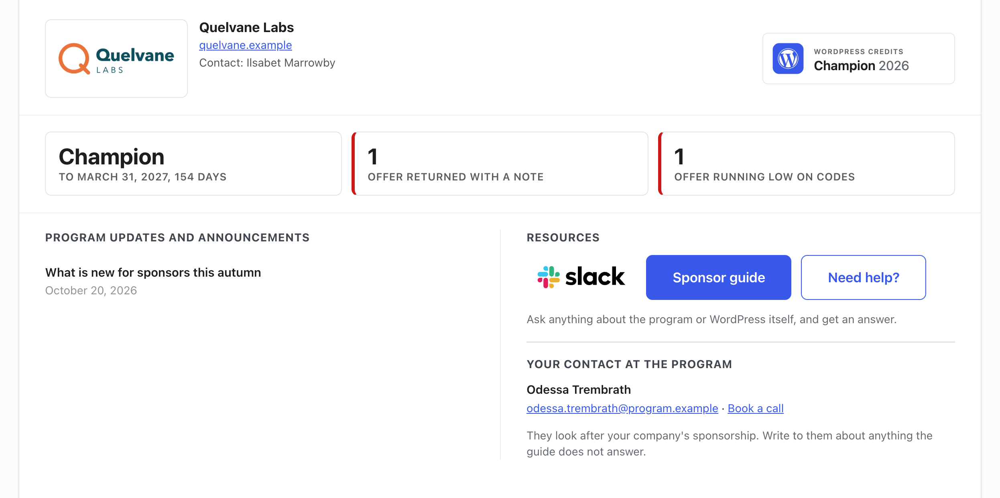
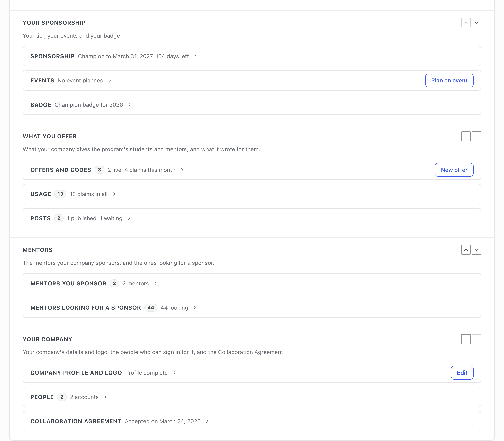
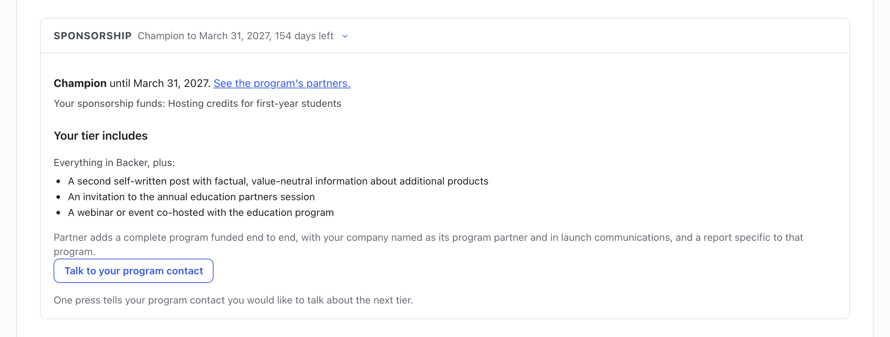
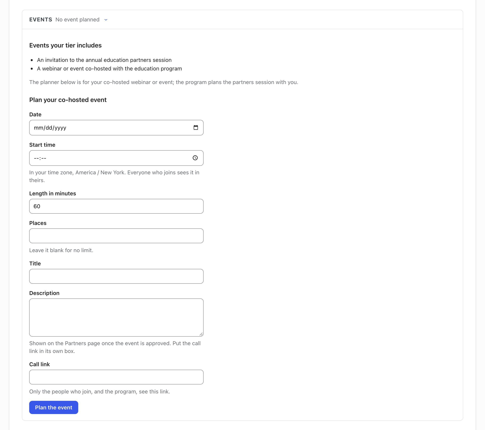
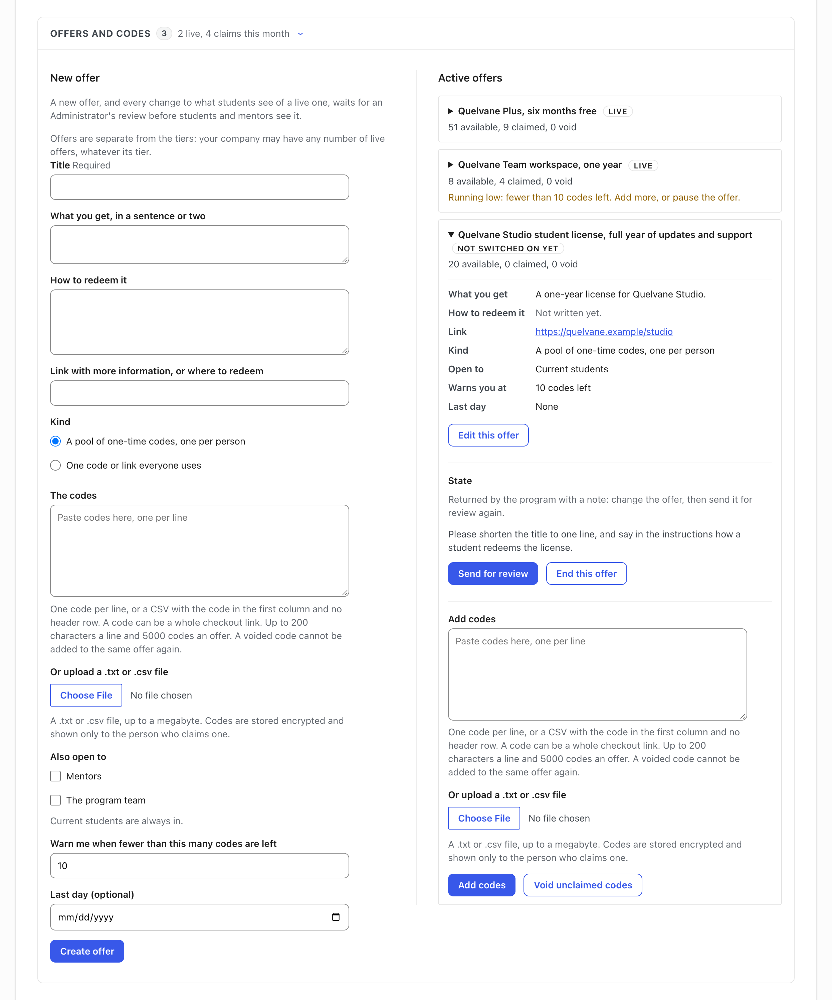
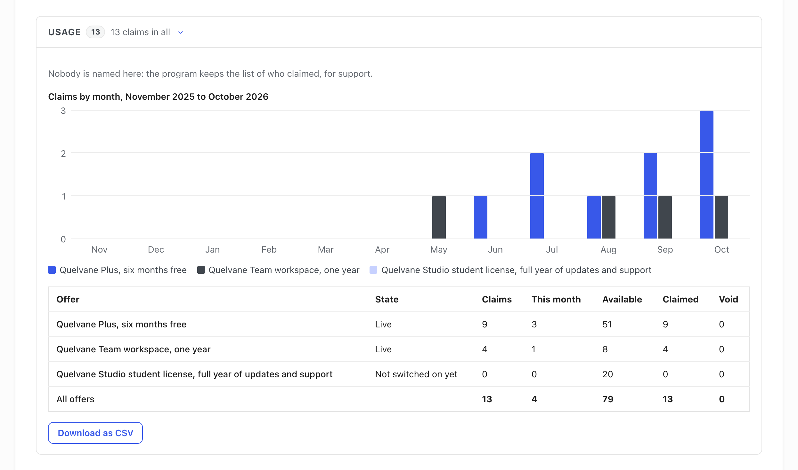
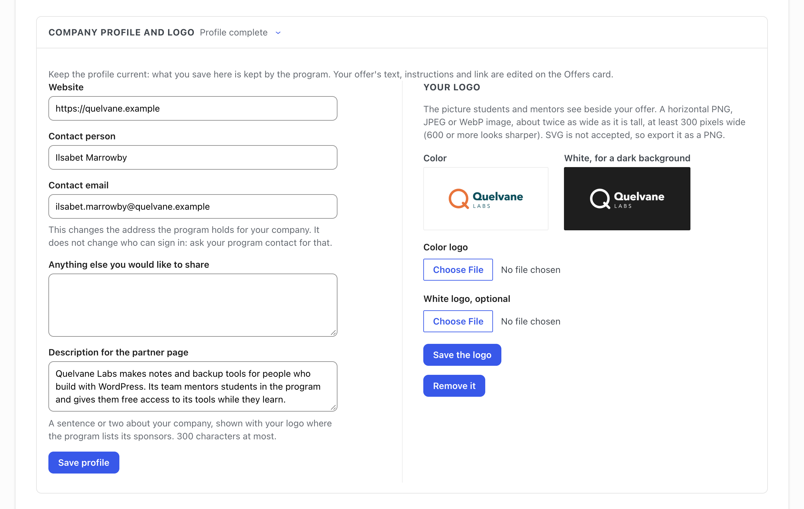

# Sponsor guide

*Your Sponsor Dashboard, your sponsorship and its events, your offers and codes, your posts, your mentors, your company and its agreement, and what your company can see.*

Thank you for sponsoring the WordPress Credits Program. This guide covers the Sponsor Dashboard, the page your company has on the Education Directory: your sponsorship and the events you co-host, your offers and the codes students and mentors claim, the posts you write and how they are approved, the mentors you sponsor, your company's details and your Collaboration Agreement, and what the program shows you and what it keeps to itself.

It is written for the people who act for a sponsor. The program's Administrators have a guide of their own.

## Signing in

Nobody registers on this site, and there is no sign-up form: the program makes every account for
the person it belongs to. That means two things on your first visit:

1. Go to the site's login page and use **Lost your password?** with the email address on your
   account. A reset link arrives at that address.
2. Set a password, and you are in - unless your account also asks for a code, which the next
   part covers.

If the reset email never arrives, the address on your account is probably not the one you are
checking. The login page cannot change it - ask whoever runs the program.

### Signing in with a code

Besides your password, your account may ask for a code. Whether it does is the program's choice,
and it is made for every account of your kind at once. When it does, there is nothing to set up
first: from your next sign-in, the code arrives by email. When it does not, signing in works as
described above, and a card on your page invites you to turn the code on for yourself.

After you enter your username and password, a second screen asks for the code. Which kind depends
on how your account is set up.

**An emailed code.** The screen says a verification code has been sent to the email address on your
account. The email comes from this site and has *Login confirmation code* in its subject line. It
holds a code of eight digits. Type it into **Verification Code** and press **Verify**. A code works
once, and for fifteen minutes. **Resend Code** sends a new one and the new one replaces the old, so
use the newest email.

**An authenticator app.** If you have set one up, the screen asks for the code from your app
instead: **Authentication Code**. Open the app, find this site in it, and type the six digits it
shows. The digits change every 30 seconds, so type the ones on the screen at that moment.

A wrong code does not lock you out for good, but the site makes you wait a moment before the next
try, and the wait grows with every wrong code, up to fifteen minutes. Wait it out, then type the
code again, carefully.

### Setting up an authenticator app

An app on your phone is quicker than waiting for an email, and it keeps working when your inbox
does not. The card at the top of your page starts it. Its heading is **Add a second step to your
sign-in** when the code is yours to choose, and **Your account asks for a code when you sign in**
when the program asks for one; its button, **Turn on two-factor authentication** or **Set up an
authenticator app**, opens your profile screen at its **Two-Factor Options**. Ignoring the card
costs nothing: signing in keeps working the way it does now.

If you already use emailed codes and you open that screen more than about ten minutes after you
signed in, it first asks you to confirm with **Revalidate now**, which takes one more code. Then
follow the steps on the screen: install an authenticator app on your phone (any will do, such as
Google Authenticator or Microsoft Authenticator), scan the QR code the screen shows with it, and
type in the code your app then displays. Once the app is set up the card stops appearing.

Before you leave that screen, generate the **recovery codes** (the card calls them backup codes)
and keep them somewhere other than your phone. Each works once, and the screen shows them only
once. They are how you get back in if you lose the phone.

### If you cannot get your code

- **The email does not come.** Look in your spam folder, then press **Resend Code**. The email goes
  to the address on your account, so if you no longer read that mailbox, an emailed code cannot
  reach you.
- **Your phone or your app is gone.** Under **Having Problems?** on the same screen, the site
  lists any other way your account has, for example **Send a code to your email**, or **Use a
  recovery code** if you saved some. Type one of your saved recovery codes where the screen asks
  for it, and cross that code off, because it will not work twice.
- **You have neither.** Without the emailed code, the app or a recovery code, the site cannot tell
  that it is you, and it lets nobody past that screen. Tell whoever runs the program that you are
  locked out, and give them the username you sign in with. This guide cannot fix it for you.

### Once you are signed in

Your page is drawn for whoever is signed in, so the same address shows each person their own
page, and no change to a link shows anybody else's. The
program's Administrators are the one exception: to help, they can open anyone's page, through a
switcher only they are shown. A company's people share one Sponsor Dashboard, and an
institution's people share one Institution Dashboard: everyone attached to the company or the
institution sees the same page.

## Your Sponsor Dashboard

Your company's page on the Education Directory is the Sponsor Dashboard, at /sponsor-dashboard/. You reach it after signing in with the account the program created for your company. Every person the program attached to your company sees the same page.

The page opens with your company's name, then **At a glance**, a row of tiles with your tier and what is waiting for your company, then the program's updates, its resources and your contact at the program. Under them are your cards, in four sections: **Your sponsorship**, **What you offer**, **Mentors** and **Your company**, in that order until your company arranges them. This guide takes them in the same order.

Your sponsorship, your offers, codes and claims, your posts and your events are kept on this site, so the page shows them as they are each time you open it. The two lists of mentors are the exception: they come from the program's mentor records, which this site reads at intervals, so a change there can take a while to reach the page.

### Your company's name

*The top of the Sponsor Dashboard: your company's name and badge, the At a glance tiles, and the places to go with a question.*

Your company's name sits at the top, with your logo beside it, or your company's initials until there is a logo. Under the name are your website, as a link, and "Contact:" with the name of the contact person you gave the program. The header shows that person's name alone: the contact address is on the **Company profile and logo** card, where you change both. From Supporter up, your badge sits at the right of the header, unless the program has paused your sponsorship.

### At a glance

The first tile is your tier. It is there once the program has launched the sponsor tiers, and its line gives the last day of your term and the days left in it, "ending today" on that day, the day the term ended once it has, or "no term". It always opens the **Sponsorship** card, where the card says how to renew.

After it comes one tile for each kind of thing that is waiting for your company, with a number and a line that says what waits:

- *Offers returned with a note*: offers, or changes to them, that an Administrator sent back.
- *Offers running low on codes*: live offers with fewer codes left than the number you chose for the warning.
- *Offers not switched on yet*: drafts, which nobody but you sees.
- *Posts returned with a note*.
- *Event returned*: the plan of your co-hosted event, sent back with a note.
- *Collaboration Agreement returned* or *Collaboration Agreement revoked*.
- *Company profile details missing*, which counts how many of the three details are empty.

An offer is counted once, under the first of its three lines that fits it, so an offer an Administrator returned is never also counted as not switched on yet. A kind with nothing waiting has no tile, and when nothing at all waits, one dimmed tile says "Nothing waits for you". A tile that waits has a red edge at its start, and its line always says what waits, so the red is never the only sign. The tier tile waits too, in the last thirty days of a term and once a term has ended.

Press a tile with something waiting and the page takes you to the card that holds it, opened. The *Event returned* tile is there only while the **Events** card can show the note, which stands above the form that plans an event: from Champion up, with no event of yours still to take place, while your sponsorship is not paused and your term still has an event to plan. It is the plan returned in your current term that the note and the tile show: once your term is renewed, a plan dated in the term before is not shown again, even in the days that term still runs.

The figures that once had tiles of their own, your next event, how many offers are live, how many mentors your company sponsors and your yearly reports, are on the lines of their cards.

### Where to find help

Under the tiles, and above the cards, are the places to go with a question:

- **Program updates and announcements** carries what the program publishes for sponsors. It says "Nothing new right now." when there is nothing, and **All updates** opens the rest when there are more than it shows.
- **Resources** holds the Slack logo, which opens the WordPress Credits Slack channel, and **Sponsor guide**, which opens this guide. It also holds **Need help?** whenever the program has switched its question assistant on for sponsors: "Ask anything about the program or WordPress itself, and get an answer." Your question is sent to an outside AI service, so do not type anything confidential.
- **Your contact at the program** is under the buttons: the Administrator who looks after your company, with a link to write to them when the program has an address for them, and **Book a call** when it has a booking link. The page says "They look after your company's sponsorship. Write to them about anything the guide does not answer." The contact is there once the program has assigned an Administrator to your company, and only while that person still is one.

### Arranging the page

Each section has two small arrows at its top right, named after it, for example "Move Your sponsorship up" and "Move Your sponsorship down". Press one and the section moves at once. The order is your company's, kept for everyone who signs in for it, and **Your sponsorship** comes first until somebody moves it.

A section with nothing to show is left out and has no arrows: until the program has launched the sponsor tiers, **Your sponsorship** is not on the page.

### Opening and folding the cards

*The four sections with every card folded, each card's line saying what it holds.*

Under each section's title, one line says what its cards hold. A card folds and unfolds with one press on its title. The number beside a title is how many things the card holds, and the words after it say where the card stands, so a folded card still tells you what is in it: "No event planned", "2 of 3 fields filled", "Accepted on September 3, 2026".

Where a card has one thing to do, its button sits beside the folded card. Open the card and the button gives way to it.

- **Plan an event**, **New offer** and **Edit** open their card at its top, where the form is.
- **Upload** opens **Collaboration Agreement** the same way, while the program has sent your agreement back or it is no longer in force.
- **Write a post** opens the WordPress editor.

**Sponsorship**, **Offers and codes** and **Mentors you sponsor** are open when you arrive, and so is **Events** while an event of yours is still to take place. Every other card stays folded until you open it. After you send one of a card's forms, the page comes back with that card open.

## Your sponsorship

**Your sponsorship** is on the page once the program has launched the sponsor tiers. Its cards come in this order: **Sponsorship**, **Events** from Champion up, **Reports** once your program contact has finished your first yearly report, and **Badge** from Supporter up. The line under the section's title names the cards it holds for your company.

What each tier adds on this page and on the Partners page:

- *Friend.* The **Sponsorship** card, and your company's name on the Partners page.
- *Supporter.* The **Badge** card and your badge in the header, a **Description for the partner page** on your profile, and the annual program report, your yearly report on the **Reports** card. The Partners page shows your logo, your website and that description.
- *Backer.* What your sponsorship funds, on the **Sponsorship** card, a report covering that cost line in your yearly report, and one post at a time.
- *Champion.* A second post, an invitation to the annual education partners session, and the **Events** card with the planner for your co-hosted event.
- *Partner.* The launch communications, which the program plans with you, and in your yearly report a section on each track your company partners.

### Your tier and its term

*The Sponsorship card, open: the tier and its term, what the tier includes, and what the next tier adds.*

**Sponsorship** comes first, and it is open when you arrive. It holds:

- your tier and, when it has a term, the last day of that term;
- from Backer up, what your sponsorship funds, after "Your sponsorship funds:";
- **Your tier includes**, a checklist of what your tier includes, which is what the Partners page says for that level. Above Friend, a line over the checklist says it comes with everything in the level below, for example "Everything in Backer, plus:". At Friend the checklist begins "Company name on the partner page";
- below Partner, what the next tier adds, and **Talk to your program contact**.

Inside the card, the first line names your tier in bold and, while a term runs, its last day, as in "Champion until March 31, 2027." Once the Partners page is published, that line ends with a link to it, "See the program's partners.", at every level, since every partner is listed there in one alphabetical list.

The row with the card's title, which shows whether the card is open or folded, says how your sponsorship stands:

- *While a term runs.* Your tier, the term's last day and the days left in it, as in "Champion to March 31, 2027, 154 days left"; on the last day, "ending today" in place of the days.
- *Once a term has ended.* The tier your company reads as since then, as in "Friend since the Champion term ended on March 31, 2027".
- *With no term.* Your tier's name alone.

### Renewing and moving up

One press on **Talk to your program contact** tells them you would like to talk about the next tier. The button keeps what you asked on record, and the page says "Sent. Your program contact will be in touch." Each account can send five a day. To tell the program anything else your company would like to do, write to your program contact, named under **Your contact at the program** near the top of the page.

A term runs through its last day, and the card follows it:

- *In the last thirty days.* The card says how many days are left, for example "Your term ends on March 31, 2027, in 12 days. Your program contact can renew it.", and the tier tile on **At a glance** waits.
- *From the day after the last day.* Your company reads as a Friend. The line with your tier says the term has ended and asks for its renewal, without the link to the Partners page: "Your company reads as a Friend now; your program contact can renew it." The same button then asks your program contact to renew the term.
- *At Partner*, the top of the ladder, there is no next tier, so the card has no button until a term has ended.

### Events you co-host

*The Events card, open: the events your tier includes, and the form that plans your co-hosted event.*

From Champion up, **Events** lists the events your tier includes and holds the planner for one of them, your co-hosted webinar or event. The program plans the partners session, and for a Partner the launch communications, with you. The card is open while an event of yours is still to take place. Its line names the soonest one, its day in your time zone and how many people have joined, or, until the program approves it, that it is waiting for the program. With none, it says "No event planned", and **Plan an event** beside it opens the card, where the form is, whenever you can plan one.

#### Planning the event

You plan one event at a time and, while a term runs, one per term, or as many more as the program grants for that term, dated no later than the term's last day. When the program grants your term more events, the list says so under the co-hosted event, for example "and 2 more this term, granted by the program", and the form says how many your term allows, for example "Your term allows 3 events." They count for that term alone, and a renewed term starts again from your tier's one.

1. Fill in **Plan your co-hosted event**: the **Date** and the **Start time**, in your own time zone, which the form names; the **Length in minutes**; the **Places**, left blank for no limit; a **Title**; a **Description**, which the Partners page shows once the program approves the event, so the call link goes in its own box; and the **Call link**, which only the people who join, and the program, see.
2. Press **Plan the event**. It goes to your program contact, and nobody else sees it until an Administrator approves it.
3. Once an Administrator approves it, the event is listed for the program's students and mentors beside their calls, for Administrators on the Administrator Dashboard and for institution contacts on the Institution Dashboard, where each of them can join it or leave it. The Partners page lists it too, as *What your company can and cannot see* describes.

A term's days are counted on the site's clock, so a start late on the term's last day in your own time zone can already fall on the next day there. The planner then names the last day and the site's time zone, for example "Choose a start on or before January 31, 2028, the last day of your sponsorship term on the site's clock (Europe / Warsaw)."

When your term is renewed before it ends, the current term still runs to its last day and the renewed term starts the day after it. An event dated in the renewed term stays in it, and moving it earlier is refused in the same way, for example "Choose a start on or after February 1, 2027, the first day of your current sponsorship term on the site's clock (Europe / Warsaw)."

Until the event has taken place, **Your event** shows where it stands, "Waiting for the program's OK." or approved with how many people have joined, never who, with **Change the event** and **Cancel the event**.

#### Why you cannot plan another

When you cannot plan another event, the card says why in the form's place, and a plan pressed anyway is refused in the same words:

- *While an event of yours is still to take place.* "Your event for this term is planned already." while your term runs; "Your next event can be planned once this one has taken place." if your sponsorship has no term, or when the program granted your term more events and another can still follow this one; and "Your events for this term are planned already." once the event still to take place is the last your term holds.
- *Once your term's event has taken place.* "Your event for this term has taken place already." for the rest of the term, or "Your events for this term have taken place already." once every event the program granted it has.

#### When a plan is refused or returned

When **Plan the event** or **Save the changes** is refused for something you can put right, the form comes back once with what you typed, with **Change the event** drawn open when it was a change; a value longer than its box allows comes back empty. That happens for:

- a detail missing or not valid;
- a start outside your term, or one that has passed;
- fewer places than the people already on the event;
- another change to your company's events going through;
- a save that failed.

Each person who can sign in for your company has ten presses an hour across **Plan the event**, **Save the changes** and **Cancel the event**; the next one reads "Ten an hour is the limit. Try again in an hour."

If the program returns your plan with a note instead of approving it, the note stands above the form when you plan again, after "Your last plan was returned:". Once your term is renewed, a note on a plan dated in the term before is no longer shown there, even in the days that term still runs.

#### Who is told, and the reminders

An email to your company goes to everyone who can sign in for it.

- *The program returns your plan.* Your company is emailed the note.
- *The program approves it.* Your company is emailed a calendar file for it.
- *A cancel, or a change of the date, the start time, the length, the title or the call link.* Everyone who joined is emailed, with a calendar file that updates the event or takes it off their calendar: the first fifty straight away and the rest within minutes. The card says whether everyone who joined has been told or is being told.
- *Any change or cancel, once the event was approved.* Your company is emailed too, and your program contact is told. A change of the description or the places alone reaches only your company and your program contact.
- *Saving the form without changing anything.* Nobody is emailed, and the page says "Nothing changed."
- *The day before the event.* Everyone who joined is emailed a reminder with the call link, and your company one that says how many people have joined so far, never who. Neither carries a calendar file.

The reminders go out with the program's daily run, normally the day before the event, sometimes closer to it, and never twice: an event approved less than a day and a half before it starts may get none, and once they have gone out a change sends no second one, since its own email gives the new time.

#### After the event, or when events stop

**Past events** lists the events that took place, each with its day and how many people joined.

If your sponsorship stops including events, because your term ends, your tier changes to one without them, or the program pauses your sponsorship, the card keeps an event of yours still to take place with **Cancel the event** alone. An approved one then reads "Approved, but no longer offered: your company's sponsorship does not include events at the moment.", and nobody new can join it. With nothing still to take place, there is no **Events** card.

### Your yearly reports

**Reports** follows once your program contact has finished your first yearly report: your yearly report of the program and of your sponsorship, one for each term. Beside each report, **Open** shows it in a new tab, ready to print, and **PDF** downloads the copy your program contact attached, when there is one. The card's line says how many yearly reports you have and which term the latest is for.

### Your badge

From Supporter up, **Badge** holds your badge for your own site, in its light and dark versions, and its **Embed code**, with **Copy the embed code**. The badge names your tier and the current year, and once a term has ended the year it ended. The card's line says the same, for example "Champion badge for 2026". The program's site serves the badge, so a change of tier shows on your Sponsor Dashboard at once and on your own site within an hour, with nothing to paste again.

The badge is only for a sponsorship the program has approved. While the program has paused yours, the **Badge** card and the badge in your header are gone, and the badge on your own site does not show.

## Offers, codes and claims

An offer is something your company gives the program's participants: a license, a plan, a credit, a course seat, a discount. It is of one of two kinds:

- **A pool of one-time codes, one per person**: a list of codes you paste or upload, one per line or as a CSV. Each code is handed to one person, once.
- **One code or link everyone uses**: a single code or checkout link that every eligible person sees.

**Offers and codes**, the first card of **What you offer**, is open when you arrive and opens on the form for a new offer. Its line says how many of your offers are live, how many offers and changes wait for an Administrator's review while any do, and how many times your offers were claimed this month.

### Making an offer

*The Offers and codes card: the form for a new offer, and your offers beside it.*

The **New offer** form sits on the left of the card. Above it, a line says "Offers are separate from the tiers: your company may have any number of live offers, whatever its tier." As the Partners page says, partners at any level may offer free access to their products. Drafts are unlimited.

1. Give the offer a **Title**, say in **What you get, in a sentence or two** what a person gets, in **How to redeem it** how to redeem it, and in **Link with more information, or where to redeem** where to find more information.
2. Choose the **Kind**. For a pool, paste **The codes** or upload a .txt or .csv file; for one code everyone uses, type **The shared code or link**.
3. Under **Also open to**, choose who else the offer is open to. Current students always are; **Mentors** and **The program team** are your choice.
4. Set **Warn me when fewer than this many codes are left**, the number at which the program warns you that the pool is running low, and, if the offer has a last day, **Last day (optional)**.
5. Press **Create offer**. The offer starts as a draft that nobody but you can see.

Your offers sit on the right, under **Active offers**, each folded to its title, its state and a line of counts: for a pool, how many codes are available, claimed and void; for a shared code, how many people took it. Open one to read its details and edit it with **Edit this offer**, to pause, resume or end it and, for a pool, to add codes or void the ones nobody has claimed. An offer that has ended, or whose last day has passed, moves under **Ended and expired offers**.

Each offer's state is a word beside its title:

- *Not switched on yet.* A draft, visible to nobody but you: send it for review when it is ready. An offer an Administrator returned with a note is a draft again, and reads the same; the next part says how to tell it apart.
- *Waiting for review.* Visible to nobody but you either, until an Administrator approves it.
- *Live.* Shown to the people it is open to. The one live offer marked "(primary)" is the offer the program names as yours.
- *Paused.* Hidden until you resume it with **Resume**, and its codes stay.
- *Dormant.* An offer the program held back while a tier capped live offers. It is hidden, its codes stay, the codes already claimed stay with the people who hold them, and you can end it but not resume it. No tier caps live offers now, so a dormant offer comes back by itself on the program's next daily run; one whose last day has passed stays as it is.
- *Ended.* Over: nothing more can be claimed, it cannot be resumed, and the codes already claimed stay with the people who hold them. **End this offer** asks you to confirm first.
- *Expired.* A live offer past its last day, shown to nobody. It says "Past its last day: shown to nobody. Change the last day to bring it back."

### Codes

Codes are stored encrypted and shown only to the person who claims one. The codes box takes one code per line, or a CSV with the code in the first column and no header row, and a code can be a whole checkout link. A line holds up to 200 characters and an offer up to 5,000 codes. A code you voided cannot be added to the same offer again.

When a code you add goes in depends on where the offer stands, and on the review that *When an Administrator reviews an offer*, below, describes:

- *A draft, or an offer waiting for review.* Codes you add go in at once and are read with the offer when it is reviewed. A draft the program made for you, such as your first offer, can be switched on with no review; once you add codes to it, it needs one like any other, and its **Switch on** becomes **Send for review**.
- *An offer that has been approved, whether it is live, paused or dormant.* Codes you add wait for an Administrator's review, since a code can be a whole checkout link. **Add codes** says "Your codes were saved and wait for an Administrator's review. Until they are approved, nobody can claim them.", and the offer says how many codes you added wait, beside any change of yours that waits.
- *Codes an Administrator adds for you.* They go in at once.

What becomes of codes that wait for review:

- *Until they are approved.* Nobody is handed one, the counts of the offer, and of what students see as left, leave them out, and the warning that the pool is running low stays as it was.
- *An approval.* It puts them in the pool with any change that waits, as one decision.
- *A return.* It takes them out of the offer with its note, which reaches you by email and shows under the offer's details with how many codes were taken out. Add them again, changed or not, to send them for review once more.
- *Discard the changes.* It takes them out too, at once.
- *Adding one again.* A code that waits is still in the offer for the repeat check, so it cannot be added twice, and it counts toward the 5,000 an offer holds.
- *Void unclaimed codes.* It leaves the codes that wait as they are, so you can void an old batch and add a new one in either order.
- *Ending the offer.* It takes the codes that wait for review on it out of the offer.

### When an Administrator reviews an offer

An Administrator reads every offer before students and mentors see it, and a line above the **New offer** form says so: "A new offer, and every change to what students see of a live one, waits for an Administrator's review before students and mentors see it."

1. When a draft is ready, press **Send for review**. The offer is then *Waiting for review*, still seen by nobody but you, and **Take it back** makes it a draft again.
2. An Administrator approves it, and it goes live, or returns it with a note, which reaches you by email.
3. A new offer that is returned is a draft again. In your list, and in the **Usage** table, its state reads "Not switched on yet", like any draft. Open it, and under **State** it says "Returned by the program with a note: change the offer, then send it for review again.", with the note under it, and **At a glance** counts it under *Offers returned with a note*. Change the offer, then press **Send for review** again.

Once an offer has been approved, a change to what students see of it is saved and waits for review too, while students and mentors go on seeing the offer as it was approved. That is its title, what a person gets, how to redeem it, where to find more information and, for one code everyone uses, the code or link itself. The offer says so under its details, and **Discard the changes** drops what waits. An approved change takes the place of what students saw; a returned one stays under the offer's details with the note, until you change it again or discard it.

Everything else takes effect at once, with no review:

- pausing, resuming and ending an offer;
- its last day;
- who it is open to;
- the number of codes the warning waits for;
- voiding the codes nobody has claimed.

While anything of yours waits, the card's line says how many offers and changes wait for review. Offers that students could already see before the review began stay as they are.

### When codes run low

When a live pool falls below the number you set in **Warn me when fewer than this many codes are left**:

- the offer's line of counts adds a warning, for example "Running low: fewer than 10 codes left. Add more, or pause the offer.";
- **At a glance** counts the offer under *Offers running low on codes*;
- the program emails everyone who can sign in for your company, and your program contact, once. Codes that go into the pool afterward set that email up again.

Add codes, or pause the offer. Codes that wait for review are left out of the counts until they are approved, so they do not lift the warning.

### Where students and mentors find your offer

A participant claims an offer from their own page: a student from the Student Report Card, a mentor from the Mentor Report Card, both in a section called **Tools from our sponsors**. A live offer is shown there to the people it is open to.

- *A pool of one-time codes.* **Get my code** hands out the next available code. The program seals it to that person and never shows it to anyone else, including you.
- *One code or link everyone uses.* **Show me the code** shows it.

A person whose code does not work can press **Report a problem with this code**, which tells the program; *What your company can and cannot see* says what the program keeps about who claimed. A post your company wrote appears under your offer in the same section, once an Administrator publishes it.

### Usage

*The Usage card, open: claims by month and by offer, and the table under the chart.*

**Usage** counts, by month and by offer, how many people took an offer: a chart of the last twelve months, a table with the totals, and **Download as CSV**, a file of the same. Its line counts every claim. The table has a row for each offer, with its **State**, its **Claims**, those of **This month** and, for a pool, its codes **Available**, **Claimed** and **Void**; **All offers** adds them up. An offer an Administrator returned reads "Not switched on yet" there too, as in your list.

Nobody is named there, and the card says so: "Nobody is named here: the program keeps the list of who claimed, for support." *What your company can and cannot see* has the rest.

## Posts, and how they are approved

From the Backer tier up, your company can write posts for the program's students, as the Partners page says: a Backer one self-written educational post about the sponsored product, and a Champion or a Partner a second, with factual, value-neutral information about additional products. Posts are written in the site's editor.

The **Posts** card, in **What you offer**, lists every post your company wrote, with where each one stands, and its line counts the published ones and the ones waiting for review. While the card is folded, **Write a post** sits beside it whenever you can write one. If posting is switched off for your company, the card says "The program has not enabled posting for this sponsor." Ask your program contact.

### Writing a post

A Backer has one post at a time, in review or published; a Champion or a Partner has two.

1. Press **Write a post**, beside the folded card or inside it. It opens the WordPress editor. **Your posts in wp-admin**, beside it inside the card, lists your company's posts.
2. Write the post. It carries your company's byline and lands in your company's category, so readers know who wrote it. A post can carry images and links; it cannot carry code that runs on the page.
3. Submit the post for review. The card lists it as *Waiting for review*.

Posts are for the program's participants: useful to a student learning WordPress, honest about what your product does, free of pricing pressure. The program's licensing and trademark rules apply to what a post says and links to. A post that reads as an advertisement is returned.

When your tier includes no more posts right now, the card says so where **Write a post** would be, for example "Your tier, Backer, includes one post at a time, in review or published. The next can follow once the program returns this one or takes it down.", and a post submitted anyway stays a draft.

### The review

Every post is read by an Administrator before it is published. The Administrator can publish it, or return it with a note that says what to change.

### When a post is returned

A returned post comes back to you as a draft, with the note on it, and its author is emailed the note. The card lists it as *Returned with a note*, with the note under it, and **At a glance** counts it under *Posts returned with a note*. Change the post and submit it again.

### Once a post is published

A published post appears to students and mentors in their **Tools from our sponsors** section, on the Student Report Card and the Mentor Report Card: under your offer, after "Guides from" and your company's name. It is also in the site's Sponsors category, which only signed-in participants can read. The card lists it as *Published*, with a link to it.

### When your tier no longer includes a post

A post the program took off the site because your tier no longer includes it is *Dormant*. The newest posts go first, and the card says why. A dormant post returns by itself when an Administrator sets a tier that includes it. If you edit a dormant post, it becomes a new submission, which an Administrator reviews before it is published again.

When your tier includes no posts at all, as at Friend and Supporter, the **Posts** card is on your Sponsor Dashboard only while your company has a post of its own: one from before the levels, one returned to you, or one the program held back. It then says where **Write a post** would be that your tier includes no posts, for example "Your tier, Supporter, includes no posts. Posts start at Backer: talk to your program contact.", with **Your posts in wp-admin**, where you can still read your posts, edit a draft or a returned post, and delete one.

## Mentors

The section **Mentors** holds two cards, both read from the program's mentor records, which this site reads at intervals. Each mentor on them is a tile: their photo when they have a WordPress.org profile, their name, linked to that profile, how many students they guide now and how many they guided before, the areas they know, and a **WordPress.org profile** link. A mentor whose account on this site is not linked yet reads "No site account yet" in place of the counts.

### Mentors you sponsor

**Mentors you sponsor** is open when you arrive. It lists the mentors your company sponsors and how many students each one guides, and its line counts them, or says "None yet". A mentor you sponsor who is not active now is not drawn as a tile: a line under the list counts them, for example "And 1 mentor who is not currently active."

### Mentors looking for a sponsor

**Mentors looking for a sponsor** lists the active mentors who asked to be listed and have no sponsor yet, and its line says how many are looking. The card stays folded until you open it. Each mentor's tile has **I would like to sponsor this mentor**: one press tells your program contact you would like to sponsor that mentor, and the page says "Thank you. Your program contact will get in touch about that mentor." Each account can send five a day.

## Your company, your people and your agreement

The section **Your company** holds three cards, in this order: **Company profile and logo**, **People** and **Collaboration Agreement**. Each stays folded until you open it.

### Company profile and logo

*The Company profile and logo card, open: your company's details on the left and your logo on the right.*

**Company profile and logo** is your company as the program records it: the details on the left, your logo on the right. The card says "Keep the profile current: what you save here is kept by the program." Its line says whether all three details are filled in, "Profile complete" or, for example, "2 of 3 fields filled", and **At a glance** counts the ones missing. **Edit**, beside the folded card, opens it.

The details are:

- **Website**, **Contact person** and **Contact email**, the three the line counts. The contact person's name is the one in the header. A new **Contact email** changes the address the program holds for your company, and not who can sign in: ask your program contact for that.
- **Anything else you would like to share**, which is optional.
- **Description for the partner page**, from Supporter up, as the next part describes.

Press **Save profile**. Once your company has an offer, the card adds that the offer's text, instructions and link are edited on the **Offers and codes** card.

Under **Your logo**, a logo in color and one in white for a dark background are shown wherever the program names you, beside your offer among them. Logos look alike side by side when they share a shape, so upload a horizontal one, about twice as wide as it is tall, at least 300 pixels wide (600 or more looks sharper), as a PNG, JPEG or WebP image, transparent where possible. SVG is not accepted, so export the logo as a PNG. Choose a **Color logo**, a **White logo, optional**, or both, and press **Save the logo**; **Remove it** takes the logo you uploaded off again.

### Your description on the Partners page

From Supporter up, once the program has launched the sponsor tiers, the profile also holds a **Description for the partner page**: a sentence or two about your company, 300 characters at most, shown with your logo and your name on the Partners page, where every partner is listed in the same format, in alphabetical order. A Friend is listed by name alone, so the box is not there, and a description saved while your company was a Supporter or above is kept but not shown.

### People

**People** lists everyone who can sign in for your company, with their email address, and its line counts the accounts. Nobody adds or removes a person on this card: it says "To add a colleague, write to your contact at the program.", and your program contact adds or removes a person.

### Your Collaboration Agreement

**Collaboration Agreement** is where the agreement between your company and the program lives: you upload the signed copy here and read where it stands. The card's line says where it stands, with the day it was accepted once it is. While it is *Sent back to you* or *Out of force*, **Upload** sits beside the folded card, and **At a glance** shows *Collaboration Agreement returned* or *Collaboration Agreement revoked*. Nothing on this dashboard depends on an agreement: your offers, your codes and your posts work either way.

- *Nothing on file.* The card says there is no agreement on file for your company, and that if the program has asked you to sign one, you upload the signed PDF here.
- *Waiting for the program.* The card says since when your signed agreement has waited for the program to read it, how many working days the program aims to answer within, and that you will get an email either way. **Download the copy we hold** gives you the file back, and **Withdraw it** deletes it from this site at once, so that you can upload another.
- *Sent back to you.* "An Administrator read your agreement and sent it back, with this note:", then the note, and a form to upload the corrected agreement, signed, as a PDF.
- *Out of force.* The card says "The agreement we held is no longer in force, with this note from the program. Nothing about your dashboard, your offers or your codes changed.", shows the program's note under it, and offers a form to upload a new signed agreement whenever you are ready.
- *Accepted.* The card says on what day your signed agreement was accepted, with **Download the copy we hold** and a form to upload a newer signed agreement to replace it. Its line reads, for example, "Accepted on September 3, 2026".
- *On file with the program.* The card says the program already holds a signed agreement with your company, recorded on the day it names, and that there is nothing for you to upload. Ask your program contact if you would like a copy. Its line reads "On file with the program since" that day.

To upload, choose the signed agreement as a PDF, tick "This document is signed by somebody who can commit the company." and press **Upload the signed agreement**. Under where it stands, the card lists what happened to your company's agreements, newest first, each with its day.

## What your company can and cannot see

The Sponsor Dashboard shows your company its own things: its profile, its people, its agreement, its offers, its usage counts, its posts and its mentors. It never shows another sponsor's page, and it never shows who a student or a mentor is beyond what that person chose to make public.

- **Students.** You see counts: how many students each of your mentors guides, how many people claimed an offer. You do not see names, addresses, reports, grades or the notes of a call. Your **Reports** card is the same: it names your mentors and counts, never a student.
- **Mentors.** You see the mentors your company sponsors by name and WordPress.org profile, with how many students each one guides, and the active mentors who asked to be listed as looking for a sponsor. You do not see a mentor's calendar, notes or feedback.
- **Claims.** You see numbers, by month and by offer. The program keeps the list of who claimed which code, so that it can help a person whose code failed, and does not share it with sponsors.
- **Events.** You see how many people joined your co-hosted event, on the **Events** card, never who: the names are for Administrators alone, and no mail your company receives carries one. The reminder the day before your event says how many have joined so far, and nothing more about them. The call link you give reaches the people who join and the program, and no list shows it to anybody else. Your **Reports** card is the same: the yearly report lists the events held in the term with how many joined, and no names.
- **Records.** The details you save on your profile card, your logo, the offer marked "(primary)" and what you send with **Talk to your program contact** are kept on this site, where Administrators read them.
- **The program's people.** Administrators see your page as you see it, and can act on it for you: create an account for a colleague, record your agreement as on file, review a post. The switcher above the page, **Viewing as sponsor**, is theirs alone.

Once the program turns the sponsor tiers on, the Partners page lists your company by name at every tier, while your sponsorship is approved and not paused, in alphabetical order with every other partner and in the same format, adding your logo, your website and your description from Supporter up. Your badge, from Supporter up, names only the program, your tier and the year, with no logo or other company detail of its own.

Once the program approves your event, the Partners page lists it under **Upcoming events** until it ends, for anybody to read:

- its title, your company's name linked to your website, its day and time in the site's time zone, its length and its description;
- in the description, any address that starts with http://, https:// or mailto: is taken out. An address written without them, such as an email address on its own or one starting with www., stays as you wrote it;
- never the call link, the places or who joined.

Under the list, a visitor who is not signed in finds a **Sign in to join** button, since the people the event is for join it on their own pages. A student, mentor, institution contact or Administrator who is signed in finds a link to that page instead, such as "Join it on your Student Report Card", and anybody else who is signed in, such as someone who signs in only for your company, finds neither. The event leaves the page if the program pauses your sponsorship or your sponsorship stops including events.

What you write on the dashboard is kept under the program's privacy policy, linked from the bottom of every page. Ask your program contact if you want something removed.
